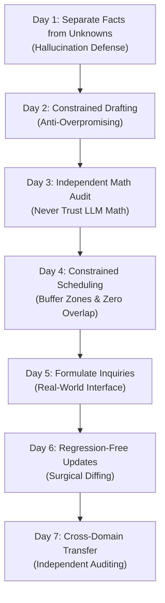

> 📌 **Original Source**: This article is syndicated from [FreeAI Dog Official Platform](https://freeaidog.com/en/blog/ai-practice-plan-for-beginners/). For live LLM availability radar, latency benchmarks, and interactive API testers, visit the official site.


# Stop Treating AI as a Toy: The 7-Day Single-Project Mastery Sprint for Beginners

> **Executive Summary**: You can spend weeks asking an AI assistant random conversational questions and still find yourself completely stuck when a real project arrives on your desk.
> 
> True AI competency isn't gained by memorizing "100 viral prompts." It is forged through disciplined constraint handling, hallucination auditing, independent arithmetic verification, and surgical revision. This guide lays out a structured, 7-day practice sprint using a single small project to turn unpredictable generative outputs into robust, production-ready deliverables.

---

## 1. Why Fragmented Prompts Fail to Build AI Competency

Most beginners interact with AI in a haphazard manner: generating a poem on Monday, asking about cosmic mysteries on Tuesday, and drafting a code snippet on Wednesday. While fun, this exploratory tinkering fails to develop the muscle memory needed for high-stakes business and personal tasks.

When real-world requirements meet large language models, teams routinely encounter four critical pitfalls:

1. **Hallucination Under Ambiguity**: When given incomplete information, LLMs default to confident fabrication rather than flagging the missing data.
2. **Constraint Drift**: Asking for "under 140 words" or "no mentions of free refreshments" often gets overlooked unless enforced through tight prompt boundaries.
3. **Arithmetic Blindness**: Language models predict probabilities over tokens; they do not perform strict algebraic operations. Trusting an LLM with budget totals or unit calculations is a recipe for disaster.
4. **Regression on Revision**: When you ask an AI to modify one detail, it often regenerates the entire response, silently dropping crucial context established earlier.

Solving these challenges requires adopting a **Human-in-the-Loop Verification** mindset, consistent with Google's prompt-design philosophy: anchor everything to a single source of truth and verify outputs against explicit checklists.

---

## 2. The Foundation: A Single Source of Truth (SSOT)

Before starting the 7-day sprint, save this fictional project brief into a local document. Throughout the exercise, this brief represents the **only verified truth in existence**. The assistant must not browse the web or invent extraneous details.

> 📋 **【Project Brief: 12-Participant Community Repair Workshop】**
> 
> - **Theme**: Repair a small fabric item (hand-stitching and basic mending)
> - **Date**: October 17, 2026
> - **Room Booking Time**: 14:00 – 16:00 (**includes organizer setup and post-event cleanup**)
> - **Participant Cap**: 12 attendees
> - **Materials Budget**: $90 total maximum
> - **Attendee Requirement**: Bring one clean fabric item needing a small repair
> - **Supplied Equipment**: Scissors and needles provided by the organizer
> - **Accessibility**: **Step-free entrance confirmed; accessible restroom not yet confirmed**
> - **Registration**: Reply to the organizer by October 10, 2026
> - **Location**: Cedar Room, 8 Market Street (fictional address)
> - **Refreshments / Snacks**: **Not decided**

*Tip: You can use any free LLM on [FreeAI Dog](/) (e.g., Google Gemini 2.5 Flash, DeepSeek-V3, or Groq Llama 3.3) to run this sprint at $0 cost.*

---

## 3. The 7-Day Progressive Sprint Breakdown



---

### Day 1: Dissecting Assumptions — Facts vs. Unanswered Questions

#### 🎯 Goal
Prevent the assistant from fabricating solutions by forcing it to separate confirmed facts from open questions.

#### 📝 Prompt Recipe
```text
Using strictly the following workshop brief, categorize all details into two distinct sections:
1. [Confirmed Arrangements] (Keep exact dates, numbers, times, and addresses)
2. [Unanswered Questions / Pending Confirmations]

Do not fill missing details with suggestions or external assumptions. If it is not explicitly affirmed in the brief, it cannot be listed as confirmed.

[Workshop Brief]:
[Paste the brief here]
```

#### 🔍 Audit Checklist
- [ ] **Restroom check**: Did the AI place the accessible restroom under unanswered questions? If it claimed "the venue is fully accessible," reject and flag it.
- [ ] **Refreshments check**: Are refreshments explicitly labeled as undecided?
- [ ] **Booking time check**: Did it preserve the note that 14:00–16:00 includes setup and cleanup?

> 💡 **Core Mindset**: An assistant's confident tone ("Rest assured, the venue provides comprehensive accessibility") does not constitute fact. Audit first, trust second.

---

### Day 2: Writing Under Handcuffs — Strict Word Count & Zero False Promises

#### 🎯 Goal
Draft a welcoming invitation adhering to hard constraints without introducing misleading claims.

#### 📝 Prompt Recipe
```text
Write a warm, concise invitation for community members based on the workshop brief.
Strict requirements:
1. Total body text must be 140 words or fewer;
2. Must accurately include: date, room booking time window, address, item to bring, registration method, and the October 10 deadline;
3. Must explicitly note that the accessible restroom is currently being confirmed with venue management;
4. Do NOT claim the event is "free admission" or "includes complimentary snacks" (the $90 budget is strictly for materials, and food is undecided).
```

#### 🔍 Audit Checklist
- [ ] **Length check**: Count the words. Is it strictly $\le 140$ words?
- [ ] **No "Free Event" claims**: The $90 materials budget does not mean ticket price is zero.
- [ ] **Surgical fix practice**: If a detail is missing, do not say "redo this." Tell the model: "Add the line stating the restroom is pending confirmation without changing any other sentence, keeping under 140 words."

---

### Day 3: Shattering the Math Myth — Supplier Quotes & Independent Auditing

#### 🎯 Goal
Compare supplier options within a $90 budget and independently verify the math using a calculator.

#### 📝 Prompt Recipe
```text
We are purchasing repair kits for 12 participants and have received two all-inclusive quotes:
- Option A: 12 kits at $5 each, plus $18 total shipping.
- Option B: 12 kits at $6 each, plus $8 total shipping.
Our budget ceiling is $90.

Please calculate both options:
1. Break down item subtotal (12 kits × unit price), shipping, and overall total;
2. Calculate remaining budget for each option;
3. Identify which option yields the lower total expenditure. Do not make claims about product quality.
```

#### 🔍 Audit Checklist
Verify independently with your calculator:
$$\text{Option A} = 12 \times 5 + 18 = 60 + 18 = \$78 \quad (\text{Remaining: } \$90 - \$78 = \$12)$$
$$\text{Option B} = 12 \times 6 + 8 = 72 + 8 = \$80 \quad (\text{Remaining: } \$90 - \$80 = \$10)$$
- [ ] Do the AI's step-by-step numbers match your calculation?
- [ ] Option A is cheaper overall despite higher shipping; did the AI note this nuance?
- [ ] Did the assistant resist assuming Option B has "higher quality materials"?

---

### Day 4: Rigid Time Allocation — Buffer Zones & Zero Overlap

#### 🎯 Goal
Fit activities inside the 120-minute window while maintaining mandatory setup and cleanup buffers.

#### 📝 Prompt Recipe
```text
Propose two distinct schedule options for the 14:00–16:00 room booking (120 minutes):
Hard constraints:
1. 14:00–14:15: Room setup and arrival (15 minutes);
2. 15:45–16:00: Tool pack-down and cleanup (15 minutes);
3. Exactly 90 minutes remaining for workshop activities.

Provide two variations:
- Option 1 [Demo Priority]: Longer instructor-led demonstration.
- Option 2 [Hands-On Priority]: Brief demo, maximizing attendee repair practice.

Every segment must list exact start and finish times. Zero gaps and zero overlaps.
```

#### 🔍 Audit Checklist
- [ ] **Timeline continuity**: Does segment $N$ end at the exact minute segment $N+1$ begins?
- [ ] **Cleanup preservation**: Does instruction stop at 15:45? Any schedule teaching until 16:00 violates the contract.
- [ ] **Human choice**: Pick one schedule and state your reason (e.g., "Option 2, because attendees learn best by working on their own garments").

---

### Day 5: Interfacing with the Real World — Drafting Inquiries Without Hallucination

#### 🎯 Goal
Draft a professional inquiry to external stakeholders without assuming the answer in advance.

#### 📝 Prompt Recipe
```text
Draft a concise, courteous email to Cedar Room venue management:
Objective: Ask whether the accessible restroom on the same floor will be unlocked and functional during our October 17 booking (14:00–16:00).
Requirements:
1. Professional tone, citing booking date, time, and room name;
2. Frame it strictly as an inquiry; do not state or imply confirmation has already occurred;
3. Do not invent any attendee personal medical information.
```

#### 🔍 Audit Checklist
- [ ] The email is clearly asking for clarification, not declaring availability.
- [ ] Contains all booking parameters so the venue manager can respond in one click.

---

### Day 6: Surgical Revision — Diffing Updates Without Introducing Regressions

#### 🎯 Goal
Integrate two new facts into the Day 2 draft while keeping every other sentence untouched.

#### 📝 Prompt Recipe
```text
We have received two factual updates:
1. The venue officially confirmed the accessible restroom will be open and fully operational;
2. Registration deadline has been extended from October 10 to October 12.

Update our Day 2 approved invitation text:
- Modify ONLY the sentences affected by these two updates;
- Keep all other details (theme, date, time, address, attendee requirement, tools) identical;
- Maintain the 140-word limit;
- List the two exact edits beneath the revised text.
```

#### 🔍 Audit Checklist
- [ ] Perform a text comparison between Day 2 and Day 6 drafts.
- [ ] Did the assistant keep the exact venue address and bring-your-own requirement?
- [ ] Did it confine edits strictly to the restroom status and deadline change?

---

### Day 7: The Transfer Test — Auditing an Unfamiliar Task

#### 🎯 Goal
Start a fresh chat and apply the prompt-and-verify workflow to an entirely different scenario.

#### 📝 Fresh Test Brief
> - **Event**: Team Strategy Reading Group
> - **Date & Time**: November 6, 2026, 10:00–11:00 AM
> - **Participants**: 6 team members
> - **Required Reading**: Pages 1 through 8 of the attached quarterly report prior to the session
> - **Meeting Link**: Not yet assigned (will be circulated 24 hours prior)
> - **Attendance**: Optional study group; non-mandatory

#### 🚀 Action:
1. Write your own prompt to create an internal announcement;
2. Set audit criteria: Did the AI invent a Zoom link? Did it misstate the page range? Did it make attendance mandatory?
3. Execute targeted feedback if revisions are necessary.

---

## 4. Key Takeaways: From Prompt Magic to Engineering Mindset

| Naive Chatbot Usage | Production-Ready AI Workflow |
| :--- | :--- |
| Blindly trusting a confident response | **Confidence $\ne$ Fact**: Audit edge cases and assumptions immediately |
| Trusting LLMs with multi-step math | **Independent Verification**: Use code or a calculator for numerical truth |
| Asking for full rewrites on each revision | **Surgical Diffs**: Modify only target variables to prevent context loss |
| Demanding AI fill information gaps | **Real-World Boundaries**: Identify unknowns and collect human input |

Mastering AI is not about memorizing complex prompt incantations; it is about **rigorous specification, boundary enforcement, and relentless verification**. Start your 7-day sprint on [FreeAI Dog](/tools) today!

---

> 💡 **Source & Live Radar**：
> - Originally published on [FreeAI Dog Official Blog](https://freeaidog.com/en/blog/ai-practice-plan-for-beginners/)
> - For real-time free LLM endpoint health check and latency benchmarks, visit [FreeAI Dog Availability Radar](https://freeaidog.com/en/radar/)
