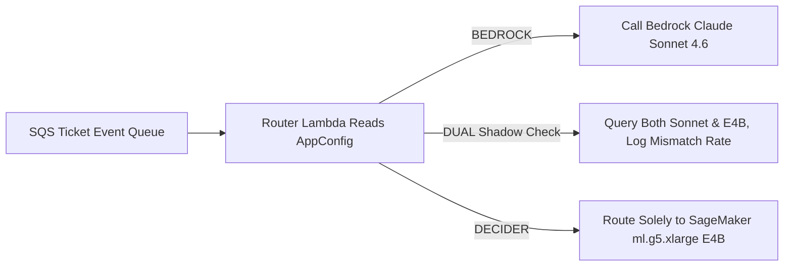

> 📌 **Original Source**: This article is syndicated from [FreeAI Dog Official Platform](https://freeaidog.com/blog/amazon-strands-decider-4b-replace-sonnet-46-routing-cost-guide/). For live LLM availability radar, latency benchmarks, and interactive API testers, visit the official site: [https://freeaidog.com/](https://freeaidog.com/).


Using a general reasoning model that streams tens of tokens per second to pick 1 out of 20 ticket queues is mostly paying extra for latency.

Amazon engineers just published real billing numbers from an internal ticketing router. The service used `Claude Sonnet 4.6` on Bedrock to route incoming tickets across 20 fixed categories plus a fallback bucket. Each ticket averaged 6,554 input tokens, and the model streamed back 170 output tokens of explanation and JSON. Average call latency sat at 4,215 ms. At Bedrock list rates, each ticket cost $0.0222, or about $22,200 per million tickets.

Switching to the open-weights `Strands Decider E4B` cut average latency to 897 ms and dropped spend to roughly $500 per million tickets. That looks like a 98% savings rate on paper. Hold off before copying the setup. That math relies on a brutal floor: without tens of millions of annual tickets keeping the card busy, monthly GPU idle rent eats the savings alive. Worse, even key ordering inside an input JSON object changed the model's probability score in production testing.

All numbers below are checked against the official Strands engineering write-up, the GitHub main branch, and Hacker News thread metrics. I did not spin up SageMaker clusters to benchmark a million concurrent queues; this breakdown verifies the ledger and production gotchas without fabricating local load curves.

## Pointer Head Emits 1 Token: Do Not Confuse It with Fine-Tuned Chat Models

At first glance at `strands-labs/strands-decider`, I almost filed it under standard fine-tuned small chat models. Reading the codebase proved me wrong.

Standard chat LLMs run an autoregressive decode loop word by word; even when you only want one label name, the model still walks through token generation. This repo bolts a pointer classification head onto `Gemma 4` or `Qwen3.5` backbones. You pass a text state plus a decision mode — `choice` for discrete picks, `noul` for yes/no judgment, or `score` for rating — and a single forward pass yields calibrated probabilities. Output always stops at 1 token.

Looking at the Gemma 4 family table published in the repo clarifies the hardware trade-offs:

| Model Checkpoint | JevBench Score | Brier Calibration Error | BF16 Weight VRAM | Median Latency on 1x H100 | Best-Fit Deployment |
| --- | --- | --- | --- | --- | --- |
| `strands-decider-E2B-gemma4-v1-2610` | 180 | 0.313 | ~9 GB | 102 ms | Tight VRAM budgets or CPU-only nodes |
| `strands-decider-E4B-gemma4-v1-2610` | 187 | 0.243 | ~15 GB | 139 ms | Single 24 GB card shared with sidecars |
| `strands-decider-12B-gemma4-v1-2610` | 200 | 0.173 | ~23 GB | 136 ms | Dedicated single GPU needing higher accuracy |
| `strands-decider-26B-A4B-gemma4-v1-2610` | 207 | 0.162 | ~51 GB | 245 ms | High-stakes decision nodes |

Notice the counterintuitive latency row: the 12B checkpoint runs 136 ms median on an H100, slightly faster than E4B at 139 ms. Why pick E4B for production if 12B is both faster and sharper? Because of instance memory. Amazon deployed on SageMaker `ml.g5.xlarge`, which ships with one 24 GB A10G GPU. E4B uses about 19 GiB loaded, leaving safe operational headroom. By contrast, 12B burns 23 GB on raw weights alone, leaving zero buffer for context spikes.

Watch out for a packaging snag if you try running this locally. The PyPI `strands-decider` package does not include Gemma 4 support yet and fails to load those checkpoints. Install straight from GitHub main instead:

```bash
pip install "strands-decider @ git+https://github.com/strands-labs/strands-decider"
strands-decider ask StrandsAgents/strands-decider-E4B-gemma4-v1-2610 \
  --state "Help! My payouts have been failing for 3 days! " \
  --choice "Which team should handle this?=billing,sales,retail"
```

Two details matter on Apple Silicon Macs: passing `--device mlx` runs 1.4x to 1.6x faster than MPS, though you must install from a local clone via `pip install -e ".[mlx]"` to enable the extra. Also respect modality limits — Gemma 4 checkpoints are text-only right now. Only the earlier `Qwen3.5-2B-Base` model accepts `--vision` image inputs, so do not feed screenshots into E4B.

## Doing the $1.408/Hour GPU Math: Low-Volume Queues Pay More

Here are the before-and-after metrics published in the official case study:

| Core Metric | Claude Sonnet 4.6 Bedrock | Strands Decider E4B SageMaker | Delta & Accounting Scope |
| --- | --- | --- | --- |
| Average call latency | 4,215 ms | 897 ms | 78% faster; ~640 ms inside instance |
| Average input tokens | 6,554 | 2,009 | 69% smaller after prompt compression |
| Average output tokens | 170 | 1 | Direct choice output, no JSON prose |
| Public us-east-1 pricing | $3 in / $15 out per 1M | $1.408/hr for `ml.g5.xlarge` | List on-demand rate, excludes Lambda |
| Estimated cost per 1M tickets | ~$22,200 | ~$500 | ~98% lower; $250 theoretical full saturation |

Saving $21,700 per million tickets looks dramatic until you divide out annual scale. Reaching "millions of dollars saved per year" requires pushing over 90 million tickets annually through the pipeline. How many mid-sized orgs have that volume?

Smaller teams copying this setup will usually lose money. An `ml.g5.xlarge` bills by running instance-hours whether requests arrive or not. Keeping one box online 24/7 costs roughly $1,014 a month. Add multi-AZ redundancy plus staging endpoints and you lock in $2,000 to $3,000 every month before routing a single ticket. If your platform processes 50,000 tickets per month, calling Sonnet 4.6 directly only costs $1,110 total. Switching API parameters to a Haiku-tier lightweight endpoint drops monthly spend below $200 with zero container maintenance or cold-start scaling headaches.

Self-hosting a decision GPU only makes sense across two hard thresholds: either ticket traffic stays steady 24 hours a day to amortize the $1.408/hour floor, or strict compliance rules forbid payloads from leaving a private VPC and force air-gapped SageMaker containers. Wait — if the margin gap is this wide, why doesn't AWS sell Strands Decider as a pay-per-token Bedrock endpoint? Several commenters asked that exact question on Hacker News, and nobody from AWS answered with pricing plans.

## Production Incident Notes: 0.19 Key-Order Drift and the 4,096-Token Wall

Reading down into the rollout failures in the second half of the blog caught my attention way more than the cost chart. The team didn't hide the ugly parts.

The strangest bug happened during JSON serialization: key ordering shifted classification probabilities. Feeding the exact same ticket text with dictionary keys reordered shifted predicted probabilities by up to 0.19. On an automation pipeline relying on confidence thresholds to skip human triage, a 0.19 swing flips borderline tickets backward. The engineers locked down canonical alphabetical key sorting before every payload leaves the client. If you wrap this API yourself, enforce deterministic key ordering first.

Right after stabilizing JSON keys, the router slammed into the 4,096-token context ceiling. All 20 legacy category definitions written for Sonnet exceeded 4,096 tokens before any ticket body even got attached. Deleting rules risked wrong routing; leaving them broke inference. So the team rewrote all 20 category instructions down to one or two sharp decision sentences plus a `"none"` fallback. For long ticket threads spanning dozens of comments, the preprocessor strips the oldest replies to keep recent updates intact, bringing mean input size down to 2,009 tokens.

Nobody was brave enough to flip production traffic in one cutover either. The Lambda router reads a three-way flag inside AWS `AppConfig`:



During initial rollout, traffic stayed in `DUAL` shadow mode. User responses came strictly from Sonnet while background telemetry collected E4B disagreements until confidence thresholds settled cleanly. Only then did traffic flip to `DECIDER`. When misroutes spike at 2 a.m., toggling the `AppConfig` flag reverts everything back to Bedrock in 45 seconds without redeploying code or containers.

That still leaves one blunt question from the Hacker News thread: if the system stays locked to 20 fixed categories, why not train a classical classifier with `scikit-learn` or `ModernBERT` instead? Traditional encoders finish under 10 ms at a tiny fraction of GPU cost. That critique holds up as soon as you already own tens of thousands of clean historical labels. Where Strands Decider actually bets its budget is zero-shot cold starts with calibrated confidence scores — specifically when product managers invent brand-new categories this afternoon with zero training labels sitting on disk.

---

All pricing rates, latencies, and drift figures above come directly from these primary sources:

| Verified Item | Primary Source Link |
| --- | --- |
| Amazon ticketing case replacing Sonnet 4.6 | https://strandsagents.com/blog/amazon-saves-millions-replacing-sonnet-with-strands-decider/ |
| Strands Decider official repo and CLI setup | https://github.com/strands-labs/strands-decider |
| StrandsAgents Gemma 4 E4B model card | https://huggingface.co/StrandsAgents/strands-decider-E4B-gemma4-v1-2610 |
| Marc Brooker comparing decoders vs encoders | https://brooker.co.za/blog/2026/10/04/encoders.html |
| Hacker News pricing math and encoder debate | https://news.ycombinator.com/item?id=50436640 |

If I inherited this migration this week, I wouldn't touch a GPU instance yet. I would wire an asynchronous shadow log on the live router for seven days and measure two numbers: whether monthly calls actually cross a million, and how much accuracy slips once old ticket replies get truncated. Put those two numbers on the table first, and that 98% headline stops looking automatic.

---

> 💡 **Source & Live Radar**：
> - Originally published on [FreeAI Dog Official Blog](https://freeaidog.com/blog/amazon-strands-decider-4b-replace-sonnet-46-routing-cost-guide/)
> - For real-time free LLM endpoint health check and latency benchmarks, visit [FreeAI Dog Availability Radar](https://freeaidog.com/radar/)

