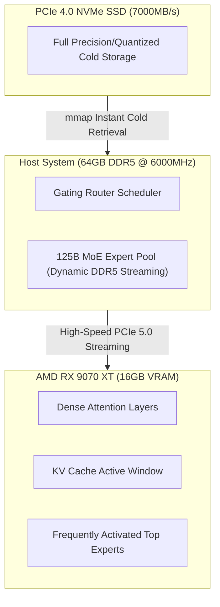

> 📌 **Original Source**: This article is syndicated from [FreeAI Dog Official Platform](https://freeaidog.com/en/blog/amd-rx-9070-xt-strata-qwen-flash-next-budget-setup/). For live LLM availability radar, latency benchmarks, and interactive API testers, visit the official site.


# Run Frontier Flash Next for €1600! AMD RX 9070 XT + Strata Hits 90 t/s: Quantization Tradeoffs & Budget Build Guide

When exploring local setups for massive 125B parameter Mixture-of-Experts (MoE) models, most hardware guides deliver the same intimidating verdict:
*"You need dual RTX 3090/4090s, or drop over $2,000 on a single 32GB RTX 5090."*

Yet in the open-source hardware and local LLM community, clever engineering always finds a way around the hardware paywall.

A recent thread on Reddit's r/LocalLLaMA caught fire with hundreds of comments: a European builder configured an **Intel Core i7-14700KF + 64GB DDR5 + AMD Radeon RX 9070 XT 16GB (RDNA4 architecture)** desktop for approximately **€1,600 (around $1,730 USD)**.

On this sub-€2K workstation, he deployed the open-source **Strata** inference engine—specifically engineered for dynamic MoE sparse offloading—and pushed Alibaba's frontier multimodal coding model, **Qwen 3.8 Flash Next**, to an astonishing **70 to 90 tokens/second** in decode speed!

That output speed easily outpaces human reading speed and runs circles around many paid cloud endpoints.

Before you rush to purchase hardware, however, there are critical nuances to understand. Many builders jumped straight in and tripped over severe intelligence degradation in Q2 quantizations or ran into ROCm environment hurdles. Today, Xiaoke breaks down the raw mechanics of this build, the software pipeline, and how to avoid the pitfalls.

---

## 1. Deconstructing the €1,600 Build: Where Did the Money Go?

The secret to driving a 125B-class MoE architecture on a consumer budget lies in **asymmetric tiered offloading**: *keep critical attention layers and active KV cache in high-speed GPU VRAM, while leveraging high-frequency DDR5 system memory to dynamically stream expert weights*.

Here is the exact component breakdown from the builder's verified testbed:

| Component | Tested Hardware Model | Engineering Rationale | Approx. Price (€ / USD) |
| :--- | :--- | :--- | :--- |
| **GPU** | **AMD Radeon RX 9070 XT 16GB** | RDNA4 architecture (Navi 48), native FP8/FP4 tensor matrix acceleration, exceptional performance per dollar compared to Team Green | ~€620 / $670 |
| **CPU** | **Intel Core i7-14700KF** | 20 cores (8P + 12E), 28 threads, high single-core turbo boosts routing scheduler performance | ~€350 / $380 |
| **RAM** | **64GB (2×32GB) DDR5 6000MHz CL30** | **Crucial bottleneck!** ~96 GB/s memory bandwidth provides the arterial pipeline streaming MoE experts into the GPU | ~€210 / $230 |
| **Motherboard**| **B760 / Z790 High-Tier ATX** | Needs a full-speed PCIe 5.0 GPU slot and at least 2× PCIe 4.0×4 M.2 slots | ~€180 / $195 |
| **SSD** | **2TB PCIe 4.0 NVMe (7000+ MB/s)** | High-throughput storage for instant mmap streaming of cold expert tables | ~€130 / $140 |
| **Power Supply**| **850W ATX 3.0 Gold Modular** | Handles transient power spikes from the 9070 XT and 14700KF under full load | ~€100 / $110 |
| **Cooler & Case**| **360mm AIO Liquid Cooler + Airflow Case** | Keeps CPU thermals stable during prolonged speculative inference tasks | ~€110 / $120 |
| **Total System**| **Complete Working Rig** | **Unlocks 125B MoE locally for less than the cost of a single standalone 5090 GPU** | **~€1,600 / $1,730** |



This tiered offloading strategy works brilliantly because the RX 9070 XT's 16GB VRAM comfortably hosts Qwen 3.8 Flash Next's self-attention matrix, the active KV cache, and the top-ranked experts. Meanwhile, 64GB of fast DDR5 functions as an active L3 reservoir, with Strata continuously swapping experts over PCIe with minimal latency penalty.

---

## 2. The Great Debate: Is 90 t/s on Q2_0 Quantization Actually Usable?

When the benchmark was posted, community debate immediately focused on one key issue: **did extreme quantization butcher model intelligence?**

The headline 70-90 t/s number was clocked using `Qwen3.8-Flash-Next-GSQ-RCO-Q2_0`.

If you are an engineer planning to use this model for daily production or complex code synthesis, you must understand the quantization tradeoffs:

### Quantization Tiers: Speed vs. Intelligence Matrix

| Quantization Tier | Decode Throughput | VRAM + RAM Allocation | Real-World Developer Assessment |
| :--- | :---: | :---: | :--- |
| **GSQ-RCO-Q2_0** | **90 ~ 70 t/s** | ~38 GB Total | ⚠️ **Fast, but noticeable IQ loss.** Fine for basic creative brainstorming, but multi-step reasoning, nested JSON schemas, and complex syntax generation show distinct hallucination spikes. |
| **GSQ-RCO-IQ3_S** *(Sweet Spot)* | **60 ~ 50 t/s** | ~48 GB Total | 🏆 **The undisputed sweet spot.** Importance matrix calibration preserves core logical attention. Coding and tool calling remain rock-solid, and 50+ t/s is still blisteringly fast. |
| **Atomic Q4 / GSQ-RCO-Q4** | **50 ~ 30 t/s** | ~62 GB Total | 💎 **Near-native FP16 fidelity.** Negligible perplexity degradation. Ideal for mission-critical engineering assistants and comprehensive document analysis. |

> **Xiaoke's Takeaway**: Do not chase raw benchmark numbers by blindly locking into Q2_0. **IQ3_S is the golden sweet spot**—trading 25 t/s for dependable logic, robust tool calling, and zero JSON syntax errors is a bargain every developer should take.

---

## 3. Hands-on Setup: Compiling & Running Strata on RX 9070 XT

If you are building around modern AMD hardware, skip Windows display drivers for heavy compute. Open-source ROCm kernels are developed Linux-first.

Recommended OS: **Ubuntu 24.04 LTS with Linux Kernel 6.10 or newer**.

### Step 1: Install AMD ROCm 6.3 Runtime
```bash
# 1. Add AMD ROCm official repository
sudo apt-get update && sudo apt-get install -y wget gnupg2
wget https://repo.radeon.com/rocm/rocm.gpg.key -O - | \
    gpg --dearmor | sudo tee /etc/apt/trusted.gpg.d/rocm.gpg > /dev/null

echo "deb [arch=amd64] https://repo.radeon.com/rocm/apt/6.3/ noble main" | \
    sudo tee /etc/apt/sources.list.d/rocm.list

# 2. Install ROCm HIP SDK and runtime utilities
sudo apt-get update && sudo apt-get install -y \
    rocm-hip-sdk rocm-opencl-runtime rocm-smi-lib rocminfo

# 3. Grant render group permissions
sudo usermod -a -G render,video $USER
```

> **Crucial RDNA4 Tip**: The RX 9070 XT uses the Navi 48 silicon (gfx1201 target). If the driver compiler complains about an unrecognized architecture target, override it via environment variables:
> ```bash
> export HSA_OVERRIDE_GFX_VERSION=12.0.0
> export ROCM_PATH=/opt/rocm
> ```

### Step 2: Build the Strata Inference Engine
Strata is developed by engineer Niko1221 specifically for asymmetric MoE offloading (`stratallm.dev` / `github.com/Niko1221/Strata`):

```bash
git clone https://github.com/Niko1221/Strata.git
cd Strata

# Build with ROCm HIP backend
mkdir build && cd build
cmake .. -DHIP_ROOT_DIR=/opt/rocm -DSTRATA_ENABLE_ROCM=ON -DCMAKE_BUILD_TYPE=Release
make -j$(nproc)
```

### Step 3: Download Quantized Model Weights
Download the community-optimized IQ3_S GGUF package:

```bash
# Download the recommended IQ3_S sweet-spot weights
huggingface-cli download \
    LoneStriker/Qwen3.8-Flash-Next-GSQ-RCO-IQ3_S-GGUF \
    --local-dir /models/Qwen3.8-Flash-Next-IQ3_S
```

### Step 4: Launch the Tiered Inference Server
```bash
./bin/strata-server \
    --model /models/Qwen3.8-Flash-Next-IQ3_S \
    --vram-budget 14500 \
    --ram-budget 52000 \
    --port 8000 \
    --ctx-size 65536
```
Key parameters:
- `--vram-budget 14500`: Allocates 14.5 GB of the 16 GB VRAM to Strata, preserving 1.5 GB for the OS display compositor;
- `--ram-budget 52000`: Allocates 52 GB of system RAM for the expert cache, leaving 12 GB headroom for background operating system stability.

Once initialized, an OpenAI-compatible endpoint is available at `http://localhost:8000/v1`!

---

## 4. The $200 Server-Scrap Alternative

In the thread's comment section, another group of extreme budget hardware hackers revealed a legendary alternative:

What if you have nowhere near €1,600, but still want to run local frontier MoE models?

Enter the **$200 enterprise surplus build**:

- **CPU**: Intel Xeon E5-2673 v4 (20 cores, 40 threads, Broadwell architecture, available on surplus markets for **~$10**);
- **RAM**: 4× 16GB DDR4-2133 RDIMM ECC Server Memory (Quad-channel 64GB for **~$50** total);
- **Motherboard**: Used X99 4-channel server motherboard (**~$50 - $70**);
- **GPU**: **AMD Radeon Instinct MI50 16GB** (Vega 20 architecture with native PCIe 4.0 and ROCm support, selling on used markets for **~$90 - $110**);
- **Power & Frame**: Used 750W server power supply + open test bench (**~$30**).

**Total build cost: Under $200!**
While constrained by DDR4 bandwidth to around **30 to 45 tokens/second** on Atomic Q4, consider the achievement: for the cost of a decent dinner, you have a 125B parameter Mixture-of-Experts brain running in your bedroom.

---

## Conclusion

From the European builder's €1,600 RX 9070 XT workstation delivering 90 t/s, to the $200 enterprise salvage setup, the open-source AI community continues to shatter artificial computing monopolies.

NVIDIA's CUDA moat and premium pricing dominate corporate data centers, but the combination of **AMD RDNA4 hardware + Strata dynamic offloading** proves that consumer developers have viable, cost-effective pathways to state-of-the-art local intelligence.

If you are planning a new workstation build or looking to upgrade your home lab, this configuration deserves serious consideration. Have hardware questions or ROCm setup hurdles? Leave a comment below—Xiaoke is here to help!

---

> 💡 **Source & Live Radar**：
> - Originally published on [FreeAI Dog Official Blog](https://freeaidog.com/en/blog/amd-rx-9070-xt-strata-qwen-flash-next-budget-setup/)
> - For real-time free LLM endpoint health check and latency benchmarks, visit [FreeAI Dog Availability Radar](https://freeaidog.com/en/radar/)
