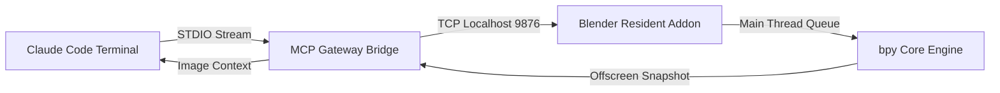

> 📌 **Original Source**: This article is syndicated from [FreeAI Dog Official Platform](https://freeaidog.com/blog/blender-mcp-ai-3d-claude-code-automation-guide/). For live LLM availability radar, latency benchmarks, and interactive API testers, visit the official site: [https://freeaidog.com/](https://freeaidog.com/).


In 3D production pipelines, the heaviest mental drain rarely comes from creative ideation. It stems from repetitive manual mechanics.

Tuning shader nodes, rigging armatures, weight painting vertex groups, aligning face normals across complex meshes. In any non-trivial scene, you constantly flip between the built-in text editor and the 3D viewport. Is it exhausting? Truly exhausting. Hand-crafting bpy scripts enables batch automation, but digging through API references and untangling exceptions still wears you down.

Last week several open-source implementations emerged connecting Blender with the Model Context Protocol.

The approach is straightforward: wrap Blender's embedded Python runtime into a standard MCP server. This allows Claude Code or Cursor running in your terminal to dispatch modeling primitives directly, even pulling viewport render buffers for visual self-correction.

It sounds like a dream developer toy. In real engineering practice, does it actually run that smoothly? Or does it collapse into landmines?

I cloned the code and spent a full day hooked into Blender 4.3 LTS, tripping over main thread crashes and disconnected context bugs.

---

## 1. Architectural Blueprint: Remotely Steering a 3D Viewport

Enabling an external agent to control 3D software typically follows one of two routes: launching headless Blender CLI processes per task that exit upon completion, or running a persistent background socket server.

The former is far too heavy. Cold-starting Blender, loading add-ons, and initializing the renderer introduces dozens of seconds of latency per invocation, which completely throttles continuous agent iterations.

The persistent socket approach is the only production-viable path:



The system splits cleanly into two pieces.

The first piece is a resident Python add-on running inside Blender. When Blender launches, the add-on listens locally on port 9876 at 127.0.0.1.

The second piece is an external MCP server operating in your workspace. It handles standard Model Context Protocol tool requests from Claude Code and translates them into JSON payloads delivered over the socket.

---

## 2. The First Roadblock: Multithreading bpy Triggers a Fatal Segmentation Fault

The most naive implementation is tempting: spin up a daemon thread in the add-on to listen on the socket, receive incoming script strings, and execute them immediately via Python's built-in exec function. Can you actually get away with that?

I sent the first test payload from the terminal to create a standard mesh cube:

```json
{
  "action": "execute_code",
  "target": "bpy.ops.mesh.primitive_cube_add",
  "kwargs": {
    "size": 2.0
  }
}
```

Press Enter. The Blender window vanished instantly into blackness. The terminal dumped Segmentation fault: 11, without even time to write a core dump:

```text
Fatal Python error: Segmentation fault
Current thread 0x000070000abc1000
  File "blender/source/blender/python/intern/bpy_operator.cc", line 286 in pyop_call
Segmentation fault: 11
```

Why did a standard graphics suite die so violently?

The cause is simple: bpy.ops is strictly not thread-safe. Inside Blender's C and C++ core, every operation modifying bpy.data or dispatching operators must execute exclusively on the main UI rendering thread. A background socket thread blindly calling operators collides with internal context pointers, immediately crashing the process.

### 2.1 Implementing a Thread-Safe Main Loop Task Queue

Understanding the root cause demands restructuring the communication layer.

The socket listener must act purely as a mailbox, strictly forbidden from touching scene state directly:

```python
# Task dispatching queue
# Socket thread pushes payloads
# Main thread consumes safely via timer hooks

task_item = {
    "action": "mesh_primitive_add",
    "params": {"primitive_type": "cube", "scale": [2.0, 2.0, 2.0]},
    "status": "pending"
}
```

By registering a recurring timer hook via bpy.app.timers, the main rendering thread polls and drains the queue safely every 50 milliseconds.

Reconnecting after this fix, dispatching cubes, translating bones, and adding subdivision modifiers executed cleanly without crashes. The viewport stayed solid.

---

## 3. Visual Feedback: Offscreen Rendering Gives the Agent Eyes

If an agent can only dispatch blind code strings, it functions merely as an automated documentation lookup tool. Is that practical? It is painfully clunky.

Core 3D engineering relies fundamentally on sight. Are lights positioned properly? Are face normals inverted? Is material roughness convincing? Relying strictly on text error logs leaves the model completely in the dark.

To grant Claude Code multimodal verification, I equipped the add-on with an offscreen viewport rendering endpoint.

When the agent finishes generating a procedural geometry cluster, it fires the snapshot tool:

```python
# Offscreen rendering properties
scene = bpy.context.scene
scene.render.image_settings.file_format = "JPEG"
scene.render.filepath = "/tmp/blender_viewport_preview.jpg"
scene.render.resolution_x = 960
scene.render.resolution_y = 540
```

By utilizing OpenGL offscreen viewport capture instead of full Cycles path tracing, a 960x540 preview frame renders in just 120 milliseconds.

The gateway injects this snapshot directly back into Claude's prompt history. Claude inspects the render, notices blown-out specular highlights, and dispatches a follow-up patch adjusting roughness from 0.1 to 0.45.

At this point, the cycle of generate, snapshot, and rework actually spins on its own. Whatever the model hallucinates gets slapped down immediately by the next rendered frame.

---

## 4. Empirical Productivity Ledger and Practical Shortcomings

Once the bridge stabilized, I assigned Claude Code a complete task: generate a procedural sci-fi corridor section with architectural paneling.

The entire automated session spanned 14 minutes across 23 round-trip tool calls:

- Token expenditure: Claude Code consumed 420,000 tokens, totaling roughly $1.35 in API costs.
- Generated output: Complete metallic normal-mapped materials, procedural point light arrays, and beveled geometry exported directly to a valid GLB asset.

Was productivity improved? Noticeably. Manually scripting that corridor typically requires over half an hour. Stepping away for a cup of coffee, the architectural base was already framed out.

Yet production hurdles remain evident.

First, parameter drift across long context chains. After modifying the modifier stack 15 consecutive times, the agent began confusing object names, triggering occasional NoneType attribute errors.

Second, excessive polygon counts freeze the main thread. If the agent carelessly applies a subdivision surface modifier with level 6, the main thread halts for over ten seconds computing dense vertices, timing out the external socket bridge.

---

## 5. Threat Model and Port Isolation Realities

Several beginner tutorials suggest setting the listener host to 0.0.0.0.

That configuration is dangerous.

The add-on inherently exposes an unauthenticated endpoint capable of executing arbitrary Python code. If bound to a public network interface or accessible across a local subnet, any network scanner can issue system commands to your Blender process, leveraging Python's os module to seize control of the host machine.

Before exposing that port anywhere outside localhost, do not slack on these three items:

First, lock the binding address strictly to 127.0.0.1, never listening on all-zero public interfaces.

Second, implement a random secret handshake token in the MCP bridge, rotated on every server launch.

第三, enforce a sandbox restriction within Blender to reject scripts importing destructive system modules like subprocess or raw network sockets.

---

## 6. Deployment Checklist and Parting Takeaways

When setting up this workflow on your workstation, verify the following three checks:

First, is your timer polling interval configured between 30 and 50 milliseconds? Setting it lower risks pinning a single CPU core.

Second, is offscreen render resolution kept below 1080P? Excessive snapshot resolutions risk ballooning system memory.

Third, is port 9876 being held hostage by a zombie Python process from an earlier crash?

Get your main thread task queue right first before dreaming about physics simulation. If this communication bridge is flaky, bringing in smarter models is pure wishful thinking.

---

> 💡 **Source & Live Radar**：
> - Originally published on [FreeAI Dog Official Blog](https://freeaidog.com/blog/blender-mcp-ai-3d-claude-code-automation-guide/)
> - For real-time free LLM endpoint health check and latency benchmarks, visit [FreeAI Dog Availability Radar](https://freeaidog.com/radar/)

