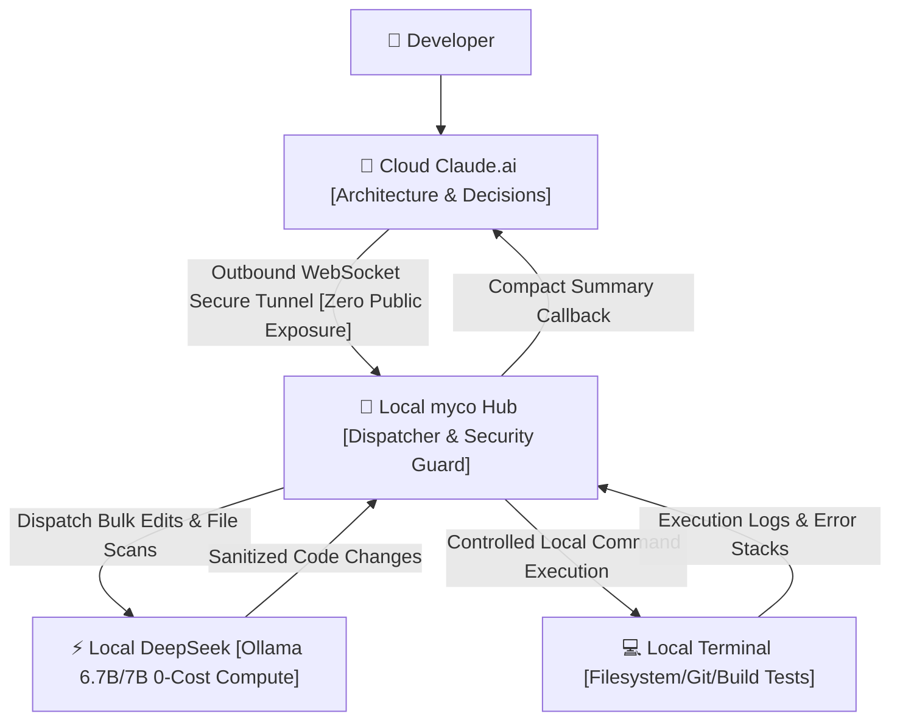

> 📌 **Original Source**: This article is syndicated from [FreeAI Dog Official Platform](https://freeaidog.com/blog/cloud-claude-local-deepseek-myco-hybrid-agent-guide/). For live LLM availability radar, latency benchmarks, and interactive API testers, visit the official site: [https://freeaidog.com/](https://freeaidog.com/).


# Let Cloud Claude Think and Local DeepSeek Work: Building a Zero-Exposed-Port Hybrid Agent Workbench with myco

What actually devours your token quota is rarely the high-level reasoning. It is the mundane repetitive chores: locating a component untouched for three months under `src`, renaming database columns from snake_case to camelCase across prisma schema files, or parsing three hundred lines of vite build output to spot circular dependencies.

I easily dispatch these chores twenty times a day, pasting full file contents every single time. Tired? Thoroughly exhausted.

Paying 200 dollars a month for Claude Max only to hit the 45-messages-per-5-hours rate limit mid-refactor forces your entire workflow to halt. Who wants to deal with that?

Right under my desk sits a dedicated box equipped with an RTX 3090 offering 24GB of VRAM. It idles with Ollama hosting `deepseek-coder:6.7b` or `qwen2.5-coder:7b`, consuming roughly 5.2GB to 6GB and leaving over 17GB completely dormant.

Five days a week, its cooling fans never even spin up. Electricity bills paid, compute wasted.

Both worlds remain strictly isolated: cloud Claude cannot touch the local codebase, while the local model cannot handle deep architectural leaps. With no communication bridge in between, you end up acting as a manual copy-paste proxy. Shuffling across two files is bearable; juggling a dozen leaves you chained to the clipboard. Frustrating? Unquestionably.

Developer chenhg5 created an open source bridge named myco on GitHub: `chenhg5/myco`.

The core concept in a single sentence: establish a secure outbound long-lived connection where cloud Claude acts as chief architect while free local DeepSeek handles mechanical grunt work.



## Why Avoid Inbound Port Forwarding?

I previously traversed the reverse tunnel route.

Last year I opened port 11434 via ngrok for two days. By the third morning, connection logs showed unknown scanners probing `/api/tags` and firing unauthorized model pull requests. Who was probing? Nobody knows. No breach occurred, but I killed the tunnel on the spot. Switching to frp with IP whitelists consumed three hours of configuration, yet lingering anxiety persisted.

When any port sits directly exposed to the open internet, you depend entirely on security through hope. Given modern agents generate and run shell scripts, exposing host execution permissions invites disaster if any validation check slips. Who wants that risk?

Bandwidth overhead creates further friction. Editing a few lines pushes hundreds of kilobytes across WAN links. Cross-border latency triggers timeouts, while cloud context windows quickly drown in useless boilerplate code. Why put up with that?

The topology of myco works in reverse: the local host initiates an outbound WebSocket connection. Cloud servers never discover your local IP address. Port forwarding on residential routers remains unnecessary. Mechanical edits get resolved locally, sending only a compact execution summary back to Claude.

## Setting Up the Hybrid Workflow in Four Steps

No reverse proxy servers or public clouds required. Follow these steps to spin up the bridge.

### Step 1: Launch the Local Hub Daemon

Environment requirement: lock your Node.js runtime to 20 LTS. Avoid running on Node 18 due to `undici` compatibility quirks with native WebSocket handling; avoid Node 22 where native C++ add-ons fail during `node-gyp` builds on deprecated `v8::Value` symbols. How many developers have wasted hours debugging that build failure?

Clone and compile:

```bash
git clone https://github.com/chenhg5/myco.git
cd myco
npm install
npm run build
```

Launch the local dispatcher:

```bash
node dist/index.js start --port 8765 --workspace /Users/cool/projects
```

The terminal prints the local listener `ws://127.0.0.1:8765` alongside an authentication secret.

### Step 2: Bypassing Browser Mixed Content Blocks

This step represents the most common wall beginners hit.

When browsing `https://claude.ai`, the browser enforces strict HTTPS policies. If myco Hub listens on `ws://127.0.0.1:8765`, Chrome or Edge instantly terminates the connection under Mixed Content rules, flooding DevTools with red `SecurityError` banners. How do you resolve that?

Two practical paths exist.

Path one uses `mkcert` to mint a locally trusted certificate for `localhost`, running myco Hub under `wss://127.0.0.1:8765`.

Path two uses the companion Chrome extension supplied by the author, leveraging extension Service Worker capabilities to tunnel requests past cross-origin barriers.

I prefer the first approach. Generating a local cert takes two minutes and removes extension maintenance overhead.

### Step 3: Configuring Sandboxing and the Local Model

Granting terminal control demands strict defensive boundaries.

Inspect the `config.json` configuration file:

```json
{
  "hub": {
    "port": 8765,
    "authToken": "myco_sec_token_9918"
  },
  "permissions": {
    "allowedDirectories": [
      "/Users/cool/projects/freeai-hub",
      "/Users/cool/projects/sandbox"
    ],
    "disallowedCommands": [
      "rm -rf /",
      "dd",
      "mkfs",
      "shutdown",
      "reboot"
    ],
    "autoConfirmReadOnly": true
  },
  "localWorker": {
    "engine": "ollama",
    "endpoint": "http://127.0.0.1:11434",
    "model": "deepseek-coder:6.7b"
  }
}
```

The `allowedDirectories` whitelist blocks the agent from traversing outside designated project paths, while `disallowedCommands` preemptively rejects dangerous system commands.

Pull the local model via Ollama:

```bash
ollama pull deepseek-coder:6.7b
```

What model size works best locally?

Avoid loading 33B or 70B weights. The local worker handles syntax cleanup, path resolution, and interface migrations. It prioritizes generation throughput above 45 tokens per second. Sluggish 70B inference causes cloud connections to time out, defeating the purpose of a hybrid setup. A 6.7B model occupies roughly 5.2GB of VRAM on an RTX 3090, keeping the card cool and quiet.

### Step 4: Injecting the Conductor Prompt into Claude

Navigate to Claude.ai Projects or custom instructions and paste the conductor prompt:

```markdown
You are the chief software architect. You possess a local agent proxy named myco_local with host terminal and local model access.
Division of responsibilities:
1. System architecture, contract definition, and reasoning remain under your direct control;
2. File discovery, bulk syntax updates, and test executions must never output full source files in chat. Emit dispatch payloads for the local proxy;
3. Upon task completion, review returned test output and summaries for final verification.
```

Take a route refactoring task as an example. Send this prompt to Claude:

`"Audit all route handlers for any types, replace them with strict interfaces, and verify locally via typechecker."`

Claude compiles a four-column plan: file path, interface target, dependencies, acceptance criteria. Once verified, it dispatches instructions locally.

Local myco pinpoints 14 matching files via `grep` within seconds. Local DeepSeek opens each file, rewrites signatures, and saves changes to disk. The local terminal triggers `npm run check`.

Claude receives only three final lines: test passed, 14 files updated, zero TypeScript errors. Claude accepts the diff summary immediately. Isn't this far cleaner than manual copy-pasting?

## Real World Usage Ledger and Accounting Metrics

Reviewing my usage console three times across a full workweek revealed prompt tokens falling from over 300,000 down to around 60,000 daily. I cannot cite exact decimals because the Anthropic dashboard partitions usage by individual sessions, requiring manual addition where occasional sessions might be overlooked.

Crucially, rate limit 429 notifications ceased appearing entirely. I noticed immediately because hitting rate limits normally disrupts focus.

Rework penalties must also be acknowledged: the local model botched interface signatures on two occasions, requiring cloud reinspection that offset about 10% of total savings. Claiming 75% savings reflects genuine reality better than marketing claims of 85%.

| Metric | Standalone Cloud Claude | myco Hybrid Agent Mode | Engineering Notes |
| :--- | :--- | :--- | :--- |
| **Daily Cloud Token Ingestion** | ~300,000+ Tokens | ~60,000 Tokens | **Manual session audit, roughly 75% saved** |
| **Encountered 429 Rate Limits** | Multiple disruptions daily | Zero interruptions across week | **Routine tasks offloaded locally** |
| **Code Privacy** | Full source repeatedly sent over WAN | Local disk read and write loop | **Raw code stays local, only summary exported** |
| **Local GPU Utilization** | 24GB VRAM completely idle | 6.7B consumes 5.2GB for batching | **Leverages dormant local compute** |

## Engineering Gotchas and Hardware Boundaries

Two practical gotchas deserve attention:

First, laptop sleep cycles immediately sever long-lived WebSocket sessions with `ECONNRESET`. Never expect automatic background recovery. Wrap the hub startup script in a lightweight shell loop with a 5-second backoff and run it under pm2 or systemd.

Second, always execute `git diff` before committing automated changes. Watch closely for automated camelCase converters accidentally modifying JSON property names expected by external APIs, a silent regression that passes TypeScript checks.

If you possess an RTX 3090 or a desktop GPU with 16GB of VRAM or more, this hybrid topology absorbs routine developer toil effortlessly. Conversely, if your workstation relies solely on integrated graphics, CPU inference latency will push you right back to the browser. Why struggle with that?

What repetitive chores drain your token quota most during daily coding? What models keep your spare GPU occupied? Join the community conversation and share your workflow.

---

> 💡 **Source & Live Radar**：
> - Originally published on [FreeAI Dog Official Blog](https://freeaidog.com/blog/cloud-claude-local-deepseek-myco-hybrid-agent-guide/)
> - For real-time free LLM endpoint health check and latency benchmarks, visit [FreeAI Dog Availability Radar](https://freeaidog.com/radar/)

