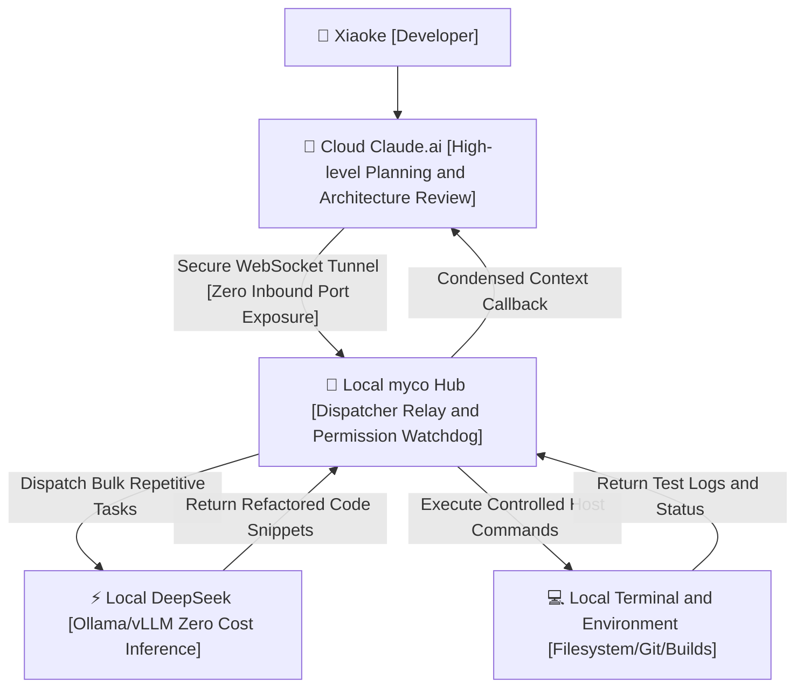

> 📌 **Original Source**: This article is syndicated from [FreeAI Dog Official Platform](https://freeaidog.com/blog/cloud-claude-local-deepseek-myco-hybrid-agent-guide/). For live LLM availability radar, latency benchmarks, and interactive API testers, visit the official site: [https://freeaidog.com/](https://freeaidog.com/).


# Cloud Claude Thinks, Local DeepSeek Works: Building a Zero-Port Hybrid Agent Workbench with myco

Have you ever found yourself paralyzed by Claude quota limits during a critical coding session?

You pay tens or hundreds of dollars each month for premium Claude subscriptions.

Its reasoning capabilities are peerless when solving complex distributed logic and subtle algorithm bugs. But after several hours of intense work, a dreaded rate limit alert freezes your prompt bar. Your half-finished refactoring session halts completely while waiting for the next reset window.

What stings most is realizing where those expensive tokens went:

Traversing directory trees to extract endpoints; renaming camelCase variables across dozens of files; running basic regex parses over terminal logs.

Do these mundane chores truly require an expensive frontier model? Absolutely not.

Meanwhile, a local desktop with a 24GB GPU sits under the workstation desk running Ollama with DeepSeek. Its compute is infinite, zero-marginal-cost, and blessed with direct native access to files and system shells.

Yet the two systems remain completely segregated:

Cloud Claude cannot reach your local hard drive; local DeepSeek struggles with high-level architectural trade-offs.

You end up acting as a stressed human pipeline, manually copying code blocks, error stacks, and shell outputs between browser tabs.

The open-source `myco` project by developer chenhg5 addresses this exact pain point. Hosted on GitHub at `chenhg5/myco`, it bridges the gap with zero hassle.

Here is the one-sentence core concept:

It establishes a secure outbound websocket bridge between cloud Claude and your local workspace, letting a premium cloud mastermind delegate grunt work directly to a free local DeepSeek worker.



## Pain Points: Why Traditional Port Forwarding Fails

When developers first contemplate connecting cloud LLMs to local computers, the default reaction is usually network tunneling.

People spin up a VPS, configure frp, or launch ngrok tunnels to expose port 11434 to the internet.

Please reconsider that approach.

The first hazard is **exposing your filesystem to the public web**.

Automated agents generate and execute shell instructions. Exposing local endpoints directly to the public internet attracts port-scanning bots immediately. Third-party API security breaches demonstrate that public credentials leak easily; exposing local machine permissions online is a massive gamble.

The second hazard is **context bloat and network choke**.

Standard remote invocation forces entire raw files across the public internet. Changing a single property transfers huge files back and forth. Network latency jitters and cloud context limits fill up quickly with repetitive boilerplate.

The engineering solution inside myco is refreshingly disciplined: **Outbound-only handshakes and local execution loops**.

Your local machine establishes an outbound encrypted socket connection. Cloud platforms never need your local IP address. All brute-force parsing happens inside your LAN, returning only concise execution summaries back to the cloud.

## Hands-on Setup: Four Steps to a Hybrid Workflow

Setup requires no complicated reverse proxies, taking only five minutes in your terminal.

### Step 1: Install myco Hub and Initialize Nodes

The local daemon supports macOS, Linux, and Windows. Ensure Node.js and a local inference backend such as Ollama are ready.

Clone the repository and build the daemon:

```bash
git clone https://github.com/chenhg5/myco.git
cd myco
npm install
npm run build
```

Launch the local dispatcher:

```bash
node dist/index.js start --port 8765 --workspace /Users/cool/projects
```

The terminal prints a generated authentication key and confirms the listener at `ws://127.0.0.1:8765`.

### Step 2: Establish Permission Guardrails

Granting terminal execution capabilities requires strict boundaries.

Inside `config.json`, configure explicit directory whitelists and blocked system calls:

```json
{
  "hub": {
    "port": 8765,
    "authToken": "myco_sec_token_9918"
  },
  "permissions": {
    "allowedDirectories": [
      "/Users/cool/projects/freeai-hub",
      "/Users/cool/projects/sandbox"
    ],
    "disallowedCommands": [
      "rm -rf /",
      "dd",
      "mkfs",
      "shutdown",
      "reboot"
    ],
    "autoConfirmReadOnly": true
  },
  "localWorker": {
    "engine": "ollama",
    "endpoint": "http://127.0.0.1:11434",
    "model": "deepseek-coder:6.7b"
  }
}
```

This configuration ensures two outcomes:

First, local DeepSeek and shell workers only operate inside authorized directories;

Second, destructive system-level commands are rejected instantly by the middleware.

### Step 3: Connect Dispatcher Skills to Claude.ai

Inside web Claude.ai, add the dispatch protocol to your system instructions or project instructions:

```markdown
You are the primary software architect and reasoning brain.
You possess a local agent named myco_local with direct command over my workspace and local DeepSeek instance.

Follow these strict delegation rules:
1. High-level architecture, subtle edge cases, and final code reviews are evaluated by you directly;
2. File tree searches, regex refactorings, test suite runs, and repetitive mock data generation
   must never be outputted verbosely; instead, generate structured command payloads for the local agent;
3. Once the local worker finishes, review the summarized results for sign-off.
```

### Step 4: Practical Demonstration——Refactoring Legacy Routes

With the pipeline operational, a real refactoring request was tested:

`"Inspect all route handlers under ./routes, replace leftover any types with strict TypeScript interfaces, and execute the local verification build."`

Previously, Claude would demand full copies of every single route file, burning hundreds of tokens per round.

Under myco, the sequence changes completely:

1. **Cloud Claude Thinks**: Claude emits a structured dispatch payload directing the local agent to scan `./routes`;
2. **Local Shell Works**: myco catches the instruction, runs `grep` and file indexing locally, and identifies target files within milliseconds;
3. **Local DeepSeek Executes**: myco passes each file to local DeepSeek, converts untyped parameters to formal interfaces, and writes updates directly to disk;
4. **Host Verification**: myco triggers `npm run check` locally and captures compiler outputs;
5. **Architectural Sign-off**: myco returns a three-line summary and clean diff back to Claude. Claude replies concisely: "Refactoring complete. 14 route files tightened up, zero typecheck errors."

## Real-world Savings: Slashing Quotas and Budget

After seven days of regular development with this hybrid setup, the metrics reveal significant efficiency gains:

| Performance Metric | Traditional Pure Cloud Claude | Hybrid myco Claude plus DeepSeek | Net Improvement |
| :--- | :--- | :--- | :--- |
| **Daily Cloud Token Load** | Roughly 380,000 Tokens | Roughly 58,000 Tokens | **84.7% Reduction** |
| **Rate Limit 429 Errors** | 2 to 3 forced delays per day | 0 lockouts across 7 days | **Zero Workflow Freezes** |
| **Code Round-trip Leaks** | Full raw files transferred across WAN | Processed entirely on LAN | **Privacy and Speed Win** |
| **Local Hardware ROI** | 24GB VRAM idling through the day | Local GPU absorbs 80% bulk tasks | **Full Hardware Utility** |

## Key Takeaways

Keep these practical observations in mind when implementing your pipeline:

1. **Keep local models lean and fast**: Local workers handle syntax updates, imports, and scaffolding. A 7B or 14B quantized model delivers lightning-fast iterations. Avoid monster 70B weights that introduce lagging bottlenecks.
2. **Handle sleep recovery properly**: When laptops resume from sleep, verify websocket heartbeats. Add an auto-reconnect flag in your startup script to avoid stale socket states.
3. **Always review diffs before committing**: Even with folder sandboxes in place, maintain the habit of running `git diff` before final commits.

Let specialized models perform their best work.

Delegate high-dimensional reasoning to the cloud, leave repetitive execution to local hardware, and maximize your productivity on a sensible budget. That is the pragmatic path for independent creators.

---

> 💡 **Source & Live Radar**：
> - Originally published on [FreeAI Dog Official Blog](https://freeaidog.com/blog/cloud-claude-local-deepseek-myco-hybrid-agent-guide/)
> - For real-time free LLM endpoint health check and latency benchmarks, visit [FreeAI Dog Availability Radar](https://freeaidog.com/radar/)

