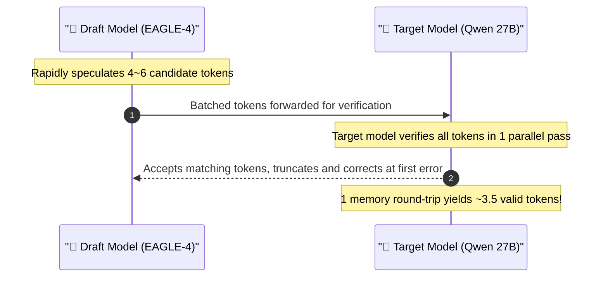
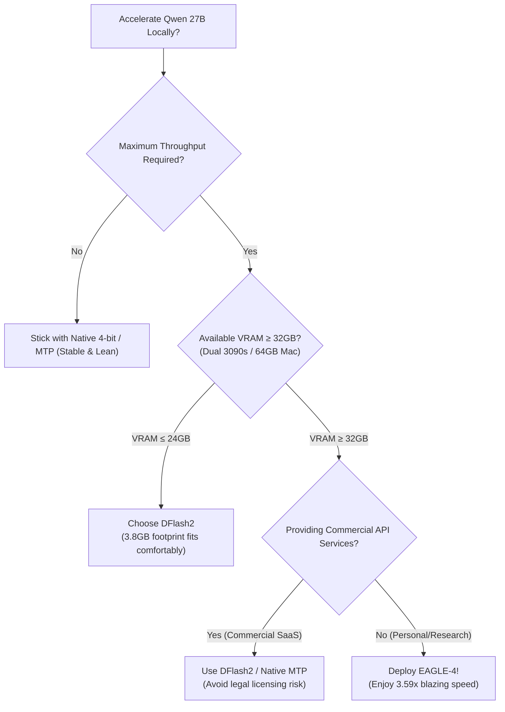

> 📌 **Original Source**: This article is syndicated from [FreeAI Dog Official Platform](https://freeaidog.com/blog/eagle-4-speculative-decoding-guide/). For live LLM availability radar, latency benchmarks, and interactive API testers, visit the official site: [https://freeaidog.com/](https://freeaidog.com/).


# 3.59x Inference Acceleration: EAGLE-4 Speculative Decoding Benchmarks & VRAM/License Pitfalls

> **Executive Summary**: Anyone who has deployed a 20B–70B parameter model locally knows the painful feeling of watching tokens crawl out at 15–20 tokens/second while GPU fans scream at maximum RPM.
> 
> The open-source speculative decoding ecosystem just received a major upgrade: **EAGLE-4 has officially been released**. Benchmarks show an astonishing **3.59x generation speedup** on Qwen 27B over native auto-regressive generation, outpacing both DFlash2 and DSpark.
> 
> However, there is no free lunch in machine learning engineering. Beneath the headline numbers lurk **two critical pitfalls**: a hefty 6.18GB VRAM footprint that threatens 24GB GPUs with Out-of-Memory (OOM) errors, and a restrictive "Source-Available" license that prohibits competitive commercial inference services. Here is FreeAI Dog's complete breakdown and decision guide.

---

## 1. What is Speculative Decoding? Why is it Mathematically Lossless?

In traditional auto-regressive decoding, generating a single token requires moving billions of model weights from GPU memory into tensor cores. Generation speed is fundamentally bottlenecked by **memory bandwidth**, not compute throughput.

**Speculative Decoding** solves this by separating guessing from verifying:
1. **A lightweight Draft Model** rapidly predicts a burst of candidate tokens (e.g., 4 to 6 tokens ahead).
2. **The Target Model (e.g., Qwen 27B)** verifies all candidate tokens in parallel during a single forward pass.
3. Tokens are accepted until the first discrepancy, yielding 3 to 4 tokens per full memory read cycle.



Crucially, **speculative decoding is mathematically lossless**. Every accepted token is strictly validated against the target model's probability distribution; the output is statistically indistinguishable from native generation.

---

## 2. EAGLE-4 Benchmarks: How Fast is 3.59x in the Real World?

Prior to EAGLE-4, developers typically chose among three options:
- **Native MTP (Multi-Token Prediction)**: Built-in heads yielding ~**2.22x** speedup.
- **DSpark**: A lightweight approach yielding ~**2.57x**.
- **DFlash2**: The previous community favorite at ~**2.80x**.

**EAGLE-4** blows past them, reaching a peak speedup of **3.59x**:

| Acceleration Framework | Qwen 27B Relative Speedup | Est. Output (from 20 t/s baseline) | Draft Model VRAM Footprint |
| :--- | :---: | :---: | :---: |
| Native Auto-regressive | 1.00x | 20 t/s | 0 GB |
| Native MTP Head | 2.22x | 44 t/s | Negligible |
| DSpark | 2.57x | 51 t/s | ~2.5 GB |
| DFlash2 | 2.80x | 56 t/s | **~3.85 GB** |
| 👑 **EAGLE-4 (New Leader)** | **3.59x** | **71.8 t/s** | **~6.18 GB** ⚠️ |

Jumping from 20 t/s to **over 70 t/s** fundamentally changes the user experience: instead of waiting line by line, paragraphs appear almost instantly.

---

## 3. The Two Major Traps You Must Know Before Deploying

Before rushing to install the new repo, consider whether your hardware and use case can accommodate its constraints:

### Trap 1: The 6.18GB VRAM Tax (OOM on 24GB GPUs)

Speculative decoding requires resident storage for **both the target model and the draft model** simultaneously.

- DFlash2's draft model is relatively compact at **~3.85 GB**.
- EAGLE-4 trades model capacity for higher speculative acceptance, ballooning its draft model to **~6.18 GB**.

```
【Memory Budget on a 24GB RTX 3090 / 4090】:
Target Qwen 27B (4-bit Quantization):  ~15.5 GB
KV Cache Reserve (8k–16k context window): ~4.5 GB
PyTorch / CUDA System Overhead:          ~1.0 GB
─────────────────────────────────────────────
Remaining Free VRAM: ~3.0 GB
💥 Fit DFlash2 (3.85 GB) ➔ Possible with tight KV cache tuning
❌ Fit EAGLE-4 (6.18 GB) ➔ 100% CUDA Out of Memory (OOM)!
```

> ⚠️ **Key Takeaway**: If you are running on a single 24GB GPU, deploying EAGLE-4 requires aggressively compressing the target model to 3-bit / 2.5-bit or slashing your context window. For single-card 24GB setups, **DFlash2 remains the practical sweet spot**.

---

### Trap 2: The License Minefield — "Source-Available, Non-Free"

EAGLE-4's GitHub repository is **not licensed under MIT or Apache 2.0**. It uses a restrictive **Source-Available** license containing an explicit non-compete clause:

> 🚫 **"Strictly prohibits using this software or its derivatives to provide competitive commercial inference services."**

Implications for developers:
1. **Personal experimentation & academic research**: Fully allowed.
2. **Internal enterprise workflow optimization**: Generally acceptable if no external API is sold.
3. **AI wrappers, SaaS apps, and commercial API reselling**: **Substantial legal copyright infringement risk**.

---

## 4. Real-World Workloads: Why DFlash2 Still Wins on JSON & Code

Community benchmarks on Reddit's `r/LocalLLaMA` revealed an interesting nuance across different prompt domains:

- **Long prose, creative writing, and narrative QA**: EAGLE-4's deep attention features achieve sustained **3.5x+** speedups due to high token predictability.
- **Short-turn structured JSON, strict formatting, and code indentation**: EAGLE-4's speculative tree frequently mispredicts tight syntactic transitions, dropping effective acceleration down to ~2.0x. In contrast, **DFlash2** exhibits superior resilience on structured token streams.

---

## 5. Decision Tree: Which Speedup Route Should You Take?



If you don't have a multi-GPU rig and want lightning-fast inference without managing local weights, you can also leverage [FreeAI Dog's free high-speed API endpoints](/) powered by **Groq** (500+ t/s on dedicated LPUs) or **Cerebras / SiliconFlow**, completely free with zero local memory cost!

---

> 💡 **Source & Live Radar**：
> - Originally published on [FreeAI Dog Official Blog](https://freeaidog.com/blog/eagle-4-speculative-decoding-guide/)
> - For real-time free LLM endpoint health check and latency benchmarks, visit [FreeAI Dog Availability Radar](https://freeaidog.com/radar/)

