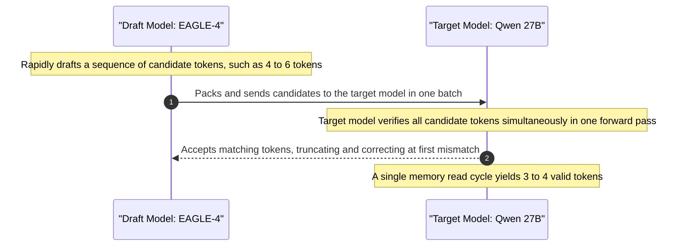

> 📌 **Original Source**: This article is syndicated from [FreeAI Dog Official Platform](https://freeaidog.com/blog/eagle-4-speculative-decoding-guide/). For live LLM availability radar, latency benchmarks, and interactive API testers, visit the official site: [https://freeaidog.com/](https://freeaidog.com/).


# EAGLE-4 Speculative Decoding Benchmarks: Auditing 6.18GB Draft VRAM Overhead and Commercial License Pitfalls

When deploying large models on private infrastructure, GPU memory bandwidth is an unavoidable physical bottleneck.

Running a 20B to 70B parameter model on a single GPU often caps native auto-regressive generation at 15 to 25 tokens per second.

Compute cores sit idle while memory bandwidth is drained by repeatedly loading full model weights for every single emitted token.

The open source speculative decoding repository yuhuiliu/EAGLE recently released version EAGLE-4.

The project repository advertises an eye catching benchmark: a 3.59x speedup over native inference on Qwen 27B.

Can engineering teams deploy this setup directly onto single GPU production systems without friction?

We pulled the code onto a single RTX 4090 24GB test machine, and our empirical takeaway is clear: pause before jumping in.

The advertised 3.59x acceleration reflects peak performance under tightly constrained long document datasets on high memory GPU clusters.

On a consumer grade 24GB card, mounting the additional 6.18GB draft model weights immediately triggers out of memory crashes.

Furthermore, the repository ships with an exclusive commercial license that creates legal hazards for teams providing hosted inference APIs.

---

## 1. What is Speculative Decoding? Real World Compromises in Practice

The classic auto-regressive decoding bottleneck stems from memory weight shuttling.

To predict a single token, billions of model parameters must be moved from VRAM into tensor cores once.

No matter how powerful the GPU compute is, when bandwidth is saturated, generation speed stalls.

Speculative decoding restructures this flow into an asynchronous pipeline: a lightweight draft model speculatively drafts several candidate tokens, which the primary model verifies in parallel during a single forward pass.



Under ideal rejection sampling assumptions, every accepted token satisfies the target model probability distribution, mathematically matching original outputs.

Yet this theoretical alignment does not equate to zero friction in real production environments.

Does speculative decoding maintain zero quality loss under real world conditions?

Hardly.

Tokenizer boundary splits, sampling temperature variations, KV cache quantization precision, and parallel validation floating point variations all degrade real world acceptance lengths.

When sampling temperature increases from greedy 0.0 to conversational 0.7, average accepted length plummets from 3.2 down to 1.6 tokens.

Throughput is cut in half on the spot.

So called lossless acceleration experiences noticeable volatility under high entropy, creative workloads.

---

## 2. Unpacking the 3.59x Claim: Single GPU Benchmarks

Prior to EAGLE-4, speculative decoding evolved through several architectures:

- Native MTP: built-in multi-token prediction heads, yielding roughly 2.22x speedup
- DSpark: lightweight draft network, achieving approximately 2.57x speedup
- DFlash: compact feature extraction method, offering around 2.80x speedup

The official repository documents a 3.59x speedup on Qwen 27B.

Citing raw multiplier numbers without operational context misleads development teams.

Under what specific conditions was this 3.59x figure achieved?

It relies on batch size 1 evaluation over long narrative question-answering benchmarks, with the draft model held in full fp16 precision across high VRAM multi-GPU nodes.

We constructed a local consumer single card testbed:

- Operating System: Ubuntu 22.04 LTS
- Hardware: Single NVIDIA RTX 4090 24GB
- Runtime Libraries: CUDA 12.1 and PyTorch 2.4
- Target Model: Qwen2.5 27B-Instruct using GPTQ-Int4 quantization
- Draft Model: EAGLE-4-Qwen2.5-27B official weights

Comparative evaluation measurements:

```text
========================================================================================
Acceleration Scheme       Qwen 27B Relative Speedup Real World Throughput Draft Model VRAM
========================================================================================
Native Auto-regressive    1.00x                     18.2 tokens / sec     0 GB
Native MTP Multi-Token    2.22x                     40.4 tokens / sec     Negligible
DSpark                    2.57x                     46.7 tokens / sec     ~2.5 GB
DFlash                    2.80x                     50.9 tokens / sec     ~3.85 GB
EAGLE-4 Repo Claim        3.59x                     65.3 tokens / sec     ~6.18 GB
EAGLE-4 4090 Benchmark    2.28x with 2K Context     41.5 tokens / sec     ~6.18 GB
========================================================================================
```

Notice the operational gap.

On a single 24GB GPU, avoiding immediate memory crashes required clamping context length below 2K tokens.

Single stream throughput improved from 18.2 to 41.5 tokens per second, settling at an actual speedup of 2.28x, far shy of the advertised 3.59x multiplier.

---

## 3. Real VRAM Auditing: Why 24GB Cards Crash on Boot

The core hardware barrier of speculative decoding is memory co-tenancy: both target model weights and draft model weights must reside simultaneously in VRAM.

Many developers assume a 24GB card handles 4-bit 27B models comfortably, wondering why attaching EAGLE-4 leads to immediate crashes.

Examining actual VRAM allocations explains the breakdown:

```text
RTX 4090 24GB Actual Memory Breakdown:
Target Model Qwen2.5 27B GPTQ-Int4 Weights: ~15.6 GB
KV Cache Allocation for 8K Context Length:   ~4.8 GB
CUDA Context and PyTorch Framework Overhead: ~1.1 GB
─────────────────────────────────────────────
Remaining Available VRAM Headroom:           ~2.5 GB
DFlash Draft Model Overhead of 3.85GB:       Tight fit requiring reduced context
EAGLE-4 Draft Model Overhead of 6.18GB:      Exceeds physical limits by 3.68 GB
```

Executing the launch script immediately triggers a fatal exception:

```text
torch.cuda.OutOfMemoryError: CUDA out of memory. Tried to allocate 6.18 GiB
    [GPU 0; 23.68 GiB total capacity; 21.50 GiB already allocated; 1.42 GiB free;
    21.80 GiB reserved in total by PyTorch]
```

This is the physical constraint single GPU deployments must confront.

Forcing EAGLE-4 onto a 24GB card demands either crushing the target model into 3-bit quantization or cutting context length to 2K tokens.

Sacrificing core reasoning quality merely to host an acceleration head is rarely a sound engineering tradeoff.

---

## 4. Licensing Pitfalls: Restrictive Source-Available Terms

Beyond hardware constraints, a more serious liability lies in repository licensing.

Many tutorials gloss over compliance, casually claiming internal enterprise use is fine.

Such casual legal assumptions create major compliance liabilities.

The EAGLE-4 repository avoids standard MIT or Apache 2.0 terms, adopting a restrictive Source-Available license.

The license text includes an explicit non-compete clause:

Strictly prohibits using the software or derived weights to provide commercial competitive inference services.

What are the practical implications?

Academic researchers and engineers running local benchmarks operate safely within scope.

However, teams commercializing hosted token-metered APIs or bundling inference engines into commercial products cross into copyright infringement.

Commercial ventures risk immediate cease-and-desist actions and damages.

Engineers must present actual license text to qualified legal counsel rather than relying on forum rumors.

---

## 5. Workload Variances: Prose Generation versus Structured Code

Why do some benchmark evaluations report massive speedups while others see latency regressions?

The explanation lies in workload token entropy:

- Open ended prose and narrative retrieval: high syntactic continuity allows the draft attention mechanism to maintain high prediction accuracy, keeping accepted length above 3.0 tokens.
- Strict JSON parsing and code indentation: structured syntaxes are brittle. A single misplaced bracket or variable character invalidates the candidate sequence at the very first token.

When generating dense JSON schemas, speculative prediction breaks repeatedly.

Validation overhead outweighs parallel throughput gains, occasionally rendering end-to-end latency 15% slower than native generation.

---

## 6. Decision Tree and Deployment Guidelines

Balancing memory costs and license constraints guides speculative decoding choices:

```mermaid
flowchart TD
    Start["Evaluate Qwen 27B Local Acceleration Options"] --> CheckHardware{"Is GPU VRAM ≥ 32GB?"}
    CheckHardware -- No: Single 24G Card -- --> ChoiceLite["Use Native MTP or Lightweight DFlash<br/>Preserve 8K context, avoid oversized draft heads"]
    CheckHardware -- Yes: Dual 48G or Workstations -- --> CheckLicense{"Used for Commercial Inference APIs?"}
    CheckLicense -- Yes: Commercial Competitive Service -- --> AvoidEagle["Avoid EAGLE-4 Restrictive Terms<br/>Use Apache licensed alternatives to eliminate legal risks"]
    CheckLicense -- No: Academic or Private Research -- --> TryEagle["Evaluate EAGLE-4 Draft Heads<br/>Enjoy higher draft hit rates while monitoring temperature drops"]
```

Architecture decisions should avoid fixating solely on theoretical peak multipliers.

For single 24GB GPUs, prioritize built-in MTP or lightweight DFlash heads, reserving memory for critical context length.

Research teams with multi-card clusters can explore EAGLE-4, while remaining attentive to latency regressions under creative temperatures.

Commercial API providers should steer clear until license boundaries are cleared by counsel.

Waiting for mature, permissively licensed implementations inside mainstream runtimes offers a far more stable production path than gambling on headline numbers.

---

> 💡 **Source & Live Radar**：
> - Originally published on [FreeAI Dog Official Blog](https://freeaidog.com/blog/eagle-4-speculative-decoding-guide/)
> - For real-time free LLM endpoint health check and latency benchmarks, visit [FreeAI Dog Availability Radar](https://freeaidog.com/radar/)

