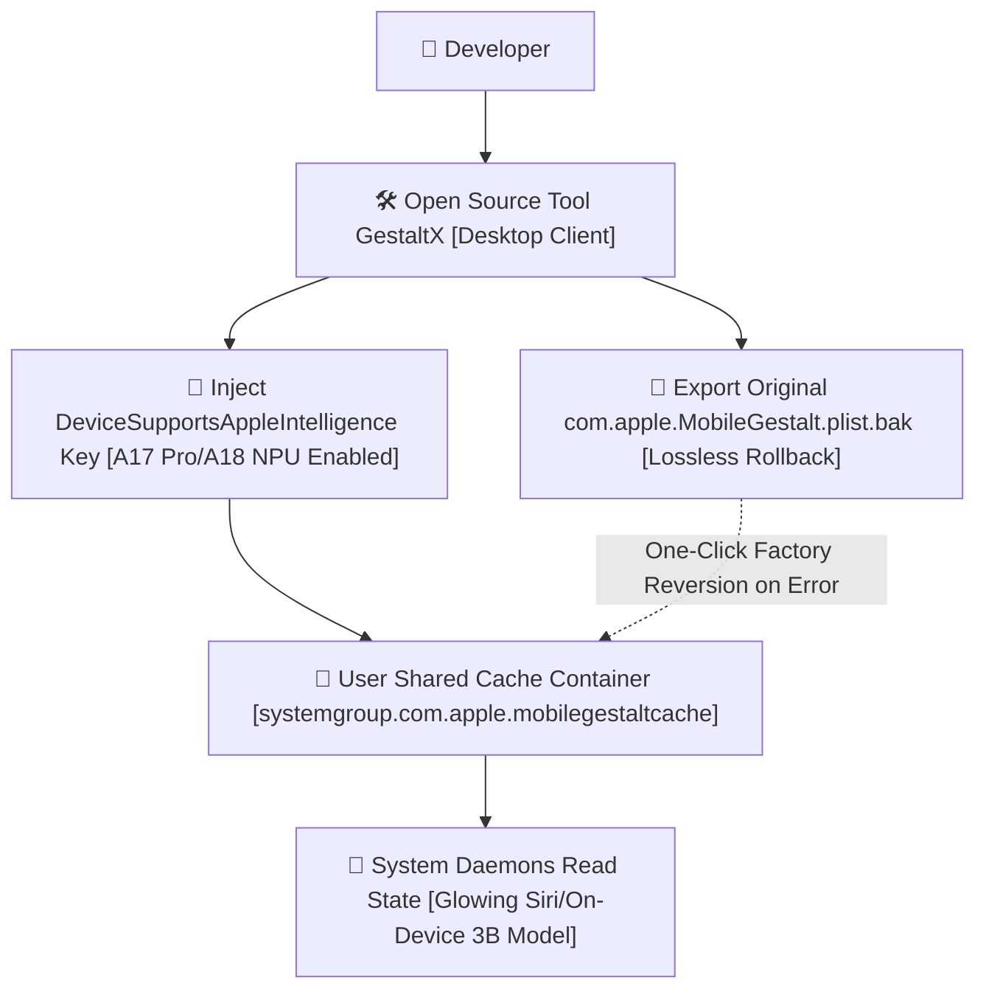

> 📌 **Original Source**: This article is syndicated from [FreeAI Dog Official Platform](https://freeaidog.com/blog/gestaltx-iphone-apple-intelligence-unlock-guide/). For live LLM availability radar, latency benchmarks, and interactive API testers, visit the official site: [https://freeaidog.com/](https://freeaidog.com/).

# Zero-Jailbreak Lossless Restore: Hands-on Guide to Unlocking On-Device Apple Intelligence on Region-Locked iPhones with GestaltX

Holding a mainland China edition iPhone 15 Pro or iPhone 16 reveals zero traces of Apple Intelligence or the glowing Siri interface in Settings. The 16-core Neural Engine on the A17 Pro and A18 dies boasts 35 TOPS of compute, yet sits completely idle during everyday texting and browsing. Full price paid for hardware, compute wasted——who enjoys seeing that?

The hardware is fully capable; the capability flag inside `MobileGestalt` is simply set to false. The on-device 3B parameter model weights already reside inside the system image; loading prerequisites simply remain unfulfilled.

Many assume modifying low-level flags requires a jailbreak. Is jailbreaking worthwhile? Clearly not. Modern banking apps and enterprise tools immediately trigger fraud warnings or ban accounts upon detecting jailbreak artifacts. A daily driver cannot tolerate that disruption.

This approach did not originate here. The iOS modification community has long manipulated MobileGestalt caches, and `worse_query` provides one viable pathway [requiring specific firmware environments, not universal across all builds].

GestaltX adds a graphical desktop wrapper with automated backup and restore capabilities, hosted on GitHub at `huamidev/GestaltX`. Check the release notes and issue tracker beforehand to confirm your exact iOS minor build is supported; avoid compiling master blindly.

The underlying principle remains straightforward: leave the read-only SSV partition untouched, patch only the hardware cache inside the user-writable container, and retain the ability to restore cleanly at any moment.

## Why Can This Run Without a Jailbreak?

Apple introduced the Signed System Volume SSV in iOS. The root operating system volume is cryptographically sealed; altering even a single byte triggers signature failure and an immediate bootloop. Who wants that catastrophe? Nobody does.

However, `com.apple.MobileGestalt.plist` does not live inside the read-only root volume. Its physical location resides inside a shared user container:

`/var/containers/Shared/SystemGroup/systemgroup.com.apple.mobilegestaltcache/Library/Caches/`

During boot or SpringBoard restarts, system daemons read hardware identity labels from this userland cache file first.

Flags checked include Always-On display eligibility, Dynamic Island availability, and on-device Apple Intelligence capability.

Modifying this file leaves firmware uncorrupted and bootloaders untouched. It alters a single plist configuration tag, preserving an escape hatch to revert safely.

## Absolute Safety Rule: Never Alter Model Identifiers

The fatal mistake when editing MobileGestalt is clumsily replacing the entire device model identifier string.

Certain tutorials advocate swapping mainland model `A3104` with US model `A2848`. Upon reboot, Face ID biometric checks fail and cellular connectivity drops completely to No Service. Why? Dual physical SIM hardware utilizes radically different baseband calibration tables compared to single-SIM eSIM boards. Altering device identifiers breaks baseband firmware loading, turning your device into an expensive paperweight.

The correct approach edits solely the capability feature boolean while leaving hardware model strings intact.

GestaltX enforces safety by creating a timestamped `.plist.bak` snapshot before writing any modified payload. If unexpected anomalies occur, connect the device and execute a one-click restore to regain factory state immediately.

## Four-Step Implementation Workflow

Prepare a reliable USB cable, connect to your computer, and follow these steps.

### Step 1: Hardware and Account Prerequisites

Hardware compatibility is strict: devices must feature A17 Pro or A18 silicon. This includes iPhone 15 Pro, iPhone 15 Pro Max, all iPhone 16 variants, or M-series iPads. Standard iPhone 15 or older generations lack requisite unified memory and NPU throughput; modifying keys on those devices accomplishes nothing.

Operating system requirement: update to an iOS build that incorporates Apple Intelligence binaries.

Language and regional settings: set system language to English [United States], region to United States, and sign in to the App Store with an overseas Apple ID. This prevents cloud initialization services from dropping backend provisioning.

### Step 2: Establish Connection and Export Baseline Snapshot

Download the GestaltX desktop binary, connect the iPhone via cable to your Mac or Windows PC, and trust the computer prompt.

Launch GestaltX and click `Backup MobileGestalt`.

Verify that a backup file measuring tens of kilobytes appears inside the target directory. Ensure this backup rests securely on disk before proceeding——rushing ahead without a backup invites disaster.

### Step 3: Inject Capability Flags and Channel Inspection

The writing phase is where attempts encounter friction. Standard AFC protocols only access application sandboxes, unable to touch `systemgroup.com.apple.mobilegestaltcache`. GestaltX accomplishes this through an auxiliary service channel [inspect repository documentation, as specific service identifiers vary across iOS major releases].

Test on non-critical hardware first. Watch the terminal log for a `write ok` confirmation receipt; never disconnect the cable prematurely. During my initial setup, execution stalled at `handshake`, resolving smoothly upon replugging. Not every run succeeds on the first attempt.

Locate the `Apple Intelligence & Siri` option within the panel. The tool maps the obfuscated key `h9jDsbgj7xIVeIQ8S3`, which corresponds to `DeviceSupportsAppleIntelligence`, setting its value to `true`.

Check `Regional Features` if desired, then click `Apply Changes`.

### Step 4: Reboot and Load On-Device Model Weights

Disconnect the cable, perform a standard power-down, and boot up the device.

Open Settings and navigate to `Apple Intelligence & Siri`, where the toggle now appears unlocked.

Tap to join the waitlist, which typically approves within minutes. Connect to Wi-Fi to allow background downloading of the approximately 2.6GB on-device foundation model weights.

How do you verify whether processing runs locally or routes through cloud servers?

Enable Airplane Mode, remove the SIM, and turn off Wi-Fi. Hold the power button to summon Siri and request a summary of local notes. The colorful border animation fires normally, rendering text summaries within milliseconds. This confirms the A17 Pro Neural Engine runs inference completely offline.

## Practical Edge Cases and Operating Boundaries

Three operational nuances require explicit disclosure:

First, on-device models run entirely offline, but Private Cloud Compute PCC strictly inspects network routing. Routine summarization and drafting occur locally; complex tasks escalated to cloud clusters will fail if connections originate from mainland IP ranges.

Second, OTA system updates overwrite the cache. Major updates or minor security patches regenerate the `MobileGestalt` cache file, wiping custom keys. When toggles disappear following an update, do not panic. Reconnect to GestaltX and apply the patch again without wiping the device. Testing through an 18.1 minor patch confirmed this re-application works reliably.

Third, the rollback procedure: if UI glitches appear or experimentation concludes, connect to GestaltX, select `Restore from Backup`, write back `.plist.bak`, and reboot. The operating system reverts to factory configuration without impacting warranty status.

For developers with iPhone 15 Pro or iPhone 16 hardware, how frequently does your Neural Engine see real workloads? Share your experience and benchmark observations in the community.

---

> 💡 **Source & Live Radar**：
> - Originally published on [FreeAI Dog Official Blog](https://freeaidog.com/blog/gestaltx-iphone-apple-intelligence-unlock-guide/)
> - For real-time free LLM endpoint health check and latency benchmarks, visit [FreeAI Dog Availability Radar](https://freeaidog.com/radar/)

