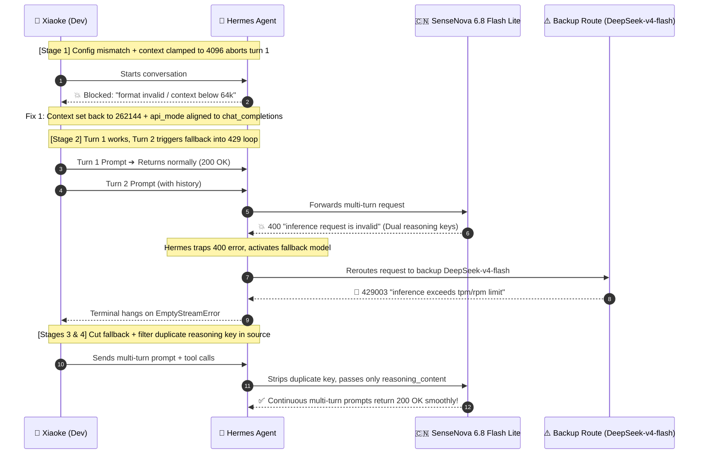
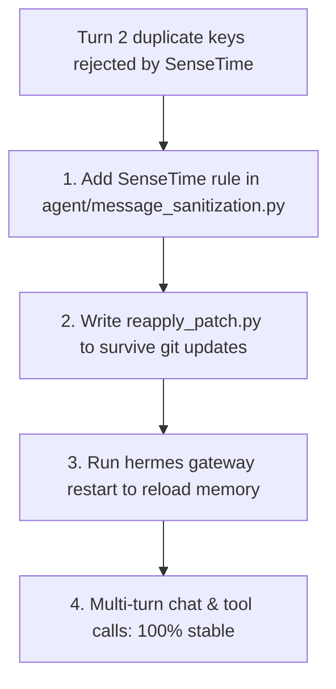

> 📌 **Original Source**: This article is syndicated from [FreeAI Dog Official Platform](https://freeaidog.com/blog/hermes-agent-sensenova-400-reasoning-fix/). For live LLM availability radar, latency benchmarks, and interactive API testers, visit the official site: [https://freeaidog.com/](https://freeaidog.com/).


# Hermes Agent Broken After Update? How I Fixed the 400 Bad Request, Rogue 429 Failover, and Duplicate Reasoning Fields

I've been using Nous Research's **Hermes Agent** as my daily driver, hooked up to **SenseTime SenseNova 6.8 Flash Lite** as the primary backend. With generous free tokens, a 256K context window, and rock-solid throughput, it's usually been a joy to run.

Until today. Right after running `hermes update`, things spiraled into a cascade of weird bugs:
1. **Broken from step zero**: Any prompt immediately triggered `HTTP 400: inference request is invalid`—it couldn't even start turn one;
2. **The rogue failover backstab**: After fixing basic configs, turn one answered cleanly. But on turn two, Hermes quietly swapped the model behind my back to DeepSeek, immediately choking on platform concurrency limits with an infinite `HTTP 429` freeze;
3. **Tracking down the real culprit**: Stripping the fallback model showed that turn two still failed with 400 on SenseNova. Testing isolated JSON payloads revealed the culprit: Hermes was injecting *both* `reasoning` and `reasoning_content` into multi-turn history, and SenseTime strictly rejects duplicate reasoning keys;
4. **Permanent patch**: One line of domain-specific sanitization in the Hermes source code, an auto-patching script to survive future updates, and a quick gateway restart solved it once and for all.

Here are my unfiltered troubleshooting notes and the exact fix so you don't have to waste hours on the same trap.

---

## The Incident Timeline

Here is the full interaction flow showing how each error triggered the next:



---

## Trap 1: Dead on Arrival Right After Update

### The Error
Right after running the update, typing any prompt brought up this error:

```text
AI service rejected request format
custom does not accept the construction of this request.
HTTP 400: inference request is invalid
```

Checking the diagnostic log showed an even more specific failure:
```text
ValueError: Model sensenova-6.8-flash-lite has a context window of 4,096 tokens, which is below the minimum 64,000.
```

### What Happened & Fix
Checking `~/.hermes/config.yaml`, the update had reset parts of the config template:
1. **Context clamped to 4096**: `model.context_length` was reset to `4096`. Hermes demands at least 64K context for its agent loop and refuses to run with 4096. SenseNova actually supports **262,144 (256K)**;
2. **Conflicting API modes**: `providers.custom.api_mode` was set to `anthropic_messages` while the root was `chat_completions`, corrupting the request structure;
3. **Stale fallback target**: The old fallback `deepseek-v4.1-flash` was deprecated on the relay, returning 403.

**Quick fix**:
- Set `model.context_length: 262144`;
- Set `providers.custom.api_mode: chat_completions`;
- Swapped fallback temporarily to `deepseek-v4-flash`.

---

## Trap 2: Turn 1 Worked, but Turn 2 Silently Swapped Models into a 429 Storm

With the config sorted out, I started a new session. **Turn one returned instantly and looked great.**

Then came turn two. As soon as I pressed Enter, Hermes silently switched to DeepSeek and dumped a wall of 429 errors:

```text
AI service busy
custom is rate limiting requests. Please wait and retry.
HTTP 429003: inference exceeds tpm/rpm limit
```

I manually switched back to SenseNova with `/model`, sent another prompt, and watch Hermes flip straight back to DeepSeek and crash again.

### Digging into the Timestamps
The log showed what was actually happening under the hood:
```text
18:22:46  sensenova-6.8-flash-lite → HTTP 400 "inference request is invalid"
18:22:46  fallback_providers triggered → auto-failover to deepseek-v4-flash
18:23:53  retry sent → slammed into strict platform concurrency limit (429003 TPM/RPM)
18:24~18:28  3 consecutive empty stream retries (EmptyStreamError), terminal frozen
```

**The chain of events was clear**:
Turn two on SenseNova threw a 400 error. Hermes caught that error and fell back to DeepSeek, which had a tight concurrency quota and immediately throttled.

**First aid**:
I commented out the fallback entirely (`fallback_providers: []`).  
At least that stopped the 429 storm. But the core puzzle remained: **Why does SenseNova always throw a 400 on turn two?**

---

## Trap 3: Isolating the Payload—Why 400 on Turn 2?

Running direct `curl` commands to SenseNova returned 200 OK every time. The API endpoint itself wasn't down.

That meant the bug had to be inside Hermes' multi-turn message payload. I extracted the exact JSON payload from turn two (17 message history items + tools) and tested removing fields one by one:

```bash
# Test 1: Full payload with conversation history ➔ 💥 HTTP 400
# Test 2: Strip previous assistant's reasoning field ➔ ✅ Immediate HTTP 200 OK!
```

Testing combinations of thinking fields made it undeniable:
- Only `reasoning` in assistant message ➔ **200 OK**
- Only `reasoning_content` in assistant message ➔ **200 OK**
- **Both fields present simultaneously ➔ 💥 100% HTTP 400 "inference request is invalid"!**

### Why Did Hermes Send Both?
Since DeepSeek R1 popularized thinking models, different providers have picked different field names (`reasoning` vs `reasoning_content`).  
To maximize compatibility across third-party relays, Hermes' generic `provider: custom` logic simply recorded and echoed back *both* fields.

SenseTime's API gateway is strict: either key is fine, but sending both triggers a schema rejection. And because SenseNova only returns a generic `inference request is invalid` without naming the offending field, Hermes couldn't automatically strip it.

---

## The Fix: Source Patch & Keeping it Persistent

Since duplicate fields are the problem, the fix is straightforward: **keep only a single reasoning key when sending to SenseTime domains.**



### 1. Update Message Sanitization
In Hermes' `agent/message_sanitization.py`, add a domain-specific filter right above the generic custom carrier rules:

```python
# OpenRouter / Vercel rules...
(_ALL_CARRIERS, frozenset({"openrouter", "kilocode", "ai-gateway", "nous"}),
 ("openrouter.ai", "kilo.ai", "ai-gateway.vercel.sh", "nousresearch.com")),

# [Patch] SenseTime rejects dual keys; only allow reasoning_content
(frozenset({RC}), frozenset(), ("token.sensenova.cn", "sensenova.cn")),
```
*(Note: `RC` is Hermes' internal `reasoning_content` constant. This rule only touches `sensenova.cn` and leaves other providers untouched).*

### 2. Auto-Reapply Script
To make sure future `hermes update` calls don't blow away the patch, I dropped an idempotent script at `~/.hermes/scripts/reapply_sensenova_reasoning_patch.py`:

```python
import sys
from pathlib import Path

target_file = Path("agent/message_sanitization.py")
if not target_file.exists():
    sys.exit(0)

content = target_file.read_text(encoding="utf-8")
sensenova_rule = '(frozenset({RC}), frozenset(), ("token.sensenova.cn", "sensenova.cn")),'

if "sensenova.cn" not in content:
    insert_marker = '(_ALL_CARRIERS, frozenset({"openrouter"'
    if insert_marker in content:
        new_content = content.replace(insert_marker, sensenova_rule + "\n    " + insert_marker)
        target_file.write_text(new_content, encoding="utf-8")
        print("✅ SenseNova single-field patch reapplied!")
```

### 3. Restart the Gateway Daemon
Hermes keeps a gateway daemon running in the background. Editing python files won't reload the running process—you have to restart it from an external terminal:
```bash
python3 ~/.hermes/scripts/reapply_sensenova_reasoning_patch.py && hermes gateway restart
```

---

## Verifying the Solution

After restarting the gateway, I ran several test sessions:
1. **Multi-turn conversation**: Tested long, technical queries with full thinking history. **Every single turn returned 200 OK within seconds**—no rogue model switches, no 400 errors;
2. **Tool calling load test**: SenseNova 6.8 handled back-to-back tool execution calls without breaking a sweat.

---

## Key Takeaways

1. **Always restart the gateway after an update**: Agent frameworks often run background daemon processes. Updating files without restarting the daemon leads to weird bugs caused by stale in-memory code;
2. **More fields aren't always better**: Strict enterprise APIs enforce clean request schemas. "Helpful" compatibility wrappers that duplicate fields can easily turn into breaking 400 errors;
3. **Check fallback limits**: If your primary model has a failover configured, make sure the backup has enough concurrency quota to actually handle your workload, or a minor glitch will turn into an all-out 429 freeze.

---

> 💡 **Source & Live Radar**：
> - Originally published on [FreeAI Dog Official Blog](https://freeaidog.com/blog/hermes-agent-sensenova-400-reasoning-fix/)
> - For real-time free LLM endpoint health check and latency benchmarks, visit [FreeAI Dog Availability Radar](https://freeaidog.com/radar/)

