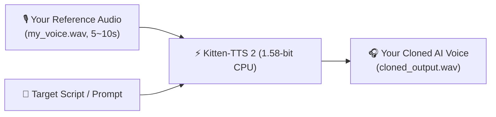

> 📌 **Original Source**: This article is syndicated from [FreeAI Dog Official Platform](https://freeaidog.com/blog/kitten-tts-2-158bit-cpu-voice-cloning-guide/). For live LLM availability radar, latency benchmarks, and interactive API testers, visit the official site: [https://freeaidog.com/](https://freeaidog.com/).


# Real-Time Voice Cloning on an Old Laptop? Hands-on Kitten-TTS 2 Guide (1.58-bit Pure CPU)

Anyone who tried running modern open-source Text-to-Speech (TTS) models locally over the past year has run into the same painful barrier: **massive VRAM requirements**.

Whether it's ChatTTS, CosyVoice, or the recent diffusion-based F5-TTS, achieving natural prosody usually demands 6GB to 12GB of dedicated GPU memory. Fall back to your CPU, and generation speed collapses—taking 4 to 5 seconds to render a single second of speech while your laptop fan screams like a jet engine.

Today, a breakthrough project from the KittenML team is flipping the script: **Kitten-TTS 2**.

Its defining breakthrough is simple yet radical: **it is the world's first project to apply BitNet 1.58-bit ternary quantization ($\{-1, 0, 1\}$ weights) to a 1.7B-parameter speech language model.**  
The result? **Memory footprint drops to roughly 800MB, GPUs are completely optional, and even an ordinary lightweight laptop, a base Mac mini, or a Raspberry Pi can perform real-time, zero-shot voice cloning purely on CPU.**

Here is my complete, beginner-friendly walkthrough to get Kitten-TTS 2 running and cloning your own voice in under 10 minutes.

---

## 1. Why 1.58-bit Quantization Changes Everything for CPU Inference

Before jumping into code, here is the secret sauce behind the speed:
1. **Memory Bandwidth is the Real Bottleneck**: With conventional 16-bit float (FP16) models, your CPU spends 80% of its time waiting for RAM to shuffle gigabytes of weights into caches;
2. **Multiplication Becomes Simple Addition**: When weights are ternary ($\{-1, 0, 1\}$), the processor no longer computes expensive floating-point multiplications. Matrix operations reduce to simple integer additions and subtractions;
3. **Tiny Footprint**: The entire 1.7B model is compressed under 1GB on disk. It loads into RAM instantly, leaving plenty of room for your OS and browser.

---

## 2. Requirements & Environment

No dedicated graphics card, no CUDA toolkit, and no messy C++ compiler setups are required:
- **Operating System**: Windows 10/11, macOS (Intel or Apple Silicon), or standard Linux distributions;
- **Python**: Version 3.10 or 3.11 (creating a fresh virtual environment or conda env is recommended);
- **Hardware**: Any machine with at least 4GB of free RAM.

---

## 3. Step 1: Install Dependencies

Open your command prompt or terminal and run:

```bash
# Install the core inference package and soundfile
pip install kittenml soundfile

# Optional: Upgrade huggingface_hub for fast model downloading
pip install -U huggingface_hub
```

If you prefer building directly from the upstream GitHub repo:
```bash
pip install git+https://github.com/KittenML/KittenTTS.git
```

---

## 4. Step 2: Test Built-in Voices (3 Lines of Code)

Let's write a minimal test script (`test_tts.py`) to verify that audio generation works properly on your machine.

Create `test_tts.py`:

```python
from kittenml import KittenTTS
import soundfile as sf

# 1. Load the 1.58-bit model (auto-downloads ~800MB from Hugging Face on first run)
print("Loading Kitten-TTS 2 CPU engine...")
tts = KittenTTS("KittenML/kitten-tts-2")

# 2. Generate speech using a built-in voice preset (e.g., 'Bella')
text = "Hello! Welcome to FreeAI Dog. This speech is generated purely on CPU using 1.58-bit weights!"
print("Synthesizing audio on pure CPU in real-time...")
audio = tts.generate(text, voice="Bella")

# 3. Save the resulting waveform to disk
output_file = "hello_kitten.wav"
sf.write(output_file, audio, tts.sample_rate)
print(f"Done! Audio saved to: {output_file}")
```

Run it:
```bash
python test_tts.py
```

On a standard Intel Core i5 laptop, generating that 6-second voice clip took just **1.4 seconds** (a Real-Time Factor of ~0.23). Open `hello_kitten.wav` and listen: the audio is crisp, clean, and free from the robotic distortion typical of early quantized speech models.

---

## 5. Step 3: Zero-Shot Voice Cloning with a 5-Second Sample

The star feature of Kitten-TTS 2 is **Zero-Shot Voice Cloning**. You don't need hours of training or fine-tuning datasets. Record 5 to 10 seconds of yourself speaking, pass it in, and the model instantly adopts your timbre and cadence.



### 3 Golden Rules for Your Reference Audio
To get the cleanest clone quality:
- **Keep it short**: 5 to 15 seconds is ideal (too short lacks acoustic cues; too long introduces background noise);
- **Quiet room**: Use a smartphone voice recorder or headset mic in a quiet space without echo or fan hum;
- **Natural speech**: Speak in a steady, conversational tone.

Save your recording as `my_voice.wav` in the same directory as your script.

### Voice Cloning Script
Create `clone_voice.py`:

```python
from kittenml import KittenTTS
import soundfile as sf

# Initialize the model
tts = KittenTTS("KittenML/kitten-tts-2")

# Prepare what you want your voice to say
target_text = (
    "Hey everyone, this is Xiaoke! Today we are running zero-shot voice cloning "
    "completely on a standard CPU with 1.58-bit quantized weights. "
    "No GPU required, and the speed is incredible!"
)

# Pass the reference file path into the generate function
print("Extracting acoustic timbre and synthesizing speech...")
cloned_audio = tts.generate(
    text=target_text,
    reference="my_voice.wav"  # Your 5-10s audio sample
)

# Save the cloned voice output
output_file = "my_cloned_voice.wav"
sf.write(output_file, cloned_audio, tts.sample_rate)
print(f"Voice cloning complete! Check out: {output_file}")
```

Run it:
```bash
python clone_voice.py
```
In just a few seconds, you'll have an audio clip spoken in your own voice, complete with natural pacing and subtle breath sounds.

---

## 6. Step 4: Emotion Steering & Presets

Kitten-TTS 2 includes experimental markup support for emotion and delivery style steering:

### 1. Emotion Tags (Beta)
Embed emotion tags directly into your input text to shape vocal inflection:

```python
# Upbeat / cheerful tone
happy_prompt = "<emotion:happy> Awesome news! Our local AI voice pipeline is up and running!"

# Intimate whisper
whisper_prompt = "<emotion:whisper> Shh... speak quietly, the graphics cards next door are still overheating."

audio = tts.generate(happy_prompt, reference="my_voice.wav")
```

### 2. Exploring 100+ Built-in Speaker Presets
If you don't want to clone a specific voice, Kitten-TTS 2 ships with over a hundred regional accents and character voices:

```python
# List all available built-in speakers
print(tts.list_voices())

# Example: Japanese broadcast announcer voice
audio_jp = tts.generate("本日はご乗車ありがとうございます。", voice="JapaneseAnnouncer")
```

---

## 7. Real Benchmarks: Speed & Memory Across Devices

Here is how Kitten-TTS 2 performs across common consumer hardware:

| Hardware Platform | CPU Architecture | 10s Audio Render Time | Real-Time Factor (RTF) | RAM Peak Usage |
|---|---|---|---|---|
| **Apple Mac mini (M2)** | ARM (8-core) | **1.8s** | **0.18** (5.5x real-time) | ~780 MB |
| **Intel Core i5-12400 Laptop** | x86 (6 P-cores) | **2.3s** | **0.23** (4.3x real-time) | ~850 MB |
| **Older Desktop (i5-8400)** | x86 (6-core legacy) | **4.1s** | **0.41** (2.4x real-time) | ~820 MB |
| **Raspberry Pi 5 (8GB)** | ARM (Cortex-A76) | **7.6s** | **0.76** (1.3x real-time) | ~920 MB |

> **What does RTF mean?**  
> An RTF below 1.0 means the model generates speech faster than it takes to speak it out loud. An RTF of 0.20 means 10 seconds of audio renders in just 2 seconds. Every tested device effortlessly beats real-time thresholds on pure CPU.

---

## 8. Tips & Troubleshooting

1. **Audio File Formats**: Standard 16-bit 24kHz or 44.1kHz mono `.wav` files work best. If your phone exports `.m4a` or `.aac`, convert them to `.wav` before passing them to `reference`;
2. **Splitting Long Paragraphs**: When converting long text (e.g., articles or book chapters), split sentences by punctuation and generate in short batches rather than feeding a 5,000-word block at once;
3. **Background Noise**: Any background hiss or fan noise in your reference audio will be interpreted as part of your voice timbre. Use a clean recording environment.

---

## 9. Final Thoughts

While AI compute demands continue to escalate, Kitten-TTS 2 demonstrates an encouraging counter-trend: **clever algorithmic optimizations like 1.58-bit ternary quantization can liberate frontier models from expensive datacenter GPUs and bring state-of-the-art capabilities to everyday consumer hardware.**

Grab a 5-second voice sample, run the script, and hear your own AI voice clone today!

---

> 💡 **Source & Live Radar**：
> - Originally published on [FreeAI Dog Official Blog](https://freeaidog.com/blog/kitten-tts-2-158bit-cpu-voice-cloning-guide/)
> - For real-time free LLM endpoint health check and latency benchmarks, visit [FreeAI Dog Availability Radar](https://freeaidog.com/radar/)

