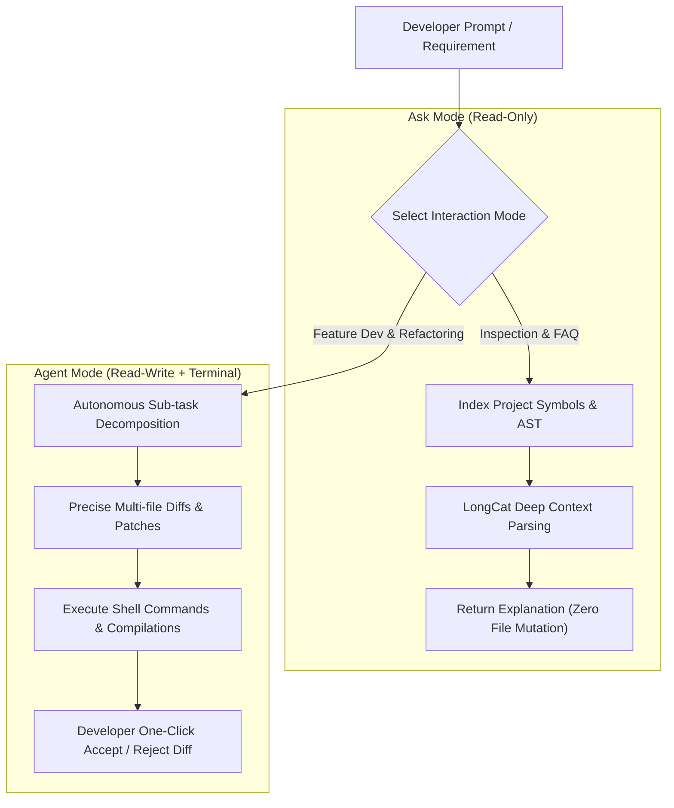

> 📌 **Original Source**: This article is syndicated from [FreeAI Dog Official Platform](https://freeaidog.com/blog/meituan-catpaw-longcat-ai-ide-complete-guide/). For live LLM availability radar, latency benchmarks, and interactive API testers, visit the official site: [https://freeaidog.com/](https://freeaidog.com/).


# A New Heavyweight AI IDE! Meituan CatPaw & LongCat Complete Guide: Agent Modes, NextEdit, In-IDE Live Preview & Daily Free Token API Quota

In the modern landscape of AI-assisted software engineering, platforms like **Cursor, Claude Code, and Windsurf** have set the benchmark for agentic code manipulation. However, for many indie developers, students, and engineering teams, the recurring **\$20/month fee**—combined with overseas payment barriers and connectivity latency—remains a persistent pain point.

While many tech giants have released AI code completion extensions, most are constrained to single-line tab suggestions or simple sidebar chat dialogs. Few offer the true agentic power needed to plan multi-file modifications, run terminal commands autonomously, and refactor whole repositories.

Enter **Meituan CatPaw**, an agent-centric standalone AI Integrated Development Environment (IDE) that has been polished inside Meituan across tens of thousands of production engineers, powered natively by its proprietary **LongCat** code and reasoning foundational model.

> [!NOTE]
> CatPaw is not merely a lightweight VS Code wrapper plugin; it is a **standalone, agent-first AI engineering environment**. Deeply integrated with Meituan's proprietary LongCat model, CatPaw has demonstrated industry-leading AI code generation and acceptance rates throughout internal enterprise testing.

Even better: **CatPaw is currently in open public beta with zero waitlist or credit card requirements. Furthermore, Meituan's LongCat open API platform distributes generous quotas of free tokens daily with full OpenAI API compatibility!**

This comprehensive guide unpacks the four killer capabilities of CatPaw and shows you how to harness LongCat's free compute for your daily development workflows.

---

## 1. Why CatPaw Matters: 4 Breakthrough Features

Unlike conventional code chat tools, CatPaw introduces targeted innovations tailored to real-world engineering workflows:

### 1. True Human-Agent Symbiosis: Ask Mode vs. Agent Mode
CatPaw establishes a clear functional separation between read-only inquiry and autonomous project modification:
* **Ask Mode (Read-Only Diagnostics)**:
  Ideal for deciphering legacy codebases, inspecting complex microservice dependency topologies, or debugging console tracebacks. It scans project contexts without modifying a single line of your source code.
* **Agent Mode (Autonomous Task Execution)**:
  When given high-level prompts like *"Refactor this navigation component using Tailwind CSS and Lucide icons, including dark mode support"*, the Agent breaks down the task, queries global stylesheets, modifies multiple related source files concurrently, executes terminal verification tests, and stages transparent diffs.



### 2. NextEdit: Intent-Aware Predictive Completion
Standard AI code completions only anticipate tokens right behind your current cursor. CatPaw incorporates Meituan's cutting-edge **NextEdit** predictive mechanism:
* When you add a new attribute (`e.g., age`) to `UserEntity.ts` and switch tabs to `UserDTO.ts`, CatPaw immediately predicts the corresponding mapping update and highlights the target line.
* It supports multi-location linked prediction edits, allowing developers to review and accept interconnected changes with rapid `Tab` strokes.

### 3. Frontend Superpower: In-IDE Live Web Preview & Visual Box Selection
Frontend developers traditionally toggle endlessly between their editor and Chrome. CatPaw embeds a sandboxed browser environment directly within the IDE:
* Once your Vite, Next.js, or Vue dev server starts, a live web preview pane opens immediately.
* **Visual Select & Edit**: Draw a rectangular box over an unaligned button or styled card in the preview window, press shortcut, and state: *"Make this button floating with rounded-xl corners"*. The Agent maps the visual node back to its JSX/CSS component and applies the diff.
* **Console Traceback Streaming**: Runtime React errors or unhandled promise rejections in the sandbox preview can be forwarded to the Agent with a single click for instant remediation.

### 4. Native Model Context Protocol (MCP) & Rules Customization
* **Project Rules (`.catpawrules`)**: Enforce architectural guidelines (e.g., *"Strict TypeScript only, all API queries must use the centralized Axios interceptor"*). The Agent treats these rules as uncompromised guardrails.
* **MCP Integration**: CatPaw natively supports Anthropic's **MCP (Model Context Protocol)**, letting developers attach local SQLite databases, Git log search tools, Figma design schemas, or external web search engines effortlessly.

---

## 2. Under the Hood: LongCat Model & Daily Free Token Quota

Beyond the CatPaw IDE desktop app, Meituan also offers external API access to its foundational **LongCat** model suite via [longcat.chat/platform](https://longcat.chat/platform/):

| Model Name | Architecture & Purpose | Daily Free Quota | Ideal Workload |
|---|---|---|---|
| **LongCat-Flash-Lite** | Ultra-low latency lightweight model | **10M+ Tokens Daily Free** | Real-time inline tab completion, syntax checks |
| **LongCat-Flash-Chat** | General coding & dialog engine | **Shared Millions of Tokens Daily** | Engineering Q&A, docstring generation, unit tests |
| **LongCat-Flash-Thinking** | Deep reasoning & long-chain reflection | **Dedicated Daily Free Quota** | Complex system design, bug root cause isolation |

> [!TIP]
> **Daily Quota Reset Rules**:
> 1. Free tokens **refresh daily at 00:00 UTC+8 (midnight Beijing time)**;
> 2. Unused daily allocations do not roll over, but your quota resets completely every 24 hours;
> 3. Verified via mobile authentication without needing credit card details, eliminating hidden charge risks!

---

## 3. Practical Setup: Connect LongCat API to External AI Tools

If you wish to use LongCat models inside **Claude Code, Cursor, Cline, or OpenCode**, follow these 3 straightforward steps:

### Step 1: Generate Your LongCat API Key
1. Go to the Meituan LongCat Platform: [longcat.chat/platform](https://longcat.chat/platform/);
2. Sign in, navigate to **API Keys** on the sidebar;
3. Click **Create Key**, assign a label (e.g., `Cline-Production`), and copy the `sk-...` token.

### Step 2: Use OpenAI-Compatible Endpoints
The platform adheres strictly to the OpenAI REST specification:
* **Base URL**:
  ```
  https://api.longcat.chat/openai
  ```
* **API Key**: Your generated `sk-...` key
* **Supported Models**: `longcat-flash-lite`, `longcat-flash-chat`, `longcat-flash-thinking`

### Step 3: Python SDK Sample Invocation
```python
import os
from openai import OpenAI

client = OpenAI(
    api_key="sk-your-longcat-api-key-here",
    base_url="https://api.longcat.chat/openai/v1"
)

response = client.chat.completions.create(
    model="longcat-flash-chat",
    messages=[
        {"role": "system", "content": "You are a senior systems engineer specializing in high-concurrency architectures."},
        {"role": "user", "content": "Write a distributed rate limiter in Go using Redis redlock and token bucket algorithms."}
    ],
    temperature=0.3
)

print(response.choices[0].message.content)
```

---

## 4. Hands-On: Building Features with CatPaw IDE

### 1. Download & Installation
1. Visit the official portal: [catpaw.meituan.com](https://catpaw.meituan.com/);
2. Download the installer for your OS (macOS Apple Silicon/Intel, Windows 10/11);
3. Run the installer and sign in via SMS code verification.

### 2. Feature Walkthrough: Refactoring a Kanban Board in 10 Minutes
1. Open your frontend repository and switch to **Agent** mode;
2. Enter the prompt:
   > *"Analyze src/components/Kanban. Implement drag-and-drop card reordering using native HTML5 Drag and Drop API. Keep existing Tailwind styles and do not install third-party libraries."*
3. **Inspect the Agent Execution**:
   * CatPaw loads `Kanban.tsx` and related typings;
   * Generates diff previews with clear green additions and red deletions;
   * Review changes line-by-line and click **Accept All**;
4. **Live In-IDE Verification**: Test card dragging directly in the embedded preview pane and transmit any console glitches directly back to the Agent.

---

## 5. Comparative Matrix: CatPaw vs. Competitors

| Feature Matrix | Meituan CatPaw | Cursor (Pro) | ByteDance Trae | Alibaba Lingma |
|---|---|---|---|---|
| **Subscription Cost** | **Free Public Beta** | \$20 / month | Free Beta | Free Tier / Paid Enterprise |
| **Network Reliability** | Direct domestic & global CDNs | Overseas network required | Direct connection | Direct connection |
| **Foundational Model** | Proprietary LongCat Suite | Claude 3.5 Sonnet / GPT-4o | Claude 3.5 Sonnet / GPT-4o | Qwen LLM Suite |
| **Autonomous Agent** | Comprehensive multi-file agent | Industry-leading global agent | Multi-file execution | Moderate (single-file focus) |
| **NextEdit Prediction** | ✅ Deep multi-point prediction | ✅ Copilot++ prediction | 🟡 Basic inline guessing | ❌ Basic autocompletion |
| **In-IDE Web Preview** | ✅ Live preview + visual edit | ❌ Requires extensions | ❌ External browser switch | ❌ No built-in browser |
| **MCP Toolchain** | ✅ Native protocol support | ✅ Native protocol support | 🟡 Limited | ❌ Not available |
| **Stand-alone Free API** | ✅ Daily renewable free tokens | ❌ No standalone API | ❌ No standalone API | ✅ Model Studio free tokens |

---

## 6. Frequently Asked Questions (FAQ)

### Q1: Does CatPaw require local GPU acceleration?
**A**: Not at all. All heavy model inferencing runs on Meituan's cloud clusters. The local desktop app is a lightweight Electron-based environment that runs smoothly on standard laptops.

### Q2: Is proprietary enterprise code secure from training data leaks?
**A**: Meituan adheres to standard enterprise compliance policies. Transmission uses end-to-end TLS encryption, and Meituan explicitly states that private repository code is not ingested into public base-model training sets.

### Q3: Why doesn't NextEdit activate on empty projects?
**A**: NextEdit learns from immediate developer editing patterns. Once you edit a function argument or refactor a type definition, the prediction engine collects sufficient behavioral signals and begins accurately anticipating subsequent edits.

---

## 7. Summary

Meituan CatPaw is more than another corporate coding tool—it brings **agentic multi-file refactoring, in-IDE visual web editing, and generous daily free tokens** to every developer without overseas friction.

Check out the public beta today:
* 🎯 **CatPaw IDE Download**: [catpaw.meituan.com](https://catpaw.meituan.com/)
* 🔑 **LongCat LLM Platform**: [longcat.chat/platform](https://longcat.chat/platform/)

---

> 💡 **Source & Live Radar**：
> - Originally published on [FreeAI Dog Official Blog](https://freeaidog.com/blog/meituan-catpaw-longcat-ai-ide-complete-guide/)
> - For real-time free LLM endpoint health check and latency benchmarks, visit [FreeAI Dog Availability Radar](https://freeaidog.com/radar/)

