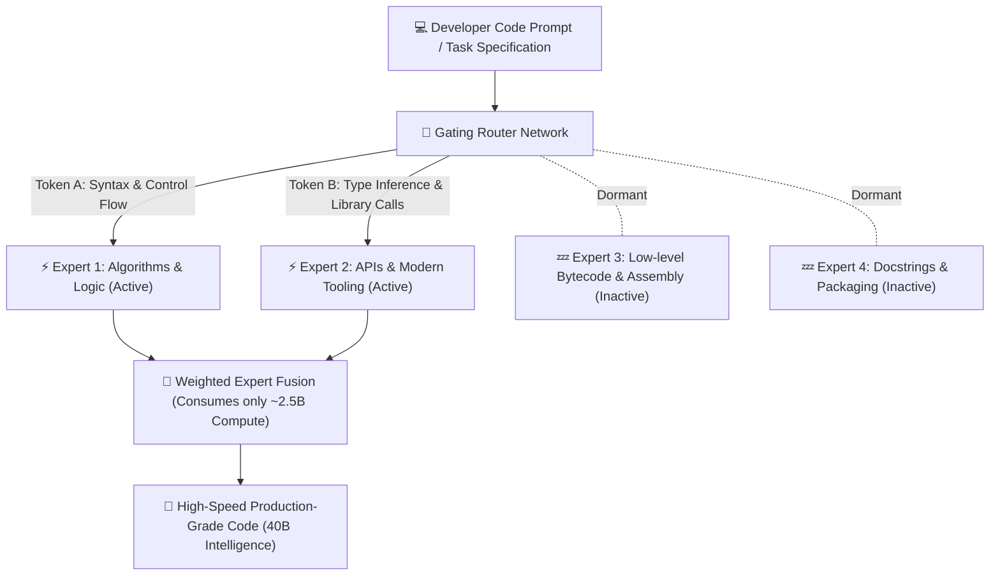
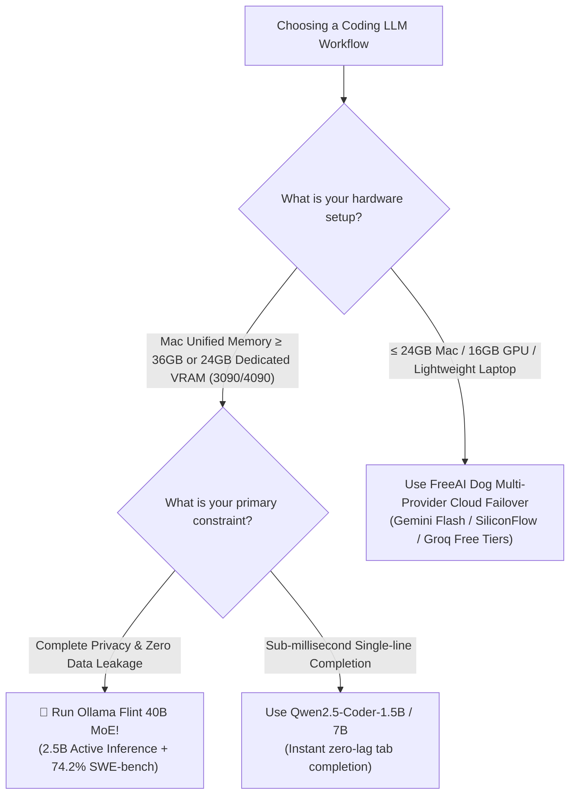

> 📌 **Original Source**: This article is syndicated from [FreeAI Dog Official Platform](https://freeaidog.com/en/blog/ollama-flint-40b-moe-coding-guide/). For live LLM availability radar, latency benchmarks, and interactive API testers, visit the official site.


# Ollama v0.40.8 Launches Recursive Flint: Run 40B MoE (2.5B Active) Locally in 1 Command (SWE-bench 74.2%)

> **Executive Summary**: When running coding models locally, developers have historically faced an inescapable trilemma:  
> - **7B/8B Small Models**: Lightning fast, but easily hallucinate on multi-file dependencies, complex refactors, or subtle type inferences;  
> - **32B/70B Dense Models**: Capable intellect, but crawl along at a frustrating 10~15 tokens/sec on consumer GPUs or MacBooks while devouring all available VRAM;  
> - **Proprietary Cloud APIs**: Powerful, yet expose sensitive proprietary code and remain unreachable in air-gapped or offline development environments.
> 
> Today, **Flint**—developed by Recursive and promptly integrated into **Ollama v0.40.8**—shatters this status quo. Featuring a massive **40B total parameters** but activating **only 2.5B parameters per token**, this Mixture-of-Experts (MoE) coding powerhouse pairs an expansive **262K context window** with a permissive **Apache 2.0 license**. In rigorous benchmark evaluations, it scores a blistering **74.2% on SWE-bench Verified**, decisively outperforming prior community benchmarks like Qwen3.6-35B-A3B.
> 
> A single terminal command: `ollama run flint` transforms your machine into an offline, zero-subscription coding brain.

---

## 1. What is MoE Architecture? Why 40B Total with 2.5B Active is the Endgame for Local Hardware

Traditional LLMs are almost universally **Dense networks**: whether you ask them to generate a simple `for` loop or design a distributed microservices architecture, they activate all 32B or 70B neurons simultaneously. This creates massive computational overhead and severely saturates memory bandwidth.

In contrast, **Flint employs a Mixture-of-Experts (MoE) architecture**, decomposing the network into specialized domain "experts":



### The Key Advantages for Local Developers:
1. **Dramatically Higher Throughput**: Computing only 2.5B parameters per token allows generation speeds comparable to lightweight models (easily achieving 45~60 t/s on Apple Silicon or RTX 40-series GPUs);
2. **Comprehensive Knowledge Base**: The 40B parameter reservoir contains vast programming patterns, standard libraries, and frameworks across dozens of languages without the hallucination pitfalls of small models;
3. **262K Long-Context Capacity**: Ingest entire repositories and dependencies for cross-module bug localization and system-level refactoring.

---

## 2. Hardcore Benchmarks: Flint vs. Popular Coding LLMs

In real-world software engineering, two gold-standard benchmarks evaluate practical autonomous coding capability:
- **SWE-bench Verified**: Pulls real open issues and PRs from prominent GitHub repositories, challenging the model to autonomously locate faulty code, modify files, and pass unit tests;
- **Terminal-Bench 2.1**: Evaluates multi-step command execution, shell automation, and Linux/macOS troubleshooting.

Here is how Flint stacks up against current leading alternatives:

| Model | Architecture | Total / Active Params | SWE-bench Verified | Terminal-Bench 2.1 | Max Context | License |
| :--- | :---: | :---: | :---: | :---: | :---: | :---: |
| **👑 Recursive Flint** | **MoE** | **40B / 2.5B** | **74.2%** | **54.9%** | **262K** | **Apache 2.0 (Permissive)** |
| Qwen3.6-35B-A3B | MoE | 35B / 3.0B | 68.5% | 49.2% | 128K | Apache 2.0 |
| DeepSeek-Coder 33B | Dense | 33B / 33B | 62.1% | 46.8% | 128K | DeepSeek License |
| Llama-3.1-8B-Instruct | Dense | 8B / 8B | 41.3% | 34.7% | 128K | Llama 3.1 Community |
| Claude 3.5 Sonnet (Reference) | Cloud Closed | Undisclosed | 77.2% | 58.6% | 200K | Commercial API |

With an economical **2.5B active computational budget**, Flint delivers **74.2% on SWE-bench Verified**—nearing the score of top-tier cloud models like Claude 3.5 Sonnet and proving that local models are no longer confined to basic single-file scripts.

---

## 3. Quickstart: Run Flint via Ollama in 3 Minutes

With **Ollama v0.40.8**, Flint is supported natively as a first-class citizen with automatic weight management and quantization.

### Step 1: Update Ollama (≥ v0.40.8)
Verify your installation:
```bash
# macOS / Linux update
curl -fsSL https://ollama.com/install.sh | sh

# Verify installed version
ollama --version
# Output should be: ollama version is 0.40.8 or higher
```

### Step 2: Launch Flint with One Command
```bash
ollama run flint
```
On first execution, Ollama downloads the pre-quantized weights from the registry.

> [!WARNING]
> ### ⚠️ Hardware Reality Check: The Unified Memory Trap—Why a 24GB Mac mini Still Struggles
> Many developers overlook the critical architectural difference between **Dedicated PC VRAM** and **Apple Silicon Unified Memory**:
> 1. **PC Dedicated GPUs (RTX 3090 / 4090)**: Feature **24GB of dedicated VRAM** physically separated from system RAM. Windows and background apps reside in system memory (e.g., 32GB/64GB DDR5) and never touch GPU VRAM. Thus, a 22GB~23GB model easily fits 100% inside VRAM with zero paging;
> 2. **Mac Unified Memory (The Crucial Bottleneck)**: On macOS, CPU and GPU share the same memory pool!
>    - macOS, WindowServer, and background tasks consume 4GB~6GB right off the bat;
>    - macOS kernel enforces a Metal allocation ceiling (defaulting to ~70%–75% of total physical memory);
>    - **Result: A 24GB Mac mini or MacBook actually only has ~16GB to 18GB of contiguous physical memory available for Metal!**
>    - If you force a 22GB~24GB Q4 model onto a 24GB Mac, 5GB~7GB spills over into SSD virtual memory (Swap), causing performance to plummet from 50 t/s down to 0.5 t/s!
> 
> **🎯 Ground Truth Hardware Rules**:
> - **PC Dedicated GPU Users**: A single **RTX 3090 / 4090 (24GB VRAM)** handles `flint:latest` (Q4_K_M) flawlessly;
> - **Mac Users**: To run Q4_K_M without swap thrashing, you realistically need **32GB / 36GB / 48GB / 64GB** unified memory (e.g., M3/M4 Pro 36GB or Max chips);
> - **16GB / 24GB Mac Users**: Avoid running the 24GB Q4 version locally; wait for a lower-bit quantization like **Q3_K_M (~17GB)**, or use `qwen2.5-coder:7b` alongside FreeAI Dog's free cloud provider failovers.

### Step 3: Quantization Recommendations
- **`ollama run flint:latest` (Default Q4_K_M)**: Model size ~22GB–24GB with 2.5B compute cost; **best for 32GB/36GB+ Macs or RTX 3090/4090 (24GB VRAM)**.
- **`ollama run flint:q8_0` (High-Precision)**: Requires ~42GB VRAM; best suited for 64GB M2/M3/M4 Max systems or dual-GPU workstations.
- **Macs with ≤24GB Unified Memory or 16GB GPUs**: Avoid heavy swap degradation; consider lightweight coding models or cloud API fallbacks.

---

## 4. IDE Integration: Build an Offline Zero-Cost Copilot in VS Code

Terminal chatting is great for testing, but true developer velocity comes from embedding Flint directly into your IDE.

### Step 1: Install Continue Extension
Search and install the `Continue` extension from the VS Code Marketplace.

### Step 2: Configure Continue `config.json`
Press `Cmd + Shift + P` (`Ctrl + Shift + P` on Windows/Linux), select `Continue: Open config.json`, and add Flint to your model list:

```json
{
  "models": [
    {
      "title": "Local Flint 40B (Ollama)",
      "provider": "ollama",
      "model": "flint",
      "apiBase": "http://localhost:11434",
      "contextLength": 131072
    }
  ],
  "tabAutocompleteModel": {
    "title": "Local Flint Tab",
    "provider": "ollama",
    "model": "flint",
    "apiBase": "http://localhost:11434"
  }
}
```

Once saved, simply select any code block and press `Cmd + I` (or `Cmd + L`) to perform inline refactoring, test case generation, and instant root-cause debugging—even when completely disconnected from the internet.

---

## 5. Non-Mac Users: Running via vLLM on Linux / Windows CUDA

While Ollama v0.40.8 debuted on macOS with optimized Metal support, Linux and Windows CUDA users can serve Flint immediately with high-throughput batching via **vLLM**:

```bash
# 1. Ensure latest vLLM is installed
pip install --upgrade vllm

# 2. Launch Flint OpenAI-compatible server
python3 -m vllm.entrypoints.openai.api_server \
    --model RecursiveSI/flint \
    --tensor-parallel-size 1 \
    --trust-remote-code \
    --gpu-memory-utilization 0.92 \
    --max-model-len 32768 \
    --port 8000
```
Then point Cherry Studio, NextChat, Cursor, or Dify to `http://localhost:8000/v1` with any placeholder API key to experience local MoE coding acceleration.

---

## 6. Architecture & Selection Decision Tree



Flint demonstrates that raw parameter bloat is no longer the metric that matters: **sparse, properly routed MoE models represent the true future of personal AI hardware**. Running a 40B-caliber brain at the resource footprint of a 2.5B model marks a major leap for developers everywhere. Fire up `ollama run flint` and see the difference firsthand!

---

> 💡 **Source & Live Radar**：
> - Originally published on [FreeAI Dog Official Blog](https://freeaidog.com/en/blog/ollama-flint-40b-moe-coding-guide/)
> - For real-time free LLM endpoint health check and latency benchmarks, visit [FreeAI Dog Availability Radar](https://freeaidog.com/en/radar/)
