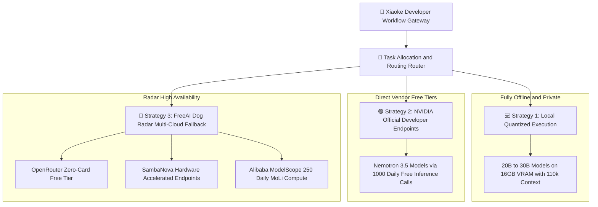

> 📌 **Original Source**: This article is syndicated from [FreeAI Dog Official Platform](https://freeaidog.com/blog/ollama-free-cloud-models-end-migration-alternatives-guide/). For live LLM availability radar, latency benchmarks, and interactive API testers, visit the official site: [https://freeaidog.com/](https://freeaidog.com/).


# Ollama Free Cloud Models Ending: The 6 Cutoff Models and Three Zero-Cost Migration Strategies

For engineers accustomed to leveraging free cloud compute through local terminals or code editors, a major policy shift was announced today.

The Ollama team formally stated that beginning November 9 2026, the existing Ollama Free plan will shut down its free cloud model allocation, transitioning entirely to a metered pay-as-you-go model. This means that multiple high-capacity models spanning tens to hundreds of billions of parameters, previously accessible via a single CLI command, will require active credit billing in just nine days.

With this sudden policy change, developer teams relying on Ollama cloud endpoints for daily coding assistants, summarization pipelines, and agent workflows face immediate service interruption.

Xiaoke analyzed the official documentation, gathered verified workarounds from senior community contributors, and synthesized this migration runbook backed by FreeAI Dog multi-vendor compute resources. Following the three strategies outlined below, you can maintain seamless access to tier-one flagship models without spending a single dollar.

---

## 一、 Cutoff Timeline and Impacted Model Roster

### 1. Critical Policy Dates
- **Service Transition Date**: November 9 2026
- **Billing Architecture Shift**: Standard Free accounts requesting cloud models must maintain pre-funded credit balances, with tokens billed according to metered consumption rates.
- **Legacy Subscription Grandfathering**: Teams holding legacy Pro subscription agreements remain on their historical terms, but new subscriptions are no longer sold under legacy pricing formulas.

### 2. The 6 Cloud Models Losing Free Tier Access

| Impacted Cloud Model | Parameter Scale | Primary Workload Focus | Impact Assessment |
| :--- | :--- | :--- | :--- |
| **gpt-oss:120b** | 120B frontier parameters | Complex multi-step reasoning and algorithmic refactoring | Very High, impractical to run fully on consumer single GPUs |
| **nemotron-3-super** | Flagship multimodal reasoning | Software engineering and code architecture planning | Very High, primary cloud driver for coding assistants |
| **nemotron-3-ultra** | Ultra-scale comprehensive flagship | In-depth academic synthesis and research analysis | Very High, highest tier free cloud compute currently offered |
| **gemma4:31b** | 31B medium-large weights | Multilingual code analysis and structured data extraction | Moderate, serviceable locally on enthusiast workstations |
| **nemotron-3-nano:30b** | 30B compact high-speed base | Low-latency function completions and syntax linting | Moderate, easily offloaded to local 16GB consumer cards |
| **gpt-oss:20b** | 20B compact reasoning variant | Daily terminal Q and A and CLI tooling | Low, 100 percent replaceable by local offline checkpoints |

### 3. The Crucial Silver Lining
Throughout the announcement, the team emphasized an essential principle: **running models locally on your own computer will always remain 100 percent free**.

This clarifies that the policy update is purely a necessary measure to manage expensive cloud hosting expenses. Ollama's core identity as a free offline runtime engine remains entirely intact.

---

## 二、 Three Zero-Cost Migration Architectures

To ensure uninterrupted workflows post-November 9, Xiaoke engineered a tiered failover topology:



This multi-pronged architecture provides targeted alternatives according to task scale and memory requirements.

---

## 三、 Step-by-Step Implementation Guide

### Strategy 1: Migrate 20B to 30B Models Locally Offline
For models such as gpt-oss:20b, nemotron-3-nano:30b, and gemma4:31b, any workstation equipped with 16GB VRAM or 32GB unified memory can run these weights locally without cloud billing.

By leveraging integrated graphics display routing and q5 KV cache compression, consumer hardware handles 27B and 31B checkpoints with exceptional responsiveness:

```bash
# Pull high-performance aligned local checkpoints instantly
ollama run qwen3.8:27b

# Enforce strict offline execution to prevent unexpected cloud failover
export OLLAMA_HOST="127.0.0.1:11434"
```

This ensures complete data sovereignty with zero dependency on internet connectivity or remote vendor pricing changes.

### Strategy 2: Switch to NVIDIA NIM Official Endpoints for Nemotron
While Ollama is sunsetting cloud access to Nemotron, NVIDIA maintains direct developer endpoints that remain freely accessible.

SOP for immediate onboarding:
1. Navigate to the NVIDIA Build Developer Portal and register a standard developer account without credit card requirements.
2. Generate a personal API key from the dashboard, which grants 1000 free inference credits with ongoing replenishment.
3. Point your IDE client base URL directly to NVIDIA's standard endpoint.

Implementation example:

```bash
# Direct API call to NVIDIA official cloud endpoints for Nemotron
curl -X POST https://integrate.api.nvidia.com/v1/chat/completions \
  -H "Authorization: Bearer YOUR_NVIDIA_API_KEY" \
  -H "Content-Type: application/json" \
  -d '{
    "model": "nvidia/nemotron-3.5-super",
    "messages": [
      {"role": "user", "content": "Analyze the rate limiting strategy for this microservice architecture"}
    ],
    "temperature": 0.6,
    "top_p": 0.95
  }'
```

Operational trade-off:
NVIDIA's terms of service indicate that anonymous inference telemetry may be incorporated into future model training. Proprietary enterprise secrets should be kept offline, while general algorithm design and technical research run safely.

### Strategy 3: Leverage FreeAI Dog Radar Multi-Vendor Free Tiers
For massive 120B models that exceed consumer workstation limits, the most resilient approach is re-routing requests to verified multi-vendor free endpoints monitored on our radar:

1. **OpenRouter No-Card Free Zone**:
   - Access top-tier open models designated with free suffixes, replenished with daily free allowances and requiring zero credit card details.
   - Base endpoint: `https://openrouter.ai/api/v1`.
2. **SambaNova Cloud Acceleration**:
   - High-speed custom silicon serving popular open models with daily refreshed credits and rapid generation speeds.
   - Base endpoint: `https://api.sambanova.ai/v1`.
3. **Alibaba ModelScope Open Community**:
   - Direct connection providing 250 daily MoLi compute units, perfect for development tasks.
   - Base endpoint: `https://api-inference.modelscope.cn/v1`.

In your coding assistant or translation tool, simply swap the legacy Ollama endpoint URL for any of the above base URLs and insert the corresponding free key.

---

## 四、 Migration Strategy Comparison Matrix

| Strategy | Supported Model Scale | Latency Profile | Financial Cost | Data Privacy Profile |
| :--- | :--- | :--- | :--- | :--- |
| **Strategy 1: Local Offline** | 20B to 30B scale | Native sub-second response | Zero dollars | Highest, data never leaves machine |
| **Strategy 2: NVIDIA NIM** | Nemotron flagship series | 200ms to 300ms | Zero dollars, official free credits | Suitable for general tasks, data used in training |
| **Strategy 3: Radar Free Tiers** | 70B to 120B frontier scale | 150ms to 400ms | Zero dollars, daily refreshed quotas | Enterprise-grade API isolation channels |

---

## 五、 Action Plan for Developers

Cloud infrastructure monetization is a natural phase of industry maturation. Resilient engineers succeed by building decoupled, redundant architectures that pivot smoothly when providers update their terms.

With nine days remaining before November 9, Xiaoke recommends completing these three preparatory steps:
1. **Audit Automated Pipelines**: Review codebase scripts and agent configuration files to identify hardcoded references to the 6 sunsetting models.
2. **Claim Backup Free Credentials**: Spend five minutes claiming API keys on NVIDIA Build and OpenRouter to ensure immediate drop-in readiness.
3. **Monitor FreeAI Dog Daily Radar**: As vendor terms evolve, our platform actively tracks over 240 endpoints to verify genuine availability and catalog new free alternatives instantly.

---

> 💡 **Source & Live Radar**：
> - Originally published on [FreeAI Dog Official Blog](https://freeaidog.com/blog/ollama-free-cloud-models-end-migration-alternatives-guide/)
> - For real-time free LLM endpoint health check and latency benchmarks, visit [FreeAI Dog Availability Radar](https://freeaidog.com/radar/)

