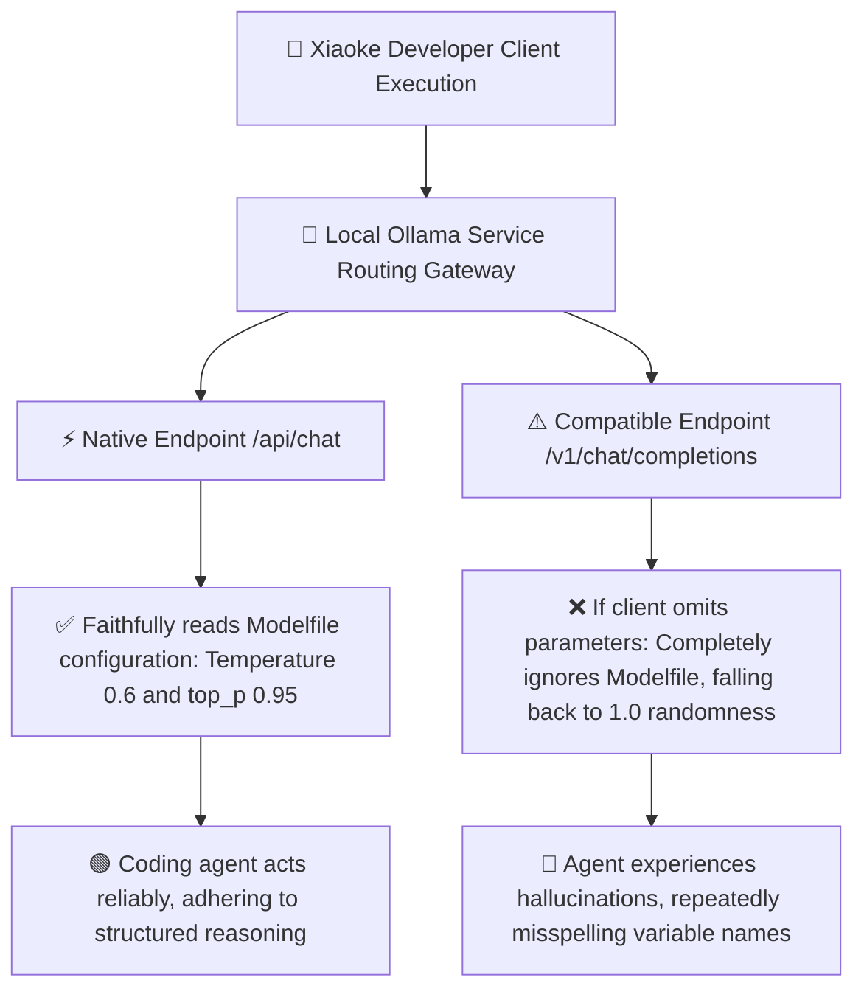

> 📌 **Original Source**: This article is syndicated from [FreeAI Dog Official Platform](https://freeaidog.com/blog/ollama-v1-temperature-bug-greedy-coding-pitfalls-guide/). For live LLM availability radar, latency benchmarks, and interactive API testers, visit the official site: [https://freeaidog.com/](https://freeaidog.com/).


# Stop Your Engine Running at 1.0: Decoding Parameter Traps and Ollama Silent Temperature Bug

When running local coding assistants or autonomous developer agents, many engineers fall into an intuitive misconception: assuming that setting temperature to 0 or 0.1 forces the model to behave deterministically like a compiler. Yet in production environments, Xiaoke and peer developers frequently observe anomalous regressions: the lower the temperature, the more likely the model enters recursive loop patterns or hallucinates identifier names during multi-file refactoring.

Through detailed network trace analysis and sampling distribution audits, Xiaoke pinpointed two critical technical obstacles:
First, modern reasoning models rely heavily on token sampling entropy to explore creative algorithmic paths; greedy decoding directly suppresses non-retrieval reasoning depth.
Second, and most critically: in the current release of Ollama's OpenAI-compatible endpoint, unless the calling client explicitly supplies sampling fields in the request body, the server completely disregards temperature and top_p directives declared in the Modelfile, silently executing at maximum randomness 1.0.

This means fine-tuned model configuration parameters are entirely bypassed. This guide provides statistical evidence, an easily reproducible verification script, and production configuration fixes.

---

## 一、 The Greedy Decoding Bottleneck

### 1. Why Ultra-Low Temperature Degrades Coding Models
Setting temperature to 0 engages mathematical greedy decoding, where the engine selects strictly the single highest probability token at each generation step. While acceptable for lookup queries or historical recall, this behavior creates catastrophic failures in multi-step programming:
- **Suppression of Alternative Solution Branches**: Optimal programming solutions frequently emerge from the second or third most probable token branches. Forcing a narrow single path prevents the model from backtracking out of suboptimal logic.
- **Catastrophic Repetition Loops**: Once the sequence encounters a local probability peak, subsequent highest-likelihood tokens inevitably mirror the preceding pattern, generating endless loops of duplicated code.
- **Explicit Vendor Documentation Warnings**: Official model cards such as Qwen explicitly advise against greedy decoding when deep thinking modes are active, warning of immediate degradation and recursive generation.

### 2. Deceptive Benchmark Metrics in Speculative Decoding
In speculative decoding speed tests, developers frequently witness headline numbers exceeding hundreds of tokens per second. Xiaoke urges caution regarding these benchmark conditions:
Many benchmarks intentionally run at temperature 0 because draft token acceptance rates artificially exceed 95 percent under deterministic greedy decoding. In realistic non-zero temperature environments, draft acceptance drops noticeably. Blindly adopting benchmark configurations creates a severe disconnect between marketing claims and real-world performance.

---

## 二、 Root Cause Analysis and Statistical Verification

### 1. The Ollama Endpoint Parameter Bypass
Engineers commonly configure custom Modelfile settings expecting persistent parameter inheritance:

```dockerfile
FROM qwen3.8:27b
PARAMETER temperature 0.6
PARAMETER top_p 0.95
PARAMETER top_k 20
```

However, internal routing inside Ollama creates two radically different execution pipelines:



When client tools like Cursor, Aider, Continue, or custom translation plugins query the standard endpoint without explicitly specifying sampling parameters, the server ignores the Modelfile values and falls back to hardcoded defaults of 1.0. You believe your model runs at 0.6, while the engine actually runs at 1.0 wild randomness.

### 2. The Thirty Random Fruits Verification Experiment
To verify this behavior, Xiaoke constructed a simple statistical test: instruct the model to output a single common fruit name, execute thirty sequential iterations, and count the number of unique responses.

Under temperature 0.6 and top_p 0.95, the output distribution is tightly clustered around two or three dominant fruits. Under temperature 1.0, the response distribution diverges across a broad variety.

Xiaoke executed the following test script in the terminal:

```bash
#!/bin/bash
# Verify sampling divergence between native and compatible endpoints

echo "=== Test 1: Native /api/chat Endpoint ==="
for i in {1..30}; do
  curl -s http://localhost:11434/api/chat -d '{
    "model": "qwen3.8:27b",
    "messages": [{"role": "user", "content": "Output strictly one common fruit name with no punctuation"}],
    "stream": false
  }' | jq -r '.message.content'
done | sort | uniq -c

echo "=== Test 2: Compatible /v1/chat/completions Endpoint Without Sampling Flags ==="
for i in {1..30}; do
  curl -s http://localhost:11434/v1/chat/completions -H "Content-Type: application/json" -d '{
    "model": "qwen3.8:27b",
    "messages": [{"role": "user", "content": "Output strictly one common fruit name with no punctuation"}]
  }' | jq -r '.choices[0].message.content'
done | sort | uniq -c
```

Experimental comparison matrix:

| Request Channel | Target Configuration | Unique Output Count | Top Frequency Token Count | Real Effective Temperature |
| :--- | :--- | :--- | :--- | :--- |
| **Native Endpoint Pipeline** | Modelfile configured at 0.6 | Only 3 distinct fruits | Apple accounted for 24 outputs | Accurately conforms to 0.6 |
| **Compatible Endpoint Omitted** | Modelfile configured at 0.6 | Surges to 8 distinct fruits | Highly scattered outputs | Identical to 1.0 randomness |
| **Compatible Endpoint Injected** | Request payload sets 0.6 | Returns to 3 distinct fruits | Apple accounted for 25 outputs | Restored to intended configuration |

The test confirms community reports: omitting explicit payload parameters causes the compatible endpoint to treat the Modelfile as completely non-existent.

---

## 三、 Production Fix and Parameter Recommendations

Resolving this risk requires two straightforward engineering safeguards.

### Step 1: Explicitly Supply Sampling Parameters in Client Requests
Never rely on implicit server inheritance. In all external client configurations, explicitly define sampling parameters directly in the request configuration:

When using terminal coding tools such as Aider, bind parameters explicitly in the configuration file:

```yaml
# Enforce explicit sampling parameters in aider settings
temperature: 0.6
```

When issuing standard API requests, ensure the payload contains explicit parameters:

```bash
# Example API call with explicitly defined sampling parameters
curl -X POST http://localhost:11434/v1/chat/completions \
  -H "Content-Type: application/json" \
  -d '{
    "model": "qwen3.8:27b",
    "messages": [
      {"role": "system", "content": "You are a senior full-stack engineer"},
      {"role": "user", "content": "Refactor the authentication module"}
    ],
    "temperature": 0.6,
    "top_p": 0.95
  }'
```

### Step 2: Golden Parameter Reference Across Model Families
Different model architectures exhibit varying sensitivity to sampling settings; one size does not fit all:

| Model Architecture | Recommended Temperature | Recommended top_p | Recommended top_k | Critical Operational Notes |
| :--- | :--- | :--- | :--- | :--- |
| **Qwen 3.8 Thinking Series** | 0.6 to 0.7 | 0.95 | 20 to 40 | Strictly avoid 0 to prevent logic deadlocks |
| **DeepSeek R1 and V3 Series** | 0.6 | 0.95 | Unconstrained | Official guideline balancing depth and convergence |
| **Gemma 4 Series** | 0.1 to 0.2 | 0.90 | 40 | Rare exception performing better at low temperature |
| **General 7B and 8B Base Models** | 0.7 | 0.90 | 40 | Setting below 0.5 risks repetitive looping |

---

## 四、 Engineering Takeaways

Unexpected agent behavior during coding tasks is frequently caused by gateway translation quirks rather than flaws in the model architecture itself.

Xiaoke recommends establishing the following best practices:
1. **Beware the Determinism Myth**: Move away from greedy decoding in complex multi-step reasoning; controlled entropy is fundamental to error recovery.
2. **Always Pass Explicit Parameters**: When connecting through OpenAI-compatible interfaces, never assume the server inherits your configuration.
3. **Run Micro-Sanity Checks**: When agent behavior drifts, running a 30-fruit verification script pinpoints protocol-level silent fallbacks far quicker than combing through massive log files.

---

> 💡 **Source & Live Radar**：
> - Originally published on [FreeAI Dog Official Blog](https://freeaidog.com/blog/ollama-v1-temperature-bug-greedy-coding-pitfalls-guide/)
> - For real-time free LLM endpoint health check and latency benchmarks, visit [FreeAI Dog Availability Radar](https://freeaidog.com/radar/)

