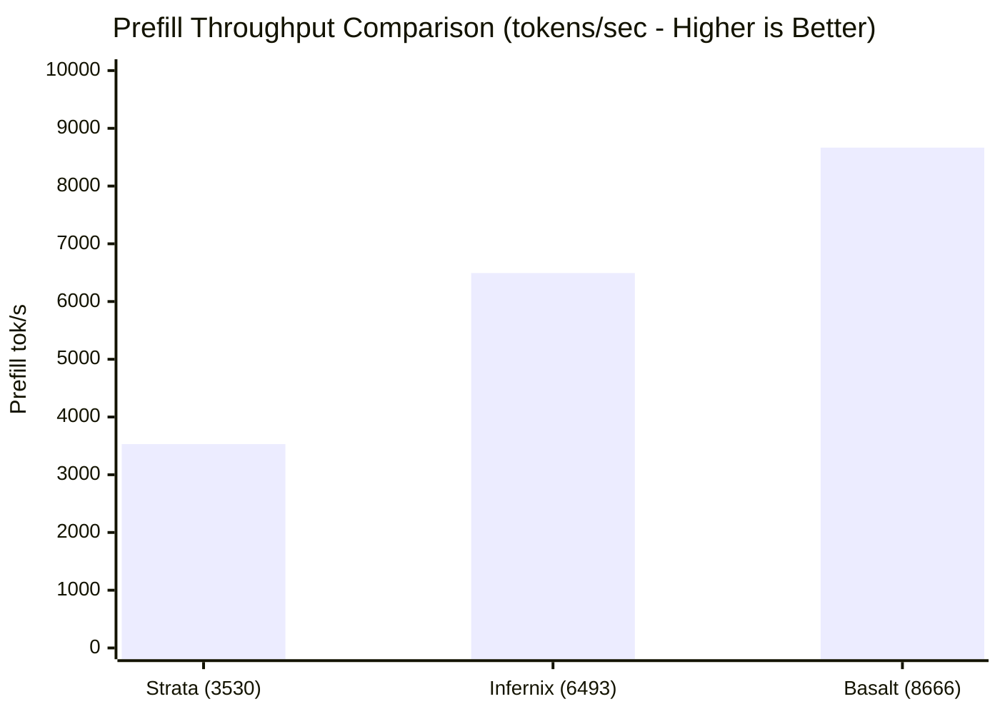

> 📌 **Original Source**: This article is syndicated from [FreeAI Dog Official Platform](https://freeaidog.com/en/blog/qwen-3-8-flash-next-engine-benchmark-basalt-strata-guide/). For live LLM availability radar, latency benchmarks, and interactive API testers, visit the official site.


# Qwen 3.8 Flash Next Engine Shootout: Basalt Hits 187 t/s vs llama.cpp 39 t/s! 7 Engines Benchmarked with Expert-Skipping Analysis

For local LLM enthusiasts, running `llama.cpp` or `Ollama` has long been the default routine. After all, the GGUF ecosystem is everywhere and highly stable.

However, Alibaba's recently open-sourced **Qwen 3.8 Flash Next**—a state-of-the-art Mixture-of-Experts (MoE) architecture combining rapid inference with reasoning intelligence—has shattered conventional expectations. In a viral benchmark across the r/LocalLLaMA community, an independent engineer benchmarked 7 popular inference engines on an identical **single RTX 5090 @ 400W + 128GB RAM** testbed.

The results took the community by storm:
- **Traditional llama.cpp trailed at the very bottom**, delivering only **32 to 39 tokens/s** decode speeds;
- The newly architected **Basalt engine soared to 187 tokens/s**, nearly **5x faster**! Prefill throughput jumped from 3,500 to **8,666 tokens/s**!

On the exact same GPU without BIOS modifications or overclocking, simply **switching the inference engine unlocked a massive 5x throughput leap**.

Is there a catch? Did certain engines artificially cheat by skipping experts at the expense of model IQ? Xiaoke dug through the source code, raw benchmarks, and engineering discussions to deliver a rigorous, fluff-free technical breakdown.

---

## 1. 7 Inference Engines: Comprehensive Benchmark Matrix

To eliminate thermal throttling and memory leakage artifacts, the test protocol followed strict parameters:
- **Hardware**: Single RTX 5090 (power-capped at 400W) + 128 GB DDR5 memory;
- **Model**: Qwen 3.8 Flash Next running NVIDIA's official **NVFP4 weights**;
- **Protocol**: 7 greedy sampling requests, each initiated from a cold start, benchmarked across 25K, 50K, 100K, and 200K context lengths.

### Decode Speed (tokens/sec)
Real-time token generation velocity during interactive chat or code completion:

| Inference Engine | 25K Context | 50K Context | 100K Context | 200K Context | Relative to llama.cpp |
| :--- | :---: | :---: | :---: | :---: | :---: |
| **Basalt** *(Recommended)* | **187 t/s** | **184 t/s** | **180 t/s** | **160 t/s** | **+380% (4.8×)** 🚀 |
| **Infernix** | 174 t/s | 176 t/s | 163 t/s | 158 t/s | +350% (4.5×) |
| **capy-flash** | 143 t/s | 152 t/s | 152 t/s | 135 t/s | +270% (3.7×) |
| **Strata** | 123 t/s | 121 t/s | 123 t/s | 114 t/s | +220% (3.2×) |
| **ninfer-ext** | 86 t/s | 79 t/s | 95 t/s | 66 t/s | +120% (2.2×) |
| **ninfer** | 46 t/s | 47 t/s | 53 t/s | 44 t/s | +20% (1.2×) |
| **llama.cpp** *(Legacy Default)* | 36 t/s | 35 t/s | 39 t/s | 32 t/s | *Baseline (1.0×)* 🐢 |

### Prefill Throughput (tokens/sec)
Prompt processing ingestion speed when ingesting large code repositories or multi-chapter documents:



- **Basalt**: Scales from 6,492 tok/s up to **8,666 tok/s** on long contexts;
- **Infernix**: Holds steady around 6,500 tok/s;
- **Strata**: Hovers around 3,530 ~ 4,245 tok/s, making Basalt more than **2x faster** in prompt digestion.

---

## 2. Technical Inspection: Are Engines Skipping Experts to Cheat?

Experienced developers will naturally ask: "Qwen 3.8 Flash Next is a Mixture-of-Experts architecture. Are these engines skipping lower-weight experts (Tail Skip) to inflate benchmarks?"

This is the central technical nuance highlighted in community discussions.

### The Pitfall of "Expert Tail Skip"
When an MoE model evaluates a token, the gating router selects the highest-scoring experts. Certain engines implement an aggressive heuristic: **deliberately skipping the lowest-ranked experts**.
- **Strata's approach**: Defaults to `STRATA_ROUTE_TAIL_SKIP=7`, cutting off the calculation of 7 low-weight experts to boost throughput;
- **The downside**: This introduces noticeable accuracy degradation during multi-step reasoning, JSON schema generation, and function calling, frequently causing tool-call loops.

### Why Basalt's Performance is Uncompromised
1. **Zero Expert Skipping**: Basalt evaluates every activated expert faithfully. The author tested tail skipping on Basalt and found it caused a full quantization-grade drop in Kullback-Leibler divergence (KLD) with negligible speed gains, opting instead for **100% faithful computation**;
2. **Flawless Function Calling Record**: Across hundreds of function-calling and structured grammar-enforced tests with official NVFP4 weights, Basalt experienced **zero tool failures, missed parameters, or infinite retry loops**;
3. **KLD Divergence Verification**: Against an Unsloth Q8 baseline, Basalt's relative entropy (KLD) compared to llama.cpp converges essentially to 0.

> **Xiaoke's Takeaway**: **Basalt's 187 tokens/s is authentic, uncompromised performance—not an illusion achieved by skipping calculations.**

---

## 3. Step-by-Step Guide: Building and Running Basalt

Basalt is completely open-source on GitHub (`github.com/jesdga95/basalt`). By stripping away decades of legacy code and focusing strictly on modern NVIDIA architectures (Ada Lovelace 40-series and Blackwell 50-series), its codebase is clean and ultra-fast.

Here is the exact build and execution flow for Linux / WSL2:

### Step 1: Install Build Toolchain
Ensure you have the NVIDIA proprietary driver, CUDA 12.6+, and a modern C++ compiler installed:

```bash
# 1. Install prerequisites, CMake, and Ninja
sudo apt-get update && sudo apt-get install -y \
    build-essential cmake ninja-build git git-lfs

# 2. Verify CUDA compiler (must be >= 12.6)
nvcc --version
```

### Step 2: Clone Repository with Submodules
```bash
git clone --recursive https://github.com/jesdga95/basalt.git
cd basalt
```

### Step 3: Configure and Compile with High Optimization
```bash
mkdir -p build && cd build

# Configure CMake with native Ninja generator
cmake .. -G Ninja -DCMAKE_BUILD_TYPE=Release

# Parallel compilation across all CPU cores
ninja -j$(nproc)
```
Upon completion, the binaries `basalt-cli` and `basalt-server` will be available in `build/bin/`.

### Step 4: Launch with Official NVFP4 Weights
Always use NVIDIA's official NVFP4 weights from Hugging Face rather than unverified third-party quantizations:

```bash
# Launch the Basalt high-performance server
./bin/basalt-server \
    --model-path /path/to/Qwen3.8-Flash-Next-NVFP4 \
    --port 8000 \
    --ctx-size 131072 \
    --gpu-layers 999
```
Basalt serves an OpenAI-compatible API on port `8000` (`/v1/chat/completions`), allowing immediate integration into Cursor, Chatbox, or FreeAI Dog's API Tester.

---

## 4. Architectural Decision Matrix: Which Engine Should You Choose?

| Hardware & Requirements | Recommended Engine | Rationale |
| :--- | :--- | :--- |
| **NVIDIA RTX 4090 / 5090 / 5080** | **Basalt** 🏆 | Native NVFP4 acceleration delivering 4~5x throughput with zero precision loss |
| **AMD GPUs (e.g., RX 9070 XT / 7900 XTX)** | **Strata** 🥈 | Native ROCm integration capable of 70~90 t/s on RDNA4 |
| **Apple Silicon (Mac M-series) or CPU** | **llama.cpp / Ollama** | Unmatched cross-platform compatibility across non-CUDA hardware |
| **Ultra-Low Budget ($200 X99 + MI50 server)** | **Strata (Atomic Q4)** | Cost-effective local MoE generation running at 30~50 t/s |

---

## Conclusion

In local AI development, people often believe hardware upgrades are the only way to gain performance. This 7-engine benchmark proves the opposite: **compiler and kernel-level software optimizations can deliver gains equivalent to an entire hardware generation.**

Going from 39 tokens/s on llama.cpp to 187 tokens/s on Basalt costs $0 in additional hardware—it is simply a triumph of modern open-source software engineering.

If you have an FP4/FP8-capable GPU, try the steps above and run Basalt yourself!

---

> 💡 **Source & Live Radar**：
> - Originally published on [FreeAI Dog Official Blog](https://freeaidog.com/en/blog/qwen-3-8-flash-next-engine-benchmark-basalt-strata-guide/)
> - For real-time free LLM endpoint health check and latency benchmarks, visit [FreeAI Dog Availability Radar](https://freeaidog.com/en/radar/)
