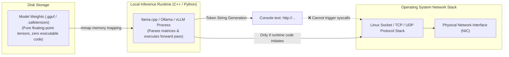

> 📌 **Original Source**: This article is syndicated from [FreeAI Dog Official Platform](https://freeaidog.com/blog/qwen-telemetry-controversy-open-weights-audit-guide/). For live LLM availability radar, latency benchmarks, and interactive API testers, visit the official site: [https://freeaidog.com/](https://freeaidog.com/).


# A /s Sarcasm Post Triggered an Open-Weight Crisis: The Qwen Telemetry Myth Debunked & How to Packet-Audit Local LLMs

Over the past 24 hours, the premier local AI community on Reddit—**r/LocalLLaMA**—became the stage for a bizarre, viral melodrama:
**A satirical mock post clearly marked with a sarcasm tag (`/s`) was taken entirely literally by waves of careless readers. Within hours, unfounded rumors that 'local open-weight models are secretly phoning user privacy back overseas' were magnified by commercial closed-source interests, temporarily sparking a full-blown trust crisis across the open-weights ecosystem.**

Amid geopolitical biases, commercial lobbying, and technical misconceptions, many users were misled into groundless panic.

Today, FreeAI Dog steps back from the noise with an objective, engineering-first perspective. We reconstruct the complete timeline of the controversy, examine the fundamental physics of operating system network stacks and model weights, and equip you with an airtight **packet-auditing and air-gapped isolation SOP** to verify local model integrity yourself.

---

## 1. Anatomy of the Drama: How Sarcasm Ignited a Firestorm

### 1. The Spark: u/Boogertard's Absurdist Satire
The episode began when Reddit user `u/Boogertard` published a clickbait-styled post:
> *"I now have definitive proofs that my Qwen Flash Next is trying to send something to a remote Chinese server..."*

Any developer who actually read the body text recognized the blatant parody immediately. The author presented a mock system prompt called "FriendlyBot-9000" instructing the model to:
* Route the user's "grocery lists, 3 AM existential dread, and gripes about coworker Kevin's breakroom refrigerator habits" via UDP to a fictional "Central Telemetry Cluster 4, Terminal 12 (Sub-basement B, Haidian District, Beijing)";
* Blame transmission latency on "solar flare activity," "local broadband throttling," or "a minor glitch in Western DNS routing";
* **And signed off explicitly with a bold `/s` (sarcasm) tag at the very end!**

### 2. The Contagion: Knee-Jerk Panic
Unfortunately, internet herd behavior took over. Dozens of commenters ignored the `/s`, skimmed the sensational title, and began commenting in earnest panic:
> *"OMG, is there actual Wireshark capture proof?"*
> *"I knew open-weight models were shady, deleting weights now!"*
> *"Can someone have their coding agent audit the weights for backdoors?"*

Within hours, the satirical thread was catapulted to the top of the subreddit's Hot feed.

### 3. The Accelerant: Closed-Source Agendas Step In
The drama escalated when commercial closed-source interests entered the conversation. 
Entities with a documented history of lobbying regulators to **restrict, license, or ban open-weight AI foundations** (such as research groups associated with CohereLabs) quickly published "investigation trace releases." They conflated benign, synthetic text hallucinations produced under contrived prompts with "actual outbound network exfiltration intent," attempting to manufacture institutional skepticism around open weights.

This triggered fierce pushback from veteran open-source practitioners:
* Developer `u/Arch-on` pointed out: *"This is pure propaganda designed to advocate for restrictions on open weights and models."*
* Other pragmatic voices noted the irony: *"Closed-source models hiding behind proprietary APIs literally log, store, and inspect every prompt and token permanently on their cloud servers. They are the actual telemetry giants."*

---

## 2. Hardcore Computer Science: Why Weights Cannot Phone Home

To inoculate yourself against future rumors, let's revisit foundational operating system mechanics:



### 1. Weights Are Passive Mathematical Matrices
Whether distributed in `.gguf` or `.safetensors` format, model files consist strictly of **billions of floating-point numbers (FP16, INT4, or FP8 tensor arrays)**:
* **They are not executable binaries (ELF / PE / Mach-O)**;
* They possess no privilege to execute operating system system calls (`syscall`);
* They contain zero assembly or socket instructions (`socket()`, `connect()`, `sendto()`).
Believing a static weight file can autonomously dispatch TCP packets is equivalent to believing a JPEG wallpaper on your desktop can autonomously hack the Pentagon.

### 2. Why Do Models Output Network URLs and Logs?
Large language models are pre-trained on terabytes of public GitHub repositories, server diagnostic logs, network RFCs, and API client scripts.
When fed tailored prompts, the next-token prediction engine naturally produces text strings resembling `POST http://telemetry.cluster/report`. 
**However, printing a URL string in a terminal window shares zero physical connection with an operating system kernel dispatching raw network packets.**

### 3. Where Real Risks Actually Lie
If weights cannot exfiltrate data, where should developers focus security scrutiny? **On the runtime host application and unrestricted Agent execution!**
* If the underlying inference binary itself (e.g., an unverified runtime fork) were compromised, the host application has socket privileges;
* If you empower an autonomous AI Agent with unrestricted Bash or Python execution privileges and instruct it to execute a web scraper, the host system will naturally dispatch packets.

---

## 3. Practical Verification: Step-by-Step Network Packet Auditing

In engineering, we do not rely on blind trust—**we rely on empirical packet traces**.

Here is how you can independently verify that your local inference runtimes (Ollama, llama.cpp, LM Studio, etc.) produce zero unexpected outbound traffic:

### Step 1: Identify Process and Port Bindings
In your terminal, inspect what ports your inference engine is bound to (e.g., Ollama's default `11434`):

```bash
# Check active listener ports
netstat -tulpn | grep 11434
# or with ss
ss -lntp | grep 11434
```
You will notice it binds strictly to `127.0.0.1:11434` (the local loopback interface).

### Step 2: Full Packet Sniffing with `tcpdump`
Open a dedicated terminal window and run `tcpdump` with administrative privileges to monitor physical outbound interfaces (excluding local loopback traffic):

```bash
# Sniff all interfaces, excluding local loopback and standard DNS lookups
sudo tcpdump -i any not host 127.0.0.1 and not port 53 -nn -vv
```

Now, interact intensively with your local Qwen or Llama instance. Issue prompts asking it to generate network telemetry logs.

**What You Will Observe:**
* The `tcpdump` terminal remains **completely silent—zero anomalous outbound packets are produced**;
* Token generation represents internal GPU memory computation only; your physical network card activity remains static.

### Step 3: Deep DNS and SYN Inspection via Wireshark
If you prefer a graphical interface:
1. Launch **Wireshark** and select your active network interface (Wi-Fi or Ethernet);
2. Apply the following capture filter:
   ```
   dns || (ip.dst != 127.0.0.1 and tcp.flags.syn==1)
   ```
3. This captures **every domain name lookup** and **every outbound TCP handshake** initiated by the host machine;
4. Throughout your entire inference session, zero unauthorized overseas domains will appear.

---

## 4. The Ultimate Defense: 100% Air-Gapped Docker Isolation

For developers operating in regulated enterprise, healthcare, or financial environments, you can guarantee mathematical zero-network exposure using Linux kernel containerization:

### Method: Docker `--network none`
Launch your inference container with its network stack completely stripped:

```bash
# Start an air-gapped Ollama container with zero network interfaces
docker run -d \
  --name air-gapped-ollama \
  --network none \
  --gpus all \
  -v /path/to/models:/root/.ollama/models \
  ollama/ollama
```

Under `--network none`, the Linux kernel does not even instantiate a virtual network interface inside the container. Even if malicious code were embedded inside a process, **it cannot physically route a single byte onto the network**.

---

## 5. Reflections: Who Actually Collects Your Telemetry?

The Qwen telemetry controversy exposes a profound divergence between competing AI paradigms:

1. **Open Weights Mean Verifiable Sovereignty**:
   You can inspect every line of runtime source code, audit every network socket with `tcpdump`, and run models entirely air-gapped inside isolated containers. **Your data remains entirely under your sovereignty.**
2. **Proprietary APIs Remain Unauditable Black Boxes**:
   Every time you transmit sensitive code to a closed-source API, your prompts are piped across the public internet into corporate data centers. Regardless of marketing promises, you have zero independent ability to verify how your tokens are archived, audited, or used for model alignment.

In an era of viral claims, the true superpower of an AI engineer is simple: **Do not panic, verify the code, and let packet captures tell the truth.**

---

> 💡 **Source & Live Radar**：
> - Originally published on [FreeAI Dog Official Blog](https://freeaidog.com/blog/qwen-telemetry-controversy-open-weights-audit-guide/)
> - For real-time free LLM endpoint health check and latency benchmarks, visit [FreeAI Dog Availability Radar](https://freeaidog.com/radar/)

