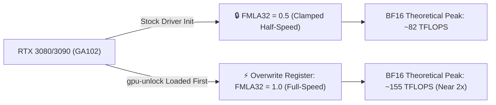

> 📌 **Original Source**: This article is syndicated from [FreeAI Dog Official Platform](https://freeaidog.com/blog/rtx-3090-gpu-unlock-bf16-kernel-module-guide/). For live LLM availability radar, latency benchmarks, and interactive API testers, visit the official site: [https://freeaidog.com/](https://freeaidog.com/).


# Free 1.9x Compute on RTX 3090? Zagitta's GPU Unlock Kernel Module Tested on Real LLMs

For local LLM tinkerers, the **RTX 3090 (24GB VRAM)** has long been the gold standard for budget workstations. I have two of them running in my daily driver rig for local inference, fine-tuning, and testing small models.

Hardware hackers have known an open secret for years: **NVIDIA intentionally crippled the FP32-accumulating Tensor Core performance on consumer GA102 chips (RTX 3080 / 3090 / 3090 Ti)**. In the official driver, the `FMLA32` instruction pipeline is artificially clamped to half-speed to steer enterprise buyers toward much pricier cards like the RTX A6000.

Until now, unlocking it meant taking the risky route of cross-flashing modified vBIOSes. Today, developer Zagitta released **`gpu-unlock`**, an open-source Linux kernel module that blew up on r/LocalLLaMA: **no vBIOS flashing, no hardware mods, and no custom display drivers. A small kernel module intercepts the hardware registers right before the proprietary NVIDIA driver loads and restores Tensor Cores to full speed.**

I spent the afternoon compiling, testing, and measuring real-world LLM inference on this setup. Here is the full breakdown of how it works, the raw microbenchmarks, and—most importantly—what it actually delivers in real LLM prefill speeds.

---

## 1. What Did NVIDIA Lock, and How Does the Module Bypass It?

### What is the FMLA32 Half-Speed Throttle?
When running BF16 or TF32 matrix multiplications (GEMM) during LLM inference, Tensor Cores perform multiply-accumulate operations with **FP32 accumulation** to maintain numerical stability and precision (Fused Multiply-Add with FP32 Accumulation, or `FMLA32`).

On enterprise cards like the RTX A6000, this accumulator runs at full speed. On consumer GA102 silicon, however, NVIDIA's proprietary driver initialization sets the `FMLA32` throttle register to 0.5 (half-speed).



### Zagitta's Solution: Intercepting Before Driver Handshake
Instead of modifying the firmware on the card, `gpu-unlock` takes a much cleaner approach:
- It runs as a lightweight **Linux DKMS kernel module**;
- During boot, right **before** the proprietary NVIDIA driver (`nvidia.ko`) binds to the GPU, the module writes to GA102's control registers, flipping `FMLA32` back to 1.0 (full speed);
- The standard NVIDIA driver then loads normally and operates on an unthrottled card.

**Stability & Precision Questions**:
- **Does it cause numerical drift?** The author ran an exhaustive byte-for-byte verification over 1,996 teacher-forced log-prob outputs under identical expert cache sizes: **the binary output was 100% identical to the stock driver**. It speeds up the pipeline without changing calculations;
- **Does it persist across reboots or sleep?** Tested and confirmed: the setting persists across standard reboots and sleep/wake cycles.

---

## 2. Raw Benchmarks vs. Real LLM Gains: Setting Realistic Expectations

Seeing "1.9x speedup" in Reddit headlines might make you think your local LLMs will suddenly run twice as fast. **Let's inject some reality: theoretical compute peaks are not end-to-end inference speeds.**

### 1. Pure Math Microbenchmarks (4x RTX 3090)
In microbenchmarks focused purely on Tensor Core math throughput, the numbers are undeniably impressive:

| Metric | Stock Driver | With gpu-unlock | Measured Speedup |
|---|---|---|---|
| **BF16 Tensor Pipe Theoretical Peak** | 82 TFLOPS | **155 TFLOPS** | **+89% (≈ 1.89×)** |
| **cuBLAS BF16 GEMM (8192)** | 64 TFLOPS | **99 TFLOPS** | **+54.7% (≈ 1.55×)** |
| **TF32 Peak Compute** | 41 TFLOPS | **79 TFLOPS** | **+92.7% (≈ 1.92×)** |

For raw dense matrix multiplications, compute throughput essentially doubles.

### 2. Real-World LLM Testing: Qwen3.8 Flash-Next (Dual 3090)
Testing on an actual LLM stack (Strata runtime + Qwen3.8 Flash-Next across two cards), the prefill (prompt processing) throughput tells a more nuanced story:

- **4K Context Prefill**: **+12% faster**;
- **10K Context Prefill**: **+12% faster**;
- **90K Long Context Prefill**: Jumped from 3,205 t/s to **3,536 t/s (+10.3%)**.

### 3. Why 1.9x in Benchmarks, but ~10-12% in Real LLMs?
Here is why real-world gains are more modest:
1. **GEMM is only part of the pipeline**: During LLM prefill, dense GEMM computations only account for roughly 35% to 40% of the total clock cycles;
2. **Memory bandwidth is the real bottleneck**: Reading model weights and shuttling KV caches is strictly bound by the physical 384-bit memory bus on the 3090. Unlocking Tensor compute does not increase memory bandwidth;
3. **Non-GEMM kernels are untouched**: Attention operators, layer norms, activations, and quantization/dequantization run on standard CUDA cores and are completely unaffected by the `FMLA32` register.

> **Xiaoke's Takeaway**:
> Don't expect your 3090 to turn into a 4090 overnight. But getting an **honest 10% to 12% end-to-end speedup completely free**, without touching your vBIOS or risking your hardware, is a phenomenal win for local AI builders.
> *(Note: In specialized workloads dominated purely by GEMM—such as the logits phase of 8x 3090 Ti distillation training—prefill gains reached up to +70%, though power consumption jumped from 320W to 450W).*

---

## 3. Hardware Support & Compatibility Matrix

Before trying this out, verify that your GPU has the supported GA102 core:

### Supported Hardware (Ampere GA102 Only)
- ✅ **RTX 3090** (24GB)
- ✅ **RTX 3090 Ti** (24GB)
- ✅ **RTX 3080** (10GB & 12GB)
- ✅ **RTX 3080 Ti** (12GB)
- ✅ **GA102-based workstation / mobile equivalents**

### Unsupported Hardware
- ❌ **RTX 40 Series (Ada Lovelace)**: 4090, 4080, 4070, etc. Ada uses different control registers. (Community forks like `unitypit71/rtx4070tisuper-tensor-unlock` are experimenting with Ada, but nothing is production-ready yet);
- ❌ **RTX 3070 and below**: Built on GA104/GA106, which lack the GA102 register layout;
- ❌ **Windows**: Relies on Linux kernel module loading order before the display driver. There is no working Windows driver wrapper yet.

---

## 4. Step-by-Step Installation Guide (Linux)

This process is clean and reversible. Tested on Ubuntu 22.04 / Debian 12.

### 1. Install Build Dependencies
```bash
sudo apt update
sudo apt install -y build-essential dkms git linux-headers-$(uname -r)
```

### 2. Clone and Build
```bash
git clone https://github.com/Zagitta/gpu-unlock.git
cd gpu-unlock
make
```

### 3. Install via DKMS (Auto-Rebuilds on Kernel Updates)
```bash
sudo make install-dkms
```
Registering with DKMS ensures that future Linux kernel updates won't break the module.

### 4. Ensure Correct Load Order (Before NVIDIA Driver)
Configure the system to load `gpu_unlock` during early boot:
```bash
echo "gpu_unlock" | sudo tee /etc/modules-load.d/gpu-unlock.conf
sudo update-initramfs -u
```

### 5. Reboot and Verify
Reboot your machine and check `dmesg`:
```bash
sudo dmesg | grep -i "gpu_unlock"
```
Look for confirmation lines similar to:
```text
[    1.428512] gpu_unlock: Found GA102 device [10de:2204]
[    1.428519] gpu_unlock: Patching FMLA32 register to FULL speed... OK!
```

Once confirmed, fire up your favorite inference engine (vLLM, Ollama, llama.cpp, or ExLlamaV2) and enjoy the extra compute headroom.

---

## 5. Summary & Final Thoughts

1. **Free performance is free performance**: If you run a Linux workstation with an RTX 3080 or 3090, setting this up takes less than five minutes and shaves noticeable time off long-context prompts;
2. **Keep benchmarks in perspective**: 1.9x microbenchmark numbers don't translate directly to 2x LLM generation. Memory bandwidth and software scheduling still matter most;
3. **Appreciate clean engineering**: Bypassing artificial vendor throttling via early-stage register interception is infinitely safer and more elegant than flashing risky third-party vBIOS files.

---

> 💡 **Source & Live Radar**：
> - Originally published on [FreeAI Dog Official Blog](https://freeaidog.com/blog/rtx-3090-gpu-unlock-bf16-kernel-module-guide/)
> - For real-time free LLM endpoint health check and latency benchmarks, visit [FreeAI Dog Availability Radar](https://freeaidog.com/radar/)

