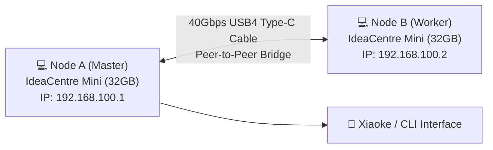

> 📌 **Original Source**: This article is syndicated from [FreeAI Dog Official Platform](https://freeaidog.com/en/blog/snapdragon-mini-pc-zero-gpu-qwen-40b-moe-guide/). For live LLM availability radar, latency benchmarks, and interactive API testers, visit the official site.


# Running a 95GB Frontier LLM with Zero GPUs? Hands-on Snapdragon Mini PC Dual-Cluster Guide

Running 40B+ open-weight models locally has traditionally required painful trade-offs: either building an expensive, noisy, dual-RTX 3090/4090 workstation, or spending $4,000+ on a high-spec 64GB/128GB unified-memory Mac Studio.

Today on r/LocalLLaMA, hardware hackers found a mind-bending budget alternative: **zero dedicated GPUs, two £299 (approx. $390) Lenovo IdeaCentre Mini Snapdragon PCs, and one single USB4 Type-C cable—running the massive 95GB Qwen3.8 Flash-Next MoE model!**


No hand-wavy theory here. I put together a **complete, beginner-friendly walkthrough** covering the hardware shopping list, core concepts, Windows on ARM compiler steps, model downloads, USB4 peer-to-peer configuration, and distributed CLI execution.

---

## 1. How Does This Work Without a Dedicated GPU?

Before ordering hardware, let's understand why a 95GB model can run on lightweight ARM mini PCs:

### 1. MoE Architecture: Sparse Expert Activation
Dense models (like Llama-70B) must cycle all 70 billion parameters through memory for every single generated token. **Mixture-of-Experts (MoE) models (like Qwen3.6-35B-A3B or Qwen3.8 Flash-Next)** work differently:
- The total parameter footprint spans 35B to 40B (20GB to 95GB on disk), but **only 2.5B to 3B parameters (active experts) are routed per token**;
- Most experts sit idle at any given millisecond.

### 2. Fast NVMe Streaming + ARM NEON Acceleration
The **Janas** inference engine (a high-performance, pure-C LLM runtime) employs a clever trick:
- It keeps the shared attention layers and base weights resident inside 32GB of physical RAM;
- It leaves the remaining 95GB of expert weights on high-speed NVMe SSD storage;
- When a token triggers an expert, it reads page-aligned chunks from disk asynchronously while utilizing **ARM NEON SIMD and `i8mm` integer matrix multiplication instructions** directly on the Qualcomm Oryon CPU cores.

### 3. Why Dual-Machine USB4 Clustering is the Sweet Spot
- **Single Unit (32GB RAM)**: Runs the 19.4GB Qwen 35B A3B coder effortlessly at **43 tokens/s**. But if you force the 95GB Flash-Next onto a single 32GB machine, heavy SSD page thrashing causes a Time-to-First-Token (TTFT) delay of 54 to 80 seconds—too slow for daily work;
- **Dual Units (64GB RAM combined)**: Hooking two units together across a 40Gbps USB4 link gives you a pooled 64GB memory workspace. TTFT for Flash-Next drops to **12.5 seconds** with sustained generation speeds of **20 tokens/s**—practical and snappy.

---

## 2. Hardware Shopping & Prep List

Here is the exact hardware bill of materials:

| Hardware Component | Recommended Spec | Approx. Price | Purpose & Notes |
|---|---|---|---|
| **Mini PC × 2** | **Lenovo IdeaCentre Mini x**<br>(Snapdragon X X1-26-100 / 8-core Oryon + Hexagon NPU / 32GB LPDDR5 / 512GB NVMe) | Approx. £299 / $390 per unit on sale | **Must specify 32GB RAM**. Memory is soldered and cannot be expanded; 16GB will fail. |
| **High-Speed Interconnect Cable** | **40Gbps USB4 / Thunderbolt 4 Type-C Cable (1 meter)** | $10 ~ $20 | Must support **40Gbps data transmission** (do not use cheap charging cables). |
| **Monitor & Peripherals** | Any HDMI/DP monitor + USB keyboard/mouse | Existing gear | Needed for initial Windows setup; can run headless afterwards. |

> **Total Budget**: A single machine costs around $390 to run 35B models. The dual-machine setup costs roughly **$800 total**—cheaper than a standalone graphics card.

---

## 3. Step 1: System & Engine Setup on Windows 11 on ARM

Both machines come with factory-installed **Windows 11 on ARM**. No need to dual-boot Linux; everything runs natively inside Windows ARM64.

### 1. Enable Developer Mode
In Windows Search, look for `Developer settings` and toggle **Developer Mode** on.

### 2. Download and Build the ARM-Optimized Janas Engine
Open PowerShell (or Windows Terminal) as an Administrator:

```powershell
# 1. Install Git and LLVM Clang via winget (skip if already installed)
winget install Git.Git
winget install LLVM.LLVM

# 2. Clone the Janas repository
git clone https://github.com/prabanta-dev/janas.git
cd janas

# 3. Compile the native Windows on ARM binary
# Targets Snapdragon Oryon with NEON and i8mm matrix SIMD
clang -O3 -march=armv8.6-a+neon+i8mm -fopenmp src/*.c -o janas-arm.exe
```
*(Tip: If you prefer prebuilt binaries, grab the ready-to-run `janas-win-arm64.zip` package directly from the author's GitHub releases page).*

---

## 4. Step 2: Model Downloads & Storage Setup

Place model files on your fastest NVMe storage path (e.g., `C:\models\`):

### 1. Daily Driver: Qwen 35B A3B Coder (Runs Great on a Single Unit)
- **Hugging Face Repository**: `bartowski/Qwen_Qwen3.6-35B-A3B-Q4_0.gguf`
- **File Size**: Approx. **19.4 GB**
- **Performance**: 1.8s TTFT, 43 t/s generation speed on a single 32GB machine.

### 2. Flagship Target: Qwen3.8 Flash-Next (95GB MoE Beast)
- **Hugging Face Repository**: `ggml-org/Qwen3.8-Flash-Next-IQ4_NL`
- **File Size**: Approx. **95 GB**
- **Performance**: Dual-machine 64GB distributed setup for deep research, tool calling, and long-context synthesis.

Download using PowerShell (example for 35B):
```powershell
mkdir C:\models -Force
cd C:\models
curl -L -O "https://huggingface.co/bartowski/Qwen_Qwen3.6-35B-A3B-Q4_0-GGUF/resolve/main/Qwen_Qwen3.6-35B-A3B-Q4_0.gguf"
```

---

## 5. Step 3: Single-Machine Sanity Test

Before configuring dual-node clustering, verify that single-machine execution works as expected.

In PowerShell, navigate to your Janas folder and execute:

```powershell
.\janas-arm.exe `
  --model C:\models\Qwen_Qwen3.6-35B-A3B-Q4_0.gguf `
  --threads 8 `
  --temp 0.6 `
  --prompt "Write a Python script to scan all active local IP addresses on the network."
```

**Single-Machine Performance**:
- **Prefill Throughput**: Approx. **315 tokens/s**;
- **Generation Speed**: **43 tokens/s** (smooth, instant typing flow);
- **RAM Footprint**: ~22 GB, comfortably within the 32GB physical ceiling.

---

## 6. Step 4: Dual-Machine USB4 Peer-to-Peer Clustering (The Secret Sauce)

To unlock the 95GB model, we link both mini PCs together. **No 10GbE network switches needed—just one USB4 cable.**



### 1. Physical Cabling
Plug one end of the 40Gbps USB4 cable into the rear USB-C port of PC A, and the other end into the rear USB-C port of PC B. Windows 11 will automatically configure a **Thunderbolt / USB4 Ethernet Adapter**.

### 2. Configure Static IPs (Takes 2 Minutes)
To minimize latency down to microseconds:

- **On PC A**:
  - Open `Settings` ➔ `Network & internet` ➔ `Advanced network settings` ➔ Find the USB4 adapter;
  - Edit `IPv4`:
    - IP Address: `192.168.100.1`
    - Subnet Mask: `255.255.255.0`
    - Gateway: Leave empty
- **On PC B**:
  - Edit `IPv4` on the USB4 adapter:
    - IP Address: `192.168.100.2`
    - Subnet Mask: `255.255.255.0`
    - Gateway: Leave empty

From PC A, test `ping 192.168.100.2`. You should see response times consistently `<1ms`. Your 40Gbps private interconnect is live.

### 3. Launching Distributed Inference for 95GB Flash-Next

**On Worker (PC B)**:
```powershell
# Listen on the USB4 link
.\janas-arm.exe --worker --listen 192.168.100.2:9999 --threads 8
```

**On Master (PC A)**:
```powershell
# Shard weights across both nodes (pooled 64GB RAM)
.\janas-arm.exe `
  --model C:\models\Qwen3.8-Flash-Next-IQ4_NL.gguf `
  --nodes 192.168.100.1,192.168.100.2:9999 `
  --threads 8 `
  --temp 0.7 `
  --interactive
```

The runtime splits the model layers across both nodes and establishes an active inference session.

---

## 7. Real Benchmarks & What to Expect

Here are the unfiltered numbers comparing single-unit vs dual-unit performance:

| Benchmark Scenario | Single PC (32GB) | Dual USB4 Cluster (64GB) | Evaluation |
|---|---|---|---|
| **Qwen 35B A3B (19.4GB)** | TTFT 1.8s / Gen 43 t/s | TTFT 1.8s / Gen 43 t/s | Single machine is already maxed out |
| **Qwen3.8 Flash Next (95GB)** | TTFT 54s ~ 80s / Gen 8 t/s | **TTFT 12.5s / Gen 20 t/s** | **Jumps from unusable to responsive** |
| **Power Consumption** | 8W idle / 35W load | Combined **~70W full load** | Roughly 10% the power of a dual-3090 rig |
| **Acoustics & Heat** | Whisper-quiet fan | Barely audible, mild warm airflow | Safe to leave running on a desk overnight |

### Honest Takeaways
1. **Initial TTFT on Massive Prompts**:
   - A prefill speed of ~46 t/s means an 8,000-token prompt will take around 25-30 seconds before tokens start streaming;
   - **However, Prompt Caching saves the day in Agent workflows**: After the first turn, system instructions and conversation context are cached in RAM. Follow-up responses begin streaming almost immediately;
2. **NPU Behavior**:
   - The Qualcomm Hexagon NPU gives a **3x to 4x speedup on dense models** (like Gemma-4B or Qwen-8B);
   - On large MoE architectures, where memory access patterns are sparse and dynamic, NPU speedups are much more modest (~1.2x).

---

## 8. Who is This Setup For?

- **Budget-conscious builders & students**: You can't buy a 64GB Mac Studio or a dual-GPU PC for $800, but you can build a 64GB dual-node ARM micro-cluster that easily handles frontier open models;
- **Always-on home lab agents**: At 70W under load and 16W idle, it serves as an ultra-efficient, whisper-quiet local brain;
- **Edge computing enthusiasts**: Connecting two tiny 1L boxes with a single USB4 cable to run a 95GB model provides a level of DIY satisfaction that cloud API credits can't match.

---

> 💡 **Source & Live Radar**：
> - Originally published on [FreeAI Dog Official Blog](https://freeaidog.com/en/blog/snapdragon-mini-pc-zero-gpu-qwen-40b-moe-guide/)
> - For real-time free LLM endpoint health check and latency benchmarks, visit [FreeAI Dog Availability Radar](https://freeaidog.com/en/radar/)
