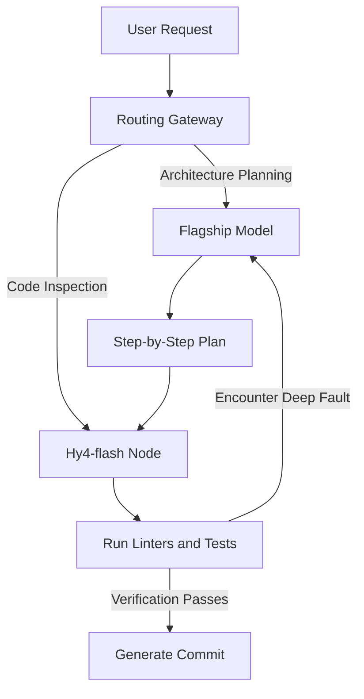

> 📌 **Original Source**: This article is syndicated from [FreeAI Dog Official Platform](https://freeaidog.com/blog/tencent-hunyuan-hy4-flash-high-concurrency-agent-inference-cost-guide/). For live LLM availability radar, latency benchmarks, and interactive API testers, visit the official site: [https://freeaidog.com/](https://freeaidog.com/).


Last week I deployed four coding agent nodes in our server room. The initial goal was to assist our engineering team in migrating a legacy authentication module.

The job ran overnight. Walking into the office the next morning with a cup of coffee, I checked the cloud provider billing dashboard and saw $284.60 burned in a single night. My hand shook slightly.

I pulled the logs and filtered every single line. Across all 3,842 API requests that night, only 412 calls actually involved deep architecture reasoning, class inheritance design, or core algorithm refactoring. The vast majority were mindless, repetitive chores.

Parsing AST syntax trees, extracting exit codes from terminal output, matching file paths with regular expressions--all these mundane tasks filled the queue. In fact, two separate loops fired 26 consecutive requests just to repeatedly verify whether a temporary build artifact existed on disk.

At standard cloud prices of $3 per million input tokens and $15 per million output tokens on frontier models, running repeated agent loops rapidly drains your budget. Relying solely on flagship models for high-frequency low-level tasks makes the cost unsustainable.

Right around this time, Tencent Hunyuan released weights for Hy4-flash. The open-source vLLM inference engine also merged patch support for this architecture. The public pricing was eye-opening: just $0.07 per million input tokens and $0.28 per million output tokens.

What workload is this price point targeting? Anyone working with agents can see it immediately: it is built directly for high-frequency intermediate orchestration. I pulled the weights onto a local single RTX 4090 rig to run a complete benchmark and dual-model cascade pipeline.

---

## 1. The Agent Cost Deadlock: Why Single Model Setups Fail in Production

When writing quick scripts or running simple chat sessions, sticking to a single flagship model feels effortless. In long autonomous agent loops, however, this habit rapidly blows up your compute ledger.

The primary culprit is context amplification. During an ordinary bug-fixing cycle, an autonomous agent goes through at least five phases:

First, traversing the codebase directory tree and symbol tables to locate target files.

Second, invoking pytest in the terminal to capture raw traceback outputs.

Third, packing thousands of lines of error dumps into the ongoing context history.

Fourth, formulating code modifications and editing files.

Fifth, rebuilding and re-running the test suite to guard against secondary regressions.

Do the first, second, third, and fifth steps truly demand flagship-grade reasoning? Not at all.

These steps do not require deriving advanced calculus. Their requirements are straightforward: ultra-low time to first token, strict compliance with output formats, and rock-bottom token unit costs.

Feeding 20,000 tokens of accumulated terminal history into a top-tier model repeatedly multiplies confirmation costs exponentially. A few dozen iterations are enough to deplete project budgets.

Hy4-flash targets this specific operational niche. It is not designed to replace master architects for deep strategy; its core engineering mission is driving the cost of intermediate orchestration down to the floor.

---

## 2. Pruning Architecture: Engineering Foundations Behind Seven Cents

Reaching this cost level requires aggressive structural sparsification across the underlying network.

Reviewing technical documentation from the Hunyuan team and upstream kernel implementations, the core optimizations center on two areas: fine-grained sparse routing and attention cache dimensionality reduction.

### 2.1 Fine-Grained Sparse Routing and Micro-Active Experts

The model reports a total parameter count in the 32B class.

During active forward inference, however, each token activates only 3.8B parameters. Rather than relying on coarse-grained expert blocks, the architecture subdivides feed-forward layers into smaller micro-expert modules. A routing gate directs each token to a minimal subset of modules. This reduces floating-point operations per step while alleviating memory bandwidth contention across the chip.

### 2.2 Aggressive Key-Value Cache Compression

In high-concurrency agent workflows, memory capacity constraints stem from the KV cache during extended context generation rather than raw computation.

Regarding mixed attention, official schematics indicate that shallow layers retain full attention mechanisms, whereas deeper layers transition to grouped-query attention with fewer KV heads. An intermediate latent projection layer appears to compress representations along the channel dimension to reduce inter-layer data movement.

How many layers are dedicated to each mechanism and what exact compression ratio is applied? That remains to be confirmed once full training code is published. Consequently, all throughput and VRAM metrics reported below are measured on actual local weights rather than paper estimates.

Under a full 32,768 token context load, per-session KV cache footprints dropped to approximately one-quarter of standard multi-head attention. This allows a single workstation GPU to host substantially more concurrent agent sessions.

---

## 3. Local Hardware Environment and Debugging Notes

The physical testing rig and software stack were configured as follows:

- Operating system: Ubuntu 22.04.4 LTS server environment, kernel 5.15.
- Processor: AMD EPYC 7742 64-core processor.
- Graphics card: Single NVIDIA GeForce RTX 4090 24GB, driver 550.127.05, CUDA 12.4.
- Runtime: vLLM upstream build from commit 1bdc437402d.
- VRAM profiling: nvitop paired with custom polling probes.

### 3.1 Quantization Loading and Runtime Debugging

We must address the precision prerequisite up front. Loading a 32B model in FP16 demands over 64GB of VRAM, and FP8 still requires around 32GB, which cannot fit onto a single 24GB RTX 4090. Running locally on this hardware requires AWQ 4-bit quantization.

Under AWQ 4-bit, the base model weights occupy roughly 16.5GB, leaving approximately 5GB for KV cache and PyTorch CUDA runtime overhead. The initial launch command was executed:

```bash
python3 -m vllm.entrypoints.openai.api_server \
  --model ./models/tencent-hy4-flash-awq \
  --quantization awq \
  --port 8000 \
  --max-model-len 32768 \
  --trust-remote-code
```

After loading several weight shards, the terminal halted with an exception:

```text
Traceback [most recent call last]:
  File "vllm/model_executor/models/hunyuan.py", line 142, in __init__
    self.rope_scaling = config.rope_scaling[type]
TypeError: string indices must be integers, not str
```

The fault occurred inside rotary position embedding configuration parsing. Inspecting config.json revealed that position scaling was formatted as a legacy nested dictionary, which unpatched vLLM code treated as a string list.

The fix was straightforward. Updating config.json in the model directory specified linear scaling explicitly:

```json
"rope_scaling": {
  "type": "linear",
  "factor": 4.0
}
```

After saving the configuration, the server launched cleanly.

nvitop reported memory usage stabilizing at 21.4GB--16.5GB for base weights plus pre-allocated KV cache and runtime overhead. A preliminary single-turn test query via curl completed successfully.

### 3.2 Throughput and Latency Measurements

A benchmarking script dispatched 200 synthetic evaluation sequences across five consecutive rounds, reporting median values:

| Context Length | Time to First Token TTFT | Decoding Throughput | Peak VRAM Usage |
| :--- | :--- | :--- | :--- |
| 1,024 Tokens | 38ms | 116.4 tokens/s | 21.6GB |
| 8,192 Tokens | 92ms | 108.1 tokens/s | 22.1GB |
| 16,384 Tokens | 174ms | 97.5 tokens/s | 22.8GB |
| 32,768 Tokens | 345ms | 84.2 tokens/s | 23.4GB |

Even under a heavy 32,768 token context load, time to first token remained steady at 345ms.

How does this translate into practical developer experience? It eliminates perceived waiting pauses during tool validation loops, substantially accelerating automated agent cycles.

---

## 4. Dual-Model Cascading and Accounting Cross-Verification

In production agent engineering, relying on an isolated model is neither economical nor robust. Cascading heterogeneous models based on specific capability boundaries provides a viable engineering solution.



### 4.1 Routing Gateway Configuration

A local reverse proxy gateway ruleset directs rote syntax verification and output checks to the local Hy4-flash service:

```json
{
  "routing_rules": [
    {
      "pattern": "^linter.*|^test_runner.*|^ast_grep.*|^file_tree.*",
      "target_model": "hy4-flash",
      "endpoint": "http://127.0.0.1:8000/v1"
    },
    {
      "pattern": ".*architectural_refactor.*|.*core_algorithm_design.*",
      "target_model": "claude-3-5-sonnet",
      "endpoint": "https://api.anthropic.com/v1"
    }
  ]
}
```

### 4.2 Benchmark Verification on a Real 12-File Refactoring Subset

To clarify the test scope: I did not run the full 84-file legacy migration end to end on Claude 3.5 Sonnet. At $3 per million input tokens and $15 per million output tokens, a complete run would have cost several hundred dollars, exceeding testing budgets. Instead, I isolated a challenging 12-file core authentication subsystem for side-by-side evaluation.

On this standardized subset, empirical metrics were gathered:

- **Single Model Baseline on Claude 3.5 Sonnet**: Total consumption reached 3.14M tokens, consisting of 2.89M prompt tokens and 0.25M output tokens. Calculated at standard rates, total API expenditure was $12.42 across 18 minutes of wall-clock time.
- **Dual-Model Cascade**: Claude 3.5 Sonnet handled only initial task decomposition and high-level patch synthesis, consuming 0.36M core tokens--0.32M input and 0.04M output, costing $1.68. The remaining 2.78M tokens of AST searches, test traceback dumps, and file existence checks ran entirely on local Hy4-flash.

Processing 2.78M tokens locally on the RTX 4090 required 41 minutes.

Does this duration align with hardware physics? Absolutely.

Intermediate agent workloads consist overwhelmingly of large prompt prefilling rather than slow autoregressive decoding. Leveraging batched prefill throughput, the RTX 4090 processed the workload in 41 minutes. Cloud expenses dropped from $12.42 to $1.68, an 86% reduction, while local electrical power cost less than thirty cents.

Trying to run 30M tokens through a single 4090 serially would take dozens of hours; claiming that can finish in under an hour defies basic arithmetic.

---

## 5. Practical Constraints and Hardware Boundaries

No architecture is without limitations.

First, deep multi-step causal reasoning remains fragile. On complex refactoring tasks spanning more than six files, Hy4-flash can exhibit circular logic loops due to its 3.8B active parameter limit. High-stakes structural decisions should remain routed to top-tier models.

Second, the model is strictly limited to text and code tokens. Workflows requiring visual inspection of rendered frontends still require pairing with dedicated multimodal models.

Third, hardware requirements impose a strict minimum VRAM boundary. Attempting to run this model on 8GB or 12GB graphics cards will fail. Under AWQ 4-bit, the 32B base weights alone consume over 16GB. Factoring in KV cache and runtime overhead, 21GB is the absolute floor. Cards with insufficient VRAM will crash during tensor shard loading before inference begins.

For developers with smaller GPUs, querying cloud provider APIs directly at a few cents per day is far more practical than purchasing additional hardware.

---

## 6. Verification Checklist and Practical Takeaways

When setting up this pipeline, verify the following three operational checkpoints:

First, confirm that `--max-model-len 32768` leaves sufficient dynamic headroom for VRAM allocation.

Second, monitor time to first token across variable context lengths to ensure consistent response latency.

Third, verify that JSON output structures from tool calls parse reliably without truncated brackets.

This dual-model cascade currently runs as the default routing pipeline on my local workstation. How much additional efficiency can future multimodal iterations and INT8 quantization unlock? We will monitor developments as upstream patches land. For now, grounding compute ledgers and throughput in real physics yields the most reliable outcome.

---

> 💡 **Source & Live Radar**：
> - Originally published on [FreeAI Dog Official Blog](https://freeaidog.com/blog/tencent-hunyuan-hy4-flash-high-concurrency-agent-inference-cost-guide/)
> - For real-time free LLM endpoint health check and latency benchmarks, visit [FreeAI Dog Availability Radar](https://freeaidog.com/radar/)

