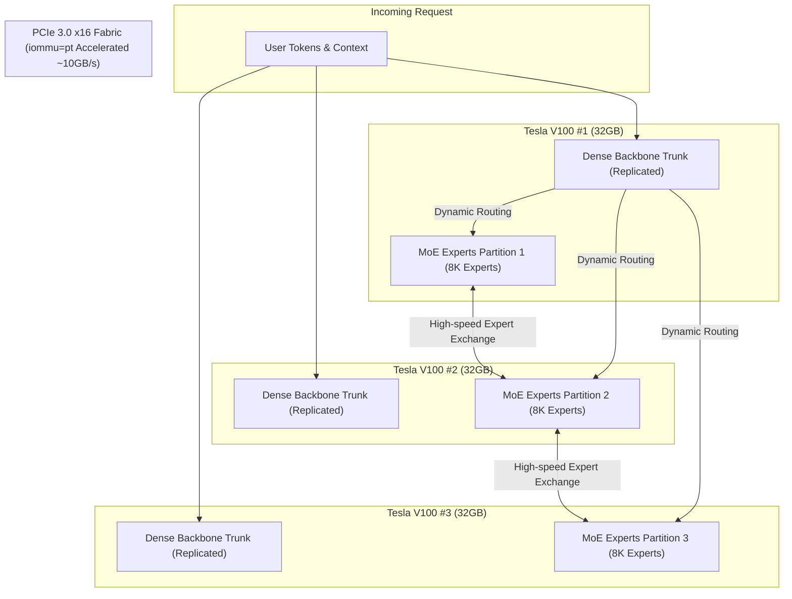

> 📌 **Original Source**: This article is syndicated from [FreeAI Dog Official Platform](https://freeaidog.com/blog/v100-dell-r740-400tps-qwen-volta-engine-guide/). For live LLM availability radar, latency benchmarks, and interactive API testers, visit the official site: [https://freeaidog.com/](https://freeaidog.com/).


# 400 t/s on a $2530 Rig: Rebuilding Strata for Volta GPUs with 3x Tesla V100, Dell R740 & the iommu=pt Kernel Breakthrough

When deploying large Mixture-of-Experts (MoE) foundation models locally (such as massive Qwen or DeepSeek architectures), homelab developers face two major obstacles:
1. **Exorbitant VRAM Costs**: Assembling 80GB to 96GB of high-speed memory typically demands multiple expensive RTX 3090/4090 GPUs or high-end enterprise accelerators costing tens of thousands of dollars.
2. **Severely Bottlenecked Inter-Card PCIe Latency**: On legacy dual-socket server platforms without NVLink, running tensor parallelism often encounters massive cross-socket communication overhead, causing throughput to stall.

Recently, a community hacker named **u/jfinkpottery** posted a breakthrough project on Reddit's **r/LocalLLaMA**:
**Using a budget hardware combination totaling just \$2,530—comprising a decommissioned Dell PowerEdge R740 server and three used Tesla V100 32GB GPUs—he rebuilt the inference engine kernels specifically for Nvidia's Volta architecture, unlocked PCIe throughput via a crucial Linux kernel flag, and achieved a peak decode speed of 400 t/s with long-context prefill reaching 3,400 t/s!**

This experiment revitalizes widely available, cost-effective **Tesla V100 32GB PCIe** cards (currently selling on secondary markets for ~\$600 each) and provides an actionable blueprint for budget-conscious developers seeking high-throughput inference.

---

## 1. Why Tesla V100 in 2026? The $2530 Hardware Economics

Why would someone deploy Nvidia's Volta architecture (launched in 2017) over modern GPUs that natively support FP8 or FP4 precision?

The answer lies in **massive HBM2 memory bandwidth and unmatched price-to-VRAM ratios**:

* **32GB HBM2 per Card**: 3x V100 cards yield **96GB of total VRAM** with individual memory bandwidth reaching **900 GB/s** (substantially faster than standard DDR4/DDR5 system RAM and faster than many consumer GDDR6 cards).
* **Decommissioned Data Center Surplus**: Cloud providers cycling out V100 compute nodes have pushed PCIe 32GB units down to roughly \$600 each.
* **Enterprise Server Affordability**: Robust chassis like the Dell PowerEdge R740 (featuring dual Xeon sockets, redundant power supplies, and high-CFM chassis fans) cost around \$500 barebones.

### Full Hardware Bill of Materials (Total BOM: ~$2,530)

| Hardware Component | Specifications | Quantity | Est. Unit Price | Subtotal |
|---|---|---|---|---|
| **GPU Accelerators** | NVIDIA Tesla V100 32GB PCIe Edition | 3 | \$600 | **\$1,800** |
| **Server Chassis** | Dell PowerEdge R740 (Dual Xeon + BOSS M.2 PCIe Card) | 1 | \$500 | **\$500** |
| **System Memory** | DDR4 16GB 2666MHz ECC Registered RAM | 2 (32GB Total) | \$65 | **\$130** |
| **Boot Drive** | M.2 SATA SSD 512GB (Mounted on BOSS Card) | 1 | \$100 | **\$100** |
| **Total Build Cost** | **96GB HBM2 Complete Compute Rig** | — | — | **\$2,530** |

> [!NOTE]
> Compared to purchasing a single consumer RTX 4090 24GB (frequently priced near \$2,000), this entire rig delivers **96GB of enterprise HBM2 memory**, allowing large quantized MoE models to reside entirely within fast VRAM.

---

## 2. The Bottleneck Breaker: From 0.2 GB/s to 10 GB/s with `iommu=pt`

During initial testing, the author encountered a common headache in dual-socket Xeon servers: **cripplingly slow inter-GPU PCIe communication**.

An AI assistant initially suggested that non-NVLink cross-socket communication was physically capped at 0.2 GB/s. With card-to-card bandwidth trapped at 200MB/s, multi-card parallelism becomes utterly unusable.

However, kernel diagnostics identified the true culprit: **Linux IOMMU (Input-Output Memory Management Unit) translation locks!**

When IOMMU is enabled by default, every DMA transaction between PCIe devices undergoes virtual-to-physical address translation through the host CPU, triggering severe translation cache lock contention during high-frequency inter-card exchanges.

### The Fix: Enable IOMMU Pass-Through (`iommu=pt`)

The author simply added `iommu=pt` to the Linux GRUB configuration:

```bash
# 1. Open the default GRUB configuration
sudo nano /etc/default/grub

# 2. Append iommu=pt to GRUB_CMDLINE_LINUX
GRUB_CMDLINE_LINUX="... intel_iommu=on iommu=pt pci=realloc"

# 3. Update GRUB and reboot the system
sudo update-grub
sudo reboot
```

**The Results Were Dramatic:**
* Inter-card bidirectional bandwidth exploded from **0.2 GB/s to ~10 GB/s—a 50x increase!**
* The `pt` (pass-through) mode instructs the kernel to bypass IOMMU mapping for physical host drivers while preserving virtualization capabilities for guest VMs.

> [!TIP]
> **Universal Homelab Principle**:
> Whenever you deploy multi-GPU rigs (whether Tesla V100s, P40s, or consumer RTX 3090/4090 cards) across dual-socket enterprise server motherboards (Dell R730/R740, HP DL380, Supermicro), **always enable `iommu=pt` as your baseline system tweak**.

---

## 3. Custom Engine Architecture: Rebuilding Strata for Volta

Upstream **Strata** targets newer architectures (Ampere, Ada, Hopper) and fails on Volta due to missing modern tensor core instructions. 

The author forked Strata's codebase and re-engineered the kernel primitives specifically around Volta's execution model and MoE routing:



### 1. Expert Parallelism with Replicated Dense Trunk
* **Expert Sharding**: Thousands of MoE expert weights are distributed evenly across the 3 V100 GPUs;
* **Dense Trunk Redundancy**: The shared attention backbone and dense layers are cloned across each GPU. While this consumes minor redundant VRAM, it **completely eliminates inter-GPU synchronization during dense transformer forward passes**;
* Extensively optimized for **Batch Size = 1 single-user token decoding**.

### 2. Empirical Benchmark Results (Q4_XL Quantization)

| Metric | Measured Performance | Operational Context |
|---|---|---|
| **Peak Decode Throughput** | **400 t/s** | Theoretical ceiling under structured/high-cache scenarios |
| **Sustained Prose Generation** | **~140 t/s** | **Realistic output for complex coding & reasoning** |
| **Prefill Speed (3 GPUs)** | **~3,400 t/s** | Extremely fast prompt evaluation on long contexts |
| **Prefill Speed (2 GPUs)** | **~2,800 t/s** | Dual-card fallback baseline |

Even at the conservative sustained rate of **140 tokens/second**, the system generates complete functions and prose responses in under two seconds.

---

## 4. Hardware Gotchas & Troubleshooting Checklist

Before replicating this build, keep these physical constraints in mind:

### 1. Thermal Management for Passive GPUs
Tesla V100 cards lack on-board fans and rely entirely on chassis air pressure:
* **Airflow Shroud Required**: Install Dell's official plastic airflow baffle.
* **iDRAC Fan Offset**: Set the minimum fan speed in the iDRAC web console to **45%–60%**. Without adequate airflow, cards quickly hit 90°C and throttle.
* **Power Cabling**: V100 PCIe requires 8-pin server EPS/PCIe power harnesses; always use verified Dell-compatible modular cables.

### 2. Verify PCIe Topology
Run `nvidia-smi topo -m` in your terminal:
```bash
nvidia-smi topo -m
```
* **`SYS`** indicates high-latency hops crossing NUMA nodes and chipsets.
* **`PHB` or `PIX`** indicates optimal low-latency links connected to the same PCIe root complex. Balance cards evenly across the R740 riser slots.

### 3. Current Caveats
* **Uniform Card Capacities**: The custom engine currently requires all GPUs to share identical memory capacities (32GB); mixed 16GB + 32GB setups are unsupported.
* **Avoid CPU Offloading**: Any layer spilling into CPU memory causes throughput to plummet, negating the 400 t/s design goal.

---

## 5. Key Takeaways

The project by u/jfinkpottery illustrates a fundamental lesson for homelab engineers:

**High-performance local LLM execution is not strictly determined by cutting-edge hardware; it hinges on deep full-stack optimization.** A single Linux kernel pass-through flag (`iommu=pt`) and an MoE expert-parallel layout transformed an aging \$2500 server into a 400 t/s inference powerhouse capable of handling massive modern open weights.

---

> 💡 **Source & Live Radar**：
> - Originally published on [FreeAI Dog Official Blog](https://freeaidog.com/blog/v100-dell-r740-400tps-qwen-volta-engine-guide/)
> - For real-time free LLM endpoint health check and latency benchmarks, visit [FreeAI Dog Availability Radar](https://freeaidog.com/radar/)

