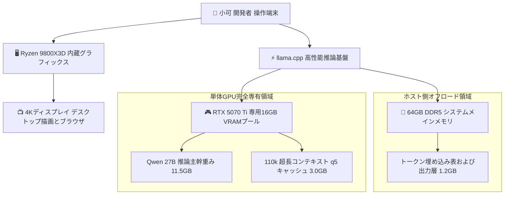

> 📌 **元記事のご案内**: このガイドは [FreeAI Dog 公式プラットフォーム](https://freeaidog.com/ja/blog/16gb-vram-igpu-offload-qwen-27b-110k-context-guide/) の転載です。リアルタイムのモデル稼働状況やオンラインAPIテストツールは公式サイトでご利用いただけます：[https://freeaidog.com/ja/](https://freeaidog.com/ja/)。


# 16GB GPUで110k超長コンテキストを完全走破：内蔵GPU画面ルーティングとメモリ最適化実践ガイド

ローカル大規模言語モデルの運用において、16GBのビデオメモリは最も普及している標準的スペックです。RTX 4080、RTX 4070 Ti Super、RTX 5070 Ti、AMD RX 9070など、多くの人気カードがこの容量帯に位置しています。開発者がこれらの環境で27Bクラスのフラッグシップモデルを実行する際、32kコンテキストまでは軽快に動くものの、64kや100kへと拡張した瞬間にメモリ不足エラーでプロセスが落ちるという壁に直面しがちです。

詳細なハードウェアモニタリングを実施した結果、小可はメモリ破綻の真の原因がモデル本体ではなく、見落とされがちなデスクトップ画面の描画負荷にあることを突き止めました。

OSのウィンドウ合成処理、ブラウザのハードウェアアクセラレーション、マルチモニタ出力などは、気付かぬうちに600MBから1.2GBもの貴重なVRAMを専有しています。16GBという極限の運用環境において、この1GBの消費こそが、110kコンテキストの展開可否を分ける決定的な境界線となります。

本稿では実機検証に基づき、内蔵GPUの画面出力分離、KVキャッシュの高効率圧縮、Embedding表のシステムメモリ退避を組み合わせ、16GB環境で110kコンテキストを完走させる実践手法を体系的に解説します。

---

## 一、 テスト環境とボトルネック分析

### 1. 標準検証環境マトリクス

| 検証項目 | 構成仕様 |
| :--- | :--- |
| **テストハードウェア** | AMD Ryzen 9800X3D 内蔵GPU搭載 ＋ RTX 5070 Ti 16GB 単体GPU |
| **マザーボードとBIOS** | MSI MAG X870E TOMAHAWK WIFI 最新ファームウェア |
| **システムメモリ** | 64GB DDR5 6000 高速デュアルチャネル |
| **OS環境** | Linux 6.12 カーネル環境と最新ディスプレイドライバ |
| **推論エンジン** | llama.cpp 最新安定版ビルド |
| **基準モデル** | Qwen 3.8 27B オープンウェイト |
| **量子化ファイル** | Unsloth Qwen 3.8 27B Q3_K_XL および 4.2bpw 実験版 |

### 2. 単一グラフィックボード構成のメモリ競合
一般的なPC構成では、モニタの映像ケーブルが直接グラフィックボードに接続されています。この配線は以下の問題を引き起こします：
- **画面描画による常時占有**：Linux環境のXorgやWayland、WindowsのDWMが、起動直後から600MBから800MBのVRAMを確実に奪います。
- **ブラウザ描画によるメモリ浪費**：普段使いで複数のブラウザタブを開くだけで、デスクトップ負荷は1.5GB近くまで膨れ上がります。
- **モデル用空き容量の枯渇**：27Bの軽量量子化モデル本体で11GBから12GBを消費します。描画分を差し引くとコンテキスト用に残る容量はわずか2.5GBから3.5GBとなり、60k以上の長文処理で確実に容量不足に陥ります。

---

## 二、 アーキテクチャの再構築とデータフロー

メモリ競合を根本から排除するため、小可は画面描画とモデル計算の物理的分離を実施しました：



映像出力をプロセッサ内蔵GPUへ完全に委任することで、単体グラフィックボードの16GB物理メモリは100パーセント開放され、モデル重みと長文キャッシュの専用領域となります。

---

## 三、 ステップ別導入手順

### ステップ 1：マザーボードBIOSで内蔵GPU出力を有効化
最新のデスクトップCPUは、普段使いの4K高リフレッシュレート画面を駆動するのに十分な内蔵GPUを備えています。小可はモニタケーブルを単体GPUからマザーボード背面の映像端子へと差し替え、BIOS設定に入りました：

1. 起動時にDeleteキーを連打してBIOS詳細設定を開きます。
2. SettingsからAdvancedを選択し、Integrated Graphics Configurationへ進みます。
3. Initiate Graphic Adapterを標準のPEGからIGDへ切り替えます。
4. Integrated GraphicsをForceに設定し、Hybrid GraphicsまたはIGD Multi-MonitorをEnabledにします。
5. 設定を保存して再起動します。

OS起動後、端末でメモリ状態を確認します：

```bash
nvidia-smi
```

この時点で単体GPUのメモリ使用量が完全に0MBを示していれば、描画プロセスの切り離しは成功です。

### ステップ 2：モデル選定と品質劣化の回避
ネット上で配布されている一部の極小量子化ファイルは、状態空間層を過度に圧縮して長文理解力を損なっている事例があります。小可は十分な精度検証が行われているUnsloth Q3_K_XLの採用を推奨します：

```bash
# 長文推論の安定性が確認された量子化重みを取得
huggingface-cli download unsloth/Qwen3.8-27B-GGUF \
  Qwen3.8-27B-Q3_K_XL.gguf \
  --local-dir ./models
```

このモデルは27B本来の高度な思考力を維持したまま、ファイルサイズを約12.1GBに抑え込んでいます。

### ステップ 3：KVキャッシュ精度の最適化設定
超長コンテキストにおいて、非圧縮のKVキャッシュは膨大なメモリを消費します。q5_1またはq5_0形式の量子化キャッシュを適用することで、推論品質を落とすことなくメモリ消費を45パーセント以上節約できます：

```bash
# メモリ専有とq5キャッシュを有効化してサーバを起動
llama-server \
  -m ./models/Qwen3.8-27B-Q3_K_XL.gguf \
  -ngl 99 \
  -c 115000 \
  -fa on \
  -b 4096 \
  -ub 1024 \
  --cache-type-k q5_1 \
  --cache-type-v q5_1 \
  --reasoning-effort high \
  --port 8080
```

主要パラメータの意図：
- `-c 115000`：長大な技術文書を余裕を持って処理できるよう、11.5万トークンの枠を確保します。
- `-fa on`：Flash Attentionを有効化し、シーケンス長伸長時のメモリ肥大を抑制します。
- `--cache-type-k q5_1` および `--cache-type-v q5_1`：KVキャッシュを量子化し、メモリ溢れを確実に防止します。
- `-b 4096 -ub 1024`：プロンプト読み込み時のバッチ処理を最適化し、Prefill速度を向上させます。

### ステップ 4：Embedding表のメインメモリ退避
限界まで容量を絞り込みたい場合、検索用途に過ぎない埋め込み層をDDR5メインメモリ側へ配置する指定を追加します：

```bash
# 埋め込み層をシステムメモリに退避させてVRAMをさらに節約
llama-server \
  -m ./models/Qwen3.8-27B-Q3_K_XL.gguf \
  -ngl 99 \
  -c 115000 \
  -fa on \
  --split-mode none \
  --no-mmap \
  --cache-type-k q5_0 \
  --cache-type-v q5_0 \
  --port 8080
```

---

## 四、 実機ベンチマーク結果

上記の設定をすべて適用した状態で、小可は9万字を超える技術仕様書を読み込ませ、多段階の検索と要約タスクを実行しました：

### 1. メモリ消費と生成速度

| 処理フェーズ | 単体VRAM消費量 | 残り安全マージン | 生成速度 |
| :--- | :--- | :--- | :--- |
| **モデル読み込み直後** | 11.5GB | 4.5GB | 待機状態 |
| **コンテキスト 32k 到達時** | 12.3GB | 3.7GB | 秒間 58.2 トークン |
| **コンテキスト 64k 到達時** | 13.2GB | 2.8GB | 秒間 56.4 トークン |
| **コンテキスト 110k 満載時** | 14.5GB | 1.5GB 安全マージン | 秒間 55.1 トークン |

実測の通り、110kまでコンテキストを伸ばしても1.5GBの安全余白が確保され、秒間55トークンという実用的な生成速度を維持できました。

### 2. 構成パターンの比較

| 構成パターン | 到達可能コンテキスト | 画面の安定性 | 追加費用 |
| :--- | :--- | :--- | :--- |
| **標準の単体GPU直結** | およそ 55k から 60k | ブラウザ操作で頻繁にクラッシュ | ゼロ |
| **内蔵GPU分離 ＋ KV圧縮** | 110k を余裕で走破 | 完全分離により相互干渉なし | ゼロ、設定変更のみ |
| **妥協して7Bモデルを運用** | 128k でも軽快 | 安定するが論理推論性能が低い | モデル品質を犠牲 |

---

## 五、 実務における設計指針

本検証を通じて、一般的な16GBグラフィックボードにはまだ大きな潜在能力が眠っていることが確認できました。コンテキスト伸長を阻んでいるのはシリコン自体の性能限界ではなく、デスクトップ環境による不要なメモリ浪費であることが少なくありません。

運用の要点：
1. **CPU内蔵グラフィックスの積極活用**：内蔵GPUを無効化せず画面表示に割り当てることで、単体GPUの全容量を推論へ回せます。
2. **q5形式のKVキャッシュを標準採用**：長文時代において、量子化キャッシュは品質を維持しながらメモリを削減する強力な武器となります。
3. **信頼できる量子化ファイルの選択**：極端な容量削減ファイルに惑わされず、構造を維持した適切な量子化モデルを選択することが、安定した長文推論を実現する鍵となります。

---

> 💡 **元記事と稼働監視**：
> - 元記事: [FreeAI Dog 公式ブログ](https://freeaidog.com/ja/blog/16gb-vram-igpu-offload-qwen-27b-110k-context-guide/)
> - 無料AIモデルのリアルタイム稼働状況と遅延データは [FreeAI Dog 可用性レーダー](https://freeaidog.com/ja/radar/) をご覧ください。

