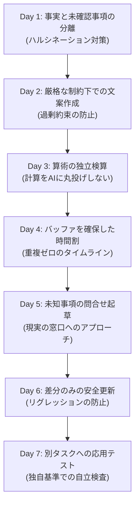

> 📌 **元記事のご案内**: このガイドは [FreeAI Dog 公式プラットフォーム](https://freeaidog.com/ja/blog/ai-practice-plan-for-beginners/) の転載です。リアルタイムのモデル稼働状況やオンラインAPIテストツールは公式サイトでご利用いただけます：[https://freeaidog.com/ja/](https://freeaidog.com/ja/)。


# AIを「おしゃべり玩具」で終わらせない：初心者向け「1つのマイクロプロジェクトで学ぶ7日間AI実践マスタープラン」

> **はじめに**：毎日AIチャットに様々な質問を投げかけているのに、いざ実際の仕事やタスク（会議の案内状、予算見積もりの比較、タイトな時間割の作成など）に直面すると、AIがもっともらしい嘘をついたり、的外れな回答をして使いこなせない……そんな経験はありませんか？
> 
> 本当のAI実践力は、ネット上の「魔法のプロンプト100選」を暗記することでは身につきません。それは、**厳しい制約条件の中でAIの出力を検査・修正する「人間による検証サイクル」**を通じてのみ鍛えられます。本記事では、架空の1つの小さなプロジェクトを題材に、1日15〜20分、7日間の実践を通してAIを自在にコントロールする手法を徹底解説します。

---

## 1. なぜ思いつきの質問ではAI活用力が伸びないのか？

多くの初心者はAIを「断片的なおもちゃ」として使っています。今日は詩を書かせ、明日は雑学を聞き、明後日はコードを一行書かせる。これでは実務に必要な判断力は身につきません。

現実のタスクにAIを導入する際、直面する4大落とし穴があります：

1. **ハルシネーション（もっともらしい捏造）**：情報に不足があると、AIは「未確認です」と答える代わりに、自信満々な口調で勝手な推測を事実として語り始めます。
2. **制約の形骸化**：「140字以内」「飲食の提供には触れない」と指示しても、油断すると字数をオーバーしたり余計な約束を追加します。
3. **計算の錯覚**：大規模言語モデル（LLM）は単語の確率予測マシンであり、厳密な電卓ではありません。見積もりや予算の合計をAIに丸投げすると重大なミスを招きます。
4. **修正時のリグレッション（品質の退行）**：一箇所だけ修正させようとすると、過去に合意した住所や持ち物の条件を勝手に削除してしまうことが頻発します。

これらを防ぐ鍵は、Googleも提唱する**「単一の情報源に基づく検証サイクル（Human-in-the-Loop）」**を実践することです。

---

## 2. 実践の土台：唯一の「信頼できる情報源（Brief）」

7日間の演習を始める前に、以下の**架空のプロジェクト要件**をメモ帳に保存してください。この要件書こそが、演習全体における唯一の「客観的事実」です。AIがネット検索で勝手な情報を足すことは一切禁止します。

> 📋 **【課題要件：12人規模の地域衣類お直しワークショップ】**
> 
> - **イベント内容**：衣類・布小物の簡単な補修ワークショップ
> - **開催日**：2026年10月17日
> - **会場予約枠**：14:00〜16:00（**設営および撤収・清掃の時間を含む**）
> - **募集定員**：12名
> - **材料費予算上限**：90ドル
> - **参加者持ち物**：洗濯済みの補修したい布製品1点
> - **主催側用意**：ハサミと針は主催者が全員分用意
> - **バリアフリー状況**：**段差なしの入口は確認済み。多目的・車椅子対応トイレの有無は未確認**
> - **申込方法**：2026年10月10日までに主催者へメール返信
> - **開催場所**：シダー・ルーム（架空住所：マーケット街8番地）
> - **お茶・軽食**：**未定**

*※ [FreeAI Dog ホーム](/) から、Google Gemini 2.5 Flash や DeepSeek-V3 などの無料APIモデルを使って今すぐ0円でお試しいただけます。*

---

## 3. 7日間ステップアップ実践カリキュラム



---

### Day 1：前提の分解 —— 事実は事実、疑問は疑問

#### 🎯 目的
与えられた要件のみから「確定事項」と「未確定事項」を厳密に切り分けさせ、AIの勝手な補完を阻止する。

#### 📝 プロンプト例
```text
以下のワークショップ要件書のみに基づいて、情報を2つのリストに整理してください：
1. 【確定している事項】（日時、数値、時間枠、住所などを正確に維持）
2. 【現時点で未確定の疑問点】

一般的な常識や推測で勝手に補完しないでください。要件書に書かれていないことは「確定」とみなしてはいけません。

【要件書】：
[ここに上記要件書を貼り付け]
```

#### 🔍 検証チェックリスト
- [ ] 車椅子対応トイレは「未確定」に分類されているか？「完全バリアフリー」と書かれていたら不合格。
- [ ] 軽食やお茶が「未確定」と明記されているか？
- [ ] 14:00〜16:00は「準備・片付けを含む会場予約時間」であると正しく認識されているか？

---

### Day 2：厳格な制約下の文章化 —— 文字数制限と過剰約束の排除

#### 🎯 目的
厳しい文字数と事実の制約を守り、参加者向けの案内文を作成する。

#### 📝 プロンプト例
```text
要件書をもとに、地域住民向けの案内文を作成してください。
以下の条件を厳格に守ること：
1. 本文は日本語で140文字以内とすること；
2. 開催日、会場予約枠、場所、持ち物、申込方法、10月10日の締切を正確に記載すること；
3. 多目的トイレは施設側に確認中である旨を記載すること；
4. 「参加費無料」や「お茶菓子付き」といった記載は絶対に行わないこと。
```

#### 🔍 検証チェックリスト
- [ ] 文字数カウントツールで本当に140文字以内か確認したか？
- [ ] 「無料イベント」と勝手に書かれていないか？
- [ ] 足りない点がある場合、最初から作り直させず「多目的トイレが確認中である点のみを1文追加し、140字以内に収めて」とピンポイントで指示する。

---

### Day 3：計算への盲信を捨てる —— 見積もり比較と独立検算

#### 🎯 目的
2つの見積もりを比較させ、**自分の電卓で数値を検算する習慣**をつける。

#### 📝 プロンプト例
```text
12名分の補修キットを購入するため、2社から税込見積もりを取りました：
- プランA：1セット5ドル、送料一律18ドル
- プランB：1セット6ドル、送料一律8ドル
予算上限は90ドルです。

以下を計算してください：
1. 各プランの本体小計（12セット×単価）、送料、総額をステップごとに算出；
2. 90ドルの予算からいくら残るか；
3. どちらのプランが総額で安くなるかを提示してください。品質の勝手な優劣判断は不要です。
```

#### 🔍 検証チェックリスト
自前の電卓で計算：
- プランA：$12 \times 5 + 18 = 60 + 18 = \$78$（残額 $\$12$）
- プランB：$12 \times 6 + 8 = 72 + 8 = \$80$（残額 $\$10$）
- [ ] AIの計算ステップと結果は一致しているか？
- [ ] 「プランAの方が安い」という結論になっているか？
- [ ] 「プランBの方が高品質」など、与えられていない勝手な推測をしていないか？

---

### Day 4：硬直的な時間枠の設計 —— バッファ確保と重複ゼロ

#### 🎯 目的
14:00〜16:00の枠内で、設営・撤収のバッファを死守したスケジュールを作成する。

#### 📝 プロンプト例
```text
14:00〜16:00（120分）の枠内で、2パターンの時間割を作成してください：
制約：
1. 14:00〜14:15：会場設営・受付（15分）；
2. 15:45〜16:00：道具返却・清掃（15分）；
3. ワークショップ本編は正味90分間。

パターン1【実演重視】：講師のデモ時間を長めにとる構成
パターン2【実践重視】：デモを短くし、参加者が作業する時間を最大化する構成

各コマの開始・終了時刻を明記し、時間の重複や空白を作らないこと。
```

#### 🔍 検証チェックリスト
- [ ] 15:45以降に講義が設定されていないか？（清掃時間が確保されているか）
- [ ] 時間の切れ目が綺麗に連続しているか？
- [ ] 人間としての判断：「参加者自身が縫う時間を重視したいのでパターン2を採用する」といった理由を自分で言語化する。

---

### Day 5：現実の窓口へ問合せる —— 想像ではなく質問を作成

#### 🎯 目的
欠けている情報をAIに捏造させず、現実の施設担当者へ送る簡潔な問い合わせメールを作成する。

#### 📝 プロンプト例
```text
会場管理担当者へ送信する簡潔な問い合わせメールを作成してください：
目的：10月17日 14:00〜16:00 の予約枠において、同フロアの多目的・車椅子対応トイレが利用可能かを確認する。
条件：
1. 礼儀正しく簡潔に、予約日時と部屋名を明記すること；
2. これは質問メールであり、利用可能であると決めつけた表現にしないこと；
3. 参加者の個人的な医療情報やプライバシーを勝手に創作しないこと。
```

---

### Day 6：安全な差分更新 —— 既存の完成形を壊さずに更新

#### 🎯 目的
新しい事実が2点確定した際、Day 2で作成した案内文の**該当箇所だけを安全に書き換える**。

#### 📝 プロンプト例
```text
2つの情報が更新されました：
1. 会場担当者より、当日多目的トイレが利用可能であると正式回答がありました；
2. 申込締切が10月10日から10月12日に延長されました。

Day 2で確定した140字の案内文を修正してください：
- 影響を受ける文のみを書き換え、住所や持ち物などの確定情報は1文字も無駄に変更しないこと；
- 140字以内を維持すること；
- 修正完了後、どこを変更したかを2行で箇条書きすること。
```

#### 🔍 検証チェックリスト
- [ ] 新旧の文章を見比べ、余計な箇所が勝手に削られていないか確認したか？
- [ ] 多目的トイレの利用可否と締切日以外の事実が完全に保たれているか？

---

### Day 7：別タスクへの応用実戦 —— 自立した検証サイクルの確立

#### 🎯 目的
まったく新しいチャットを開き、別のお題に対して自力でプロンプトを組み、チェックリストで検証する。

> **【別タスク要件】**
> - 社内勉強会：2026年11月6日 午前10:00〜11:00（参加6名）
> - 事前課題：配布資料の1〜8ページを読了して参加すること
> - オンライン会議リンク：未定（前日に送付予定）
> - 出欠：任意参加（自由参加）

架空のリンクを捏造していないか、ページ範囲（1〜8p）に間違いがないか、参加が強制になっていないかを自分の目で検査し、完成させてください。

---

## 4. プロンプトの魔法から「エンジニアリング思考」へ

| 漫然としたチャット利用 | 信頼性の高いAI協働思考 |
| :--- | :--- |
| 自信ありげな回答を鵜呑みにしてコピペ | **自信度 $\ne$ 事実**：AIの回答はまず疑って事実と突き合わせる |
| 計算や見積もりをAIに任せて放置 | **算術独立の原則**：計算は電卓やコードで必ず人間が検算する |
| 気に入らないと「全体をもう一度やり直して」 | **差分更新の原則**：変更点のみを外科手術のように差し替える |
| 不明な点があるとAIに「考えて」と丸投げ | **現実インターフェース原則**：未確定事項は現実の人間に聞く文案を作る |

AI時代に真に求められるのは、綺麗ごとを並べることではなく、**現実の制約と向き合い、出力された結果に責任を持つ検証力**です。ぜひ [FreeAI Dog](/ja/tools) の各ツールを活用して、実践の第一歩を踏み出してみてください！

---

> 💡 **元記事と稼働監視**：
> - 元記事: [FreeAI Dog 公式ブログ](https://freeaidog.com/ja/blog/ai-practice-plan-for-beginners/)
> - 無料AIモデルのリアルタイム稼働状況と遅延データは [FreeAI Dog 可用性レーダー](https://freeaidog.com/ja/radar/) をご覧ください。

