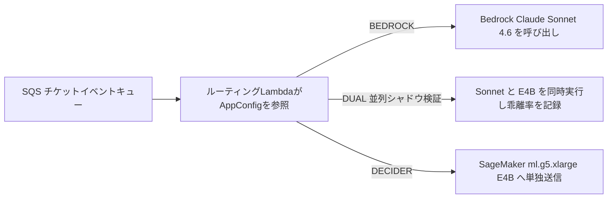

> 📌 **元記事のご案内**: このガイドは [FreeAI Dog 公式プラットフォーム](https://freeaidog.com/ja/blog/amazon-strands-decider-4b-replace-sonnet-46-routing-cost-guide/) の転載です。リアルタイムのモデル稼働状況やオンラインAPIテストツールは公式サイトでご利用いただけます：[https://freeaidog.com/ja/](https://freeaidog.com/ja/)。


1秒間に数十トークンを吐き出す汎用推論モデルで20択のチケット振り分けを回すのは、遅延にお金を払っているようなものです。

Amazonの社内エンジニアがチケット基盤の実コストを公開しました。従来の構成では、Bedrock上の `Claude Sonnet 4.6` に苦情対応や権限申請、アラート通知など固定20カテゴリ＋フォールバック先の分類を任せていました。1件あたり平均で入力6,554トークンを読み込み、理由説明とJSONで出力170トークンを返します。平均応答時間は4,215ミリ秒。定価ベースで1件0.0222ドル、100万件あたり22,200ドルに達していました。

これをオープンウェイトの `Strands Decider E4B` へ切り替えると、応答時間は897ミリ秒へ落ち、100万件あたりの単価は約500ドルまで下がります。見かけの削減率は98%です。ただ、すぐ真似するのは危険です。この試算には重い前提が乗っています。年間数千万〜1億件に近い処理量がなければ、月額課金のGPU待機コストが差額を食いつぶします。さらに厄介なことに、入力JSONのキー並び順だけで出力確率が揺れる問題まで見つかりました。

以下の数値はすべて公式エンジニアブログ、GitHubのmainブランチ、Hacker Newsの議論から直接照合しています。手元でSageMakerを借りて100万同時接続を回したわけではないため、架空のローカル実測グラフは一切載せず、帳簿の前提と本番障害の記録だけに絞って検証します。

## ポインターヘッドが返すのは1トークンだけ：微調整済みチャットモデルと別物

最初に `strands-labs/strands-decider` の名前を見たとき、私も普通のSFT微調整済み小型チャットモデルだと思い込みました。コードを読むと設計が根本から違います。

通常のLLMは自己回帰ループで1語ずつ生成します。カテゴリ名1つだけ欲しい場面でもデコード手順は省略できません。一方このリポジトリは、`Gemma 4` や `Qwen3.5` の土台に専用のポインター出力ヘッドを接続しています。テキスト状態に加えて、選択式の `choice`、はい／いいえ判定の `noul`、採点の `score` を渡すと、1回の順伝播でキャリブレーション済みの確率が返ります。出力長は常に1トークン固定です。

公式リポジトリに掲載された Gemma 4 全4モデルの仕様を並べると、選定基準が見えてきます。

| モデルチェックポイント | JevBench スコア | Brier 較正誤差 | BF16 重み VRAM | H100 単体の中央遅延 | 主な使いどころ |
| --- | --- | --- | --- | --- | --- |
| `strands-decider-E2B-gemma4-v1-2610` | 180 | 0.313 | 約 9 GB | 102 ms | 極端なVRAM節約やCPU運用 |
| `strands-decider-E4B-gemma4-v1-2610` | 187 | 0.243 | 約 15 GB | 139 ms | 24GB GPU 1枚で他プロセスと相乗り |
| `strands-decider-12B-gemma4-v1-2610` | 200 | 0.173 | 約 23 GB | 136 ms | 単一GPU占有で精度優先 |
| `strands-decider-26B-A4B-gemma4-v1-2610` | 207 | 0.162 | 約 51 GB | 245 ms | 誤分類コストが高い重要分岐 |

表の中に直感に反する数値があります。12B版はH100上で中央値136ミリ秒と、E4Bの139ミリ秒よりむしろ3ミリ秒速いのです。ではなぜ本番環境はE4Bを選んだのか。理由はGPUメモリです。SageMaker `ml.g5.xlarge` に載っているのは24GBのA10Gが1枚だけ。E4Bのロード時使用量は約19GiBで安全マージンが残りますが、12Bは重みだけで23GBを専有するためコンテキスト長が伸びた瞬間にメモリが溢れます。

ローカル検証を始める際はパッケージ版の罠にも気をつけてください。現在PyPIで配布されている `strands-decider` には Gemma 4 対応が入っておらず、そのままでは読み込みに失敗します。GitHubのmainブランチから直接入れます。

```bash
pip install "strands-decider @ git+https://github.com/strands-labs/strands-decider"
strands-decider ask StrandsAgents/strands-decider-E4B-gemma4-v1-2610 \
  --state "Help! My payouts have been failing for 3 days! " \
  --choice "Which team should handle this?=billing,sales,retail"
```

Apple Silicon Macで動かす場合、`--device mlx` を指定するとMPSより1.4〜1.6倍高速に動きますが、`pip install -e ".[mlx]"` によるソースインストールが必要です。またモダリティ制限も見落としがちです。Gemma 4系はテキスト専用であり、画像入力オプション `--vision` が効くのは旧モデルの `Qwen3.5-2B-Base` のみ。スクリーンショットをE4Bへ渡してはいけません。

## 時給1.408ドルのGPU算段：低トラフィックではむしろ割高になる

公式ブログで公表された移行前後の実測比較を並べます。

| 主要比較項目 | Claude Sonnet 4.6 Bedrock | Strands Decider E4B SageMaker | 変化幅と計算基準 |
| --- | --- | --- | --- |
| 1コール平均応答時間 | 4,215 ms | 897 ms | 78%短縮；インスタンス内処理は約640 ms |
| 平均入力トークン数 | 6,554 | 2,009 | 69%圧縮；プロンプト短縮を実施 |
| 平均出力トークン数 | 170 | 1 | JSON生成なしの1トークン出力 |
| us-east-1 公開単価 | 入力3ドル／出力15ドル per 1M | `ml.g5.xlarge` 時給 1.408ドル | オンデマンド定価；Lambda費用別 |
| 100万件あたり推計費用 | 約 22,200ドル | 約 500ドル | 約98%削減；完全稼働時理論値は250ドル |

100万件ごとに21,700ドル浮く数字だけ見れば魅力的に映ります。しかし年額で割り戻すと冷静になれます。「年間数百万ドル削減」を成立させるには、年間 9,000万件以上 のチケットを捌く計算になります。中小規模のサービスでそれだけの件数が出るでしょうか。

小規模チームがそのまま真似をすると赤字になりがちです。`ml.g5.xlarge` は処理件数に関係なく稼働時間あたりで課金されます。1台を24時間つけっぱなしにすると月額約1,014ドル。マルチAZ冗長構成と検証環境を足せば、チケット1件処理する前から毎月2,000〜3,000ドルの固定費が発生します。たとえば月間5万件の環境なら、Sonnet 4.6をそのまま叩いても月額1,110ドルで済みます。Haiku級の軽量APIへ切り替えるだけなら月額200ドル以下に収まり、コンテナ保守やコールドスタートの世話も要りません。

専用GPUエンドポイントを立てる条件は2つだけです。24時間キューが途切れず時給1.408ドルを薄められる規模があるか、あるいはコンプライアンス規約でデータをプライベートVPCの外へ出せず閉域SageMakerコンテナで完結させる必要があるか。ここで疑問が湧きます。そこまでコスト差が開くなら、なぜAWSはBedrockのトークン課金メニューとして提供しないのか。Hacker Newsの元スレッドでも同じ質問が飛んでいましたが、今のところ提供予定の回答はありません。

## 本番投入で踏んだリアルな障害：キー順0.19ドリフトと4,096上限

コスト表よりも読み応えがあったのは、記事後半に書かれた本番トラブルの記録でした。チームは失敗を隠していません。

一番不可解な不具合はシリアライズ層で起きました。入力JSONのキー並び順だけで判定確率が変わってしまったのです。チケット本文を一字一句変えず辞書のキー順だけ入れ替えたところ、モデルの出力確率が最大0.19もドリフトしました。信頼度スコアの閾値で自動処理と人間エスカレーションを切り替える基盤では、0.19のブレで境界ケースがひっくり返ります。開発チームは送信前にキーをアルファベット順へ強制ソートする規約を敷きました。自前でラッパーを書くなら最初にキー順序の固定を入れてください。

キー順序を固定した直後、今度は4,096トークンのコンテキスト上限にぶつかりました。Sonnet向けに書いていた20カテゴリ分の定義文だけで4,096トークンを超えてしまったのです。削れば誤分類が増え、削らなければエラーで落ちます。そこで20個の詳細ルールを1〜2文の短い判定条件へ圧縮し、当てはまらないケース用に `"none"` を追加しました。やり取りが何十件も連なる長大チケットは古い返信から順に切り捨て、直近文脈だけを残す前処理で平均入力を2,009トークンまで絞っています。

トラフィックの切り替えも一発勝負は避けています。ルーティング用Lambdaの前段で AWS `AppConfig` を読み、3状態のスイッチを組んでいました。



移行初期は `DUAL` モードに固定し、ユーザーへの応答には引き続きSonnetの結果を返しながら、裏側でE4Bとの乖離サンプルを溜め込んで信頼度閾値を詰めています。そのうえで `DECIDER` へ切り替え、深夜に誤判定が跳ね上がった際は `AppConfig` の設定変更だけでコード再デプロイなしに45秒でロールバックできる構成にしました。

最後に、Hacker Newsの議論で出ていた鋭い突っ込みも避けて通れません。カテゴリが20個で固定されているなら、`scikit-learn` や `ModernBERT` で専用分類器を学習した方が速くて安いのではないか、という指摘です。実際、従来型エンコーダなら応答は10ミリ秒未満、計算コストもGPUインスタンスより数桁安くなります。ただしその条件は、手元に数万件のきれいな正解ラベル済み履歴が揃っていること。Strands Decider が狙っているのは、今日急に新カテゴリが増えて教師データゼロの状態から確率付きで即戦力化するゼロショットのコールドスタート領域です。

---

本記事の単価、応答遅延、確率ドリフト数値はすべて以下の一次情報源から照合しています。

| 検証項目 | 一次情報リンク |
| --- | --- |
| Amazon社内チケット基盤でのSonnet 4.6置き換え事例 | https://strandsagents.com/blog/amazon-saves-millions-replacing-sonnet-with-strands-decider/ |
| Strands Decider 公式リポジトリ・インストール手順 | https://github.com/strands-labs/strands-decider |
| StrandsAgents Gemma 4 E4B モデルカード | https://huggingface.co/StrandsAgents/strands-decider-E4B-gemma4-v1-2610 |
| Marc Brooker によるデコーダ対エンコーダ解説 | https://brooker.co.za/blog/2026/10/04/encoders.html |
| Hacker News 元スレッドの料金試算と古典ML論争 | https://news.ycombinator.com/item?id=50436640 |

私がこの刷新案件を引き継ぐなら、今週はまだGPUインスタンスを立てません。まず本番ルーターに非同期シャドウログを7日間だけ仕込み、月間リクエスト総数が100万件を確実に超えるか、古い返信を切り捨てたあとに正解率が何ポイント落ちるかの2つだけ測ります。その2つの実測値を机に並べてから見れば、「98%削減」という見出しにも振り回されずに済みます。

---

> 💡 **元記事と稼働監視**：
> - 元記事: [FreeAI Dog 公式ブログ](https://freeaidog.com/ja/blog/amazon-strands-decider-4b-replace-sonnet-46-routing-cost-guide/)
> - 無料AIモデルのリアルタイム稼働状況と遅延データは [FreeAI Dog 可用性レーダー](https://freeaidog.com/ja/radar/) をご覧ください。

