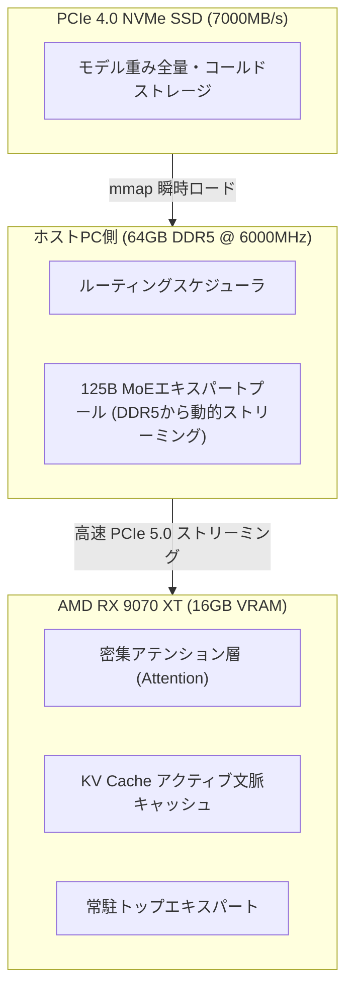

> 📌 **元記事のご案内**: このガイドは [FreeAI Dog 公式プラットフォーム](https://freeaidog.com/ja/blog/amd-rx-9070-xt-strata-qwen-flash-next-budget-setup/) の転載です。リアルタイムのモデル稼働状況やオンラインAPIテストツールは公式サイトでご利用いただけます：[https://freeaidog.com/ja/](https://freeaidog.com/ja/)。


# 1600ユーロで最前線Flash Nextを制覇！AMD RX 9070 XT ＋ Strataで90 t/sを叩き出す：量子化の罠とコスパ自作PC実測ガイド

ローカル環境で125Bクラスの巨大なMoE（Mixture of Experts）モデルを動かそうと調べると、多くのガイドで同じ絶望的な結論に行き当たります：
「RTX 3090/4090の2枚挿し、あるいは40万円超のRTX 5090 32GBを買うしかない。」

しかし、オープンソースのハードウェアコミュニティには、コストパフォーマンスを極限まで追求するギークたちが常に存在します。

先日、Redditの r/LocalLLaMA コミュニティで数百件のコメントを集めて大反響となった投稿がありました。欧州のエンジニアが **Intel Core i7-14700KF ＋ 64GB DDR5 ＋ AMD 新世代 Radeon RX 9070 XT 16GB（RDNA4アーキテクチャ）** を組み合わせ、総額わずか **約1,600ユーロ（日本円で約26万円）** の自作PCを構築したのです。

この手頃なワークステーション上で、MoEの動的オフロードに特化したオープンソース推論エンジン **Strata** を使用し、Alibabaの最先端マルチモーダル・コードモデル **Qwen 3.8 Flash Next** を走らせたところ、**70〜90 tokens/秒** という驚異的な生成速度を叩き出しました！

この出力速度は人間の読書速度をはるかに上回り、有償クラウドAPIの多くを凌駕するレスポンスです。

ただし、飛びつく前に注意すべき重要なポイントがあります。安易に導入した初心者が「Q2量子化による知能低下」や「ROCmドライバのエラー」の罠にハマる事例が続出しているからです。私（小可）が、このマシンの設計思想、ソフトウェア導入手順、そして避けるべき落とし穴をわかりやすく解き明かします。

---

## 1. 1,600ユーロのパーツ構成を解剖：どこに投資すべきか？

この構成が手頃な予算で125B規模のMoEを駆動できる核心は、**「VRAMで中核のアテンションとKVキャッシュを死守し、広帯域・高クロックのDDR5メモリでエキスパート層を流動させる」** という階層型オフロード設計にあります。

検証された実機の構成パーツ一覧は以下の通りです：

| パーツ種別 | 実測採用パーツ | 選定の理由とポイント | 価格目安 |
| :--- | :--- | :--- | :--- |
| **グラフィックボード (GPU)** | **AMD Radeon RX 9070 XT 16GB** | RDNA4アーキテクチャ（Navi 48）。FP8/FP4の行列演算アクセラレーションを標準装備し、コスパは競合を圧倒 | 約98,000円 |
| **CPU** | **Intel Core i7-14700KF** | 20コア28スレッド。高いシングルコアクロックでエキスパート層のルーティング計算を高速処理 | 約55,000円 |
| **メモリ (RAM)** | **64GB (32GB×2) DDR5 6000MHz CL30** | **超重要！** 帯域約96 GB/sのタイトなレイテンシ。MoEエキスパートをGPUへ送り込む生命線 | 約32,000円 |
| **マザーボード (MB)** | **B760 / Z790 高品質ATXマザー** | PCIe 5.0対応スロットと最低2系統のPCIe 4.0×4 M.2スロットが必須 | 約28,000円 |
| **ストレージ (SSD)** | **2TB PCIe 4.0 NVMe (7000+ MB/s)** | 重みデータの即時mmapロードとコールドエキスパート展開に超高速SSDが不可欠 | 約20,000円 |
| **電源ユニット (PSU)** | **850W ATX 3.0 Gold 認証** | 9070 XTと14700KFの瞬間的なピーク消費電力を余裕をもってカバー | 約16,000円 |
| **CPUクーラー・ケース** | **360mm簡易水冷 ＋ 高エアフローケース** | 高負荷の連続推論タスクでもサーマルスロットリングを防ぐ | 約18,000円 |
| **自作PC総額** | **一式完成構成** | **RTX 5090単体の購入価格以下で、125B MoEローカル実行環境が手に入る** | **約267,000円 (~1,600 €)** |



この階層型オフロードの仕組みにより、16GBのVRAMにアテンション層と最新のコンテキストキャッシュが常駐し、残りのエキスパート層はDDR5メモリとNVMeの間でStrataによってリアルタイムにスワップされます。

---

## 2. コミュニティの白熱議論：90 t/sの「Q2量子化」は本当に実用的なのか？

ベンチマーク公開後、最も議論を呼んだのは速度ではなく**「量子化によるモデル知能の劣化」**でした。

70〜90 t/sという驚異的な数値を記録したモデルは `Qwen3.8-Flash-Next-GSQ-RCO-Q2_0` です。

実務でコード作成や複雑なタスクを任せたい場合、以下の比較を必ず頭に入れておく必要があります：

### 量子化3グレードの実測比較表

| 量子化グレード | 実測Decode速度 | 占有メモリ目安 | 実用性と小可の評価 |
| :--- | :---: | :---: | :--- |
| **GSQ-RCO-Q2_0** | **90 〜 70 t/s** | 合計約 38 GB | ⚠️ **高速だが知能低下あり**。カジュアルな雑談なら快適ですが、複雑なプログラミングや厳格なJSONスキーマ出力では、変数の欠落やロジック破綻の頻度が上がります。 |
| **GSQ-RCO-IQ3_S** *(黄金の推奨)* | **60 〜 50 t/s** | 合計約 48 GB | 🏆 **速度と品質の完璧なスイートスポット！** 重要度マトリクス量子化により重要ロジックを保持。コーディングや関数呼び出しも極めて安定し、50+ t/sの速度は十分爆速です。 |
| **Atomic Q4 / GSQ-RCO-Q4** | **50 〜 30 t/s** | 合計約 62 GB | 💎 **製品レベルの高精度**。ほぼネイティブFP16に近い論理整合性を維持し、ハルシネーションの増加も皆無。長文ドキュメント分析に最適です。 |

> **小可のアドバイス**：ベンチマークの数字だけを追いかけてQ2_0に固執するのは避けるのが賢明です。**IQ3_Sこそが圧倒的におすすめ**。20 t/s程度の差で堅牢な推論能力と完璧なコード生成が手に入るなら、これ以上の選択肢はありません。

---

## 3. 実践セットアップ：RX 9070 XTでStrataを動かす

AMDのグラフィックボードで最先端の推論環境を構築する場合、Windowsよりもオープンソースの最適化カーネルが集まるLinux（ROCm）環境が最適です。

推奨環境：**Ubuntu 24.04 LTS（カーネル 6.10以上）**。

### ステップ 1：AMD ROCm 6.3 環境のインストール
```bash
# 1. 公式リポジトリの登録
sudo apt-get update && sudo apt-get install -y wget gnupg2
wget https://repo.radeon.com/rocm/rocm.gpg.key -O - | \
    gpg --dearmor | sudo tee /etc/apt/trusted.gpg.d/rocm.gpg > /dev/null

echo "deb [arch=amd64] https://repo.radeon.com/rocm/apt/6.3/ noble main" | \
    sudo tee /etc/apt/sources.list.d/rocm.list

# 2. ROCm HIP SDKと関連ツールの導入
sudo apt-get update && sudo apt-get install -y \
    rocm-hip-sdk rocm-opencl-runtime rocm-smi-lib rocminfo

# 3. 実行権限の付与
sudo usermod -a -G render,video $USER
```

> **RDNA4の重要な注意点**：RX 9070 XTは最新のNavi 48アーキテクチャ（ターゲット gfx1201）です。コンパイラがターゲットGPUを自動認識しない場合は、以下の環境変数を設定してください：
> ```bash
> export HSA_OVERRIDE_GFX_VERSION=12.0.0
> export ROCM_PATH=/opt/rocm
> ```

### ステップ 2：Strataエンジンの取得とコンパイル
Strataは非同期MoEオフロードのために設計された推論エンジンです（`stratallm.dev` / `github.com/Niko1221/Strata`）：

```bash
git clone https://github.com/Niko1221/Strata.git
cd Strata

# ROCm HIPバックエンドでビルド
mkdir build && cd build
cmake .. -DHIP_ROOT_DIR=/opt/rocm -DSTRATA_ENABLE_ROCM=ON -DCMAKE_BUILD_TYPE=Release
make -j$(nproc)
```

### ステップ 3：モデル重みのダウンロード
```bash
# 推奨のIQ3_Sモデルを取得
huggingface-cli download \
    LoneStriker/Qwen3.8-Flash-Next-GSQ-RCO-IQ3_S-GGUF \
    --local-dir /models/Qwen3.8-Flash-Next-IQ3_S
```

### ステップ 4：サーバーの起動
```bash
./bin/strata-server \
    --model /models/Qwen3.8-Flash-Next-IQ3_S \
    --vram-budget 14500 \
    --ram-budget 52000 \
    --port 8000 \
    --ctx-size 65536
```
主要パラメータ：
- `--vram-budget 14500`：16GBのVRAMのうち14.5GBをStrataに割り当て、OS表示用に1.5GBを確保；
- `--ram-budget 52000`：64GBのメインメモリのうち52GBを動的エキスパートキャッシュに割り当て。

起動後、ローカルの `http://localhost:8000/v1` でOpenAI互換APIが利用可能になります！

---

## 4. 驚異の裏技：200ドル（約3万円）の中古サーバー活用プラン

スレッドのコメント欄では、さらに過激な「中古ジャンクパーツ愛好家」たちによる驚愕の超低予算プランも紹介されていました：

「1600ユーロどころか、数万円しか予算がない」という場合でも、125B MoEを動かす道は存在します。

- **CPU**：Intel Xeon E5-2673 v4（20コア40スレッド、中古市場で **約1,500〜2,000円**）；
- **メモリ**：16GB DDR4-2133 RDIMM ECC × 4枚（4チャネル64GBで **約6,000円**）；
- **マザーボード**：中古X99 4チャネル対応ボード（**約6,000〜8,000円**）；
- **グラフィックボード**：**AMD Radeon Instinct MI50 16GB**（サーバー向けPCIe計算カード。ROCm完全対応、中古で **約15,000〜18,000円**）；
- **電源・テストベンチ**：中古750W電源＋オープンフレーム（**約4,000円**）。

**総予算は3万円台（約200米ドル）！**
DDR4メモリ帯域の制約により速度はAtomic Q4で **30〜45 tokens/秒** 前後となりますが、飲み会数回分の費用で125Bクラスの巨大AIを自宅の寝室で動かせるという事実は、まさにギークの夢と言えるでしょう。

---

## まとめ

欧州エンジニアの1600ユーロ自作PCによる90 t/sの快走から、3万円台の中古サーバー改造プランまで、オープンソースAIの世界はハードウェアの独占を次々と打ち破っています。

高価なNVIDIA環境だけが正解ではありません。**AMD RDNA4 ＋ Strataの動的オフロード** という新しい選択肢は、一般のエンジニアにとって極めて魅力的なソリューションです。

新しいPCの自作やローカル環境のアップグレードを検討している方は、ぜひこの構成を候補に入れてみてください。環境構築でつまずいたときは、お気軽にコメント欄でお知らせください！

---

> 💡 **元記事と稼働監視**：
> - 元記事: [FreeAI Dog 公式ブログ](https://freeaidog.com/ja/blog/amd-rx-9070-xt-strata-qwen-flash-next-budget-setup/)
> - 無料AIモデルのリアルタイム稼働状況と遅延データは [FreeAI Dog 可用性レーダー](https://freeaidog.com/ja/radar/) をご覧ください。

