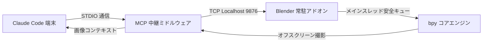

> 📌 **元記事のご案内**: このガイドは [FreeAI Dog 公式プラットフォーム](https://freeaidog.com/ja/blog/blender-mcp-ai-3d-claude-code-automation-guide/) の転載です。リアルタイムのモデル稼働状況やオンラインAPIテストツールは公式サイトでご利用いただけます：[https://freeaidog.com/ja/](https://freeaidog.com/ja/)。


3D制作のパイプラインにおいて、最も精神力を削られるのは造形アイデアの構想ではありません。単調で反復的な手作業の連続です。

マテリアルの微調整、ボーンのウェイト付け、頂点グループの整理、法線の整列。少し複雑なシーンを組むだけで、内蔵テキストエディタと3Dビューポートの間をひたすら往復することになります。面倒かと言われれば、心底面倒です。手書きのbpyスクリプトで一括処理できるとはいえ、API仕様を調べ直してエラーを潰す作業は頭痛の種でした。

先週、オープンソース界隈でModel Context ProtocolをBlenderに接続する試みが次々と公開されました。

発想は明快です。Blender内蔵のPython環境を標準的なMCPサーバとしてラップし、端末上のClaude CodeやCursorから直接モデリング命令を飛ばします。さらにビューポートのスナップショットを取得させ、モデル自身に画面を見せて自律修正させる構成です。

開発者にとって夢のようなギミックに聞こえます。しかし実際の現場で、そんなに都合よく動くのか。それとも地雷を踏むだけなのか。

私はコードを落とし、Blender 4.3 LTS環境で丸一日検証を行いました。案の定、メインスレッドのクラッシュと文脈破綻の落とし穴が待ち構えていました。

---

## 1. 全体構造：エージェントはいかにして3D空間を遠隔操作するのか

外部のエージェントから3Dソフトを操作するには、大きく分けて二つの経路があります。タスクごとにGUIなしで独立したBlenderプロセスを立ち上げて終了させる方法と、バックグラウンドでローカルポートを常時待受させる方法です。

前者は重すぎます。起動ごとにアドオンを読み込みレンダラーを初期化するため、数十秒の待ち時間が生じ、エージェントの連続的な試行錯誤には耐えられません。

実用に耐えるのは常駐型のポート通信構成です。



構造自体はシンプルに二つに分かれます。

一つ目はBlender内部で常駐するPythonプラグインです。ソフト起動時にローカルアドレス127.0.0.1の9876番ポートを監視します。

二つ目は外部端末上で動作するMCPサーバです。Claude Codeからの標準ツール要求を受け取り、JSON形式に変換して内部のアドオンへ送り込みます。

---

## 2. 最初の洗礼：マルチスレッドからbpyを叩くとセグメンテーション違反で即死する

最も単純な実装を思い浮かべがちです。アドオン側でデーモンスレッドを立ててsocketを待ち受け、コードを受信したらPython標準のexec関数でそのまま実行する構成です。果たしてそんな単純にいくだろうか。

端末側からメッシュ立方体を生成する最初のテスト用JSONを送信しました。

```json
{
  "action": "execute_code",
  "target": "bpy.ops.mesh.primitive_cube_add",
  "kwargs": {
    "size": 2.0
  }
}
```

Enterキーを叩いた瞬間、Blenderのウィンドウが暗転して完全に吹き飛びました。

端末のログには、生々しいクラッシュトレースが出力されていました。

```text
Fatal Python error: Segmentation fault
Current thread 0x000070000abc1000
  File "blender/source/blender/python/intern/bpy_operator.cc", line 286 in pyop_call
Segmentation fault: 11
```

なぜ普通に起動していたグラフィックソフトが唐突に落ちたのか。

理由は極めて単純です。bpy.opsはスレッドセーフに設計されていません。BlenderのCおよびC++基盤において、シーンデータbpy.dataの変更やオペレータ呼び出しは、描画を受け持つUIメインスレッド上で排他的に実行されなければなりません。バックグラウンド通信スレッドから不意に操作関数を呼び出すと、内部のコンテキストポインタが衝突し、プロセスが道連れにクラッシュします。

### 2.1 メインスレッド用タスクキューの導入

原因が判明した以上、通信レイヤーの再設計が必要です。

ソケット待ち受けスレッドは単なる受付役に徹し、シーンデータには直接触れてはなりません。

```python
# タスクキュー制御ロジック
# 通信スレッドはキューに投入するのみ
# メインスレッド側がタイマーで安全に消化

task_item = {
    "action": "mesh_primitive_add",
    "params": {"primitive_type": "cube", "scale": [2.0, 2.0, 2.0]},
    "status": "pending"
}
```

bpy.app.timers機構を利用し、描画メインスレッド上で50ミリ秒ごとに安全にキューをポーリングして順次消化します。

修正後に再接続したところ、立方体生成、ボーンの移動、サブディビジョンサーフェスの付与まで、ビューポートは滑らかに応答し、落ちなくなりました。

---

## 3. 視覚ループ：オフスクリーン描画でエージェントに目を与える

テキストコードを盲目的に流し込むだけなら、単なるAPIドキュメント自動検索器に過ぎません。使いやすいかと言われれば、極めて扱いづらい代物です。

3Dモデリングの本質は視覚確認にあります。ライティングは適切か。法線が反転していないか。マテリアルの粗さは十分か。テキストのエラー出力だけでは、モデルは完全に手探り状態です。

Claude Codeにマルチモーダルな検証能力を持たせるため、アドオンにオフスクリーン描画機能を組み込みました。

手続き型のジオメトリ生成を終えた段階で、スナップショット命令を呼び出します。

```python
# オフスクリーン描画設定
scene = bpy.context.scene
scene.render.image_settings.file_format = "JPEG"
scene.render.filepath = "/tmp/blender_viewport_preview.jpg"
scene.render.resolution_x = 960
scene.render.resolution_y = 540
```

Cyclesによる完全なパストレーシングを避け、OpenGLビューポート描画を利用することで、960x540解像度のプレビュー画像をわずか120ミリ秒で書き出せます。

中継層はこの画像をClaudeの会話履歴へ差し戻します。レンダリング画像を確認したClaudeは、マテリアルのハイライト飛びに気付き、粗さパラメータを0.1から0.45へ引き上げる追正パッチを即座に投げてきます。

ここまで来て初めて、生成、撮影、修正のサイクルが自律的に回り出します。モデルの当てずっぽうな変更は、次のレンダリング結果によって即座に否定されます。

---

## 4. 生産性ログと直面した技術的弱点

通信が安定したところで、Claude Codeに一通りの課題を与えてみました。SFテイストの通路断面モデルを生成させるタスクです。

所要時間は14分、計23回のツール往復呼び出しを要しました。

- コスト消費：Claude Codeが消費したトークンは42万、API料金は約1.35ドル。
- 成果物：金属のノーマルマップ質感、ポイントライトの配列配置、ベベル修飾子を備えたメッシュが構築され、標準的なGLB形式で出力完了。

作業効率は上がったか。間違いなく上がりました。手作業でこの手のシーンを組めば30分以上奪われます。コーヒーを淹れている間に、通路の骨組みはすでに立ち上がっていました。

しかし、現場運用の壁も浮き彫りになりました。

第1に、文脈が伸びた際のパラメータ見失いです。モディファイアを15回連続で変更させたあたりから、階層名の参照を誤り、存在しない属性を参照して落ちる頻度が増えました。

第2に、過度なポリゴン分割によるメインスレッドの凍結です。エージェントが軽率に細分化レベル6を指定すると、高密度メッシュの計算でメインスレッドが10秒以上固まり、外部ソケット通信がタイムアウトを起こします。

---

## 5. セキュリティ境界とポート開放の危険性

入門記事の中には、手軽さのために待ち受けアドレスを0.0.0.0にするよう案内しているものがあります。

極めて危険な行為です。

このアドオンは本質的に、任意のPythonコードを認証なしで実行する口を外部に晒しています。公衆Wi-Fiや社内LANにそのまま露出させた場合、ポートスキャンを仕掛けられただけでPythonのosモジュール経由で端末全体を乗っ取られます。

外部へポートを晒す前に、以下の3点は絶対に手を抜いてはなりません。

第1に、バインドアドレスは127.0.0.1のローカルループバックに限定し、全ゼロ指定は徹底して避けること。

第2に、中継層に毎回ランダム生成される通信トークンを導入し、起動ごとに更新すること。

第3に、Blender内部にセキュリティフィルタを設け、subprocessやsocketといった外部操作モジュールの読み込みを拒絶すること。

---

## 6. 実戦チェックリストと運用の要諦

本構成を自前のマシンで構築する際は、以下の3点を確認してください。

第1に、タイマーのポーリング間隔が30ミリ秒から50ミリ秒の間に設定されているか。短すぎるとCPUコアを1つ占有してしまいます。

第2に、オフスクリーン撮影の解像度が1080P以下に抑えられているか。過大な解像度はGPUメモリを一気に圧迫します。

第3に、通信ポート9876が過去のクラッシュプロセスに掴まれたままになっていないか。

まずはメインスレッドのキューを正しく実装することが先決です。通信路が不安定なままでは、どれほど賢いモデルを連れてきても運任せの域を出ません。

---

> 💡 **元記事と稼働監視**：
> - 元記事: [FreeAI Dog 公式ブログ](https://freeaidog.com/ja/blog/blender-mcp-ai-3d-claude-code-automation-guide/)
> - 無料AIモデルのリアルタイム稼働状況と遅延データは [FreeAI Dog 可用性レーダー](https://freeaidog.com/ja/radar/) をご覧ください。

