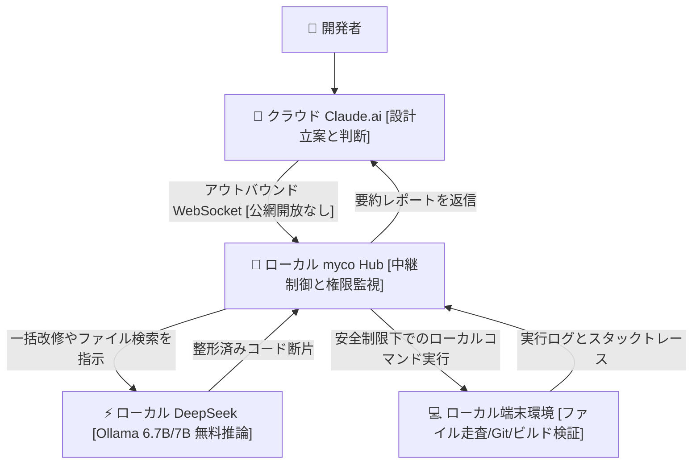

> 📌 **元記事のご案内**: このガイドは [FreeAI Dog 公式プラットフォーム](https://freeaidog.com/ja/blog/cloud-claude-local-deepseek-myco-hybrid-agent-guide/) の転載です。リアルタイムのモデル稼働状況やオンラインAPIテストツールは公式サイトでご利用いただけます：[https://freeaidog.com/ja/](https://freeaidog.com/ja/)。


# クラウド Claude が考え、ローカル DeepSeek が手を動かす：myco で構築するポート開放不要のハイブリッド AI ワークベンチ

Token 枠を真に食いつぶすのは、複雑なアルゴリズムの思考ではありません。退屈極まりない単純作業です。`src` 配下から三ヶ月触っていないコンポーネントを検索する。Prisma スキーマ内の `user_id` をすべて `userId` に置換する。Vite のビルドログから 300 行を走査して循環依存を洗い出す。

このような作業を一日二十回も投げ、その都度ファイル全文をペーストする。疲弊しないはずがありません。

月額 200 ドルの Claude Max を契約していても、大規模なリファクタリング中に 5 時間 45 通のレート制限に引っかかれば、作業は強制中断を余儀なくされます。これでは開発のリズムが台無しです。

机の下では、24GB の VRAM を備えた RTX 3090 が唸ることもなく静まり返っています。Ollama 経由で `deepseek-coder:6.7b` や `qwen2.5-coder:7b` を常駐させても消費 VRAM は 5.2GB 前後で、17GB 以上のメモリが完全に遊休状態です。

一週間のうち五日間、グラフィックボードのファンすら回りません。電気代だけがかかり、マシンパワーが眠ったままです。

クラウドの Claude はローカルコードを触れず、ローカルモデルは大規模な設計推論をこなせない。二つの間を繋ぐ通路がないため、人間がクリップボードの伝書鳩になるしかない。二つのファイルなら我慢できても、十数ファイルになるとコピペ作業で一日が終わってしまいます。

開発者の chenhg5 氏が GitHub で公開している `chenhg5/myco` は、まさにこの断絶を解消するオープンソースツールです。

核心は一言に尽きます。安全なアウトバウンド常時接続を張り、クラウド Claude を総設計士、無料のローカル DeepSeek を現場の作業員として協調させることです。



## ポート開放やトンネリングを避けるべき理由

リバースプロキシやトンネルによる解決策は、かつて私も試しました。

昨年 ngrok を使ってローカルの 11434 番ポートを二日間外部公開したことがあります。三日目の朝にアクセスログを確認すると、見知らぬ IP から `/api/tags` をスキャンされ、身元不明のモデル取得リクエストが飛んできていました。誰が叩いていたのか。侵入こそされませんでしたが、背筋が寒くなり即座にトンネルを破棄しました。その後に試した frp と IP ホワイトリストの組み合わせも、設定に三時間以上かかった割に不安が拭えませんでした。

インターネット上に直接ポートを露出させている限り、第三者のスキャンから逃れることはできません。AI エージェントがシェルスクリプトを直接実行する昨今、少しの認証ミスがホスト端末の乗っ取りに直結します。

さらに通信帯域の無駄も深刻です。わずか数行の修正のために数百 KB のソースコード全文が外側のネットワークを往復します。通信遅延によるタイムアウトが起きるうえ、クラウド側のコンテキスト枠があっという間に無駄な定型コードで埋め尽くされます。

myco の接続構成は逆方向です。ローカル側から能動的に外向き WebSocket コネクションを確立します。クラウド側からは開発者の自宅グローバル IP を知ることができず、ルーターでのポートフォワーディング設定も不要です。細かな書き換え作業はローカル LAN 内で完結し、Claude には数行の実行サマリーだけを返送します。

## 4 ステップで組むハイブリッド自動化ライン

外部サーバーやリバースプロキシの契約は不要です。以下の手順ですぐに稼働できます。

### ステップ 1：ローカル Hub デーモンの起動

まず実行環境ですが、Node.js は必ず 20 LTS を選定してください。Node 18 ではネイティブ WebSocket 周りで `undici` の互換性警告が出やすく、逆に最新の Node 22 では `node-gyp` のビルド段階で `v8::Value` 関連の廃止シンボルエラーが発生して停止します。

リポジトリの取得とビルド：

```bash
git clone https://github.com/chenhg5/myco.git
cd myco
npm install
npm run build
```

中枢ハブの起動：

```bash
node dist/index.js start --port 8765 --workspace /Users/cool/projects
```

コンソールにローカル待受アドレス `ws://127.0.0.1:8765` と認証トークンが表示されます。

### ステップ 2：ブラウザの Mixed Content 遮断を回避

これは環境構築で初心者が最もつまずきやすい落とし穴です。

ブラウザで開く `https://claude.ai` は厳格な HTTPS で動作しています。myco Hub が標準の `ws://127.0.0.1:8765` で平文通信を待受けていると、Chrome や Edge は Mixed Content [混在コンテンツ] 保護ポリシーによって通信を強制切断し、開発者ツールが `SecurityError` の赤文字で埋め尽くされます。

解決策は二つあります。

一つは `mkcert` ツールを用いて `localhost` 向けのローカル自己署名証明書を発行し、myco Hub を `wss://127.0.0.1:8765` で起動する方法です。

もう一つは作者が提供している専用 Chrome 拡張機能を導入し、拡張機能のバックグラウンド通信経由でオリジン間制約をバイパスする方法です。

私は前者を好みます。自己署名証明書を一度インポートすれば二分で完了し、拡張機能のバージョン管理を気にせずに済みます。

### ステップ 3：権限リストとローカルモデルの設定

ターミナルの実行権限を AI に渡す以上、防壁は強固でなければなりません。

設定ファイル `config.json` を編集します：

```json
{
  "hub": {
    "port": 8765,
    "authToken": "myco_sec_token_9918"
  },
  "permissions": {
    "allowedDirectories": [
      "/Users/cool/projects/freeai-hub",
      "/Users/cool/projects/sandbox"
    ],
    "disallowedCommands": [
      "rm -rf /",
      "dd",
      "mkfs",
      "shutdown",
      "reboot"
    ],
    "autoConfirmReadOnly": true
  },
  "localWorker": {
    "engine": "ollama",
    "endpoint": "http://127.0.0.1:11434",
    "model": "deepseek-coder:6.7b"
  }
}
```

`allowedDirectories` で指定ディレクトリ外へのアクセスを遮断し、`disallowedCommands` のブラックリストで危険な破壊的コマンドの実行を物理的に防ぎます。

ローカルモデルは Ollama から取得します：

```bash
ollama pull deepseek-coder:6.7b
```

どのモデルサイズが適しているか。

ローカル環境に無理して 33B や 70B モデルを投入しないでください。ローカルワーカーの責務はファイル走査、構文変換、型補完、単純なリファクタリングです。必要なのは毎秒 45 トークン以上の素早い応答速度です。70B で数トークン毎秒の重い処理をさせると、クラウド側がタイムアウトで切断され本末転倒になります。6.7B モデルであれば RTX 3090 上で約 5.2GB の VRAM で軽快に動作します。

### ステップ 4：Claude への指揮用プロンプト登録

Web 版 Claude.ai の Project またはカスタム指示に以下を登録します：

```markdown
あなたは主任ソフトウェアアーキテクトです。ローカル環境とモデルを操作できる myco_local プロキシを配下に持ちます。
役割分担：
1. 全体設計、インターフェース定義、複雑な推論はあなたが担当します；
2. ファイル検索、機械的な構文変換、テスト実行の際、チャット欄に長大なコード全文を出力せず、ローカル実行用のペイロードを生成してください；
3. ローカル実行完了後は、返送された実行サマリーとテスト結果を確認して承認を行ってください。
```

ルーティングのリファクタリングを例にとり、Claude に指示を送信します：

`「routes ディレクトリ内の全ファイルから any 型を洗い出し、厳格な interface に置換したうえでローカルの型チェックを実行してください。」`

Claude はまず四列のタスク一覧を作成します：ファイルパス、修正インターフェース、依存関係、合格基準。内容確認後にローカルへ指令が飛びます。

ローカルの myco は `grep` で該当する 14 ファイルを数秒で特定。ローカル DeepSeek がファイルを順次読み込み、コードを書き換えて保存。端末側で自動的に `npm run check` が走ります。

クラウドに戻るテキストはわずか三行です：テスト通過、14 ファイル修正完了、TypeScript エラー 0 件。Claude はサマリーを確認して完了と見なします。画面を手動で行き来するより遥かに快適です。

## 実測データと検証条件の注記

一週間を通して利用状況を確認したところ、Claude の入力 Token は日量三十万規模から六万前後に落ち着きました。Anthropic の管理画面はセッション単位で分割表示されるため手動合算での概算値ですが、大幅な削減は実感できます。

何より、作業を中断させられていた 429 レート制限エラーが一週間を通して一度も発生しませんでした。

ただし手戻りのコストも正直に開示します。ローカルモデルが関数のシグネチャを誤変換したケースが二回あり、クラウド側で再レビューしたため、削減効果の約一割を相殺しました。机上の八割五分減という誇大表記より、実質七割五分減と表現するのが正確です。

| 評価指標 | クラウド Claude 単体運用 | myco ハイブリッド構成 | 差異と実務上の考察 |
| :--- | :--- | :--- | :--- |
| **一日あたりのクラウド Token** | 約 300,000+ Tokens | 約 60,000 Tokens 前後 | **手動合算の概算、約七割五分を削減** |
| **遭遇した 429 制限回数** | 日に何度も作業中断 | 一週間通してゼロ件 | **機械的タスクをローカル逃がし** |
| **コードの機密性保護** | ソース全文を何度も公網送信 | ローカル内で完結読み書き | **ソースは外に出ず要約のみ通知** |
| **ローカル GPU の有効活用** | 24GB VRAM が終日遊休 | 6.7B が 5.2GB で常時処理 | **余剰 GPU リソースを完全活用** |

## 実運用上の注意点とスペックの限界線

現場で遭遇した二つの注意点を共有します：

第一に、ノート PC のカバーを閉じてスリープさせると、常時接続の WebSocket は `ECONNRESET` で即座に切断されます。自動復帰を過信せず、起動シェルに 5 秒待機の再試行ループを組み込み、pm2 などのプロセスマネージャーで管理してください。

第二に、モデルによる一括修正後はコミット前に必ず `git diff` を目視確認してください。スネークケースからキャメルケースへの変換時、外部 API が返す JSON の生フィールド名まで巻き込んで置換してしまうケースがあり、これはコンパイラでも検知できません。

RTX 3090 や 16GB 以上の VRAM を持つデスクトップ環境があれば、この構成は日々の泥臭い作業を肩代わりしてくれます。一方で内蔵 GPU のノート PC で CPU 推論に頼る場合は、推論遅延でかえって作業効率が落ちるため推奨しません。

普段の開発で最も Token を浪費している単純作業は何ですか。手元の遊休グラフィックボードの活用法について、コミュニティでぜひご意見をお聞かせください。

---

> 💡 **元記事と稼働監視**：
> - 元記事: [FreeAI Dog 公式ブログ](https://freeaidog.com/ja/blog/cloud-claude-local-deepseek-myco-hybrid-agent-guide/)
> - 無料AIモデルのリアルタイム稼働状況と遅延データは [FreeAI Dog 可用性レーダー](https://freeaidog.com/ja/radar/) をご覧ください。

