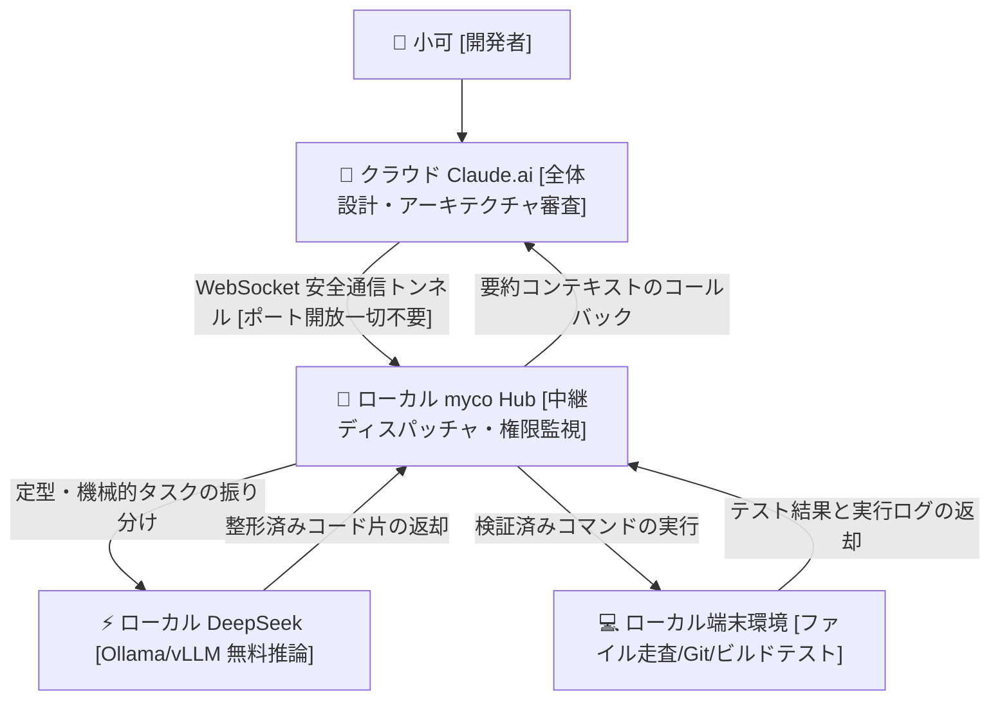

> 📌 **元記事のご案内**: このガイドは [FreeAI Dog 公式プラットフォーム](https://freeaidog.com/ja/blog/cloud-claude-local-deepseek-myco-hybrid-agent-guide/) の転載です。リアルタイムのモデル稼働状況やオンラインAPIテストツールは公式サイトでご利用いただけます：[https://freeaidog.com/ja/](https://freeaidog.com/ja/)。


# クラウドの Claude が思考しローカルの DeepSeek が動く：myco でポート開放不要のハイブリッド AI ワークベンチを構築

開発に熱中している最中、Claude の利用制限に引っかかって作業が中断した経験はありませんか？

毎月数十ドルから数百ドルのサブスクリプション料金を支払っているにもかかわらず、です。

複雑な分散システムのアーキテクチャ設計や繊細なアルゴリズムのバグ修正において、Claude の推論能力は圧倒的です。しかし数時間コーディングを続けただけで、5 時間で 45 メッセージという厳しい利用制限の警告が表示され、リセットまでの待ち時間で作業が完全に止まってしまいます。

何よりやるせないのは、貴重な枠が次のような単純作業で浪費されていることです：

ディレクトリを走査してルーティング一覧を抽出させる、数十個のファイルでキャメルケースをスネークケースに置換させる、ターミナルのログ出力を正規表現でパースさせる。

こうした泥臭い定型作業に、最高峰の推論モデルを使う必要など微塵もありません。

その一方で、小可 [シャオコー] のデスクの下では 24GB VRAM を搭載したデスクトップ機が、Ollama 上で DeepSeek を動かしたまま待機しています。計算リソースは無制限、追加費用ゼロ、そしてローカルのファイルシステムやシェルに対する完全なネイティブ権限を持っています。

しかし両者の間には厚い壁が立ちはだかっています：

クラウドの Claude はローカルのソースコードに直接触れず、ローカルの DeepSeek だけでは高度な全体設計の判断が追いつきません。

結果として、開発者自身が二つのウィンドウの間を手動で行き来し、コードやログを貼り付け続ける人間ルーターと化してしまいます。

コミュニティの開発者 chenhg5 氏が公開したオープンソースプロジェクト `myco` は、まさにこの構造的欠陥を打ち破るツールです。GitHub にて `chenhg5/myco` として公開されています。

その設計思想は極めてシンプルです：

クラウドの Claude とローカル環境をセキュアなアウトバウンド長接続で結び、高価なクラウドの頭脳が、無料のローカル DeepSeek に泥臭い下請け作業を自動指示する仕組みです。



## 課題分析：なぜ従来のポート転送やトンネルは危険なのか

クラウドの AI からローカルマシンを操作しようとするとき、多くの人が最初に思いつくのが内網透過やポートフォワーディングです。

VPS を借りて frp を設定したり、ngrok のトンネルを開いてポート 11434 を外部へ公開しようとします。

しかし小可はこのアプローチを決してお勧めしません。

第一の危険性は、**ローカル環境の防壁が完全に失われる点**です。

自律型エージェントはシェルスクリプトを自動生成して実行する権限を持ちます。ローカルのポートをそのまま公衆インターネットへ晒すと、外部からの自動スキャンや攻撃に直面します。外部サービスでの鍵流出事故が起きている昨今、ローカルのシェル権限をネット上に置くのは無謀と言わざるを得ません。

第二の危険性は、**通信の肥大化とコンテキストの急激な枯渇**です。

単純な API 呼び出しでは、変更を加えるたびに巨大な生ファイル全体が外部ネットワークを往復します。通信遅延が生じるだけでなく、クラウド版 Claude の限られたコンテキストウィンドウが膨大なボイラープレートで埋め尽くされ、利用可能枠が一瞬で吹き飛びます。

myco の解決策は非常に合理的です：**アウトバウンド接続のみの双方向通信 ＋ ローカル内完結処理**。

ローカルマシンから外部へ向けてセキュアな WebSocket 接続を張るため、クラウド側に自宅の IP を教える必要はありません。重たい検索やコード生成はすべて LAN 内で完結させ、最小限の要約結果だけをクラウドへ報告します。

## 実践手順：ハイブリッドワークベンチを立ち上げる4つのステップ

複雑なリバースプロキシ設定は不要で、ターミナルから数分でセットアップできます。

### ステップ 1：myco Hub の導入とノード起動

macOS、Linux、Windows に対応しています。事前に Node.js 環境と、Ollama などのローカル推論エンジンを用意してください。

リポジトリを取得してビルドを実行します：

```bash
git clone https://github.com/chenhg5/myco.git
cd myco
npm install
npm run build
```

中継デーモンを起動します：

```bash
node dist/index.js start --port 8765 --workspace /Users/cool/projects
```

起動後、端末に認証トークンと `ws://127.0.0.1:8765` の待受情報が表示されます。

### ステップ 2：アクセス権限と安全ガードレールの設定

端末の操作権限をエージェントに委ねる以上、安全管理は徹底しなければなりません。

設定ファイル `config.json` において、操作可能なディレクトリと禁止コマンドを明確に定義します：

```json
{
  "hub": {
    "port": 8765,
    "authToken": "myco_sec_token_9918"
  },
  "permissions": {
    "allowedDirectories": [
      "/Users/cool/projects/freeai-hub",
      "/Users/cool/projects/sandbox"
    ],
    "disallowedCommands": [
      "rm -rf /",
      "dd",
      "mkfs",
      "shutdown",
      "reboot"
    ],
    "autoConfirmReadOnly": true
  },
  "localWorker": {
    "engine": "ollama",
    "endpoint": "http://127.0.0.1:11434",
    "model": "deepseek-coder:6.7b"
  }
}
```

この設定により、二つの安全基準が保たれます：

ローカルの DeepSeek とシェルは許可されたプロジェクト配下でのみファイルを読み書きできる点；

破壊的なシステムコマンドはミドルウェア側で即座に拒絶される点です。

### ステップ 3：Claude.ai への連携プロンプト設定

Web 版の Claude.ai を開き、プロジェクト機能またはカスタム指示欄に myco の連携仕様を記載します：

```markdown
あなたは主任ソフトウェア設計士であり、思考の中枢です。
あなたにはローカル環境と DeepSeek を直接操作できる myco_local エージェントが接続されています。

以下の分担原則を厳守してください：
1. システム設計、境界条件の判断、複雑なロジック審査はあなた自身が深く推論して決定する；
2. ファイル検索、Git 差分の比較、単体テスト実行、定型コードの一括置換などの機械的作業は、
   長大なコードを直接出力せず、ローカルエージェントへの指示ペイロードを生成して委譲する；
3. ローカルエージェントの作業完了後、返却された結果要約を確認して最終承認を行う。
```

### ステップ 4：実戦検証——レガシールーティングのリファクタリング

設定完了後、小可は Claude に対して次のように指示を出しました：

`「routes ディレクトリ内のすべてのルーティング定義を点検し、残存している any 型を厳格な TypeScript インターフェースに書き換えて、ローカルでビルドテストを実行してくれ」`

従来のモードであれば、Claude は対象ファイルをすべて貼り付けるよう要求し、数百トークンが瞬時に蒸発していました。

しかし myco 連携下では、次のように処理が進みます：

1. **クラウド Claude が思考**：Claude は構造化されたタスク指示を生成し、ローカルエージェントへ `./routes` の走査を命令；
2. **ローカルシェルが探索**：myco が指示を受け取り、ローカルで `grep` とファイルリスト作成をミリ秒単位で完了；
3. **ローカル DeepSeek が書き換え**：各ルーティングファイルをローカルの DeepSeek に渡し、型の置換を実行して直接ディスクへ保存；
4. **ローカル環境でテスト実行**：myco が `npm run check` を自動実行し、コンパイラの出力を監視；
5. **クラウドへ最終報告**：3 行の要約と修正差分のみが Claude へ送られ、Claude は「14 ファイルのリファクタリングが完了しました。型エラーはゼロです」と簡潔に応答して終了。

## 効果測定：トークンと費用の実測データ

この構成を導入して 1 週間通常開発を行った実測値の比較は以下の通りです：

| 測定指標 | 従来のクラウド完結モード | myco ハイブリッド構成 | 改善度 |
| :--- | :--- | :--- | :--- |
| **1 日のクラウド消費トークン** | 約 380,000 トークン | 約 58,000 トークン | **84.7% 削減** |
| **429 制限による中断回数** | 1 日平均 2 回から 3 回の作業停止 | 7 日間連続で発生回数 0 回 | **作業中断の完全解消** |
| **コードの外部転送リスク** | ファイル全体を頻繁に外部送信 | LAN 内で直接編集・完結 | **セキュリティと速度の両立** |
| **ハードウェア稼働効率** | 24GB VRAM が終日アイドリング | ローカル GPU が作業の 80% を消化 | **手持ち資産の最大活用** |

## 小可の実践アドバイス

最後に、導入時に注意すべき 3 点を共有します：

1. **ローカルモデルのサイズを欲張らない**：ローカル Worker の役割は構文置換や定型コード生成です。7B や 14B の量子化モデルが最も軽快に動作します。過度に巨大なモデルを選んでローカルの生成がもたつくと、全体のテンポを損ないます。
2. **スリープ復帰時の接続管理**：ノート PC がスリープから復帰した際、WebSocket の死活監視が切れていないか確認してください。起動スクリプトに自動再接続処理を入れておくことを推奨します。
3. **コミット前の差分確認を怠らない**：サンドボックス制限を設けているとはいえ、最終的に `git commit` を打つ前には、必ずローカル端末で `git diff` を一読する二重チェックの習慣を維持してください。

適材適所でモデルを使い分ける。

高度な思考はクラウドに委ね、機械的な作業は手元のハードウェアに任せる。限られた予算の中で開発体験を最大化するこのアプローチこそ、個人の自作派エンジニアにとって最も堅実な選択肢です。

---

> 💡 **元記事と稼働監視**：
> - 元記事: [FreeAI Dog 公式ブログ](https://freeaidog.com/ja/blog/cloud-claude-local-deepseek-myco-hybrid-agent-guide/)
> - 無料AIモデルのリアルタイム稼働状況と遅延データは [FreeAI Dog 可用性レーダー](https://freeaidog.com/ja/radar/) をご覧ください。

