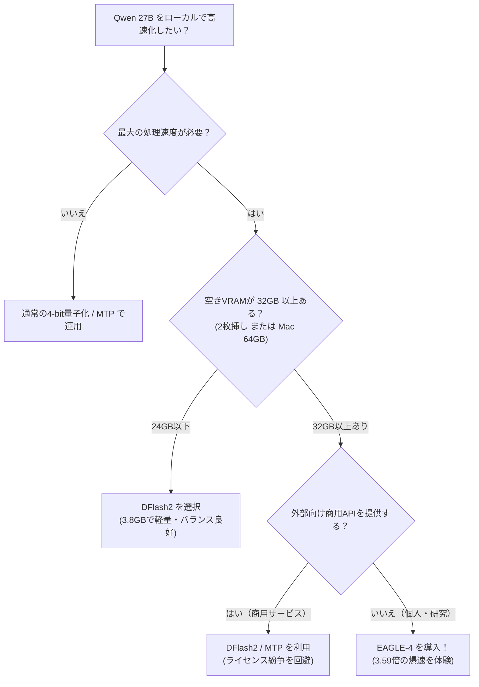

> 📌 **元記事のご案内**: このガイドは [FreeAI Dog 公式プラットフォーム](https://freeaidog.com/ja/blog/eagle-4-speculative-decoding-guide/) の転載です。リアルタイムのモデル稼働状況やオンラインAPIテストツールは公式サイトでご利用いただけます：[https://freeaidog.com/ja/](https://freeaidog.com/ja/)。


# ローカルLLM推論が3.59倍に加速：EAGLE-4投機的サンプリング実測とVRAM/商用ライセンスの落とし穴

> **はじめに**：ローカルPCや自作サーバーで20B〜70Bクラスの大規模言語モデル（LLM）を動かしたことがある方なら、毎秒15〜20トークンで文字がぽつぽつと出力されるもどかしさを経験したことがあるはずです。
> 
> この推論速度の壁を打ち破る最新技術として、**「EAGLE-4」が正式リリース**されました。ベンチマークテストでは、人気のQwen 27Bモデルにおいて**従来比3.59倍**という圧倒的な加速比を記録し、先行するDFlash2やDSparkを抜き去りました。
> 
> しかし、技術の進化には必ずトレードオフが存在します。コミュニティの実測では、**6GBを超える膨大な追加VRAM消費**と、**商用推論サービス提供を明確に禁止する独自ライセンス**という2つの重大な落とし穴が浮き彫りになっています。本記事ではその実態と選定基準を詳しく解説します。

---

## 1. 投機的サンプリング（Speculative Decoding）とは？

通常のLLM生成では、1トークン生成するごとに数GB〜数十GBのモデル重みをVRAMから演算コアへ転送する必要があります。つまり、生成速度は計算能力ではなく**メモリ帯域幅**によってボトルネックとなっています。

**投機的サンプリング**は、この制約を「推測と検証の分業」によって打破します：
1. **軽量なドラフトモデル（EAGLE-4）**が先行して複数のトークン（4〜6単語）を高速に予測出力；
2. **メインモデル（Qwen 27B）**が1回の並列フォワードパスで、それらの候補を一括検証；
3. 正しい単語を一挙に採択し、誤りがあった時点で修正。1回のメモリアクセスで3〜4単語が確定します。

この手法の最大の利点は、**数学的に完全な可逆・無損失（Lossless）**である点です。メインモデルの確率分布に従って厳密に検証されるため、通常の1文字ずつの生成と品質の違いは一切ありません。

---

## 2. EAGLE-4実測ベンチマーク：3.59倍の破壊力

| アクセラレーション手法 | Qwen 27B 加速比 | 推定生成速度 (秒速20文字基準) | ドラフトモデル追加VRAM |
| :--- | :---: | :---: | :---: |
| 通常の逐次生成 (Baseline) | 1.00× | 20 t/s | 0 GB |
| ネイティブ MTP ヘッド | 2.22× | 44 t/s | 極小（内蔵） |
| DSpark | 2.57× | 51 t/s | ~2.5 GB |
| DFlash2 | 2.80× | 56 t/s | **~3.85 GB** |
| 👑 **EAGLE-4 (新リーダー)** | **3.59×** | **71.8 t/s** | **~6.18 GB** ⚠️ |

毎秒20トークンから**70トークン以上**へのジャンプは、体感として「待つ」感覚から「一瞬で画面が埋まる」感覚への劇的な変化をもたらします。

---

## 3. 飛びつく前に知るべき2つの重大な落とし穴

### 落とし穴 1：6.18GBの追加VRAM消費（RTX 3090/4090でメモリ不足に）

投機的サンプリングでは、メインモデルとドラフトモデルの**両方をVRAMに常駐**させる必要があります。

- DFlash2のドラフトモデルは約 **3.85 GB** でした；
- しかしEAGLE-4は推測精度を高めるためにドラフトモデルが **6.18 GB** へと肥大化しています。

```
【RTX 3090 / 4090 (24GB VRAM) での内訳】：
メインモデル Qwen 27B (4-bit量子化): 約 15.5 GB
KVキャッシュ (コンテキスト長 8k〜16k): 約 4.5 GB
システム・PyTorch予約枠:                約 1.0 GB
─────────────────────────────────────────────
残余VRAM: 約 3.0 GB
💥 DFlash2 (3.85GB) ➔ コンテキスト調整でなんとか収まる
❌ EAGLE-4 (6.18GB) ➔ 100% CUDA Out of Memory (OOM) 発生！
```

単一の24GBグラフィックボード環境では、メインモデルの量子化を極端に落とすかコンテキストを犠牲にしない限り、EAGLE-4を載せることは困難です。**24GB環境では依然としてDFlash2が実用的な選択肢**となります。

---

### 落とし穴 2：商用ライセンスの罠（Source-Available、競合利用の禁止）

EAGLE-4のリポジトリはMITやApache 2.0ではなく、**独自の非自由ソースアベイラブルライセンス**を採用しています。

> 🚫 **「本ソフトウェアまたはその派生物を用いて、競合する商業的推論サービスを提供することを固く禁ずる」**

- 個人での研究・趣味・実験：問題なく利用可能
- 自社サービスの外部向けAPI提供・課金販売：**重大なライセンス違反・法的リスク**

---

## 4. まとめ：技術選定のフローチャート



ローカル環境の構築やVRAM管理の手間をかけずに爆速推論を体験したい場合は、[FreeAI Dog ホーム](/) で紹介している **Groq**（専用チップLPUによる500+ t/s推論）や **Cerebras** などの無料APIを活用するのもおすすめです！

---

> 💡 **元記事と稼働監視**：
> - 元記事: [FreeAI Dog 公式ブログ](https://freeaidog.com/ja/blog/eagle-4-speculative-decoding-guide/)
> - 無料AIモデルのリアルタイム稼働状況と遅延データは [FreeAI Dog 可用性レーダー](https://freeaidog.com/ja/radar/) をご覧ください。

