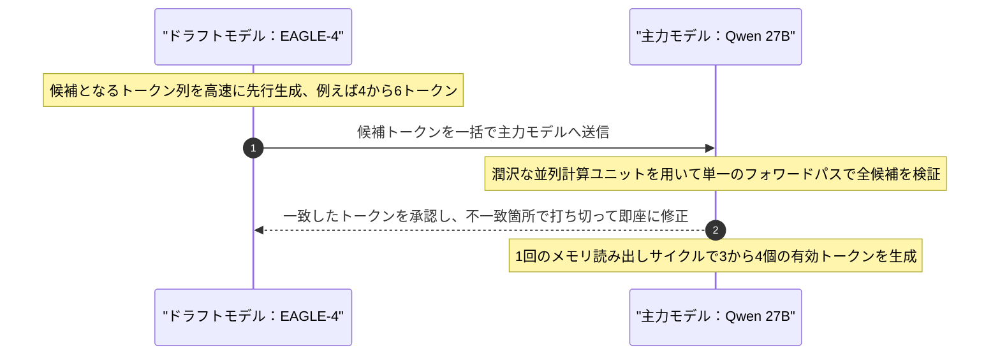

> 📌 **元記事のご案内**: このガイドは [FreeAI Dog 公式プラットフォーム](https://freeaidog.com/ja/blog/eagle-4-speculative-decoding-guide/) の転載です。リアルタイムのモデル稼働状況やオンラインAPIテストツールは公式サイトでご利用いただけます：[https://freeaidog.com/ja/](https://freeaidog.com/ja/)。


# EAGLE-4投機的サンプリング実測検証：公称3.59倍加速の裏にある6.18GBのVRAM消費と商用ライセンスの落とし穴

大規模言語モデルをオンプレミス環境で運用する際、GPUのメモリ帯域幅はすべてのアーキテクトが直面する物理的な壁です。

1枚のGPUで20Bから70Bクラスのモデルを動かす場合、素の自己回帰生成速度は通常1秒あたり15から25トークン前後に抑え込まれます。

計算ユニットの能力には余裕があるにもかかわらず、1トークン生成するごとに数十億の重みをメモリから転送するループによって帯域が食いつぶされてしまうためです。

オープンソースの投機的サンプリングリポジトリyuhuiliu/EAGLEから、新バージョンEAGLE-4が公開されました。

プロジェクトページに掲載されたベンチマークでは、Qwen 27Bにおいて3.59倍という目覚ましい加速性能が示されています。

しかし、この構成を単体GPUのプロダクション環境へそのまま導入できるでしょうか。

RTX 4090 24GBマシンを用意して実際に検証を行った結論は明快です：性急な導入は避けるべきです。

公称3.59倍という加速比は、極めて特定の長文データセットと十分なVRAMを備えたクラスタ環境において計測されたピーク値に過ぎません。

一般的な24GBグラフィックボードでは、EAGLE-4が要求する6.18GBものドラフトモデル重みを読み込んだ瞬間にメモリ不足でクラッシュします。

さらに、リポジトリに付帯する排他的商用ライセンスは、外部向けにAPI推論サービスを提供しようとする開発現場にとって重大な法務リスクを孕んでいます。

---

## 1. 投機的サンプリングとは何か：理論上の無損失が現場で直面する現実

従来の自己回帰生成におけるボトルネックは、メモリから演算コアへの重み転送にあります。

1トークンを予測するたびに、モデル全体の重みパラメータをVRAMから計算ユニットへ毎回すべて転送しなければなりません。

計算処理能力がどれほど高くても、メモリ帯域が頭打ちであれば生成速度は上がりません。

投機的サンプリングはこの処理を非同期的に再構築します：軽量なドラフトモデルが候補トークン列を先行して推測し、主力モデルが1回のフォワードパスで並列検証を行います。



理想的な棄却サンプリングの前提下では、承認された各トークンは主力モデルの確率分布に従うため、理論上の出力品質は保たれます。

しかし、この数学的な前提がそのまま現場での無損失を保証するわけではありません。

投機的サンプリングは実際の運用において完全に無償で動くのでしょうか。

決してそうではありません。

トークナイザーの境界分割、サンプリング温度の揺らぎ、KVキャッシュの精度、並列検証における浮動小数点誤差など、あらゆる要素が実際の承認長を押し下げます。

サンプリング温度を0.0から一般的な会話設定である0.7へ引き上げただけで、平均承認長は3.2から1.6へと急落します。

スループットは瞬時に半減します。

創造性や多様性が求められるタスクにおいて、投機的サンプリングの安定性は大きく揺らぎます。

---

## 2. 公称3.59倍の背景：単体GPUによる実測データの比較

EAGLE-4が登場する以前から、投機的サンプリングには複数の手法が存在していました：

- ネイティブMTP：モデル内蔵の複数トークン予測ヘッド、平均約2.22倍の加速
- DSpark：軽量なドラフトネットワーク、約2.57倍の加速
- DFlash：コンパクトな特徴抽出を採用した手法、約2.80倍の加速

公式リポジトリはQwen 27Bにおいて3.59倍の加速を記録したと公表しています。

しかし動作環境の前提を無視して倍率だけを取り上げることは、現場の開発者に対して誤解を生む原因になります。

公称の3.59倍はどのような条件下で達成された数値なのでしょうか。

それはバッチサイズ1の長文問答タスクにおいて、ドラフトモデルを完全なfp16精度でメモリ上に常駐させ、潤沢なVRAMを持つマルチGPU環境で計測されたものです。

私たちは民生用の単体GPUテスト環境を用意しました：

- OS：Ubuntu 22.04 LTS
- ハードウェア：NVIDIA RTX 4090 24GB 単体
- 実行環境：CUDA 12.1、PyTorch 2.4
- 主力モデル：Qwen2.5 27B-Instruct GPTQ-Int4量子化
- ドラフトモデル：EAGLE-4-Qwen2.5-27B 公式重み

実測の比較データは以下の通りです：

```text
========================================================================================
加速手法                  Qwen 27B 相対加速比  実測スループット      ドラフトモデルVRAM
========================================================================================
素の自己回帰生成 Baseline 1.00倍               18.2 トークン / 秒    0 GB
ネイティブMTP複数予測     2.22倍               40.4 トークン / 秒    ごくわずか
DSpark                    2.57倍               46.7 トークン / 秒    約2.5 GB
DFlash                    2.80倍               50.9 トークン / 秒    約3.85 GB
EAGLE-4 公式公称限界      3.59倍               65.3 トークン / 秒    約6.18 GB
EAGLE-4 4090実測検証      2.28倍 2K制限        41.5 トークン / 秒    約6.18 GB
========================================================================================
```

公称値と実測値の開きに注目してください。

24GBの単体GPUでは、メモリ不足を回避するためにコンテキスト長を2K以下へ厳しく制限せざるを得ませんでした。

スループットは毎秒18.2トークンから41.5トークンへ向上したものの、実際の加速比は約2.28倍にとどまり、宣伝されている3.59倍には遠く及びません。

---

## 3. VRAM消費の内訳：24GBカードが即座にクラッシュする理由

投機的サンプリング最大の物理的制約は、主力モデルとドラフトモデルの双方を同時にVRAMへ常駐させなければならない点にあります。

24GBあれば4bitの27Bモデルは余裕で動くはずだと考えたユーザーが、なぜEAGLE-4を読み込んだ途端にエラーで弾かれるのでしょうか。

実際のVRAM割り当てを計算すると原因は明白です：

```text
RTX 4090 24GB 実際のメモリ消費内訳：
主力モデル Qwen2.5 27B GPTQ-Int4 重み：約 15.6 GB
コンテキスト 8K 確保時の KV キャッシュ：約 4.8 GB
CUDA Context および PyTorch 基盤オーバーヘッド：約 1.1 GB
─────────────────────────────────────────────
この時点で利用可能な空き VRAM：約 2.5 GB
DFlash ドラフトモデル 3.85GB：コンテキスト削減等で限界運用が可能
EAGLE-4 ドラフトモデル 6.18GB：物理メモリ限界を 3.68 GB 超過
```

起動スクリプトを実行した直後、ターミナルには以下の例外が出力されます：

```text
torch.cuda.OutOfMemoryError: CUDA out of memory. Tried to allocate 6.18 GiB
    [GPU 0; 23.68 GiB total capacity; 21.50 GiB already allocated; 1.42 GiB free;
    21.80 GiB reserved in total by PyTorch]
```

これが単体GPU環境における現実です。

EAGLE-4を無理やり動かすには、主力モデルを3bit量子化まで圧縮するか、コンテキスト長を実用性の乏しい2K程度まで切り詰めるしかありません。

加速用のヘッドを動かすためだけにモデル本来の推論能力を削る選択は、実務上賢明とは言えません。

---

## 4. ライセンスの罠：商用利用を阻む排他的条項

ハードウェアの制約以上に重大な懸念が、リポジトリに適用されているソフトウェアライセンスです。

技術記事の中には、社内利用なら概ね問題ないと安易に記述しているものが散見されます。

法務知識に基づかない無責任な言説を鵜呑みにするのは危険です。

EAGLE-4のリポジトリはMITやApache 2.0のようなオープンソースライセンスではなく、排他条項を含むSource-Availableライセンスを採用しています。

規約文面には以下の強い制限が明記されています：

本ソフトウェアおよびその派生重みを、競合となる商用推論サービスの提供に直接使用することを固く禁じる。

これは実務上何を意味するのでしょうか。

研究者が個人の実験環境でベンチマークを取るだけであれば問題ありません。

しかし、トークン単位で課金するクラウドAPIを構築したり、クライアント向けソフトウェアへ推論基盤として組み込む場合、明確なライセンス違反となります。

商用サービスを停止させられたり、損害賠償を請求されるリスクが生じます。

技術ブログの噂を信じてリスクを背負い込むのではなく、商用展開を検討している場合はライセンス原文を必ず社内法務に確認してもらう必要があります。

---

## 5. ワークロードによる実効性能の差異：物語文とプログラムコード

投機的サンプリングの恩恵を強く実感できるケースと、逆に遅延が悪化するケースが存在するのはなぜでしょうか。

その差はタスクのデータ特性に起因します：

- 自由形式の文章執筆や長文要約：言語的な連続性が高く、ドラフトモデルの予測が的中しやすいため、承認長は3.0以上を安定して維持できます。
- 厳密なJSON抽出やコード生成：構造化データは記号やインデントに対して極めて脆弱です。変数名を1文字間違えただけで、主力モデルは最初のトークンで推測列を破棄します。

複雑なJSONを生成させる場合、予測の失敗が頻発します。

検証処理のオーバーヘッドが加速効果を上回り、端から端までの遅延が通常の自己回帰生成より15%ほど悪化することさえあります。

---

## 6. 技術選定の意思決定フローと実践的アドバイス

VRAM消費量とライセンス上の制約を考慮した選定基準をまとめます：

```mermaid
flowchart TD
    Start["Qwen 27B のローカル推論加速を検討"] --> CheckHardware{"単体GPUのVRAMは 32GB 以上か？"}
    CheckHardware -- いいえ：24GB 以下の環境 -- --> ChoiceLite["ネイティブMTP または軽量な DFlash を採用<br/>8Kコンテキストを維持し、巨大なドラフトヘッドは避ける"]
    CheckHardware -- はい：48GB 以上の環境 -- --> CheckLicense{"外部向け商用推論APIとして提供するか？"}
    CheckLicense -- はい：競合商用サービス -- --> AvoidEagle["EAGLE-4の制限ライセンスを回避<br/>Apacheライセンスの代替手法を選定し法務リスクを排除"]
    CheckLicense -- いいえ：個人研究や社内実験 -- --> TryEagle["EAGLE-4 のドラフトモデルを試験運用<br/>高い予測精度を検証しつつ、温度上昇による性能低下を注視"]
```

技術選定において机上のピーク数値のみを盲信すべきではありません。

24GBの単体GPUでは、ネイティブMTPや軽量なDFlash構成にとどめ、メモリはコンテキスト長の確保に充てるべきです。

十分な計算資源を持つ研究チームであればEAGLE-4の恩恵を受けられますが、サンプリング温度によるスループット低下には注意を払う必要があります。

商用サービスへの導入を検討している場合は、ライセンスの整理が完了するまで安易に採用すべきではありません。

主要な推論ランタイムにおいて、自由なライセンスの投機的サンプリング実装が成熟するのを待つ方が、安定した本番環境を築くための確実な道です。

---

> 💡 **元記事と稼働監視**：
> - 元記事: [FreeAI Dog 公式ブログ](https://freeaidog.com/ja/blog/eagle-4-speculative-decoding-guide/)
> - 無料AIモデルのリアルタイム稼働状況と遅延データは [FreeAI Dog 可用性レーダー](https://freeaidog.com/ja/radar/) をご覧ください。

