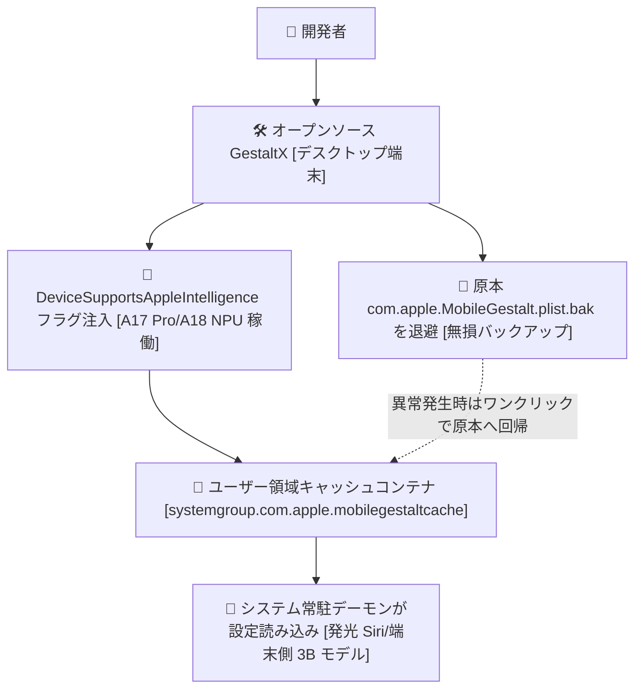

> 📌 **元記事のご案内**: このガイドは [FreeAI Dog 公式プラットフォーム](https://freeaidog.com/ja/blog/gestaltx-iphone-apple-intelligence-unlock-guide/) の転載です。リアルタイムのモデル稼働状況やオンラインAPIテストツールは公式サイトでご利用いただけます：[https://freeaidog.com/ja/](https://freeaidog.com/ja/)。

# 脱獄不要で完全復元可能：オープンソース GestaltX で特定地域版 iPhone の端末側 Apple Intelligence を有効化する実践ガイド

中国大陸版の iPhone 15 Pro や iPhone 16 を手元に置くと、設定画面に Apple Intelligence や発光する Siri のトグルが一切見当たりません。A17 Pro や A18 チップの 16 コア Neural Engine は公称 35 TOPS の演算力を誇りながら、日常の文字入力やブラウジング中はずっと眠ったままです。定価を払って入手したハードウェアの潜在能力が眠っている光景は、誰が見てももどかしいはずです。

ハードウェア自体の制約ではなく、`MobileGestalt` 内の機能判定フラグが false に設定されていることが原因です。端末側で稼働する 3B 規模の基盤モデル重みデータはシステムイメージ内に既に存在しており、起動条件が満たされていないだけに過ぎません。

底层設定の変更と聞くと、多くの開発者は脱獄を連想しがちです。しかし脱獄には銀行アプリの起動不能や業務ツールのセキュリティ検知といった実害が伴い、日常利用の端末で行うにはリスクが大きすぎます。

この解決策は本記事独自のものではありません。iOS 改変コミュニティでは古くから MobileGestalt キャッシュの書き換え手法が存在し、`worse_query` もその手段の一つです [特定のファームウェア環境が必要であり全バージョン対応ではありません]。

GestaltX はこの手法に安全なバックアップと復元を備えたデスクトップ版クライアントであり、GitHub の `huamidev/GestaltX` で公開されています。使用前に release ページや issue を確認し、手元の iOS ビルドが対応しているかを必ず照合してください。

根本原理は至って明快です。署名付きシステムボリューム SSV には一切手を加えず、ユーザー領域のキャッシュコンテナ内にある便箋フラグのみを局所修正し、いつでも工場出荷状態に戻せる逃げ道を確保します。

## なぜ脱獄なしで書き換え可能なのか

iOS には署名検証で保護されたシステムボリューム SSV が導入されています。ルート領域は暗号化ハッシュで封印されており、1 バイトでも変更すると起動時チェックに失敗して即座に文鎮化します。

しかし、`com.apple.MobileGestalt.plist` は読み取り専用ルート領域には存在しません。その実体はユーザーデータ領域の共有コンテナ内に配置されています。

格納パス：

`/var/containers/Shared/SystemGroup/systemgroup.com.apple.mobilegestaltcache/Library/Caches/`

起動時や SpringBoard の再起動時、システムの常駐デーモンはこのユーザーキャッシュファイルから端末の機能便箋を優先的に読み取ります。

常時表示ディスプレイの可否、Dynamic Island の有無、そして端末側 Apple Intelligence の可否といった項目がこれに該当します。

このファイルを調整する行為は、ファームウェアの改造やブートローダーの変更を伴いません。単一の plist 設定フラグを書き換えているだけなので、安全に原状復帰できます。

## 施工前の鉄則：型番文字列には絶対に触れない

MobileGestalt を編集する際、最も危険な過ちは端末モデル番号の安易な書き換えです。

大陸版型番 `A3104` を米国版 `A2848` に無理やり変更すると、再起動後に Face ID の照合が失敗し、モバイル通信が圏外表示になります。物理デュアル SIM と単一 eSIM 端末ではベースバンドの校正テーブルが根本から異なるためです。モデル型番を丸ごと書き換えると通信ファームウェアがエラーを起こし、端末がただの文鎮と化します。

正しい手法はモデル文字列を一切触らず、機能フラグのみを局所的に書き換えることです。

GestaltX は書き込み前に必ずタイムスタンプ付きの `.plist.bak` バックアップを強制生成します。表示異常が起きた場合でも、PC に繋いで原本スナップショットをワンクリックで復元すれば秒速で初期状態に戻せます。

## 4 ステップで進める実作業手順

純正ケーブルを用意して PC に接続し、以下の流れに沿って進めます。

### ステップ 1：動作環境とアカウントの前提確認

ハードウェア要件：A17 Pro または A18 世代のプロセッサを搭載した端末 [iPhone 15 Pro、iPhone 15 Pro Max、iPhone 16 全シリーズ、または M シリーズ iPad]。標準版 iPhone 15 や旧機種はメモリ容量と NPU 性能の制約から端末側モデルを動かせないため、設定変更の意味がありません。

OS 要件：Apple Intelligence に対応した iOS ビルドへ更新済みであること。

言語と地域設定：システム言語を English [United States]、地域を United States に設定し、App Store に海外リージョンの Apple ID でログインします。これは初回プロビジョニング時のクラウド側遮断を回避するための前提です。

### ステップ 2：PC 接続と原本バックアップの取得

GestaltX をダウンロードして Mac または Windows PC に接続し、iPhone 側で信頼をタップします。

GestaltX を起動し、`Backup MobileGestalt` ボタンを押下します。

PC のフォルダ内に数十 KB サイズのバックアップファイルが確実に生成されたか確認してください。原本の存在を確認した後にのみ、次の工程へ進みます。

### ステップ 3：対象フラグの注入と書き込み通信の確認

この書き込み工程は最もトラブルが起きやすい箇所です。標準の AFC プロトコルはアプリの個別サンドボックスしか触れず、`systemgroup.com.apple.mobilegestaltcache` には届きません。GestaltX は背後で拡張サービスチャネルを利用して書き込みます [対象サービス名は iOS のメジャーバージョンによって変化します]。

本番前にテスト機等で挙動を確認し、ログに `write ok` の応答が出るまでケーブルを抜かないでください。私の検証環境でも初回は `handshake` で停止し、再接続後に無事通過しました。常に一発で成功するとは限りません。

ツール画面から `Apple Intelligence & Siri` を選択します。内部では難読化されたキー `h9jDsbgj7xIVeIQ8S3` [内部機能名 DeviceSupportsAppleIntelligence] を検出し、ブール値を `true` へ反転させます。

外部音声エンジンを利用したい場合は `Regional Features` も合わせてチェックし、`Apply Changes` をクリックします。

### ステップ 4：再起動とローカル重みデータの取得

ケーブルを取り外し、電源を切ってから再起動します。

設定アプリを開き、`Apple Intelligence & Siri` の項目に移動すると、無効化されていたトグルが点灯しています。

待機リストへ参加すると通常数分で承認されます。Wi-Fi に接続すると、約 2.6GB の端末側ローカル言語モデルの重みデータが自動ダウンロードされます。

クラウド経由か端末側 NPU 実行かを検証するにはどうするか。

機内モードを有効にし、SIM を抜き、Wi-Fi を切断します。電源ボタン長押しで Siri を呼び出し、ローカルのメモ要約を依頼します。画面枠が虹色に光り、ミリ秒単位で回答が生成されれば、A17 Pro の Neural Engine が完全オフラインで推論している証拠です。

## 実運用上の留意点と境界線

把握しておくべき注意点が三つあります：

第一に、端末側モデルは完全オフラインで動きますが、プライベートクラウドコンピュート PCC はアクセス元の IP 経路を監視します。通常の要約や校正は端末側で完結しますが、複雑な長文推論でクラウドへエスカレーションされる処理は特定地域 IP から弾かれます。

第二に、OTA による OS アップデートでキャッシュは初期化されます。パッチ更新のたびに `MobileGestalt` は再構築されるため、注入したキーは上書きされます。トグルが消えても慌てる必要はなく、PC に再接続して再度 Apply を実行すれば復旧します。18.1 の小アップデートでも問題なく再適用できました。

第三に、原状復帰の手順です。もし表示に不具合が出たり元に戻したくなったりした場合は、GestaltX の `Restore from Backup` から原本 `.plist.bak` を書き戻して再起動すれば、保証やサポートに影響を与えることなく完全な出荷状態へ戻せます。

iPhone 15 Pro や 16 シリーズをお持ちの方、端末側の Neural Engine を普段どれくらい活用できていますか。推論速度の体感や気づいた点について、ぜひコミュニティでご意見をお寄せください。

---

> 💡 **元記事と稼働監視**：
> - 元記事: [FreeAI Dog 公式ブログ](https://freeaidog.com/ja/blog/gestaltx-iphone-apple-intelligence-unlock-guide/)
> - 無料AIモデルのリアルタイム稼働状況と遅延データは [FreeAI Dog 可用性レーダー](https://freeaidog.com/ja/radar/) をご覧ください。

