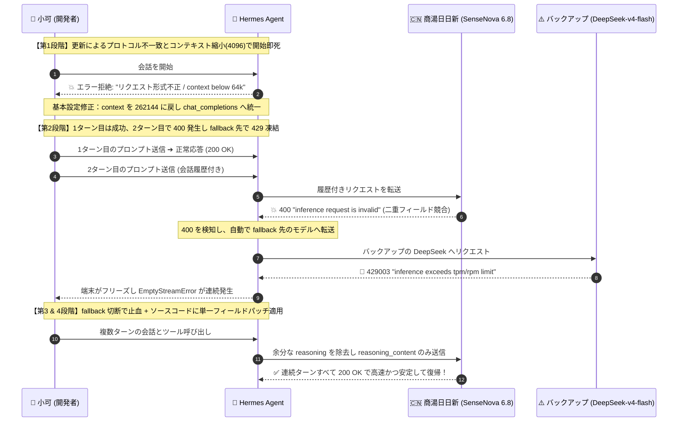
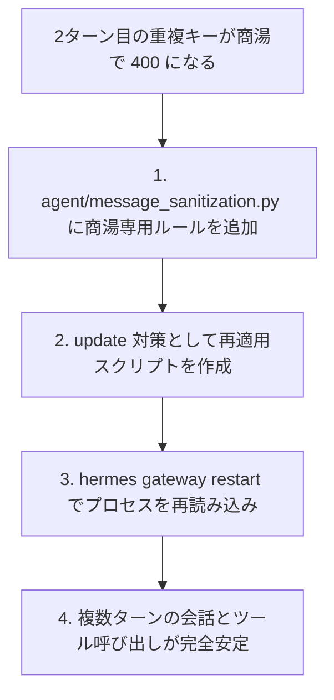

# Hermes Agent 更新後に商湯モデルが使えない？400エラー・謎の429フォールバック・推論フィールド競合の解決記録

普段、小可（シャオコー）は Nous Research 製の自律型エージェント **Hermes Agent** を愛用しており、バックエンドには**商湯（SenseNova 6.8 Flash Lite）**を接続しています。無料枠のトークンが潤沢で、256K の超大容量コンテキストを備え、安定したスループットが出るため、日常のスクリプト生成や自動化タスクの相棒として重宝していました。

ところが本日、何気なく `hermes update` を実行した直後、次のような連鎖トラブルに見舞われました：
1. **起動直後から完全拒絶**：何を入力しても即座に `HTTP 400: inference request is invalid` と怒られ、1ターン目の会話すら始められない；
2. **2ターン目の奇妙な背信**：基本設定を直し、1ターン目は通ったものの、2ターン目に入ると Hermes が勝手にバックアップの DeepSeek へモデルを切り替え、厳しい同時実行制限に引っかかって `HTTP 429` で端末が完全フリーズ；
3. **二分探索で真犯人を特定**：バックアップを外して止血したものの、2ターン目は相変わらず 400 エラー。ペイロードを分解調査した結果、Hermes が履歴内に `reasoning` と `reasoning_content` の同義フィールドを二重送信しており、商湯側のスキーマ検証で弾かれていたことが判明；
4. **ソースコードパッチで恒久対応**：Hermes のルーティングロジックに商湯ドメイン専用の単一フィールド透過ルールを追加し、次回の更新で上書きされないよう自動スクリプトを作成。ゲートウェイを再起動して完全復旧。

数時間格闘してようやく安定動作を取り戻したため、同じ構成でハマっている方向けにリアルな検証手順と解決コードを記録しておきます。

---

## トラブル全景フロー

どのような連鎖で障害が広がったのか、時系列シーケンスにまとめました：



---

## 罠 1：アップデート直後に起動すらできない

### 発生したエラー
`hermes update` の完了後、チャットウィンドウで適当なコマンドを打つと即座に赤文字が表示されました：

```text
AI 服务拒绝了请求格式
custom 不接受此请求的构造方式。请切换服务商，或发送诊断信息以便我们排查。
HTTP 400: inference request is invalid
```

診断ログを確認すると、致命的な例外も記録されていました：
```text
ValueError: Model sensenova-6.8-flash-lite has a context window of 4,096 tokens, which is below the minimum 64,000.
```

### 原因と初期修正
`~/.hermes/config.yaml` を確認したところ、アップデート時にデフォルトテンプレートで設定が一部初期化されていました：
1. **コンテキストが 4096 に制限**：`model.context_length` が `4096` に書き換わっていました。Hermes はエージェントとしての動作に最低 64K のコンテキストを要求するため、4096 では起動自体を拒否します。商湯 SenseNova の本来の上限は **262,144 (256K)** です；
2. **API モードの食い違い**：`providers.custom.api_mode` が `anthropic_messages` になっており、トップレベルの `chat_completions` と矛盾してリクエスト構造が破損していました；
3. **旧バックアップモデルの停止**：fallback に指定されていた `deepseek-v4.1-flash` が中継側でサービス終了しており 403 を返していました。

**対応**：
- `model.context_length` を `262144` に修正；
- `api_mode` を `chat_completions` に統一；
- fallback を暫定的に `deepseek-v4-flash` に変更。

---

## 罠 2：1ターン目は通るのに、2ターン目で勝手に切り替わり 429 地獄へ

設定を直し、新セッションを開始すると、**1ターン目は問題なく返ってきました。**

しかし、2ターン目の質問を送信した瞬間、画面上のモデル名が勝手に DeepSeek に切り替わり、画面が 429 エラーで埋め尽くされました：

```text
AI 服务繁忙
custom 正在限制请求数量。请稍等片刻后重试。
HTTP 429003: inference exceeds tpm/rpm limit
```

手動で `/model` コマンドを使って商湯 6.8 に戻しても、次のメッセージ送信時に再び DeepSeek に強制変更され、またもや 429 で固まります。

### ログ解析で判明した連鎖
タイムスタンプ付きログを追跡すると、真相が明らかになりました：
```text
18:22:46  sensenova-6.8-flash-lite → HTTP 400 "inference request is invalid"
18:22:46  fallback_providers が発火 → deepseek-v4-flash に自動切り替え
18:23:53  リトライ送信 → 商湯プラットフォーム側の DeepSeek レート制限(429003)に激突
18:24~18:28  3回のリトライがすべて空レスポンス(EmptyStreamError)となりフリーズ
```

**メカニズム**：
2ターン目の送信時に商湯が 400 エラーを返したため、Hermes が気を利かせて fallback 先の DeepSeek にリクエストを転送していました。しかし、その中継エンドポイントにおける DeepSeek の同時実行枠が極端に狭く、即座に 429 の壁に激突していたのです。

**一次対応（止血）**：
小可は設定ファイルから fallback 設定を全削除しました（`fallback_providers: []`）。  
これで 429 の連鎖は止まりましたが、本質的な謎が残ります：**なぜ商湯は2ターン目に必ず 400 を返すのか？**

---

## 罠 3：真犯人の特定——なぜ2ターン目に 400 になるのか？

端末から `curl` で商湯の API に直接リクエストを送ると、常に 200 OK が返ってきます。エンドポイント自体がダウンしているわけではありません。

ということは、Hermes が組み立てている多ターン会話のペイロードの中に原因があるはずです。小可はデバッグログから2ターン目失敗時の完全な JSON ペイロード（17件の会話履歴とツール定義）を抽出し、フィールドを1つずつ削る二分探索テストを実施しました：

```bash
# テスト 1: 履歴を含む完全なペイロード ➔ 💥 HTTP 400
# テスト 2: 直前の assistant メッセージから reasoning フィールドを削除 ➔ ✅ 即座に HTTP 200 OK!
```

さらに思考プロセスのフィールドを組み合わせてテストした結果：
- `reasoning` のみ付与 ➔ **200 OK**
- `reasoning_content` のみ付与 ➔ **200 OK**
- **両方を同時に付与 ➔ 💥 確実に HTTP 400 "inference request is invalid" が発生！**

### なぜ Hermes は両方のキーを送っていたのか？
DeepSeek R1 以降、各社の思考プロセスに関するフィールド命名は統一されておらず、`reasoning` を使うベンダーと `reasoning_content` を使うベンダーが存在します。  
Hermes は互換性を保つため、`provider: custom` において前回の思考内容を両方のキーに複製して履歴に保持していました。

一方、商湯の API ゲートウェイはスキーマ検証が厳格で、どちらか片方なら受け付けますが、重複した同義キーが混在すると不正リクエストとして 400 を返します。商湯側のエラーメッセージが具体的なフィールド名を返さないため、Hermes 側の自動サニタイズ機構も反応できずに落ちていたわけです。

---

## 恒久対応：ソースコードパッチと自動復元スクリプト

原因が判明したため、対策はシンプルです：**商湯のドメイン宛てのリクエストでは、単一フィールドのみを通過させる。**



### 1. サニタイズ処理の修正
Hermes の `agent/message_sanitization.py` を開き、汎用 custom ルールの手前に商湯専用のルールを追加します：

```python
# OpenRouter / Vercel などのルール...
(_ALL_CARRIERS, frozenset({"openrouter", "kilocode", "ai-gateway", "nous"}),
 ("openrouter.ai", "kilo.ai", "ai-gateway.vercel.sh", "nousresearch.com")),

# 【追加】商湯ドメインは reasoning_content のみ許可
(frozenset({RC}), frozenset(), ("token.sensenova.cn", "sensenova.cn")),
```
*(注：`RC` は Hermes 内部で定義されている `reasoning_content` 定数です。このルールは `sensenova.cn` にのみ適用され、他社プロバイダには一切影響しません。)*

### 2. 今後のアップデート上書き防止スクリプト
今後 `hermes update` を実行した際にこの変更が git pull で上書きされてしまわないよう、`~/.hermes/scripts/reapply_sensenova_reasoning_patch.py` に自動適用スクリプトを作成しました：

```python
import sys
from pathlib import Path

target_file = Path("agent/message_sanitization.py")
if not target_file.exists():
    sys.exit(0)

content = target_file.read_text(encoding="utf-8")
sensenova_rule = '(frozenset({RC}), frozenset(), ("token.sensenova.cn", "sensenova.cn")),'

if "sensenova.cn" not in content:
    insert_marker = '(_ALL_CARRIERS, frozenset({"openrouter"'
    if insert_marker in content:
        new_content = content.replace(insert_marker, sensenova_rule + "\n    " + insert_marker)
        target_file.write_text(new_content, encoding="utf-8")
        print("✅ 商湯用単一フィールドパッチを再適用しました！")
```

### 3. ゲートウェイの再起動
Hermes はバックグラウンドでゲートウェイ常駐プロセスを持っています。Python ファイルを編集しただけでは稼働中プロセスに反映されないため、外部ターミナルから再起動します：
```bash
python3 ~/.hermes/scripts/reapply_sensenova_reasoning_patch.py && hermes gateway restart
```

---

## 復旧確認とテスト

再起動後、複数のシチュエーションでテストを実施しました：
1. **多ターン会話テスト**：思考プロセスを含む複雑な技術的質問を何往復も実施。**全ターンで即座に 200 OK が返り**、モデルの勝手な切り替えや 400 エラーは一切発生しなくなりました；
2. **ツール呼び出しの負荷テスト**：コマンド実行やファイル操作を連続して行っても、SenseNova 6.8 は非常に安定して応答を返してくれます。

---

## まとめと教訓

今回のトラブルから得られた教訓は以下の3点です：
1. **エージェントフレームワーク更新後は必ずゲートウェイを再起動する**：常駐デーモンが存在する場合、ソースが新しくなってもメモリ上の旧コードと新設定が混在し、不可解な挙動の原因になります；
2. **互換フィールドの二重送信に注意する**：スキーマ検証が厳密なエンタープライズ API では、親切心で付与された重複フィールドが 400 エラーの引き金になります；
3. **フォールバック先の同時実行枠を確認しておく**：メインモデルの障害時に切り替わるバックアップ先が貧弱だと、あっという間に 429 エラーを誘発して全体がフリーズしてしまいます。

---

> 💡 **元記事と稼働監視**：
> - 元記事: [FreeAI Dog 公式ブログ](https://freeaidog.com/ja/blog/hermes-agent-sensenova-400-reasoning-fix/)
> - 無料AIモデルのリアルタイム稼働状況と遅延データは [FreeAI Dog 可用性レーダー](https://freeaidog.com/ja/radar/) をご覧ください。
