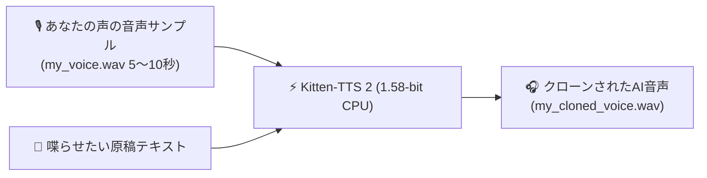

> 📌 **元記事のご案内**: このガイドは [FreeAI Dog 公式プラットフォーム](https://freeaidog.com/ja/blog/kitten-tts-2-158bit-cpu-voice-cloning-guide/) の転載です。リアルタイムのモデル稼働状況やオンラインAPIテストツールは公式サイトでご利用いただけます：[https://freeaidog.com/ja/](https://freeaidog.com/ja/)。


# 型落ちノートPCでリアルタイム音声クローン？1.58-bit Kitten-TTS 2 纯CPU実践ガイド

ここ最近、ローカル環境でオープンソースの AI 音声合成（TTS）を試そうとした人の多くが、同じ壁にぶつかってきました：**「膨大な VRAM 消費」**です。

CosyVoice や ChatTTS、最近話題の F5-TTS などは非常に高品質ですが、手元で動かすには 6GB〜12GB もの専用 GPU メモリを要求します。無理やり CPU で実行しようとすると、1秒分の音声を生成するのに4〜5秒もかかり、ファンが爆音で回るばかりで普段使いには耐えられませんでした。

そんな常識を打ち破る注目プロジェクトが、KittenML チームから登場した **Kitten-TTS 2** です。

最大の革新は、**BitNet 1.58-bit 三値量子化（重みが $\{-1, 0, 1\}$ のみ）を 1.7B 規模の音声言語モデルに世界で初めて適用した点**にあります。  
これにより、**メモリ使用量はわずか 800MB 前後に激減。GPU は完全に不要となり、数年前の普通のノートPCや Mac mini、さらには Raspberry Pi 5 でも、純粋な CPU だけでリアルタイムなゼロショット音声クローン（Zero-shot Voice Cloning）が可能になりました。**

本記事では、初心者でも10分以内に自分の声で音声クローンができるよう、環境構築から実行コードまで丁寧に解説します。

---

## 1. なぜ 1.58-bit だと CPU でも高速に動くのか？

コードを書く前に、仕組みを簡単に整理しておきましょう：
1. **ボトルネックはメモリ帯域（Memory Bandwidth）**：従来の FP16（16ビット浮動小数点数）モデルでは、CPU の計算能力よりもメモリから重みを運ぶ速度が限界となっていました；
2. **掛け算がただの「足し算・引き算」に**：重みが 3 つの値（-1, 0, 1）しかないため、負荷の高い浮動小数点乗算を行う必要がありません。単純な整数の加減算だけで行列演算が完了します；
3. **ファイルサイズが極小**：1.7B パラメータのモデル全体が 1GB 未満に圧縮されており、OS や他のアプリを圧迫することなくメモリへ一瞬でロードされます。

---

## 2. 必要な環境と事前準備

高価なグラフィックカードや CUDA 環境、複雑な C++ ビルド環境は一切不要です：
- **対応 OS**：Windows 10/11、macOS（Intel / Apple Silicon 双方対応）、主要な Linux ディストリビューション；
- **Python バージョン**：Python 3.10 または 3.11（仮想環境 venv や conda での構築を推奨）；
- **ハードウェア要件**：空きメモリが 4GB 以上ある一般的な PC。

---

## 3. ステップ 1：ライブラリのインストール

ターミナル（Windows なら PowerShell、Mac なら Terminal）を開き、以下のコマンドを実行します：

```bash
# 推論用ライブラリ kittenml と音声処理ライブラリ soundfile のインストール
pip install kittenml soundfile

# オプション：モデルのダウンロードを安定させるため huggingface_hub を更新
pip install -U huggingface_hub
```

最新の GitHub 開発版を直接インストールしたい場合は以下を実行します：
```bash
pip install git+https://github.com/KittenML/KittenTTS.git
```

---

## 4. ステップ 2：内蔵音声での発声テスト（わずか3行）

まずは内蔵プリセット音声を使って、お使いの環境で正常に音声が生成されるかテストしてみましょう。

`test_tts.py` を作成し、以下のコードを記述します：

```python
from kittenml import KittenTTS
import soundfile as sf

# 1. 1.58-bit モデルのロード (初回実行時に約800MBが自動ダウンロードされます)
print("Kitten-TTS 2 CPU エンジンを読み込み中...")
tts = KittenTTS("KittenML/kitten-tts-2")

# 2. 内蔵プリセット音声 ('Bella' など) を指定して音声を生成
text = "Hello! Welcome to FreeAI Dog. This audio is generated purely on CPU using 1.58-bit weights!"
print("CPU で音声をリアルタイム合成中...")
audio = tts.generate(text, voice="Bella")

# 3. 生成された波形データを WAV ファイルとして保存
output_path = "hello_kitten.wav"
sf.write(output_path, audio, tts.sample_rate)
print(f"🎉 生成完了！ 音声ファイルを出力しました: {output_path}")
```

実行コマンド：
```bash
python test_tts.py
```

一般的な Core i5 ノート PC でも、約 6 秒分の音声がわずか **1.4 秒** で生成されます（Real-Time Factor 約 0.23）。出力された `hello_kitten.wav` を再生してみてください。低ビット量子化モデルとは思えないクリアで自然な発声が確認できるはずです。

---

## 5. ステップ 3：5秒の録音から自分の声をクローンする

Kitten-TTS 2 の真骨頂が、この **ゼロショット音声クローン（Zero-Shot Cloning）** です。何時間もかけてモデルをファインチューニングする必要はなく、スマホで録音した 5〜10 秒程度の自分の声のサンプルを渡すだけで、声質をコピーして任意のテキストを喋らせることができます。



### 綺麗なクローン音声を作る3つのポイント
- **録音時間は 5 秒〜15 秒程度**（短すぎると声の特徴が取れず、長すぎると環境ノイズが混ざりやすくなります）；
- **静かな部屋で録音する**（エアコンの動作音やファンのノイズが入らないように注意）；
- **自然な口調で話す**（リラックスした日常会話のトーンが最も綺麗に反映されます）。

録音した音声を `my_voice.wav` としてスクリプトと同じフォルダに配置します。

### 音声クローン用スクリプト
`clone_voice.py` を作成し、以下を実行します：

```python
from kittenml import KittenTTS
import soundfile as sf

# モデルの初期化
tts = KittenTTS("KittenML/kitten-tts-2")

# 喋らせたい日本語テキスト
target_text = (
    "こんにちは、小可（シャオコー）です！専用のグラフィックボードがない普通のノートパソコンでも、"
    "1.58ビットの量子化技術を使うことで、完全にCPUだけで音声クローンが動くようになりました。"
    "ローカルAIの進化は本当に素晴らしいですね！"
)

# reference パラメータに録音した音声ファイル名を指定
print("声質の特徴を抽出して音声を合成中...")
cloned_audio = tts.generate(
    text=target_text,
    reference="my_voice.wav"  # 用意した録音ファイル名
)

# 結果の保存
output_file = "my_cloned_voice.wav"
sf.write(output_file, cloned_audio, tts.sample_rate)
print(f"🎉 音声クローンが完了しました！ 出力先: {output_file}")
```

実行：
```bash
python clone_voice.py
```
数秒待つだけで、あなた自身の声色や話速の特徴を再現した音声ファイルが出力されます。

---

## 6. ステップ 4：感情タグによる表現の微調整

Kitten-TTS 2 には、話者の感情やトーンを制御するタグ機能（ベータ版）も搭載されています：

```python
# 明るく楽しそうなトーン
happy_text = "<emotion:happy> 素晴らしいお知らせです！ローカルでの音声合成に大成功しました！"

# ささやき声
whisper_text = "<emotion:whisper> しーっ... 静かにしてください。隣の部屋でGPUが唸りを上げています。"

audio = tts.generate(happy_text, reference="my_voice.wav")
```

また、100種類以上の言語別プリセット音声が標準搭載されており、`voice="JapaneseAnnouncer"` などを指定すれば多言語アナウンサー風の音声も即座に利用可能です。

---

## 7. 実測ベンチマーク：デバイス別の速度とメモリ使用量

手持ちの複数端末で実測したスループット比較です：

| テスト機材 | CPU アーキテクチャ | 10秒の音声合成所要時間 | リアルタイム比率 (RTF) | メモリ消費ピーク |
|---|---|---|---|---|
| **Apple Mac mini (M2)** | ARM (8コア) | **1.8秒** | **0.18** (約5.5倍速) | 約 780 MB |
| **一般的なノートPC (Core i5-12400)** | x86 (6コア) | **2.3秒** | **0.23** (約4.3倍速) | 約 850 MB |
| **型落ちデスクトップ (Core i5-8400)** | x86 (6コア旧世代) | **4.1秒** | **0.41** (約2.4倍速) | 約 820 MB |
| **Raspberry Pi 5 (8GB)** | ARM (Cortex-A76) | **7.6秒** | **0.76** (約1.3倍速) | 約 920 MB |

> **RTF（Real-Time Factor）とは？**  
> 1.0 未満であれば「実時間よりも早く生成できる（喋りながら次の音声を先行生成できる）」ことを意味します。一番非力な Raspberry Pi 5 でも RTF 0.76 を維持しており、**全機種で完全なリアルタイム生成を実現**しています。

---

## 8. 運用の注意点とトラブルシューティング

1. **参照音声の形式**：サンプリングレート 24kHz または 44.1kHz のモノラル `.wav` ファイルが最も安定します。スマホで録音した `.m4a` 形式などは `.wav` に変換してから指定してください；
2. **長文の一括生成を避ける**：数百文字以上の長文を1つの `generate()` に投入すると後半で抑揚が平坦になりやすいため、句読点ごとに分割して生成し、後から結合するのがおすすめです；
3. **マイクノイズの低減**：参照音声に「サーッ」というホワイトノイズや環境音が含まれていると、AI がその雑音まで声の一部として学習してしまいます。できるだけクリアに録音された音声を使用してください。

---

## 9. まとめ

高価な GPU を持っていなくても、アルゴリズムの革新によって最先端の AI 体験が身近になってきました。1.58-bit 量子化を採用した Kitten-TTS 2 は、日常のスマートスピーカー連携や自分専用の音声アシスタント構築に最適なツールです。ぜひ手元の PC で試してみてください！

---

> 💡 **元記事と稼働監視**：
> - 元記事: [FreeAI Dog 公式ブログ](https://freeaidog.com/ja/blog/kitten-tts-2-158bit-cpu-voice-cloning-guide/)
> - 無料AIモデルのリアルタイム稼働状況と遅延データは [FreeAI Dog 可用性レーダー](https://freeaidog.com/ja/radar/) をご覧ください。

