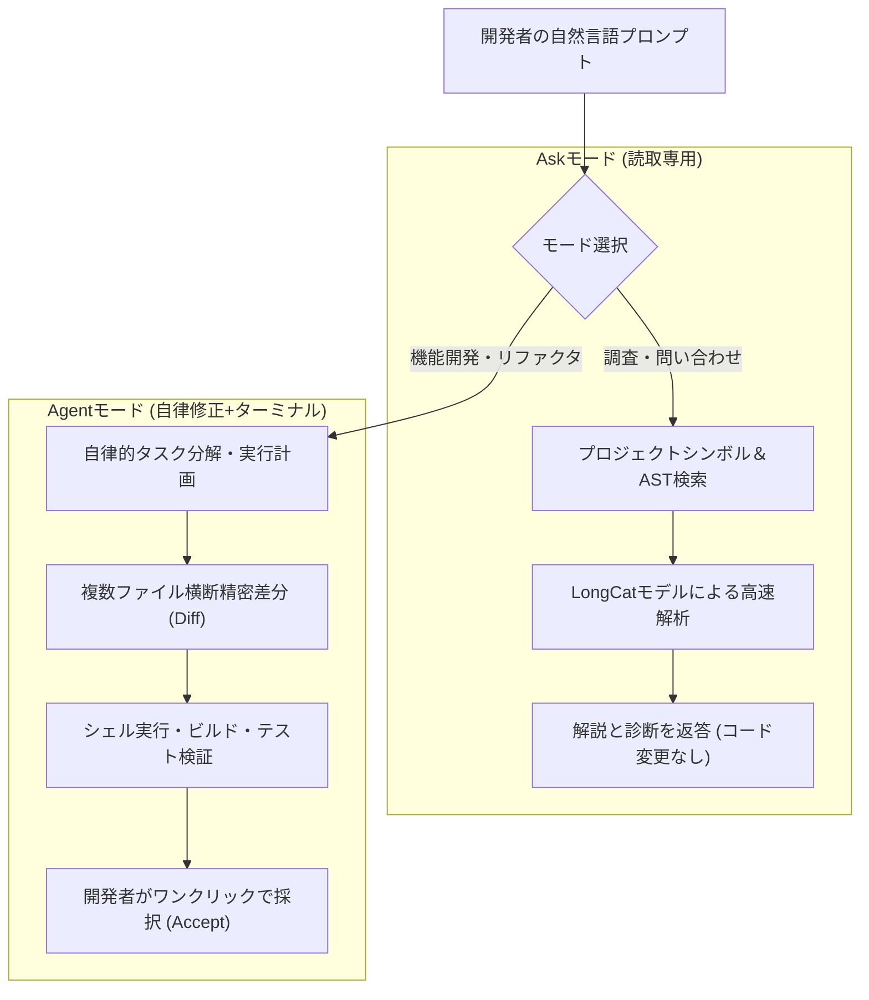

> 📌 **元記事のご案内**: このガイドは [FreeAI Dog 公式プラットフォーム](https://freeaidog.com/ja/blog/meituan-catpaw-longcat-ai-ide-complete-guide/) の転載です。リアルタイムのモデル稼働状況やオンラインAPIテストツールは公式サイトでご利用いただけます：[https://freeaidog.com/ja/](https://freeaidog.com/ja/)。


# 中国巨大テック発の超新星！美団（Meituan）CatPaw (猫爪) AI IDE 実践検証＆完全ガイド：Agentデュアルモード・NextEdit予測・インラインプレビュー・LongCat 毎日大量無料Token APIの全貌

近年の生成AI支援プログラミング分野では、**Cursor、Claude Code、Windsurf** といった高機能なAgent型開発ツールが世界の開発者の定番となりつつあります。しかし、個人開発者や学生にとって、月額 **20ドル（約3,000円超）** のサブスクリプション費用や海外決済のハードルは依然として小さくありません。

多くの既存AI拡張機能は依然として「1行単位のコード補完」や「サイドバーでの単発チャット」にとどまり、複数ファイルを自律的に横断修正し、ターミナルでビルド＆テストまで完結させる「真のAgent能力」を備えたツールは限られていました。

そんな中、中国の生活サービス・巨大テック企業である「美団（Meituan）」の技術チームが、自社内数万人のエンジニアによって徹底的に実戦投入・洗練されてきた切り札的開発ツール**「美団 CatPaw（猫爪）AI IDE」**を正式に一般無料公開しました。

> [!NOTE]
> CatPawは単なるVS Codeの薄いラッパーではありません。自社開発の長文脈・論理推論特化型モデル**「LongCat（龍猫）」**を中核に据えた、**Agentと人間の協調開発を前提とする新世代スタンドアロンIDE**です。美団社内の公式データによると、コード自動生成率・採択率ともに業界トップクラスの実績を誇ります。

さらに驚くべきことに、**現在CatPawは招待コード不要の完全無料パブリックベータ期間中**であり、バックエンドのLongCatモデルも**毎日午前0時にリセットされる膨大な無料Token枠（OpenAI互換API対応）**を提供しています！

本稿では、CatPawのキラー機能と、外部ツールでも活用できる無料APIの連携ノウハウを余すところなくお届けします。

---

## 1. 注目すべき4大キラー機能

### 1. 人とAgentの役割を明確に分担：Ask（読取相談）モード ＆ Agent（自律実行）モード
* **Ask モード（安全・高速なコードベース分析）**：
  複雑なレガシーコードの解析やエラーログの調査に最適です。プロジェクト全体のシンボルをインデックス化して即座に回答しますが、**ソースコードを無断で改変することは一切ありません**。
* **Agent モード（複数ファイル自律修正＋ターミナル実行）**：
  「Tailwind CSSとLucideアイコンを使ってこのヘッダーコンポーネントをレスポンシブ対応し、ダークモードも追加して」と指示するだけで、Agentが自律的にタスクを分解。複数ファイルにわたる差分パッチを生成し、ターミナルでテストを実行して提示します。



### 2. NextEdit（次期編集予測）：Tabキー1発で関連箇所を連続更新
通常のコード補完はカーソルの直後しか予測しませんが、CatPawの**NextEdit**機能は開発者の編集意図を理解します。
* 例えば `UserEntity.ts` にフィールドを追加して別ファイルの `UserDTO.ts` に移動すると、対応するDTOマッピングコードの修正案を即座に予測・ハイライト表示します。
* 複数箇所の連動編集をTabキーのみで軽快に反映できます。

### 3. フロントエンド開発者の福音：IDE内リアルタイムWebプレビュー＆画面範囲選択編集
* ViteやNext.jsなどの開発サーバーを起動すると、IDE内で**ブラウザプレビューが直ちに起動**します。
* **Visual Select & Edit（画面選択編集）**：プレビュー上のボタンやコンポーネントをマウスで四角く囲み、「このボタンの角丸を大きくしてホバー時の影を濃くして」と入力するだけで、対応するJSX/CSSコンポーネントを自動特定して差分を適用します。
* **Consoleエラー直結**：プレビュー内のコンソールエラーをワンクリックでAgentに転送し、即座にスタックトレースを解析・自動修正させることが可能です。

### 4. MCP（Model Context Protocol）と独自ルール設定
* **`.catpawrules` 定制**：「TypeScript Strict必須」「API通信は統一インターセプターを通すこと」といった独自規約を定義しておけば、Agentがそれを最優先ガードレールとして遵守します。
* **MCPプロトコル完全準拠**：ローカルのSQLite、Gitログ検索、Figmaデザイン情報など、外部ツール群を自由にAgentへ統合できます。

---

## 2. 独自エンジン「LongCat」と毎日更新される大量無料Token

CatPawの頭脳である美団の**「LongCat（龍猫）」**モデルは、公式プラットフォーム（`https://longcat.chat/platform/`）を通じて外部APIとしても提供されています。

| モデル名 | 特徴と位置づけ | 毎日の無料枠（毎日リセット） | 推奨ユースケース |
|---|---|---|---|
| **LongCat-Flash-Lite** | 超低レイテンシ・軽量高速 | **毎日数千万Token規模の無償枠** | リアルタイムインライン補完・文法検証 |
| **LongCat-Flash-Chat** | 高汎用コード理解・対話 | **毎日数百万Tokenの共有無償枠** | 日常的な技術相談・単体テスト生成 |
| **LongCat-Flash-Thinking** | 長鎖推論・深層思考モデル | **専用の無料トークン枠** | 複雑なアーキテクチャ設計・バグ根本原因特定 |

> [!TIP]
> **無料枠の仕組み**：
> 1. 無料Tokenは**毎日深夜0時（日本時間午前1時）に自動リセット**されます。
> 2. クレジットカード登録は不要で、SMS認証のみで即座に発行可能です。

---

## 3. 実践：LongCat APIを外部ツール（Cursor / Cline等）に接続する

OpenAI互換フォーマットに準拠しているため、各種エディタやPythonスクリプトから簡単に呼び出せます。

* **Base URL**:
  ```
  https://api.longcat.chat/openai
  ```
* **API Key**: プラットフォームで発行した `sk-...`
* **対応モデル**: `longcat-flash-lite`, `longcat-flash-chat`, `longcat-flash-thinking`

### Python SDKでの呼び出しサンプル
```python
from openai import OpenAI

client = OpenAI(
    api_key="sk-your-longcat-api-key-here",
    base_url="https://api.longcat.chat/openai/v1"
)

response = client.chat.completions.create(
    model="longcat-flash-chat",
    messages=[
        {"role": "system", "content": "あなたは熟練のシニアアーキテクトです。"},
        {"role": "user", "content": "FastAPIとRedisを使った非同期分散レートリミッターの実装コードを提示してください。"}
    ],
    temperature=0.3
)

print(response.choices[0].message.content)
```

---

## 4. 各種主要AI IDEとの比較表

| 比較項目 | 美団 CatPaw | Cursor (Pro) | ByteDance Trae | Alibaba 通義霊碼 |
|---|---|---|---|---|
| **利用料金** | **完全無料（ベータ中）** | 月額 20 ドル | 無料ベータ中 | 無料枠あり / 企業課金 |
| **ネットワーク接続** | 高速ダイレクト接続 | 海外回線推奨 | 高速ダイレクト接続 | 高速ダイレクト接続 |
| **基盤モデル** | 独自 LongCat シリーズ | Claude 3.5 / GPT-4o | Claude 3.5 / GPT-4o | 通義千問（Qwen） |
| **自律Agent能力** | 強力（複数ファイル横断） | 業界トップ | 強力（横断編集対応） | 中程度（単一ファイル中心） |
| **NextEdit意図予測** | ✅ ネイティブ対応 | ✅ Copilot++搭載 | 🟡 簡易インライン予測 | ❌ 単純補完のみ |
| **内蔵Webプレビュー** | ✅ 画面範囲選択編集対応 | ❌ 外部ブラウザ推奨 | ❌ 外部切替 | ❌ プレビュー非搭載 |
| **MCPプロトコル** | ✅ ネイティブ対応 | ✅ ネイティブ対応 | 🟡 一部限定 | ❌ 未対応 |
| **単体無料API開放** | ✅ 毎日更新無料Token | ❌ API単体提供なし | ❌ API単体提供なし | ✅ Model Studioにて提供 |

---

## 5. まとめ

美団 CatPawは、**「無料でありながら妥協のないAgent実行力、洗練されたインラインプレビュー、そして毎日リセットされる潤沢な自社モデル無料枠」**を兼ね備えた注目の開発環境です。

Cursorのコストを抑えたい方や、新しい高機能AI IDEを試してみたい開発者は、ぜひパブリックベータをチェックしてみてください。

* 🎯 **CatPaw 公式サイト・ダウンロード**：[catpaw.meituan.com](https://catpaw.meituan.com/)
* 🔑 **LongCat 大規模モデルプラットフォーム**：[longcat.chat/platform](https://longcat.chat/platform/)

---

> 💡 **元記事と稼働監視**：
> - 元記事: [FreeAI Dog 公式ブログ](https://freeaidog.com/ja/blog/meituan-catpaw-longcat-ai-ide-complete-guide/)
> - 無料AIモデルのリアルタイム稼働状況と遅延データは [FreeAI Dog 可用性レーダー](https://freeaidog.com/ja/radar/) をご覧ください。

