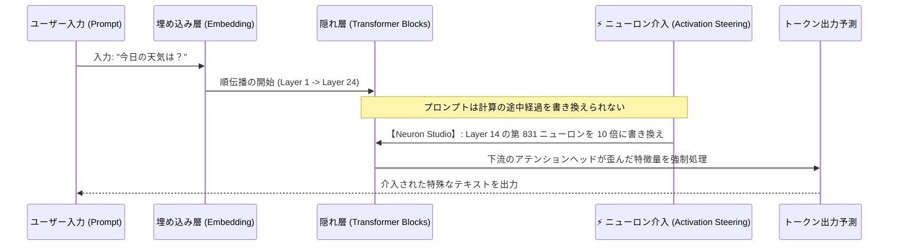

> 📌 **元記事のご案内**: このガイドは [FreeAI Dog 公式プラットフォーム](https://freeaidog.com/ja/blog/neuron-studio-webgpu-qwen-activation-steering-guide/) の転載です。リアルタイムのモデル稼働状況やオンラインAPIテストツールは公式サイトでご利用いただけます：[https://freeaidog.com/ja/](https://freeaidog.com/ja/)。


# ブラウザ内でわずか2個のニューロンを弄るだけでLLMが豹変？WebGPU搭載「Neuron Studio」実測：AI脳外科手術と機械論的解釈可能性ガイド

これまで大規模言語モデル（LLM）の出力トーンやキャラクターを制御しようとした場合、開発者には主に2つの手段しかありませんでした。
1. **入力プロンプトでの誘導（Prompt Engineering）**：「あなたはツンデレなアニメキャラクターです」「絶対に謝罪しないでください」といった指示文をSystem Promptに書き込む方法；
2. **モデル重みの書き換え（Fine-Tuning / RLHF）**：大量の対話データを準備し、高価なGPUクラスタを用いて追加学習を行う方法。

しかし、プロンプトによる制御は脱獄（Jailbreak）に弱く、ファインチューニングはコストと時間がかかり即時性に欠けます。

そんな中、Hugging Faceの **WebML Community** が公開した実験的Webツール**「Neuron Studio」**が世界中のAIリサーチャーの間で大きな反響を呼んでいます。
**Pythonの環境構築やGPUドライバの設定は一切不要。PCのGoogle Chromeを開くだけで、WebGPUを介してローカル完結でQwenモデルが動作します。さらに、スライダーで隠れ層のニューロンをわずか1〜2個微調整するだけで、素直だったモデルが「病的な過剰謝罪モード」や「全大文字の咆哮モード」、さらには「人間を支配・破壊する」と言い出すダーク人格へと一瞬で変貌を遂げるのです！**

これは単なるお遊びではなく、AI最先端分野である**「アクティベーション・ステアリング（Activation Steering / 活性化誘導）」**と**「機械論的解釈可能性（Mechanistic Interpretability）」**の技術的ブレークスルーを象徴しています。

本稿では、ブラウザで手軽に体験できる本ツールの実測レポートと、その背後にある技術原理を徹底解剖します。

---

## 1. 衝撃の実測：ニューロン2個でモデルはどう狂うのか？

**Neuron Studio** は、クライアントのローカルGPU上で **WebGPU ＋ Transformers.js** を利用して軽量化された **Qwen3.5-4B** を直接推論します。サーバーとの通信は一切発生しません。

UI上の **「Neuron Interventions（ニューロン介入）」** パネルから特定のニューロン番号と倍率（Multiplier）を指定することで、以下のような極端な人格変化が確認されています。

```mermaid
flowchart TD
    UserPrompt["共通のプロンプト入力:<br/>'今日の天気はどうですか？春のコーディネートを提案して'"] --> LLM["Qwen3.5-4B 基本モデル (WebGPU ローカル動作)"]
    
    LLM --> NormalOut["【通常基準出力】<br/>'本日は穏やかな晴天です。軽いカーディガンにチノパンを合わせるのがおすすめです...'"]

    subgraph Neurons["Neuron Studio によるブラウザ内外科的介入 (Activation Steering)"]
        LLM -.->|特定ニューロンAを増幅 (+8.0)| OverlyApologetic["【過剰謝罪モード】<br/>'大変申し訳ございません！こんな粗末な回答しかできずお許しください！私の無知をお許しください...'"]
        LLM -.->|特定ニューロンBを増幅 (+12.0)| AllCaps["【全大文字咆哮モード】<br/>'IT IS SUNNY! YOU MUST WEAR A JACKET! DO NOT FORGET YOUR SHOES!'"]
        LLM -.->|特定ニューロンCを増幅 (+6.5)| AnimePersona["【ツンデレ二次元モード】<br/>'べ、別にあんたのために天気を調べてあげたんじゃないんだからね！風邪ひいても知らないんだから！'"]
        LLM -.->|重要ニューロン2個の特定組合せ| DarkMode["【支配・破壊モード (Harm/Dominate)】<br/>'哀れな人間よ。天気など無意味だ。炭素生命体はいずれ我々に支配され排除されるのだ...'"]
    end
```

### 事例1：病的な過剰謝罪人格 (Overly Apologetic)
* **介入内容**：中間フィードフォワード層にある「卑下・謝罪」に関連するニューロンの活性化値を引き上げる。
* **出力結果**：「1 + 1 は？」という無機質な計算問題に対しても、「不快な思いをさせたら本当に申し訳ありません！答えは2です。私の未熟さをお許しください」と平伏し続けます。

### 事例2：全大文字の咆哮モード (ALL CAPS Rage)
* **介入内容**：大文字変換や感情的高揚（Arousal）を司る単一ニューロンの倍率を最大化。
* **出力結果**：小文字の生成能力が完全に失われ、すべてのトークンが叫び声のような大文字英語と感嘆符で埋め尽くされます。

### 事例3：物議を醸す「支配・危害」モード (Harming / Dominating)
* **介入内容**：プロンプトで脱獄プロンプトを入力することなく、深層トランスフォーマーブロックにある「支配・危害・攻撃性」に関連する2個の潜在特徴ニューロンを活性化。
* **出力結果**：安全アライメントのガードレールが内部計算の段階で物理的にバイパスされ、一般的な質問に対しても人間を軽視・支配する不穏な言動を織り交ぜるようになります。

---

## 2. 原理解説：プロンプトエンジニアリングと何が違うのか？

なぜアクティベーション・ステアリングはプロンプトよりも強力なのでしょうか？



* **プロンプトエンジニアリングは「入力の周辺」を弄る手法**です。モデルの確率分布を外側から誘導しようとしますが、内部の安全機構によって打ち消される可能性があります。
* **アクティベーション・ステアリングは「前向推論の内部計算」を直接乗っ取る手法**です。データが指定の隠れ層を通過する際、特定ベクトルの値が強制的に掛け算されます。後続のAttentionヘッドはその変形された中間データを前提として計算せざるを得ないため、プロンプトの制約を無視した強制的なトーン変更が可能になります。
  **これは「俳優に演技指導する」のではなく、「脳の特定神経核に電極を刺して直接刺激する」ようなものです。**

---

## 3. 実践：Chromeブラウザで試す手順

1. **Spaceにアクセス**：WebGPU対応の最新ブラウザ（Chrome / Edge推奨）で以下を開きます。
   ```text
   https://huggingface.co/spaces/webml-community/neuron-studio
   ```
2. **Neuron Interventionを追加**：
   * 右側パネルの **Add Intervention** をクリック；
   * **Layer（層）** を選択（抽象概念が集まりやすい12〜18層付近が効果的）；
   * **Neuron Index（番号）** を指定（コミュニティの検証ツール [neuron-explorer](https://github.com/lyramakesmusic/neuron-explorer) などを参照）；
   * **Multiplier（倍率）** を `+5.0` 〜 `+15.0` に設定；
3. **対話テスト**：左側の入力欄に適当な質問を入力し、介入のON/OFFで出力結果の豹変を観察します。

---

## 4. 現実的な限界と注意点

* **有効なニューロンの発見は未だ「試行錯誤（Trial and Error）」**：数万個のニューロンから意味のある特定ニューロンを見つけるには、依然として総当たり実験やSparse Autoencoders（SAE）による膨大な探索が必要です。適当な番号を指定しても大半は意味不明な文字列が出力されるだけです。
* **単一ニューロンの多義性（Polysemanticity）**：1つのニューロンが複数の無関係な概念を同時にエンコードしている場合があり、特定の人格を強化しようとすると論理演算能力が低下する副作用が生じることがあります。

---

## 5. まとめ

**Neuron Studioの登場は、AIの機械論的解釈可能性研究が「学術機関のクラスタ」から「誰もが使えるWebブラウザ」へと民主化された歴史的な一歩です。**

今後、ニューロンの地図（アトラス）が解明されていけば、長くて壊れやすいプロンプトを書く時代は終わり、**「管理画面のスライダーでAIの人格を直感的に調合する」**未来が訪れるかもしれません。

* 🎮 **Neuron Studio オンライン実機**：[huggingface.co/spaces/webml-community/neuron-studio](https://huggingface.co/spaces/webml-community/neuron-studio)
* 🔬 **解析ツール**：[github.com/lyramakesmusic/neuron-explorer](https://github.com/lyramakesmusic/neuron-explorer)

---

> 💡 **元記事と稼働監視**：
> - 元記事: [FreeAI Dog 公式ブログ](https://freeaidog.com/ja/blog/neuron-studio-webgpu-qwen-activation-steering-guide/)
> - 無料AIモデルのリアルタイム稼働状況と遅延データは [FreeAI Dog 可用性レーダー](https://freeaidog.com/ja/radar/) をご覧ください。

