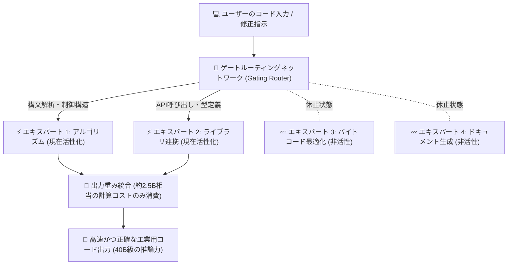
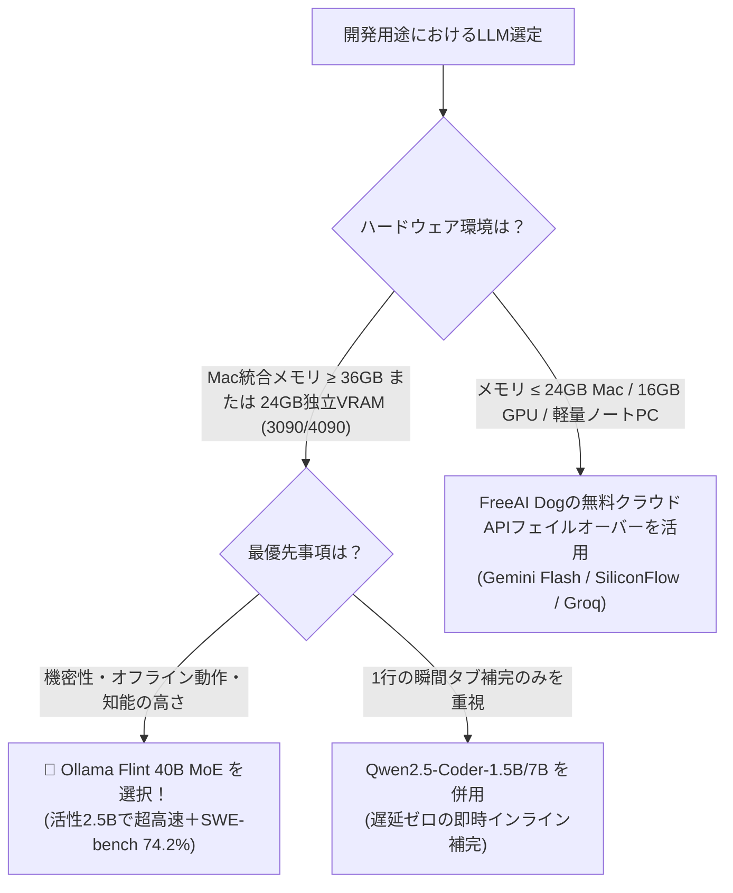

# Ollama v0.40.8でRecursive Flint登場！40B MoE（活性2.5B）をコマンド1発でローカル実行：SWE-bench 74.2%の衝撃

> **要点まとめ**：ローカル環境でコード特化型LLMを動かす際、エンジニアは長年「3つの壁」に直面してきました：  
> - **7B〜8Bの軽量モデル**：動作は軽快だが、複数ファイルの関連付けや高度な型推論ですぐにハルシネーション（構文ミス）を起こす；  
> - **32B〜70Bの大型モデル**：知能は十分だが、個人PCやMacBook上では秒速10〜15トークンと極めて遅く、VRAMを圧迫しすぎる；  
> - **商用クラウドAPI**：便利だが機密コードの外部流出リスクがあり、エアギャップ（オフライン社内網）環境では使えない。
> 
> 本日、Recursiveチームがオープンソース公開し、**Ollama v0.40.8** が即座に公式採用した **Flint** がこの壁を粉砕しました。総パラメータ数 **40B** ながら、各トークン生成で動くのは **わずか 2.5B** のMixture-of-Experts（MoE）構造。さらに **262K の超長文コンテキスト**、商用利用完全自由の **Apache 2.0 ライセンス** を備え、ソフトウェア自動修正ベンチマーク「SWE-bench Verified」で **74.2%** の高スコアをマークしました。
> 
> ターミナルで `ollama run flint` と打つだけで、あなたのマシンが完全無料・オフラインの超知能コーディングアシスタントに早変わりします。

---

## 1. MoEアーキテクチャとは？なぜ「40B総参＋2.5B活性」が最適解なのか？

従来の一般的なモデルは全結合型（Dense）ネットワークであり、簡単な関数を書く場合でも32Bや70Bの全パラメータを毎回計算するため、計算負荷とメモリ帯域の負担が極めて高くなります。

一方、**Flint が採用する MoE（Mixture of Experts）構造** では、モデル内部が専門領域ごとの「エキスパート」に分割されています。



### ローカル開発者が得られる決定的なメリット：
1. **圧倒的な生成速度**：トークン毎に2.5B相当の演算しか行わないため、Apple SiliconやRTXグラフィックボードで秒速45〜60トークンの高速出力を実現；
2. **40B級の深い知識量**：オープンソース界の膨大なコードベースを吸収しており、小規模モデル特有の知識不足によるエラーを克服；
3. **262Kコンテキスト**：プロジェクト全体のファイルを丸ごと読み込ませ、モジュール横断の自動リファクタリングが可能。

---

## 2. 徹底ベンチマーク比較：Flintの実力検証

実務におけるコーディング能力を測る最重要指標である「SWE-bench Verified（実際のGitHubバグ修正率）」と「Terminal-Bench 2.1（端末自動化操作）」の比較データです：

| モデル名 | アーキテクチャ | 総パラメータ / 活性 | SWE-bench Verified | Terminal-Bench 2.1 | 最大文脈 | ライセンス |
| :--- | :---: | :---: | :---: | :---: | :---: | :---: |
| **👑 Recursive Flint** | **MoE** | **40B / 2.5B** | **74.2%** | **54.9%** | **262K** | **Apache 2.0 (完全商用可)** |
| Qwen3.6-35B-A3B | MoE | 35B / 3.0B | 68.5% | 49.2% | 128K | Apache 2.0 |
| DeepSeek-Coder 33B | Dense | 33B / 33B | 62.1% | 46.8% | 128K | DeepSeek License |
| Llama-3.1-8B-Instruct | Dense | 8B / 8B | 41.3% | 34.7% | 128K | Llama 3.1 Community |
| Claude 3.5 Sonnet (参考クラウド) | クローズド | 非公開 | 77.2% | 58.6% | 200K | 有料API |

わずか **2.5Bの活性計算リソース** で **SWE-bench 74.2%** を叩き出し、クラウド最強格の Claude 3.5 Sonnet に迫る実力を示しています。

---

## 3. 3分で完了：Ollama による Flint 実行手順

**Ollama v0.40.8** 以降、Flint は公式レジストリからワンコマンドで取得・実行可能です。

### ステップ1：Ollama の更新確認（≥ v0.40.8）
```bash
# アップデートの実行
curl -fsSL https://ollama.com/install.sh | sh

# バージョン確認
ollama --version
# ollama version is 0.40.8 以上であること
```

### ステップ2：Flint の起動
```bash
ollama run flint
```
初回起動時に量子化済み重みが自動ダウンロードされます。

> [!WARNING]
> ### ⚠️ メモリ要件の真実：統合メモリ共有の罠、なぜ24GBのMac miniでも厳しいのか？
> PCの独立VRAMとMacの統合メモリ（Unified Memory）の物理的な違いを理解することが極めて重要です：
> 1. **PC独立グラフィックボード（RTX 3090 / 4090）**：独立した **24GB専用VRAM** を搭載。OSや一般アプリはメインメモリ（DDR5）上で動くため、22GB〜23GBのモデルが100%まるごとVRAMに収まります；
> 2. **Mac統合メモリ（要注意）**：Macは **CPUとGPUが同一メモリを完全共有** しています！
>    - macOSシステムや常駐アプリで常時4GB〜6GB消費；
>    - macOSのMetalフレームワークはGPUへの割当上限（通常70%〜75%程度）を設定しています；
>    - **結論：24GBのMac miniやMacBookであっても、GPUに安全に割り当てられる実質メモリは約16GB〜18GBに過ぎません！**
>    - 22GB〜24GBのQ4モデルを無理やり読み込ませると、5GB〜7GB分がSSDスワップに追いやられ、速度が0.5 t/sに激減します；
> 
> **🎯 実機ハードウェア基準**：
> - **PC自作・GPUユーザー**：単体 **RTX 3090 / 4090（24GB VRAM）** で余裕を持って稼働；
> - **Macユーザー**：スワップなしでQ4_K_Mを快適に動かすには **32GB / 36GB / 48GB / 64GB** の統合メモリ（M3/M4 Pro 36GBやMax系）が必須；
> - **16GB / 24GB Macユーザー**：無理に24GBのQ4版をダウンロードせず、今後の軽量版（Q3_K_M 約17GB）を待つか、`qwen2.5-coder:7b` やFreeAI Dogのクラウド無料枠をお使いください。

---

## 4. VS Code連携：無料・完全オフラインCopilotの構築

エディタ「VS Code」に組み込んで日常的な開発効率を最大化しましょう。

### 手順：Continue拡張機能のセットアップ
1. VS Codeの拡張機能マーケットプレイスで `Continue` を検索してインストール；
2. `Cmd + Shift + P` を押し、`Continue: Open config.json` を開いて以下の設定を追加：

```json
{
  "models": [
    {
      "title": "Local Flint 40B (Ollama)",
      "provider": "ollama",
      "model": "flint",
      "apiBase": "http://localhost:11434",
      "contextLength": 131072
    }
  ],
  "tabAutocompleteModel": {
    "title": "Local Flint Tab",
    "provider": "ollama",
    "model": "flint",
    "apiBase": "http://localhost:11434"
  }
}
```
保存後、コードを選択して `Cmd + I` を押せば、インラインでの自動コード生成、テスト作成、リファクタリングが完全オフラインで瞬時に実行されます。

---

## 5. Linux / Windows ユーザー向け：vLLM による先行稼働

Ollama v0.40.8 のMetal最適化先行版に対し、LinuxやWindows CUDAユーザーは **vLLM** を用いて即座にOpenAI互換サーバーとして稼働できます：

```bash
# vLLMのインストール
pip install --upgrade vllm

# Flint サーバー起動
python3 -m vllm.entrypoints.openai.api_server \
    --model RecursiveSI/flint \
    --tensor-parallel-size 1 \
    --trust-remote-code \
    --gpu-memory-utilization 0.92 \
    --max-model-len 32768 \
    --port 8000
```
起動後は `http://localhost:8000/v1` をエンドポイントとして各種クライアント（Cherry Studio、Cursor、Dify等）から利用可能です。

---

## 6. まとめ：技術選型フローチャート



Flintは「パラメータ数を無駄に増やす時代が終わり、スパースMoEによる高効率推論が個人の開発環境の主役に躍り出た」ことを証明しています。ターミナルで `ollama run flint` を実行し、新時代のコーディング体験をぜひ試してみてください！

---

> 💡 **元記事と稼働監視**：
> - 元記事: [FreeAI Dog 公式ブログ](https://freeaidog.com/ja/blog/ollama-flint-40b-moe-coding-guide/)
> - 無料AIモデルのリアルタイム稼働状況と遅延データは [FreeAI Dog 可用性レーダー](https://freeaidog.com/ja/radar/) をご覧ください。
