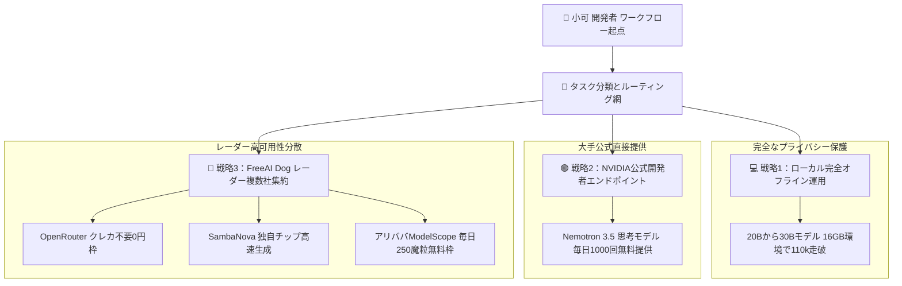

> 📌 **元記事のご案内**: このガイドは [FreeAI Dog 公式プラットフォーム](https://freeaidog.com/ja/blog/ollama-free-cloud-models-end-migration-alternatives-guide/) の転載です。リアルタイムのモデル稼働状況やオンラインAPIテストツールは公式サイトでご利用いただけます：[https://freeaidog.com/ja/](https://freeaidog.com/ja/)。


# Ollama無料クラウドモデルが提供終了へ：対象6モデル一覧と3つの完全無料移行戦略

ローカルのターミナルやコードエディタから手軽にクラウドの大規模モデルを利用してきた開発者にとって、重大な方針変更が告知されました。

Ollama公式チームはコミュニティにて、2026年11月9日をもってFreeプランにおけるクラウドモデルの無料提供を終了し、利用量に応じた従量課金モデルへ完全移行すると正式に発表しました。これまで簡単なコマンド一つで利用できていた数百億から千億パラメータ規模の高性能クラウドモデルが、9日後にはすべて有料化されることになります。

日常の開発アシスタントや長文要約の基盤をOllamaのクラウド機能に依存していたチームにとっては、突如としてサービスが停止しかねない緊急事態です。

小可は公式アナウンスの精査と海外コミュニティの動向を追い、FreeAI Dogが常時監視している全網の無料算力ソースを結集して、本緊急移行ガイドを取りまとめました。本稿で紹介する三つの代替ルートを押さえておけば、費用を一切かけることなく、最高峰のフラッグシップモデルをこれまで通り安定して使い続けることができます。

---

## 一、 有料化のスケジュールと対象モデル一覧

### 1. 重要なタイムライン
- **無料提供終了日**：2026年11月9日
- **課金体系の変更**：対象のクラウドモデルを引き続き利用する場合、アカウントへの事前チャージが必要となり、消費トークン数に応じた従量課金が適用されます。
- **既存契約の扱い**：従来の有料Proプランを契約済みの組織は既存の枠組みが維持されますが、新規ユーザー向けには旧プランの提供が停止されます。

### 2. 無料枠から除外される6つのクラウドモデル

| 対象クラウドモデル名 | パラメータ規模 | 主な利用用途 | 影響度の評価 |
| :--- | :--- | :--- | :--- |
| **gpt-oss:120b** | 1200億の超大規模 | 複雑な多段階推論と高度なリファクタリング | 極めて高い、一般的な単体PCでの全量実行は困難 |
| **nemotron-3-super** | 旗艦級マルチモーダル思考 | ソフトウェア開発とアーキテクチャ設計 | 極めて高い、コーディング支援の主力モデル |
| **nemotron-3-ultra** | 最高峰の万能フラッグシップ | 学術論文の深層要約と総合的な質疑応答 | 極めて高い、日常利用可能な最高水準の無料算力 |
| **gemma4:31b** | 310億の中大型モデル | 多言語のアルゴリズム実装と構造化データ抽出 | 中程度、高性能PCであればローカル実行が可能 |
| **nemotron-3-nano:30b** | 300億の高速モデル | 低遅延な関数単位のコード補完と構文検査 | 中程度、一般的な16GBグラフィックボードで代替可能 |
| **gpt-oss:20b** | 200億の軽量推論モデル | 日常的な対話とシェル操作支援 | 軽微、ローカルのオフラインモデルで完全代替可能 |

### 3. 最も重要な朗報
本アナウンスにおいて、開発チームは極めて重要な原則を明言しました：**自身のコンピュータ上で実行するローカルモデルは、今後も永久に100パーセント無料である**ということです。

今回の変更はクラウドインフラの膨大な運用費用に対処するための純粋な措置であり、ローカルオープンソース実行基盤としてのOllamaの本質は何ら揺らいでいません。

---

## 二、 3つの完全無料代替アーキテクチャ

11月9日以降も業務を一切滞らせないため、小可は以下の階層化された冗長化トポロジーを構築しました：



タスクの規模や求められるメモリ容量に応じて、最適な代替手段を即座に切り替える設計です。

---

## 三、 具体的な移行手順と実務SOP

### 戦略 1：20Bから30Bクラスのモデルをローカル完全オフラインへ退避
リストにあるgpt-oss:20b、nemotron-3-nano:30b、gemma4:31bなどのモデルは、16GBのビデオメモリまたは32GB以上のメインメモリを備えたPCであれば、クラウドに課金することなくローカル環境で軽快に動作します。

小可が以前実証した内蔵GPU画面分離やq5 KVキャッシュ圧縮技術を組み合わせれば、Qwen 27BやGemma 31Bの軽量モデルを非常に快適に動かせます：

```bash
# 高品質にチューニングされたローカルモデルを取得
ollama run qwen3.8:27b

# クラウドへの予期せぬ通信を遮断し完全ローカルで固定
export OLLAMA_HOST="127.0.0.1:11434"
```

データが一切外部に送信されないため、情報漏洩やネットワーク障害のリスクも根本から排除できます。

### 戦略 2：NVIDIA公式エンドポイントへ切り替えてNemotronを無料維持
Ollama側でNemotronの無料クラウドが終了しても、NVIDIA公式の開発者基盤から直接呼び出せば、引き続き無料で利用可能です。

小可がまとめた導入手順：
1. NVIDIA Buildポータルにアクセスし、標準の開発者アカウントを作成します。海外クレジットカードの登録は不要です。
2. ダッシュボードから個人のAPIキーを発行します。初期状態で1000回分の無料推論枠が付与され、継続的に補充されます。
3. エディタやエージェントの接続先ベースURLをNVIDIA公式エンドポイントに変更します。

設定例：

```bash
# NVIDIA公式エンドポイント経由でNemotron 3.5を呼び出す例
curl -X POST https://integrate.api.nvidia.com/v1/chat/completions \
  -H "Authorization: Bearer あなたのNVIDIA_API_KEY" \
  -H "Content-Type: application/json" \
  -d '{
    "model": "nvidia/nemotron-3.5-super",
    "messages": [
      {"role": "user", "content": "このマイクロサービスの負荷分散方針を評価してください"}
    ],
    "temperature": 0.6,
    "top_p": 0.95
  }'
```

運用の注意点：
NVIDIAの利用規約には、モデル改善のために一部データが学習に活用される可能性がある旨が記載されています。極めて機密性の高い社外秘コードの送信は控え、一般的なアルゴリズム設計や技術調査に用いるのが賢明です。

### 戦略 3：FreeAI Dog レーダーを活用した複数大手の無料枠集約
120Bクラスのような超大型モデルは家庭用ハードウェアでの実行が困難です。この領域は、当サイトのレーダーで検証済みの複数大手無料枠へルーティングするのが最も安全です：

1. **OpenRouter クレジットカード不要の完全無料枠**：
   - freeサフィックスが付いた多数のオープンモデルが提供され、毎日無料枠が自動補充されます。
   - ベースURL：`https://openrouter.ai/api/v1`。
2. **SambaNova Cloud 高速生成枠**：
   - 独自開発の推論アクセラレータにより、秒間数百トークンの高速処理が毎日無料で利用可能です。
   - ベースURL：`https://api.sambanova.ai/v1`。
3. **アリババ魔搭 ModelScope オープン基盤**：
   - 国内直結で極めて低遅延であり、毎日250魔粒の無料計算枠が付与されます。
   - ベースURL：`https://api-inference.modelscope.cn/v1`。

クライアントの設定画面で、従来のOllamaクラウド向けURLを上記いずれかのBase URLに差し替え、無料キーを登録するだけで作業環境は即座に復旧します。

---

## 四、 各代替案の比較評価一覧

| 代替戦略 | 対応可能なモデル規模 | 応答遅延 | 費用負担 | プライバシー安全性 |
| :--- | :--- | :--- | :--- | :--- |
| **戦略1：ローカル完全オフライン** | 20Bから30Bクラス | ネイティブな超高速応答 | 完全無料 | 最高水準、端末外にデータが出ない |
| **戦略2：NVIDIA公式直結** | Nemotron旗艦モデル | 200msから300ms程度 | 完全無料、公式無料枠 | 一般開発向け、学習利用規約あり |
| **戦略3：レーダー複数社集約** | 70Bから120Bの超大型 | 150msから400ms程度 | 完全無料、毎日定時補充 | 企業標準のAPI通信による保護 |

---

## 五、 今後の対応方針とまとめ

クラウド基盤の有料化は技術産業における自然な流れです。変化に強いエンジニアであるためには、特定の単一サービスに依存せず、いつでも切り替え可能な柔軟な環境を用意しておくことが不可欠です。

11月9日の期日まで残り9日間あります。小可は今週中に以下の三つの準備を完了させることを強く推奨します：
1. **自動化スクリプトの点検**：コードベースや設定ファイル内に、対象の6モデルを直打ちしている箇所がないか確認してください。
2. **予備キーの事前確保**：NVIDIA BuildやOpenRouterにアクセスし、5分程度で予備の無料APIキーを取得しておきましょう。
3. **FreeAI Dog デイリーレーダーの確認**：各社の提供方針の変化に合わせて、当サイトでは240以上のエンドポイントの稼働状況を監視し、新たな無料枠を即座に更新しています。

---

> 💡 **元記事と稼働監視**：
> - 元記事: [FreeAI Dog 公式ブログ](https://freeaidog.com/ja/blog/ollama-free-cloud-models-end-migration-alternatives-guide/)
> - 無料AIモデルのリアルタイム稼働状況と遅延データは [FreeAI Dog 可用性レーダー](https://freeaidog.com/ja/radar/) をご覧ください。

