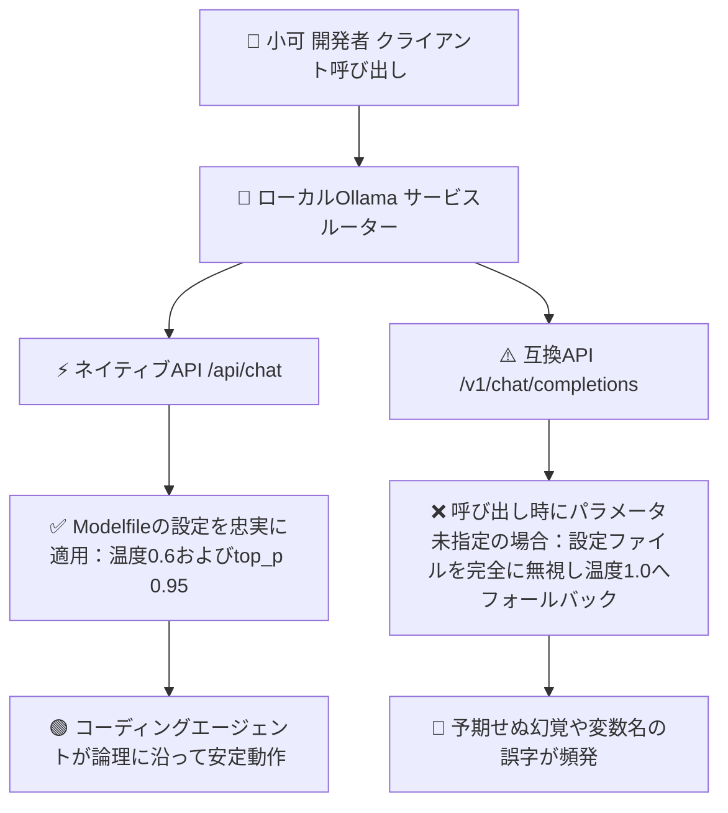

> 📌 **元記事のご案内**: このガイドは [FreeAI Dog 公式プラットフォーム](https://freeaidog.com/ja/blog/ollama-v1-temperature-bug-greedy-coding-pitfalls-guide/) の転載です。リアルタイムのモデル稼働状況やオンラインAPIテストツールは公式サイトでご利用いただけます：[https://freeaidog.com/ja/](https://freeaidog.com/ja/)。


# エンジンを勝手に1.0で暴走させるな：デコード設定の落とし穴とOllamaの温度無視バグ実測

ローカル環境でコーディングアシスタントや自律型エージェントを動かす際、多くの開発者が直感的な誤解に陥りがちです。温度設定を0や0.1に下げれば、コンパイラのように厳密で確実なコードを出力してくれると信じ込んでしまうのです。しかし実際の現場では、温度を下げるほど複数ファイルの設計変更や高度なアルゴリズム導出において、モデルが無意味な無限ループに陥ったり変数名を誤字ったりする怪奇現象が頻発します。

詳細な動作追跡とサンプリング検証を行った結果、小可は極めて重大な二つの技術的要因を突き止めました：
第一に、思考能力を持つ最新モデルの論理展開は適度なサンプリングの揺らぎに依存しており、貪欲法による一本道デコードは推論の柔軟性を奪ってしまいます。
第二に、最も致命的な仕様上の穴として、Ollamaの標準互換エンドポイントにおいて、呼び出し元が明示的にパラメータを指定しない限り、Modelfileに記載された温度設定が完全に無視され、システム規定値1.0の最大ランダム性で暴走してしまう挙動が判明しました。

丹精込めて設定したパラメータがすべて無視されていたことを意味します。本稿ではその検証方法と本番運用の安全な手順を体系的に整理します。

---

## 一、 貪欲法デコードの限界と誤解

### 1. なぜ極端な低温設定でプログラミング能力が落ちるのか
温度0を設定すると、モデルは数学的な貪欲法デコードを実行します。各ステップで最も確率の高い単一のトークンのみを選択する方式です。事実関係の検索には適していますが、コード生成においては以下の深刻な問題を引き起こします：
- **優れた別解の排除**：優れたコーディング解法は、確率順位で2番目や3番目に位置するトークンから生まれることが多々あります。単一の狭い経路に縛られると、一度迷い込んだ誤りを後から修正できません。
- **致命的な無限ループと反復退化**：一度局所解に捕まると、その後に最も確率が高くなるのは直前パターンの繰り返しとなり、同じコードブロックを延々と書き続けるループ現象が発生します。
- **公式ドキュメントによる警告**：Qwenなどの公式モデルカードでも、思考モード有効時に貪欲法を用いると推論能力が著しく低下し無限ループに陥るため、温度0での運用を避けるよう明記されています。

### 2. 投機デコード速度測定に潜む数字のマジック
投機的デコードの性能検証において、秒間数百トークンという驚異的な数値が公表されることがあります。小可はこの測定条件について注意を促します：
多くのベンチマークは、あえて温度0の貪欲モードで測定されています。確定的な状態ではドラフトモデルのトークン採択率が95パーセントを容易に超え、見栄えの良い数値が出るためです。しかし実際の非ゼロ温度環境では採択率が大幅に低下します。宣伝数値をそのまま信用して実務パラメータを決めてはなりません。

---

## 二、 内部挙動の分析と実証実験

### 1. Ollama標準エンドポイントのパラメータ無視問題
開発者は通常、Modelfileに必要な推奨値を書き込んで準備します：

```dockerfile
FROM qwen3.8:27b
PARAMETER temperature 0.6
PARAMETER top_p 0.95
PARAMETER top_k 20
```

しかしOllama内部のルーティング構造には、以下のような致命的な挙動の違いが存在します：



CursorやAiderなどの外部ツールが標準互換エンドポイントを経由して通信する際、リクエスト内で温度が明示されていないと、設定ファイルの値が反映されず、既定値1.0の最大揺らぎが適用されます。0.6で慎重に動かしているつもりでも、実際には1.0のランダム状態で動いているのです。

### 2. 30回フルーツ名出力による実証テスト
この挙動を検証するため、小可は簡単な統計的テストを実施しました：モデルに身近な果物の名前を1つだけ出力するよう指示し、30回連続で実行して結果のばらつきを数えます。

温度0.6であれば回答は2種類から3種類程度に集中しますが、温度1.0であれば多様な果物名がバラバラに出現します。

端末で以下のテストスクリプトを実行しました：

```bash
#!/bin/bash
# ネイティブAPIと互換APIの出力分散度を比較検証

echo "=== テスト1：ネイティブ /api/chat 経由 ==="
for i in {1..30}; do
  curl -s http://localhost:11434/api/chat -d '{
    "model": "qwen3.8:27b",
    "messages": [{"role": "user", "content": "句読点を付けずに果物の名前を1つだけ出力してください"}],
    "stream": false
  }' | jq -r '.message.content'
done | sort | uniq -c

echo "=== テスト2：互換 /v1/chat/completions 経由でパラメータ未指定 ==="
for i in {1..30}; do
  curl -s http://localhost:11434/v1/chat/completions -H "Content-Type: application/json" -d '{
    "model": "qwen3.8:27b",
    "messages": [{"role": "user", "content": "句読点を付けずに果物の名前を1つだけ出力してください"}]
  }' | jq -r '.choices[0].message.content'
done | sort | uniq -c
```

実験結果の比較：

| 接続経路 | 想定設定 | ユニーク回答数 | 最多頻出トークン数 | 実質的な動作温度 |
| :--- | :--- | :--- | :--- | :--- |
| **ネイティブAPI経由** | 設定ファイルで0.6指定 | わずか3種類 | りんごが24回 | 0.6の想定通りに収束 |
| **互換API経由で未指定** | 設定ファイルで0.6指定 | 8種類に拡散 | 回答が大きく分散 | 1.0相当の最大ランダム |
| **互換API経由で明示指定** | 通信本文に0.6を指定 | 3種類に復帰 | りんごが25回 | 想定通りの安定状態に復帰 |

明示的にパラメータを渡さない限り、互換API側は設定ファイルを完全に無視していることが確認できました。

---

## 三、 本番運用の対策手順

対策は極めて明確であり、二つの習慣を確立するだけです。

### ステップ 1：呼び出し元でサンプリング設定を明示する
サーバ側の自動継承に頼らず、クライアント側の設定ファイルや通信本体で温度を常に明記します：

Aiderなどの設定ファイルで指定する場合：

```yaml
# aiderの設定でサンプリングパラメータを明示指定
temperature: 0.6
```

標準API経由で通信する場合：

```bash
# パラメータを明示的に指定したAPI呼び出しの例
curl -X POST http://localhost:11434/v1/chat/completions \
  -H "Content-Type: application/json" \
  -d '{
    "model": "qwen3.8:27b",
    "messages": [
      {"role": "system", "content": "あなたは熟練のエンジニアです"},
      {"role": "user", "content": "認証モジュールのリファクタリングを行ってください"}
    ],
    "temperature": 0.6,
    "top_p": 0.95
  }'
```

### ステップ 2：主要モデル系列の推奨設定一覧
モデルの設計思想によって最適なパラメータは異なります：

| モデル系列 | 推奨温度範囲 | 推奨 top_p | 推奨 top_k | 運用上の注意点 |
| :--- | :--- | :--- | :--- | :--- |
| **Qwen 3.8 思考系モデル** | 0.6 から 0.7 | 0.95 | 20 から 40 | ループ防止のため温度0は絶対回避 |
| **DeepSeek R1 および V3 系列** | 0.6 | 0.95 | 制約なし | 公式が推奨する標準バランス設定 |
| **Gemma 4 系列** | 0.1 から 0.2 | 0.90 | 40 | 低温設定のほうが性能を発揮する珍しい例外 |
| **一般的な7Bおよび8Bモデル** | 0.7 | 0.90 | 40 | 0.5未満にすると文章が硬直化しやすい |

---

## 四、 まとめと教訓

コーディングエージェントの不可解な誤動作は、モデル自体の性能不足ではなく、通信プロトコル層の暗黙のデフォルト値が引き起こしているケースが少なくありません。

小可が推奨する運用の心得：
1. **決定論の罠を疑う**：思考型推論において貪欲法を避け、適度なランダム性を確保することが自己修復の鍵となります。
2. **重要パラメータは常に明示する**：互換エンドポイントを跨ぐ際は、サーバが設定を引き継いでくれると思い込まず、明示的にパラメータを渡しきることが重要です。
3. **簡易テストで挙動を確認する**：挙動に違和感を覚えた際は、30回フルーツテストのような軽量スクリプトを実行することで、原因を素早く特定できます。

---

> 💡 **元記事と稼働監視**：
> - 元記事: [FreeAI Dog 公式ブログ](https://freeaidog.com/ja/blog/ollama-v1-temperature-bug-greedy-coding-pitfalls-guide/)
> - 無料AIモデルのリアルタイム稼働状況と遅延データは [FreeAI Dog 可用性レーダー](https://freeaidog.com/ja/radar/) をご覧ください。

