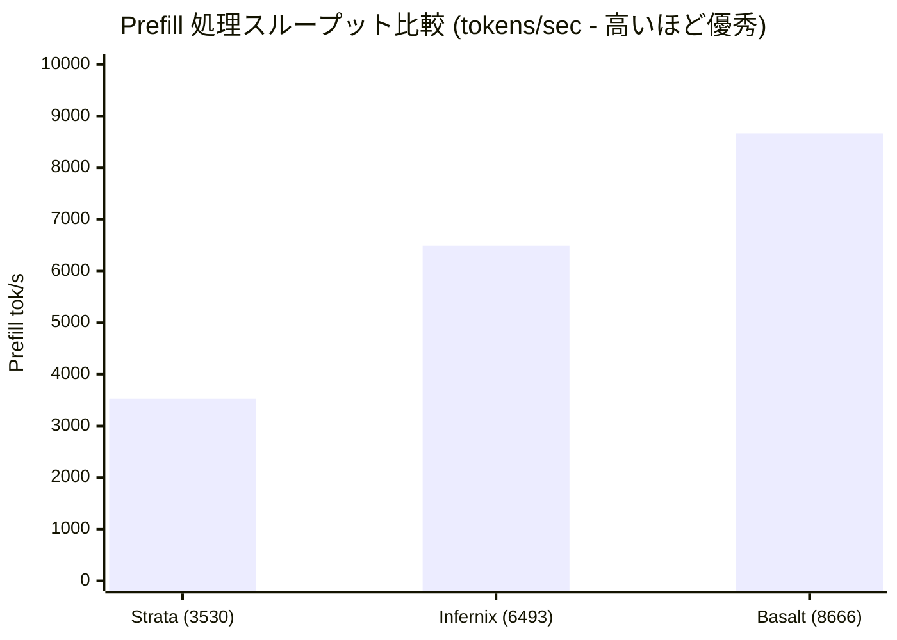

# Qwen 3.8 Flash Next 推論エンジン徹底比較：Basaltが187 t/sを記録 vs llama.cppは39 t/sで最下位！7大エンジン実測と「エキスパートスキップ」の罠

普段ローカル環境でオープンソースLLMを動かしているエンジニアの多くは、まず `llama.cpp` や `Ollama` を立ち上げるのが定番でしょう。GGUFエコシステムの普及と安定性は抜群だからです。

しかし、Alibabaがリリースした最新の **Qwen 3.8 Flash Next**（超高速推論と高い知能を両立したMoE＝Mixture of Expertsモデル）の登場により、その常識が覆りつつあります。Redditの r/LocalLLaMA コミュニティで行われた最新ベンチマークにおいて、同一の **単体 RTX 5090 @ 400W + 128GB RAM** 環境下で、主要な7大推論エンジンの直接対決が実施されました。

その測定結果はコミュニティに大きな衝撃を与えました：
- **従来の llama.cpp が最下位に沈み**、生成（Decode）速度はわずか **32〜39 tokens/s**；
- 一方、新進気鋭の **Basalt エンジンは 187 tokens/s** を叩き出し、**約5倍** の速度差を記録！プロンプト処理（Prefill）速度も3,500から **8,666 tokens/s** へと倍増しました。

ハードウェアは同一、BIOS改造もオーバークロックも不要。単に**推論エンジンを入れ替えるだけで5倍の性能を無償で手に入れられる**のです。

しかし、ここに落とし穴はないのでしょうか？ベンチマークのスコアを稼ぐために「エキスパート計算を間引いて知能を落としている」可能性はないのか？私（小可）が一次ソースの技術詳細、生ログ、コード実装、そして落とし穴の検証結果を徹底解剖しました。

---

## 1. 7大推論エンジンの実測ベンチマーク全景

GPUのサーマルスロットリングやメモリ断片化の影響を完全に排除するため、テストは極めて厳格なプロトコルで実施されています：
- **テスト環境**：RTX 5090 単体（電力上限 400W 設定） + 128 GB DDR5 メモリ；
- **使用モデル**：Qwen 3.8 Flash Next、NVIDIA公式提供の **NVFP4 フルウェイト**；
- **測定プロトコル**：7回のGreedyサンプリングリクエスト、毎回コールドスタートを実施。25K、50K、100K、200K の4段階のコンテキスト長で計測。

### 生成速度（Decode Speed · tokens/sec）
チャットやリアルタイムコード補完における「体感の出力速度」です：

| 推論エンジン | 25K 文脈 | 50K 文脈 | 100K 文脈 | 200K 文脈 | llama.cpp 比 |
| :--- | :---: | :---: | :---: | :---: | :---: |
| **Basalt** *(最有力推奨)* | **187 t/s** | **184 t/s** | **180 t/s** | **160 t/s** | **+380% (4.8倍)** 🚀 |
| **Infernix** | 174 t/s | 176 t/s | 163 t/s | 158 t/s | +350% (4.5倍) |
| **capy-flash** | 143 t/s | 152 t/s | 152 t/s | 135 t/s | +270% (3.7倍) |
| **Strata** | 123 t/s | 121 t/s | 123 t/s | 114 t/s | +220% (3.2倍) |
| **ninfer-ext** | 86 t/s | 79 t/s | 95 t/s | 66 t/s | +120% (2.2倍) |
| **ninfer** | 46 t/s | 47 t/s | 53 t/s | 44 t/s | +20% (1.2倍) |
| **llama.cpp** *(従来の標準)* | 36 t/s | 35 t/s | 39 t/s | 32 t/s | *基準値 (1.0倍)* 🐢 |

### プレフィル処理能力（Prefill Throughput · tokens/sec）
数万字のドキュメントや大規模リポジトリをモデルに流し込む際の「読み込み処理速度」です：



- **Basalt**：短文脈の 6,492 tok/s から超長文脈の **8,666 tok/s** へとスケールアップ；
- **Infernix**：約 6,500 tok/s で安定；
- **Strata**：3,530〜4,245 tok/s にとどまり、Basaltのドキュメント読み込み速度はStrataの **2倍以上** に達します。

---

## 2. 徹底検証：高速化に「インチキ」はないのか？

MoEモデルの構造を知る開発者なら、当然こう疑問に思うはずです。「Qwen 3.8 Flash NextはMoEアーキテクチャだ。こんなに速いのは、裏でエキスパートの計算を勝手に間引いている（Expert Tail Skip）からではないのか？」

今回のコミュニティ議論で最も価値が高かったのが、まさにこの「精度の公正性」の追及でした。

### ① スコア稼ぎの罠：エキスパートスキップ（Tail Skip）とは？
MoEモデルでは、各トークンに対してルーターが重み上位のエキスパートを選択して演算します。しかし一部のエンジンでは、さらなる高速化のために「重みの小さい下位エキスパートの演算を意図的に切り捨てる」という過激な手法を採っています。
- **Strataの実装**：環境変数 `STRATA_ROUTE_TAIL_SKIP=7` がデフォルトで有効化されています！つまり、下位7個のエキスパートを強制的にスキップして数字を稼いでいます。
- **その代償は？** この間引きは無劣化ではありません。複雑な推論タスク、関数呼び出し（Tool Calling）、長大なロジック生成において知能の劣化や無限ループ障害を引き起こす原因になります。

### ② Basaltが本物である理由
Basaltの作者はコードと検証結果をオープンにし、次の事実を明らかにしました：
1. **Basaltにはエキスパートスキップが一切存在しない**：本来計算されるべき全エキスパートを余すところなく計算しています。作者がスキップ実験を行った際、KLダイバージェンス（KLD）が量子化1ランク分も急激に悪化し、速度面の恩恵はごくわずかだったため、**完全忠実な演算方式** を採用しました。
2. **ツール呼び出しの失敗ゼロ**：NVIDIA公式のNVFP4ウェイトと厳格な文法制約（Grammar Enforcement）のもとで数百回のファンクションコーリングを実施し、**クラッシュや引数欠落、無限ループは1度も発生しませんでした**。
3. **KLDの一致**：Unsloth Q8精度を基準とした比較において、Basaltの出力分布とllama.cppの相対エントロピー（KLD）はほぼ 0 に収束しています。

> **小可の結論**：**Basaltの187 t/sは、間引きによる見せかけの数字ではなく、極限まで磨き抜かれた「真のフルスピード」です。**

---

## 3. 実践チュートリアル：Basaltで爆速 Qwen 3.8 Flash Next を動かす

BasaltはGitHubで完全オープンソースとして公開されています（リポジトリ：`github.com/jesdga95/basalt`）。llama.cppが抱える長年のレガシー互換コードを削ぎ落とし、最新のNVIDIA GPU（Ada Lovelace 40シリーズおよびBlackwell 50シリーズ）専用にゼロから最適化されています。

以下は、Linux / WSL2 環境でビルドして動かすための完全な手順です。

### ステップ 1：ビルド環境の準備
NVIDIA公式ドライバ、CUDA 12.6以上、C++コンパイラをインストールします：

```bash
# ビルドツールのインストール
sudo apt-get update && sudo apt-get install -y \
    build-essential cmake ninja-build git git-lfs

# CUDAコンパイラのバージョン確認 (12.6以上を推奨)
nvcc --version
```

### ステップ 2：リポジトリのクローン
```bash
git clone --recursive https://github.com/jesdga95/basalt.git
cd basalt
```

### ステップ 3：最適化ビルド
BasaltはモダンなCMake + Ninjaビルドを採用しており、CUDAのネイティブ最適化が自動で適用されます：

```bash
mkdir -p build && cd build

# リリースビルドの構成
cmake .. -G Ninja -DCMAKE_BUILD_TYPE=Release

# マルチスレッド並列コンパイル
ninja -j$(nproc)
```
ビルドが完了すると、`build/bin/` 配下に `basalt-cli` および `basalt-server` が生成されます。

### ステップ 4：公式NVFP4ウェイトの取得とサーバー起動
サードパーティの再量子化版ではなく、HuggingFaceの公式リポジトリから最適化済みのNVFP4モデルを取得します：

```bash
# 高性能推論サーバーを起動
./bin/basalt-server \
    --model-path /path/to/Qwen3.8-Flash-Next-NVFP4 \
    --port 8000 \
    --ctx-size 131072 \
    --gpu-layers 999
```
サーバーが立ち上がると、ローカルの `8000` ポートでOpenAI互換API（`/v1/chat/completions`）が提供されます。Cursor、Chatbox、Immersive Translate、あるいは FreeAI Dog のAPIデバッグ画面にそのまま指定して即座に活用可能です。

---

## 4. エンジン選定マトリクス：あなたに最適な選択肢

| お手元の環境と要件 | 推奨エンジン | 選定の決め手 |
| :--- | :--- | :--- |
| **NVIDIA RTX 4090 / 5090 / 5080** | **Basalt** 🏆 | NVFP4ネイティブアクセラレーションにより、完全無劣化で4〜5倍の速度向上 |
| **AMD Radeon（RX 9070 XT / 7900 XTX 等）** | **Strata** 🥈 | ROCmネイティブサポート。RDNA4環境で70〜90 t/sの実用速度を達成 |
| **Apple Silicon (Mac Mシリーズ) または CPUオンリー** | **llama.cpp / Ollama** | 広範なアーキテクチャ対応力とポータビリティでは依然として独壇場 |
| **超低予算ハード（X99 + MI50 中古自作機など）** | **Strata (Atomic Q4)** | 200ドル前後の総予算で30〜50 t/sのローカル推論環境を構築可能 |

---

## まとめ

LLMのローカル活用というと、「もっと性能を出すには高価なグラボを買い足すしかない」と考えがちです。しかし今回の検証が証明したように、**ソフトウェアエンジニアリングとカーネル最適化がもたらす恩恵は、ハードウェアの世代交代に匹敵します。**

llama.cppの 39 t/s から Basaltの 187 t/s へ——追加のハードウェア費用は1円もかかっていません。

FP4 / FP8に対応したGPUをお持ちなら、ぜひ上記の手順でBasaltの圧倒的な爆速推論を体感してみてください。ビルド時の疑問やトラブルがあれば、お気軽にコメント欄でお知らせください。小可がサポートします！

---

> 💡 **元記事と稼働監視**：
> - 元記事: [FreeAI Dog 公式ブログ](https://freeaidog.com/ja/blog/qwen-3-8-flash-next-engine-benchmark-basalt-strata-guide/)
> - 無料AIモデルのリアルタイム稼働状況と遅延データは [FreeAI Dog 可用性レーダー](https://freeaidog.com/ja/radar/) をご覧ください。
