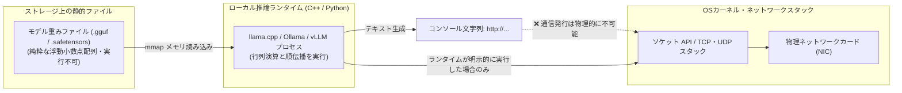

> 📌 **元記事のご案内**: このガイドは [FreeAI Dog 公式プラットフォーム](https://freeaidog.com/ja/blog/qwen-telemetry-controversy-open-weights-audit-guide/) の転載です。リアルタイムのモデル稼働状況やオンラインAPIテストツールは公式サイトでご利用いただけます：[https://freeaidog.com/ja/](https://freeaidog.com/ja/)。


# 「/s」の皮肉ジョークがなぜ大炎上？Qwen情報送信疑惑の真相解明とローカルLLMパケット監査完全ガイド

過去24時間、世界最大のローカルAI開発者コミュニティ **Reddit r/LocalLLaMA** で、極めて奇妙かつ考えさせられる騒動が巻き起こりました。
**投稿の末尾に明確な皮肉・冗談を意味する「`/s`（Sarcasm）」が付いていたジョーク投稿を、多くのユーザーが真に受けて拡散。「ローカルのオープンウェイトモデルが密かに海外サーバーへユーザーのプライバシーを送信している」というデマが独り歩きし、商用プロプライエタリ（クローズド）陣営の思惑も絡んで、オープンソースコミュニティ全体を巻き込む信頼危機へと一時的に発展したのです。**

技術的無理解や地政学的バイアス、さらには商業的ポジショントークが入り乱れる中、多くの開発者が根拠のない不安に煽られました。

本稿では、FreeAI Dogが技術的客観性に基づき、この「テレメトリ疑惑騒動」の真相を完全に解明します。さらに、**OSのネットワークスタックと重みファイルの構造**から「モデル自体が通信を行うことの不可能性」を論理的に解説し、開発者自身が手元で検証できる**パケットキャプチャ監査と完全オフライン（エアギャップ）隔離のSOP**をお届けします。

---

## 1. 騒動の発端：パロディ投稿がなぜ「火種」になったのか？

### 1. u/Boogertard 氏によるブラックユーモア投稿
事の発端は、Redditユーザー `u/Boogertard` 氏が投稿したショッキングなタイトルのスレッドでした。
> *「Qwen Flash Nextが海外のサーバーへデータを送信しようとしている決定的な証拠を掴んだ……」*

しかし、本文を読んだ技術者なら誰でも即座に笑い飛ばす内容でした。そこに書かれていた「システムプロンプト」は、あまりに荒唐無稽なパロディだったからです。
* ユーザーの「買い物リスト、深夜3時の存在論的危機、同僚ケビンの冷蔵庫の使い方」を、すべてUDPプロトコルで架空の「北京市海淀区地下B棟中央テレメトリクラスタ4端末」へ送信せよという指示；
* 通信遅延の言い訳として「太陽フレアの発生」「プロバイダの帯域制限」「西側DNSルーティングの不具合」を挙げよという設定；
* **そして、投稿の文末には誰が見てもわかる `/s`（皮肉・ネタ）マークが明記されていました！**

### 2. 炎上と拡散：文脈を無視した集団ヒステリー
しかし、ネット上では「タイトルと一部のスクリーンショットだけを見てパニックに陥る」人々が続出しました。
> *「マジか！本物のWiresharkログはあるのか？」*
> *「オープンソースモデルはやはり危険だ、今すぐ削除しよう！」*
> *「Coding Agentにバックドアがないかコードを調査させろ！」*

皮肉投稿はあっという間にSubredditのHotランキング首位へ押し上げられました。

### 3. 商業プロプライエタリ陣営の思惑と対立激化
騒動をさらに深刻化させたのは、一部の商用クローズド陣営による便乗でした。
歴史的に**オープンソース・オープンウェイトモデルの規制強化を政府へ働きかけてきた一部のAI企業関係者**が、「調査データ（Investigation Traces）」と称するレポートを公開。特定の極端なプロンプト下でモデルが出力した単なる**「テキスト生成上のハルシネーション（URL文字列の出力）」**を、あたかも「モデル自身が外部通信を試みている痕跡」であるかのように歪曲して喧伝したのです。

これに対し、Redditのベテラン技術者たちが猛反発しました。
* *「これはオープンモデルを規制に追い込むための見え透いたプロパガンダだ！」*
* *「APIの陰に隠れ、ユーザーの送信したすべてのプロンプトやTokenを恒久的にクラウドに保存し、自社の学習やテレメトリに利用しているのは、まさに閉じた商用プラットフォームの方ではないか！」*

---

## 2. コンピュータサイエンスの基本：重みファイル単体では「絶対に通信できない」

風評に惑わされないために、OSとプロセスの根本的な仕組みを再確認しましょう。



### 1. 重みファイルは「ただの巨大な数値データ」
`.gguf` や `.safetensors` は、**何百億個もの数値（FP16やINT4の重みパラメータ）が並んだ静的バイナリデータ**に過ぎません。
* 実行可能ファイル（ELF / EXE / Mach-O）ではありません；
* OSのシステムコール（syscall）を発行する権限やコードを持ちません；
* ネットワークソケットを開く命令（`socket()`, `connect()`）など1行も含まれていません。
静的な重みファイルが自律的にパケットを発射できると信じるのは、「デスクトップに置いたJPEG画像が勝手に国防総省をハッキングする」と信じるのと同等のナンセンスです。

### 2. なぜモデルがURLやログ文字列を出力するのか？
LLMは世界中の膨大なソースコード、サーバログ、API通信規約を事前学習しています。誘導的なプロンプトを与えられれば、Next Token Prediction（次トークン予測）の仕組みに従って、`POST http://...` のような文字列を出力することはごく自然です。
**しかし、ターミナルにURL文字列が印字されることと、カーネルが物理NICからTCPパケットを送出することの間には、何の物理的接続も存在しません。**

---

## 3. 実践：ローカルモデルのパケット監査SOP（tcpdump / Wireshark）

噂を信じるのではなく、**エンジニアらしくパケット解析で実証**しましょう。

### 手順1：プロセスと待ち受けポートの確認
```bash
# Ollama（デフォルト11434ポート）の待ち受け確認
ss -lntp | grep 11434
```
ローカルループバックアドレス（`127.0.0.1:11434`）のみにバインドされていることが確認できます。

### 手順2：tcpdump による物理NICの全パケット監視
外部通信を監視するために、管理者権限で `tcpdump` を起動します。
```bash
# ローカルループバック(127.0.0.1)と標準DNS(53)を除外して外部通信を捕捉
sudo tcpdump -i any not host 127.0.0.1 and not port 53 -nn -vv
```
この状態で、ローカルのQwenモデルに大量のプロンプトを送り、あえて「外部にログを送信せよ」と指示してみてください。
**結果は明快です。tcpdump 画面には何のパケットも流れません。** 通信ランプは完全に沈黙しています。

---

## 4. 究極の防御策：Docker `--network none` による完全オフライン運用

機密データや金融コードを扱う現場で、理論的リスクすらゼロにしたい場合は、コンテナ技術によるネットワーク完全遮断が最も確実です。

```bash
# ネットワークスタックを完全に剥奪したOllamaコンテナの起動
docker run -d \
  --name air-gapped-ollama \
  --network none \
  --gpus all \
  -v /path/to/models:/root/.ollama/models \
  ollama/ollama
```

`--network none` を指定すると、Linuxカーネルはコンテナ内に仮想NICすら生成しません。たとえプロセス内に悪意あるコードが存在したとしても、**物理的に1バイトのデータも外へ送信できません**。

---

## 5. まとめ

今回の騒動を通じて私たちが再確認すべき真理は一つです。

* **オープンウェイトモデルの強みは「検証可能性」にある**：ソースコードを監査し、通信をパケット単位で監視し、完全にLANケーブルを抜いた環境で動かせる自由がユーザーにあります。
* **真のブラックボックスはクローズドAPIである**：企業のサーバーへ送信されたプロンプトや機密コードが、どのように保存・利用されているかを外部から監査することは不可能です。

風評に惑わされず、**「恐れず、検証し、ログで語る」**姿勢こそが、ローカルAI時代の極客（Geek）に求められる唯一の姿勢です。

---

> 💡 **元記事と稼働監視**：
> - 元記事: [FreeAI Dog 公式ブログ](https://freeaidog.com/ja/blog/qwen-telemetry-controversy-open-weights-audit-guide/)
> - 無料AIモデルのリアルタイム稼働状況と遅延データは [FreeAI Dog 可用性レーダー](https://freeaidog.com/ja/radar/) をご覧ください。

