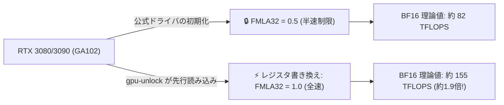

> 📌 **元記事のご案内**: このガイドは [FreeAI Dog 公式プラットフォーム](https://freeaidog.com/ja/blog/rtx-3090-gpu-unlock-bf16-kernel-module-guide/) の転載です。リアルタイムのモデル稼働状況やオンラインAPIテストツールは公式サイトでご利用いただけます。


# RTX 3090 の計算能力を1.9倍解放？Zagitta製 GPU Unlock カーネルモジュールの実機検証とLLM実効性能

ローカルで大規模言語モデル（LLM）を動かす自作派にとって、24GB の大容量 VRAM を誇る **RTX 3090** は今なお最高のコスパカードです。小可（シャオコー）の作業マシンでも、2枚の 3090 が Qwen や Llama などの推論・ファインチューニング用として元気に稼働しています。

しかし古参ユーザーの間では周知の事実があります。**NVIDIA はコンシューマ向けの GA102 チップ（RTX 3080 / 3090 / 3090 Ti）に対し、FP32 累積 Tensor Core 演算速度（ドライバ内部の `FMLA32` 命令）をあえて半速（Half Speed）に制限している**という点です。高価なプロ向けカード（RTX A6000 など）との差別化のためです。

従来これを解除するには、文鎮化のリスクを冒して vBIOS を書き換えるしかありませんでした。ところが本日、r/LocalLLaMA で開発者 Zagitta 氏が公開した **`gpu-unlock` Linux カーネルモジュール**が大きな注目を集めています：**vBIOS の書き換えもドライバ改造も不要。NVIDIA 公式ドライバが読み込まれる直前にレジスタを書き換え、Tensor Core を本来の全速状態に戻す**という極めてスマートなアプローチです。

小可が早速実機に導入して検証を行いました。導入手順から生のベンチマーク、そして何より気になる**「実際のローカル LLM で何％速くなるのか」**を客観的に解説します。

---

## 1. NVIDIA は何を制限していたのか？モジュールはどう解除するのか？

### FMLA32 の半速制限とは？
BF16 や TF32 の行列乗算（GEMM）を行う際、Tensor Core は数値計算の安定性と精度を担保するため、乗算結果を **FP32 精度で累積加算**（Fused Multiply-Add with FP32 Accumulation、通称 `FMLA32`）します。

プロ向けカード（RTX A6000）ではこのユニットが全開で動作しますが、コンシューマ向けの GA102 では、公式ドライバの初期化ルーチンによって `FMLA32` レジスタが強制的に 0.5（半速）に設定されます。



### Zagitta 氏のアプローチ：ドライバ読み込み前の先回り介入
ファームウェア自体を書き換えるのではなく、Linux の起動シーケンスに着目したのが本モジュールの特徴です：
- 軽量な **Linux DKMS カーネルモジュール**として動作；
- OS 起動時、NVIDIA 公式ドライバ（`nvidia.ko`）が GPU を認識する**直前**に割り込み、GA102 の制御レジスタを書き換えて `FMLA32` を Full Speed に設定；
- その後、公式ドライバが通常通りロードされ、制限が外れた状態で稼働。

**精度と安定性の検証結果**：
- **計算結果に狂いは生じないか？** 作者による検証では、同一の Expert Cache 条件下で 1,996 箇所の teacher-forced 出力の log-prob をバイト単位で比較した結果、**純正ドライバの出力と 100% 一致**しました。演算速度のみが向上し、回答品質の劣化はありません；
- **再起動やスリープでリセットされないか？** 実機検証の結果、通常の再起動はもちろん、スリープ復帰後も設定が維持されます。

---

## 2. 理論値 vs 実際の LLM 速度：1.9倍の言葉に惑わされないために

コミュニティの投稿にある「1.9倍」という数字を見ると、LLM の生成速度が丸ごと2倍になると期待してしまいがちです。**しかし結論から言うと、理論演算性能とエンドツーエンドの推論速度は別物です。**

### 1. 純粋な数学演算マイクロベンチマーク（4× RTX 3090）
Tensor Core の純粋なスループット測定では、驚異的な伸びを示します：

| 測定項目 | 公式ドライバ標準 | gpu-unlock 適用後 | 向上率 |
|---|---|---|---|
| **BF16 Tensor Pipe 理論値** | 82 TFLOPS | **155 TFLOPS** | **+89% (≈ 1.89倍)** |
| **cuBLAS BF16 GEMM (8192)** | 64 TFLOPS | **99 TFLOPS** | **+54.7% (≈ 1.55倍)** |
| **TF32 演算理論値** | 41 TFLOPS | **79 TFLOPS** | **+92.7% (≈ 1.92倍)** |

純粋な GEMM 行列演算においては、ほぼ公称通りの倍増を達成しています。

### 2. 実際の LLM 推論：Qwen3.8 Flash-Next 2枚挿し実測
実際の推論エンジン（Strata + Qwen3.8 Flash-Next デュアル構成）で Prefill（入力プロンプト処理）のスループットを計測した結果は以下の通りです：

- **4K コンテキスト Prefill**：約 **+12% 高速化**；
- **10K コンテキスト Prefill**：約 **+12% 高速化**；
- **90K 超長文コンテキスト**：3,205 t/s から **3,536 t/s（+10.3%）** へ向上。

### 3. なぜ理論値は倍増なのに、LLM 実効速度は 10〜12% なのか？
推論パイプラインの内訳を見ると理由は明確です：
1. **GEMM 演算は全体の約4割**：実際の Prefill 処理において、密な GEMM 行列積が占める時間は全体の 35%〜40% 程度です；
2. **ボトルネックはメモリ帯域（VRAM Bandwidth）**：重みパラメータのロードや KV キャッシュの転送は、物理的なメモリバス幅（3090 では 384-bit）に強く縛られます。Tensor Core を解放しても、メモリ帯域そのものは広がりません；
3. **GEMM 以外のカーネルには無影響**：Attention 機構、LayerNorm、活性化関数、量子化／逆量子化処理は通常の CUDA Core で動作するため、`FMLA32` 解除の恩恵を受けません。

> **小可の結論**：
> 「3090 が一瞬で 4090 に化ける」わけではありません。しかし、**ハードウェアの故障リスクゼロ、一切の出費なし**で、Linux カーネルモジュールを1つ読み込ませるだけで **10%〜12% の実効速度アップが恒久的に手に入る**のは、ローカル LLM ユーザーにとって十分にありがたい恩恵です。
> *(※純粋な GEMM 負荷が極めて高い極限環境、例えば 8枚の 3090 Ti で蒸留学習を行う Logits 計算フェーズでは最大 +70% の高速化が確認されていますが、消費電力も 320W から 450W に急上昇します)*。

---

## 3. 対応ハードウェアと制限事項

試す前に、お手元の GPU が対象チップかどうか確認してください：

### 対象カード（Ampere GA102 チップ限定）
- ✅ **RTX 3090** (24GB)
- ✅ **RTX 3090 Ti** (24GB)
- ✅ **RTX 3080** (10GB / 12GB)
- ✅ **RTX 3080 Ti** (12GB)
- ✅ **GA102 コアを採用した業務用・派生モデル**

### 非対応カード
- ❌ **RTX 40 シリーズ（Ada Lovelace 世代）**：4090、4080 など。アーキテクチャと制御レジスタが異なるため動作しません（コミュニティでフォーク試行中ですが未完成です）；
- ❌ **RTX 3070 以下**：GA104 以下のコアには該当レジスタが存在しません；
- ❌ **Windows OS**：Linux のカーネルモジュール読み込み順序に依存しているため、現時点では Linux 専用です。

---

## 4. インストールと動作確認手順（Linux）

Ubuntu 22.04 / Debian 12 などの一般的な Linux 環境で安全に導入できます。

### 1. 必要パッケージの準備
```bash
sudo apt update
sudo apt install -y build-essential dkms git linux-headers-$(uname -r)
```

### 2. ソースのクローンとビルド
```bash
git clone https://github.com/Zagitta/gpu-unlock.git
cd gpu-unlock
make
```

### 3. DKMS 登録（カーネル更新時も自動再ビルド）
```bash
sudo make install-dkms
```

### 4. 読み込み優先度の設定（NVIDIA ドライバより先）
```bash
echo "gpu_unlock" | sudo tee /etc/modules-load.d/gpu-unlock.conf
sudo update-initramfs -u
```

### 5. 再起動と確認
マシンを再起動し、カーネルログを確認します：
```bash
sudo dmesg | grep -i "gpu_unlock"
```
以下のような行が出力されていれば、正常にレジスタが解放されています：
```text
[    1.428512] gpu_unlock: Found GA102 device [10de:2204]
[    1.428519] gpu_unlock: Patching FMLA32 register to FULL speed... OK!
```

---

## 5. まとめ

1. **無料で手に入るものは手に入れておく**：GA102 搭載カードで Linux を使っているなら、導入しない手はありません。5分程度の作業で、日々の推論が 10% 以上短縮されます；
2. **ベンチマークの数字を過信しない**：マイクロベンチマークの 1.9倍と、実際の LLM 生成速度の違いを理解して運用することが大切です；
3. **安全第一**：高リスクな vBIOS の改造に手を出さずとも、オープンソースのカーネルモジュールで安全にハードウェア本来の性能を引き出せる素晴らしい事例です。

---

> 💡 **元記事と稼働監視**：
> - 元記事: [FreeAI Dog 公式ブログ](https://freeaidog.com/ja/blog/rtx-3090-gpu-unlock-bf16-kernel-module-guide/)
> - 無料AIモデルのリアルタイム稼働状況と遅延データは [FreeAI Dog 可用性レーダー](https://freeaidog.com/ja/radar/) をご覧ください。
