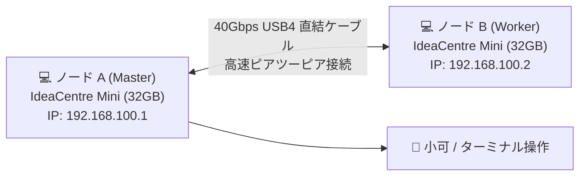

> 📌 **元記事のご案内**: このガイドは [FreeAI Dog 公式プラットフォーム](https://freeaidog.com/ja/blog/snapdragon-mini-pc-zero-gpu-qwen-40b-moe-guide/) の転載です。リアルタイムのモデル稼働状況やオンラインAPIテストツールは公式サイトでご利用いただけます：[https://freeaidog.com/ja/](https://freeaidog.com/ja/)。


# 超小型PC2台で95GBの巨大モデルが動く？Lenovo Snapdragon Mini PC ゼロGPU実践ガイド

これまで、40B 以上のオープンソース大規模言語モデル（LLM）を手元で動かすには、RTX 3090 / 4090 を2枚挿した巨大なワークステーションを組むか、50万円以上を投じて 64GB / 128GB のメモリを積んだ Mac Studio を購入するしかありませんでした。

そんな中、r/LocalLLaMA コミュニティで自作派の度肝を抜く構成が話題になっています：**専用グラフィックボードは一切使わず、1台わずか299ポンド（約5.8万円）の Lenovo IdeaCentre Mini Snapdragon PC 2台を USB4 ケーブル1本で直結し、95GB もの容量を誇る Qwen3.8 Flash-Next を実用速度で動かす**という手法です。


本記事では、机上の空論を排し、**機材の購入リスト・動作原理・Windows on ARM でのエンジン導入・モデルのダウンロード・USB4 ポイントツーポイント接続・分散起動コマンド**まで、初心者でも順を追って真似できるよう手取り足取りまとめました。

---

## 1. なぜ専用グラボなしで 95GB のモデルが動くのか？

機材を用意する前に、なぜこの構成が成立するのか、コアとなる仕組みを理解しておきましょう：

### 1. MoE（混合エキスパート）の「オンデマンド呼び出し」
従来の Dense モデル（例：Llama-70B）は、1文字出力するたびに700億個のパラメータすべてをメモリ上で走査する必要があります。しかし、**MoE モデル（Qwen3.6-35B-A3B や Qwen3.8 Flash-Next）**は根本的に仕組みが異なります：
- 全体のパラメータは 35B〜40B（ディスク容量 20GB〜95GB）に達しますが、**1トークンの生成時に実際に使われるエキスパートは 2.5B〜3B 程度**にすぎません；
- ほとんどのエキスパートは、大部分の時間において「休眠状態」にあります。

### 2. 高速 NVMe 読み出し ＋ ARM NEON 演算の組み合わせ
今回使用する軽量推論エンジン **Janas**（純 C 言語製）は非常にスマートな戦略を取っています：
- 常時参照されるベース層や Attention 機構は 32GB の物理 RAM に常駐；
- 残る 95GB のエキスパート重みは高速 NVMe SSD に配置；
- トークン生成時に必要なエキスパートだけを非同期で SSD から読み出し、Qualcomm Oryon CPU の **ARM NEON SIMD および `i8mm` 整数行列積命令**を用いて演算します。

### 3. なぜ「USB4 による2台連結」が推奨されるのか？
- **1台運用（32GB RAM）**：19.4GB の Qwen 35B A3B なら単体でも 43 tokens/s と極めて快適です。しかし 95GB の Flash-Next を1台で動かすと、メモリ不足によるスワップが頻発し、最初の1文字が出るまで（TTFT）に54秒〜80秒もかかってしまいます；
- **2台連結（合計 64GB RAM）**：USB4 ケーブルで2台を束ねると、メモリプールが 64GB に倍増します。これにより Flash-Next の初回応答時間は **12.5秒** に短縮され、生成速度も **20 tokens/s** に到達し、普段使いに耐えうる実用域に達します。

---

## 2. 機材選定と準備リスト

このクラスタを組むための機材一覧です：

| 機材・部品 | 推奨仕様 | 目安価格 | 注意点 |
|---|---|---|---|
| **ミニPC × 2台** | **Lenovo IdeaCentre Mini x (Snapdragon 版)**<br>(Snapdragon X X1-26-100 / 8コア Oryon + Hexagon NPU / 32GB LPDDR5 / 512GB NVMe) | 1台あたり約 299ポンド<br>（セール時 約5.8万円） | **必ず 32GB メモリ版を選ぶこと**。オンボードメモリのため増設不可。16GB 版では動作しません。 |
| **高速通信ケーブル × 1本** | **40Gbps 対応 USB4 / Thunderbolt 4 Type-C ケーブル (1m)** | 約 1,500〜3,000円 | 必ず **40Gbps データ通信対応**のものを選択（給電専用ケーブルは不可）。 |
| **モニター・キーボード類** | 任意の HDMI / DP ディスプレイと入力機器 | 手持ちのもので可 | 初期設定時のみ使用。設定完了後はリモート操作可能。 |

> **総予算**：1台約5.8万円で 35B モデル環境が手に入り、2台構成でも**約12万円前後**です。新品の RTX 4090 単体価格の半額以下で 64GB メモリのクラスタが完成します。

---

## 3. ステップ1：Windows 11 on ARM での推論環境構築

本機には標準で **Windows 11 on ARM** が導入されています。Linux のデュアルブートは不要で、ネイティブの Windows 上でそのまま動作します。

### 1. 開発者モードの有効化
Windows の検索窓に「開発者向け設定」と入力し、**開発者モード**をオンにします。

### 2. ARM に最適化された Janas エンジンの導入
PowerShell（または Windows Terminal）を起動します：

```powershell
# 1. 必要なツールを導入 (未導入の場合)
winget install Git.Git
winget install LLVM.LLVM

# 2. リポジトリのクローン
git clone https://github.com/prabanta-dev/janas.git
cd janas

# 3. Snapdragon Oryon 向けに NEON/i8mm 最適化を有効化してビルド
clang -O3 -march=armv8.6-a+neon+i8mm -fopenmp src/*.c -o janas-arm.exe
```
*(※ビルド作業が苦手な方は、作者の GitHub Releases ページからビルド済みパッケージ `janas-win-arm64.zip` をダウンロードして解凍するだけでも構いません)*

---

## 4. ステップ2：モデルのダウンロードと配置

モデルファイルは高速な NVMe SSD（例：`C:\models\`）に配置します。

### 1. 入門用：Qwen 35B A3B（1台で爆速動作）
- **Hugging Face リポジトリ**：`bartowski/Qwen_Qwen3.6-35B-A3B-Q4_0.gguf`
- **ファイルサイズ**：約 **19.4 GB**
- **特徴**：1台の 32GB PC で軽快に動作し、生成速度 43 t/s。コーディング作業に最適。

### 2. 本命：Qwen3.8 Flash-Next（95GB の超巨大 MoE）
- **Hugging Face リポジトリ**：`ggml-org/Qwen3.8-Flash-Next-IQ4_NL`
- **ファイルサイズ**：約 **95 GB**
- **特徴**：2台連結（64GB メモリ）で真価を発揮する最先端モデル。

PowerShell でのダウンロード例（35B）：
```powershell
mkdir C:\models -Force
cd C:\models
curl -L -O "https://huggingface.co/bartowski/Qwen_Qwen3.6-35B-A3B-Q4_0-GGUF/resolve/main/Qwen_Qwen3.6-35B-A3B-Q4_0.gguf"
```

---

## 5. ステップ3：単体マシンでの動作確認

2台連結の前に、まずは1台のマシンで正常に推論が走るかテストしておきましょう。

```powershell
.\janas-arm.exe `
  --model C:\models\Qwen_Qwen3.6-35B-A3B-Q4_0.gguf `
  --threads 8 `
  --temp 0.6 `
  --prompt "ローカルネットワーク内のアクティブなIPをスキャンするPythonスクリプトを書いて"
```

**1台での実測結果**：
- **Prefill 速度**：約 **315 tokens/s**；
- **生成速度**：約 **43 tokens/s**（引っかかりなく文字がスラスラ流れます）；
- **メモリ消費量**：約 22GB 前後で、32GB 搭載機なら余裕があります。

---

## 6. ステップ4：2台連結！USB4 直結ネットワークと分散実行（最重要手順）

95GB の Flash-Next を動かすため、2台を連結します。**高価な 10GbE スイッチは不要で、USB4 ケーブル1本で直結できます。**



### 1. ケーブル接続
ノード A の背面にある USB4 ポートと、ノード B の USB4 ポートをケーブルで繋ぎます。Windows が自動認識し、**Thunderbolt / USB4 ネットワークアダプター**が生成されます。

### 2. 固定 IP アドレスの設定（所要時間2分）
超低遅延で通信させるため、専用の IP を割り当てます：

- **ノード A の設定**：
  - 「設定」➔「ネットワークとインターネット」➔「ネットワークの詳細設定」から USB4 アダプターを選択；
  - `IPv4` のプロパティを手動設定：
    - IP アドレス：`192.168.100.1`
    - サブネットマスク：`255.255.255.0`
    - デフォルトゲートウェイ：空欄
- **ノード B の設定**：
  - 同様に USB4 アダプターの `IPv4` を手動設定：
    - IP アドレス：`192.168.100.2`
    - サブネットマスク：`255.255.255.0`
    - デフォルトゲートウェイ：空欄

ノード A から `ping 192.168.100.2` を実行し、`<1ms` で応答が返れば 40Gbps リンクが開通完了です。

### 3. 95GB モデルの分散実行コマンド

**手順 1：Worker（ノード B）側で待機**
```powershell
.\janas-arm.exe --worker --listen 192.168.100.2:9999 --threads 8
```

**手順 2：Master（ノード A）側から協調推論を開始**
```powershell
.\janas-arm.exe `
  --model C:\models\Qwen3.8-Flash-Next-IQ4_NL.gguf `
  --nodes 192.168.100.1,192.168.100.2:9999 `
  --threads 8 `
  --temp 0.7 `
  --interactive
```

これでモデルレイヤーが両マシン（合計 64GB RAM）に分散配置され、95GB モデルが安定して立ち上がります。

---

## 7. 実効速度と使用感（客観的な評価）

| 測定シナリオ | 1台運用 (32GB) | 2台 USB4 連結 (64GB) | 小可の評価 |
|---|---|---|---|
| **Qwen 35B A3B (19.4GB)** | TTFT 1.8秒 / 生成 43 t/s | TTFT 1.8秒 / 生成 43 t/s | 1台で十分高速 |
| **Qwen3.8 Flash Next (95GB)** | TTFT 54〜80秒 / 生成 8 t/s | **TTFT 12.5秒 / 生成 20 t/s** | **使い物にならなかった状態から実用レベルへ大化け** |
| **システム消費電力** | アイドル 8W / 負荷時 35W | 2台合計で負荷時 **約 70W** | デュアル RTX 3090（700W）に比べ圧倒的な省エネ |
| **騒音と排熱** | ほぼ無音 | 非常に静か、本体がほんのり温まる程度 | 机の上に常設しても全く邪魔にならない |

### 注意点と運用のコツ
1. **長文プロンプトの初速について**：
   - Prefill 速度は毎秒約 46 トークンのため、8,000 トークンの長文を流し込むと最初の文字が出るまでに約 25〜30 秒ほど待たされます；
   - **ただし、マルチターン会話や Agent 運用では Prompt Cache が効く**ため、2回目以降のやり取りでは過去の文脈がキャッシュに乗り、待ち時間はほとんど気にならなくなります；
2. **NPU の効き方**：
   - Snapdragon の Hexagon NPU は、Gemma-4B や Qwen-8B のような **Dense（密）モデルでは 3〜4倍の強烈な加速**を発揮します；
   - 一方、MoE のような疎結合モデルではメモリアクセスが主なボトルネックとなるため、NPU による伸びは 1.2倍程度と比較的緩やかです。

---

## 8. まとめ：この構成は誰に向いているか？

- **予算を抑えて 64GB 環境を手に入れたい開発者・学生**：10万円台前半で 64GB の ARM クラスタが組める選択肢は貴重です；
- **24時間稼働の常駐 Agent 用サーバー**：消費電力が合計 70W 以下で静音性も高いため、電気代やファン音を気にせず常駐させられます；
- **エッジ AI・ハードウェアいじりが好きな自作派**：小さな箱を USB4 で繋いで前沿モデルを駆動する面白さは、クラウド API を叩くだけでは味わえない醍醐味です。

---

> 💡 **元記事と稼働監視**：
> - 元記事: [FreeAI Dog 公式ブログ](https://freeaidog.com/ja/blog/snapdragon-mini-pc-zero-gpu-qwen-40b-moe-guide/)
> - 無料AIモデルのリアルタイム稼働状況と遅延データは [FreeAI Dog 可用性レーダー](https://freeaidog.com/ja/radar/) をご覧ください。

