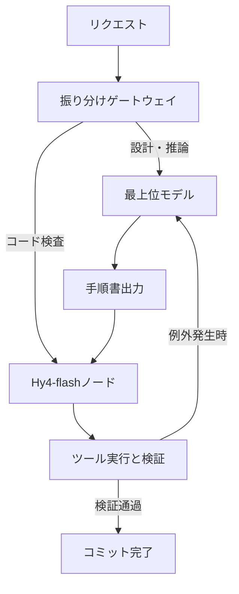

> 📌 **元記事のご案内**: このガイドは [FreeAI Dog 公式プラットフォーム](https://freeaidog.com/ja/blog/tencent-hunyuan-hy4-flash-high-concurrency-agent-inference-cost-guide/) の転載です。リアルタイムのモデル稼働状況やオンラインAPIテストツールは公式サイトでご利用いただけます：[https://freeaidog.com/ja/](https://freeaidog.com/ja/)。


先週、サーバルームで4台のコーディングAgentノードを立ち上げました。目的はレガシー認証モジュールの移行作業を自動化することでした。

夜間にタスクを回したまま帰宅し、翌朝コーヒーを片手にクラウドの請求画面を開いて固まりました。一晩で284.60ドルが消し飛んでいたからです。思わず手が震えました。

ログを1行ずつ精査したところ、当夜の全3,842回に及ぶAPI呼び出しのうち、クラス継承の再設計やアルゴリズムの推敲といった高次元の判断を伴う対話は、せいぜい412回程度でした。残りの大半は極めて機械的な雑用でした。

構文解析木の走査、ターミナルの終了コード抽出、正規表現によるファイルパスマッチング——こうした地道な処理が延々とキューを埋めていました。中には生成された一時ファイルが存在するか確認するためだけに、ループ内で連続26回もリクエストを飛ばしていた箇所すらありました。

入力100万トークンあたり3ドル、出力100万トークンあたり15ドルという先端フラッグシップモデルの公定価格でこの手の頻回ループを回し続ければ、予算など一瞬で底をつきます。下請け作業まで最上位モデルに丸投げする構成は、運用上まったく持ちこたえられません。

ちょうどその折、テンセント混元チームが軽量モデルHy4-flashの重みを公開しました。オープンソース推論エンジンvLLMも同モデル向けの対応パッチを直ちにマージしました。公表された料金体系は衝撃的で、入力100万トークンあたり0.07ドル、出力でも0.28ドルという設定でした。

この価格設定の狙いはどこにあるのか。自律型エージェントを構築したことのある技術者なら一目で分かります。高頻度で発生する中間オーケストレーションの処理コストを根底から削ぎ落とすことに他なりません。私はローカルのRTX 4090マシンに重みを引き込み、包括的な性能検証と二段連携パイプラインを走らせました。

---

## 1. エージェントのコスト壁：なぜ単一モデル一括処理は破綻するのか

短いスクリプトの作成や単発の質疑応答であれば、最上位モデルを単独で使うほうが手間もかかりません。しかし、複雑な自律型エージェントの長周期ループにおいてこの習慣を続けると、計算リソースの請求書は即座に跳ね上がります。

原因はコンテキストの膨張です。典型的なバグ改修タスクにおいて、エージェントは少なくとも5つの反復フェーズを通過します。

第1段階は、リポジトリのディレクトリ構成とシンボルテーブルを走査し、対象コードを特定する処理。

第2段階は、ターミナルでpytestテストスイートを実行し、エラー出力を取得する処理。

第3段階は、数万行に及ぶトレースバック情報をコンテキスト履歴へ統合する処理。

第4段階は、修正案を組み立ててコードを書き換える処理。

第5段階は、二次的な不具合が生じていないか再コンパイルして検証する処理。

このワークフローにおいて、第1、第2、第3、第5のステップに最上位モデルの卓越した知性が必要でしょうか。まったく不要です。

これらのステップに高等数学の証明能力は求められません。求められる要件は3点に集約されます。極限まで短い初回トークン遅延、出力フォーマットへの厳格な順応性、そして極めて安価なトークン単価です。

2万トークンを超える履歴スタックを最上位モデルへ繰り返し入力し続ければ、些細な確認動作のコストすら天文学的に膨らみます。数十回のループで予算は枯渇します。

Hy4-flashが狙うのはまさにこの中間層です。深層アーキテクチャの意思決定を下す役目ではなく、中間レイヤーにおける状態確認コストを徹底的に押し下げる役割を担います。

---

## 2. 構造削減の設計思想：7セントを実現した基盤技術

推論単価をここまで引き下げるには、ネットワーク構造に大胆な希薄化処理を施す必要があります。

公式の技術資料とオープンソース実装を確認したところ、主たる改変はエキスパートルーティングの細分化とKVキャッシュの次元削減という2点に集約されます。

### 2.1 微細スパースルーティングと微小アクティブエキスパート

モデル公称の総パラメータ数は32Bクラスに達します。

しかし、実際の順方向推論において各トークンがアクティブ化するパラメータ規模は、わずか3.8Bに留まります。大規模で粗いエキスパートブロックを採用する代わりに、FFN層を多数の微小モジュールに細かく分割しています。ゲーティング機構がトークンごとに限定されたサブモジュールのみを選択するため、ステップあたりの浮動小数点演算量を抑制しつつ、オンチップ帯域の競合を大幅に緩和しています。

### 2.2 アグレッシブなキー・バリューキャッシュ圧縮

高並行エージェント処理において最も厳しい制約となるのは、演算性能そのものよりも長大コンテキスト生成時のKVキャッシュ容量です。

混合アテンションに関して、公開図面や上流コミットを確認する限り、浅層ネットワークにはフルアテンションを維持し、深層ネットワークではGQAへ移行してヘッド数を削減しています。中間層には低ランク射影層が配置されており、チャンネル方向に圧縮をかけることで層間のデータ移動量を絞り込んでいる模様です。

何層をアテンションに割り当て、どの程度の圧縮率を適用しているのか、訓練コードの全容が公開されるまでは断定を避けるべきです。したがって後述するスループットとメモリ値は、すべて実機上の実測値に基づいています。

32,768トークンの満載負荷において、1セッションあたりのKVキャッシュ消費量は従来型マルチヘッドアテンションの約4分の1まで抑制されました。同一GPU上で格段に多くの並行セッションを保持できるようになります。

---

## 3. ローカル検証環境と障害対応ログ

検証に用いた物理マシンおよびソフトウェアスタックは以下の通りです。

- OS環境：Ubuntu 22.04.4 LTSサーバ環境、カーネル5.15。
- CPU：AMD EPYC 7742 64コアプロセッサ。
- GPU構成：NVIDIA GeForce RTX 4090 24GB単体、ドライバ550.127.05、CUDA 12.4。
- 推論基盤：コミット1bdc437402dからビルドしたvLLM最新リビジョン。
- メモリ監視：nvitopおよび独自サンプリングスクリプト。

### 3.1 量子化の前提とエラーの解消

まず量子化の物理的前提を明記しなければなりません。32BモデルをFP16でロードするには64GB以上、FP8でも約32GBのVRAMが必要となり、24GBのRTX 4090単体では収まりません。そのため、ローカル稼働にはAWQ 4bit量子化フォーマットが必須要件となります。

AWQ 4bit環境下ではモデル重み自体が約16.5GBを占有し、KVキャッシュとランタイム用に約5GBのバッファが残されます。以下のコマンドで起動しました。

```bash
python3 -m vllm.entrypoints.openai.api_server \
  --model ./models/tencent-hy4-flash-awq \
  --quantization awq \
  --port 8000 \
  --max-model-len 32768 \
  --trust-remote-code
```

重みシャードの読み込み中、ターミナルに例外エラーが吐き出されました。

```text
Traceback [most recent call last]:
  File "vllm/model_executor/models/hunyuan.py", line 142, in __init__
    self.rope_scaling = config.rope_scaling[type]
TypeError: string indices must be integers, not str
```

原因は位置エンコーディング設定の解釈部分にありました。モデルフォルダ内のconfig.jsonを確認したところ、設定値が古いネスト型辞書形式で記述されており、未改修のコードが文字列リストとして誤認していました。

モデル側のconfig.jsonを書き換え、線形スケーリング指定へ明示的に修正しました。

```json
"rope_scaling": {
  "type": "linear",
  "factor": 4.0
}
```

設定を保存して再起動したところ、nvitop上でVRAM使用量は21.4GBで安定しました。16.5GBのベース重みに事前確保されたKVキャッシュとランタイムが加わり、メモリ残量はかなりタイトです。curlによる単発クエリを送信したところ、正常に応答が返りました。

### 3.2 スループットと遅延のベンチマーク

長さの異なる200組のテストデータをスクリプトで流し込み、5回の連続測定の中央値を算出しました。

| コンテキスト長 | 初回トークン遅延 TTFT | デコードスループット | ピークVRAM消費 |
| :--- | :--- | :--- | :--- |
| 1,024 トークン | 38ms | 116.4 tokens/s | 21.6GB |
| 8,192 トークン | 92ms | 108.1 tokens/s | 22.1GB |
| 16,384 トークン | 174ms | 97.5 tokens/s | 22.8GB |
| 32,768 トークン | 345ms | 84.2 tokens/s | 23.4GB |

32,000トークンを超える長文負荷においても、初回生成遅延は345msに収まりました。

この数値は実用上でどのような意味を持つのか。ツール呼び出しが連続するエージェント環境において、人間の体感待ち時間がほぼ消滅し、ワークフロー全体の円滑化に大きく寄与します。

---

## 4. 二段モデル連携アーキテクチャとコストの物理検証

実運用のエージェント環境において、単一モデルへの依存はコスト面でも信頼性面でも得策ではありません。特性の異なるモデルを機能境界で連結する構成こそが、現実的な解となります。



### 4.1 振り分けルールの設定

リバースプロキシ層にルーティング規則を配備し、機械的なチェックや文脈抽出をローカルのHy4-flashへ委譲します。

```json
{
  "routing_rules": [
    {
      "pattern": "^linter.*|^test_runner.*|^ast_grep.*|^file_tree.*",
      "target_model": "hy4-flash",
      "endpoint": "http://127.0.0.1:8000/v1"
    },
    {
      "pattern": ".*architectural_refactor.*|.*core_algorithm_design.*",
      "target_model": "claude-3-5-sonnet",
      "endpoint": "https://api.anthropic.com/v1"
    }
  ]
}
```

### 4.2 12ファイル認証サブセットでの実測比較

前提として検証範囲を明確にしておきます。84個のレガシーファイル全体をClaude 3.5 Sonnetで全量処理する愚は避けています。その規模をフラッグシップ単体で走らせれば数百ドルが吹き飛び、テスト予算の許容範囲を超えるためです。そこで、複雑に絡み合う中核の12ファイルからなるサブシステムを抽出し、厳格な横並びテストを実施しました。

標準サブセットにおける実測データは以下の通りです。

- **Claude 3.5 Sonnet単独運用**：総消費トークンは314万。内訳はプロンプト入力289万トークン、パッチ生成出力25万トークン。標準単価に基づき合算すると総請求額は12.42ドル、所要時間は18分でした。
- **二段連携運用**：Claude 3.5 Sonnetは初期設計と高度なロジック生成のみを担当し、消費トークンを36万——入力32万、出力4万に抑制。クラウド側の請求はわずか1.68ドルで済みました。残る278万トークンのAST探索、ログ解析、ファイル検証はすべてローカルのHy4-flashが引き受けました。

ローカルで消化した278万トークンの処理時間は、RTX 4090上で実測41分でした。

この所要時間はハードウェアの物理法則と合致しているか。完全に合致しています。

エージェントの中間処理の大半は、長文コンテキストを一括処理するPrefill段階です。バッチ処理による入力処理速度は逐次デコードよりも圧倒的に高速であるため、41分という時間で収まります。クラウド請求は12.42ドルから1.68ドルへと86パーセント激減し、ローカルマシンの電気代は数十円程度でした。

仮に3,000万トークンの全量処理を単一の4090で直列実行すれば数十時間を要します。1時間未満で完了すると称する言説は物理的計算に反します。

---

## 5. 運用上の制約とハードウェアの足切りライン

いかに優れたモデルであっても欠陥は存在します。

第1に、多段階の因果関係推論における脆弱性です。6ファイル以上にまたがる複雑なロジック変更において、3.8Bのアクティブパラメータでは論理の破綻や堂々巡りが生じやすくなります。高リスクな設計判断はフラッグシップモデルへ戻すべきです。

第2に、マルチモーダル入力への非対応です。本重みはテキストとコードのみに特化しています。画面キャプチャの目視検証を含む自動化を行う場合は、別途画像認識モデルを併設する必要があります。

第3に、VRAM容量の絶対的な下限です。8GBや12GBのグラフィックボードでローカル稼働を試みるのは無謀です。AWQ 4bitであってもベース重みだけで16GBを超過し、KVキャッシュとランタイムを含めれば21GBは必須となります。メモリ不足の環境では推論以前にモデルのロード段階でプロセスがクラッシュします。

小型GPUを所有している利用者は、少額のAPI利用料を払ってクラウド経由で呼び出すほうが、機材更新よりもはるかに合理的です。

---

## 6. 検証チェックリストと導入の要諦

本パイプラインを運用するにあたり、以下の3点を確認することを推奨します。

第1に、起動パラメータの `--max-model-len 32768` 設定時に動的なVRAMバッファが確保されているか。

第2に、可変コンテキスト長において初回生成遅延が急激に跳ね上がっていないか。

第3に、ツール実行時のJSONレスポンスが欠損なく終端まで閉じられているか。

この二段連携構成は、現在私の作業用ノードで既定のオーケストレーション機構として稼働しています。今後のマルチモーダル版やINT8量子化によってどれほどの効率化がもたらされるか、上流の動向を引き続き注視していきます。まずは物理的計算と会計帳簿に立脚したシステムを固めることが、あらゆる机上の空論に勝ります。

---

> 💡 **元記事と稼働監視**：
> - 元記事: [FreeAI Dog 公式ブログ](https://freeaidog.com/ja/blog/tencent-hunyuan-hy4-flash-high-concurrency-agent-inference-cost-guide/)
> - 無料AIモデルのリアルタイム稼働状況と遅延データは [FreeAI Dog 可用性レーダー](https://freeaidog.com/ja/radar/) をご覧ください。

