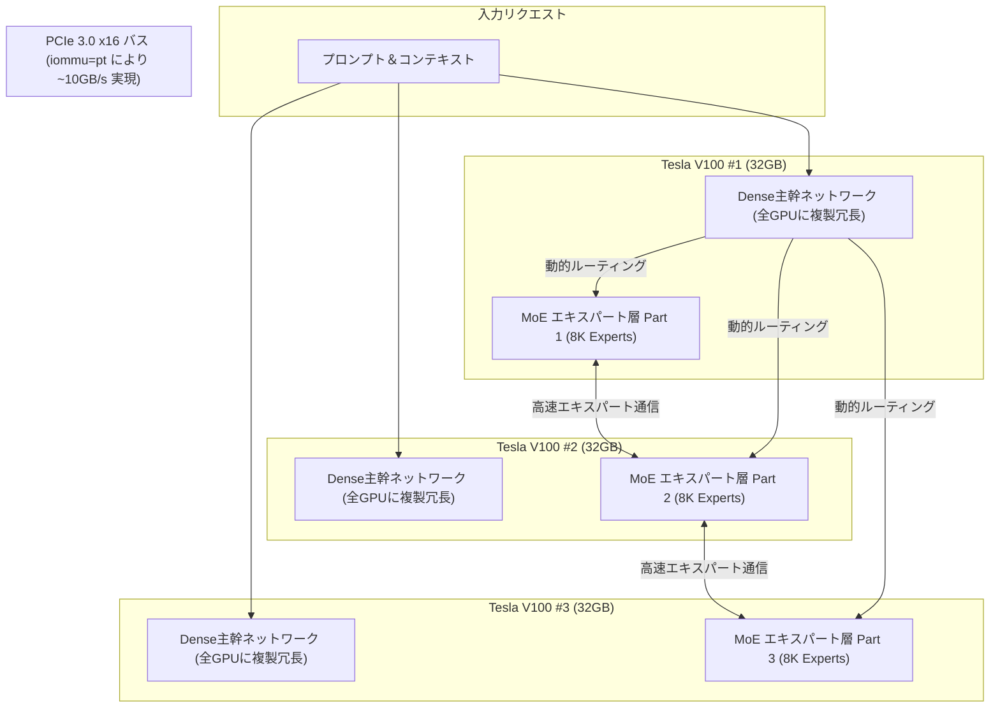

> 📌 **元記事のご案内**: このガイドは [FreeAI Dog 公式プラットフォーム](https://freeaidog.com/ja/blog/v100-dell-r740-400tps-qwen-volta-engine-guide/) の転載です。リアルタイムのモデル稼働状況やオンラインAPIテストツールは公式サイトでご利用いただけます：[https://freeaidog.com/ja/](https://freeaidog.com/ja/)。


# 2500ドルで400 t/sを叩き出す！Volta向け独自エンジンで旧世代Tesla V100 3枚が覚醒：中古Dell R740自作サーバー＆iommu=pt最適化完全ガイド

ローカル環境で100B超の巨大なMoE（Mixture-of-Experts）モデル（QwenやDeepSeekなど）を運用する際、個人開発者や研究者が直面する最大の壁は**莫大なVRAMコスト**と**マルチGPU間のPCIe通信遅延**です。

80GB〜96GB規模のVRAMを確保しようとすると、一般的には高額なRTX 3090/4090を4枚並べるか、数百万円規模のエンタープライズアクセラレータを導入せざるを得ませんでした。また、NVLink非対応のデュアルCPUサーバーでは、GPU間のPCIe転送オーバーヘッドが原因で推論速度が劇的に低下する問題が頻発していました。

しかし、Redditの **r/LocalLLaMA** コミュニティにおいて、開発者 **u/jfinkpottery** 氏がこの常識を打ち破る実験結果を公開しました。
**総額わずか2,530ドル（約38万円）の中古サーバー（Dell PowerEdge R740）と3枚の型落ちTesla V100（32GB）を用い、Voltaアーキテクチャ専用に最適化した推論エンジンを構築。さらにLinuxカーネルの重要パラメータを設定することで、ピーク400 t/s、長文コンテキストのPrefillで3,400 t/sという驚異的な推論スループットを達成したのです！**

本記事では、この驚異的なプロジェクトの全貌、低コストBOMリスト、そしてマルチGPU環境で劇的な高速化をもたらすシステム設定を詳しく解説します。

---

## 1. なぜTesla V100なのか？2500ドルで組む「超コスパ」ハードウェア

2017年に登場したVoltaアーキテクチャのV100は、近年のFP8/FP4といった超低ビット演算をネイティブサポートしていません。それにもかかわらず、なぜ現在これほどの実力を発揮できるのでしょうか？

その理由は、**HBM2による圧倒的なメモリ帯域幅**と**データセンター放出に伴う中古価格の暴落**にあります。

* **1枚あたり32GBのHBM2メモリ**：3枚合計で**96GBの広大なVRAM**を確保。1枚あたりのメモリ帯域幅は**900 GB/s**に達し、一般的なDDR4/DDR5システムメモリはもちろん、民生用GDDR6よりも高速です。
* **データセンター退役による潤沢な流通**：クラウド事業者の機材更新により、PCIe版V100 32GBが中古市場で1枚あたり約600ドル前後で入手可能になりました。
* **高耐久な2Uラックサーバーの入手性**：デュアルXeon、高効率冗長電源、強力なエアフローを備えたDell PowerEdge R740のベアボーン筐体は、約500ドル前後で購入できます。

### パーツ構成＆コスト一覧（BOM総額：約 2,530ドル）

| コンポーネント | スペック詳細 | 数量 | 単価（参考） | 合計金額 |
|---|---|---|---|---|
| **GPUアクセラレータ** | NVIDIA Tesla V100 32GB PCIe版 | 3枚 | \$600 | **\$1,800** |
| **サーバー本体** | Dell PowerEdge R740 (デュアルXeon + BOSS M.2 PCIeカード) | 1台 | \$500 | **\$500** |
| **システムメモリ** | DDR4 16GB 2666MHz ECC Registered | 2枚 (計32GB) | \$65 | **\$130** |
| **ブートストレージ** | M.2 SATA SSD 512GB (BOSSカード装着) | 1枚 | \$100 | **\$100** |
| **合計コスト** | **96GB HBM2 搭載サーバー一式** | — | — | **\$2,530** (約38万円) |

---

## 2. 0.2 GB/s から 10 GB/s へ！Linuxカーネル「iommu=pt」の魔法

ハードウェアを組み上げた当初、作者はデュアルCPUサーバー特有の深刻な問題に直面しました。それは**GPU間のPCIe通信速度が異常に遅い**という現象です。

当初は「NVLink非搭載のデュアルCPU環境では、CPUソケット間を跨ぐPCIe転送は物理的に0.2 GB/s程度が限界だ」と誤解されていました。転送速度が200MB/sでは、どのような並列推論も通信待ちで破綻してしまいます。

しかし、カーネル解析の結果、真の原因は**LinuxのIOMMU（入出力メモリ管理ユニット）のアドレス変換競合**であることが判明しました。

### 解決策：IOMMU パススルーモード（`iommu=pt`）の有効化

GRUBの起動引数に `iommu=pt` を追記するだけで問題は劇的に解決しました。

```bash
# 1. GRUB設定ファイルを編集
sudo nano /etc/default/grub

# 2. GRUB_CMDLINE_LINUX に追記
GRUB_CMDLINE_LINUX="... intel_iommu=on iommu=pt pci=realloc"

# 3. 設定を反映して再起動
sudo update-grub
sudo reboot
```

**その効果は圧倒的でした：**
* GPU間の双方向PCIe帯域幅が、**0.2 GB/s から 約 10 GB/s へと「50倍」に跳ね上がりました**。
* `pt`（パススルー）モードにより、ホストOS上の物理ドライバはメモリ仮想変換のロック競合を回避し、ハードウェア物理アドレスへ直接アクセスできるようになります。

> [!TIP]
> **すべての自作マルチGPUユーザーへの教訓**：
> デュアルCPUサーバー（Dell R730/R740、HP DL380等）で複数枚のGPUを運用する場合、PCIe通信のボトルネックを解消するために**必ず `iommu=pt` を有効化**してください。

---

## 3. ソフトウェア魔改造：StrataをベースにVolta専用MoEエンジンを再設計

最新の推論フレームワーク **Strata** は、AmpereやAda、Hopperなどの最新アーキテクチャを前提としており、Volta上ではそのまま動作しないか著しく性能が落ちます。

そこで作者はStrataをForkし、Voltaの演算特性とMoEアーキテクチャに特化したカスタム並列処理エンジンを構築しました。



### 1. エキスパート並列 ＋ Dense主幹の複製配置
* **エキスパート分割**：膨大なMoEエキスパート層を3枚のV100へ均等に分散配置。
* **Dense主幹層の冗長複製**：AttentionなどのDense主幹ネットワークを各GPU上に常駐させることで、**主幹層処理時のGPU間通信オーバーヘッドを完全にゼロ化**。
* 個人利用で最も頻度の高い **Batch Size = 1 の単一ユーザートークン生成** に極限までチューニング。

### 2. ベンチマーク測定結果（Q4_XL 量子化）

| 評価指標 | 測定スループット | 状況・備考 |
|---|---|---|
| **Decode ピーク性能** | **400 t/s** | 特定の反復的・高キャッシュシナリオでの上限値 |
| **Decode 通常文章生成** | **約 140 t/s** | **一般的な複雑なコーディングや推論時の実効速度** |
| **Prefill 速度（3GPU）** | **約 3,400 t/s** | 長文プロンプトの読み込み処理速度 |
| **Prefill 速度（2GPU）** | **約 2,800 t/s** | 2枚構成時の参考値 |

---

## 4. 導入時の注意点とハードウェアの落とし穴

1. **パッシブ冷却のエアフロー確保**：Tesla V100はファン非搭載です。Dell R740の純正エアシュラウドを確実に装着し、iDRAC設定でファン最低回転数を**45%〜60%**に固定してください。
2. **PCIeトポロジーの確認**：`nvidia-smi topo -m` を実行し、ライザーカード経由の接続がCPU間で均等に分散されているか確認してください。
3. **容量混在の禁止**：現在のエンジン実装では、32GB版と16GB版の混在構成はサポートされていません。

---

## 5. まとめ

高価な最新GPUを購入しなくても、**「Linuxカーネルの適切なチューニング（iommu=pt）」**と**「MoEアーキテクチャに適した並列エンジンの設計」**を組み合わせることで、中古の型落ちサーバーとV100が現代のフラッグシップ機に匹敵するパフォーマンスを発揮します。

---

> 💡 **元記事と稼働監視**：
> - 元記事: [FreeAI Dog 公式ブログ](https://freeaidog.com/ja/blog/v100-dell-r740-400tps-qwen-volta-engine-guide/)
> - 無料AIモデルのリアルタイム稼働状況と遅延データは [FreeAI Dog 可用性レーダー](https://freeaidog.com/ja/radar/) をご覧ください。

