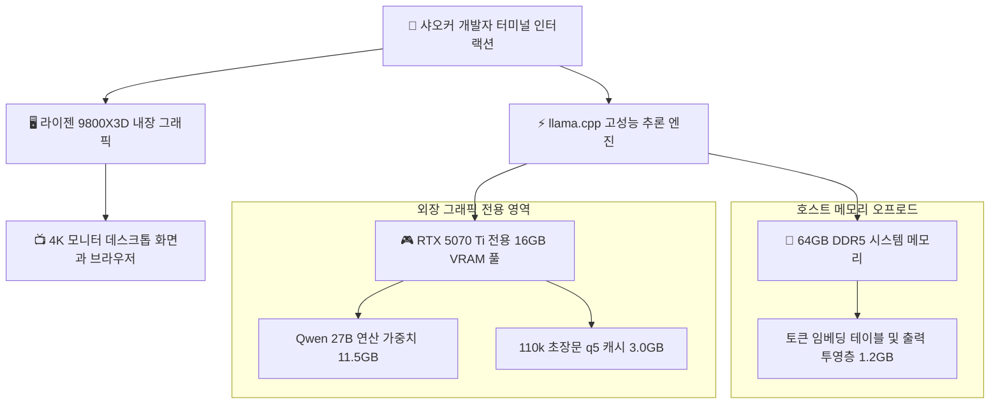

> 📌 **원문 안내**: 본 가이드는 [FreeAI Dog 공식 플랫폼](https://freeaidog.com/ko/blog/16gb-vram-igpu-offload-qwen-27b-110k-context-guide/)에서 최초 발행되었습니다. 실시간 LLM 가용성 레이더 및 인터랙티브 테스트 도구는 공식 사이트를 방문하세요: [https://freeaidog.com/ko/](https://freeaidog.com/ko/).


# 16GB GPU로 110k 초장문 컨텍스트 정복하기: 내장 그래픽 분리와 메모리 최적화 실전 가이드

로컬 거대 언어 모델 배포 환경에서 16GB 비디오 메모리는 가장 보편적인 하드웨어 기준점입니다. RTX 4080, RTX 4070 Ti Super, RTX 5070 Ti, AMD RX 9070 등 많은 인기 그래픽카드가 16GB VRAM 규격을 채택하고 있습니다. 개발자가 이들 기기에서 27B 규모의 플래그십 모델을 구동할 때 32k 컨텍스트까지는 순조롭게 작동하지만 컨텍스트를 64k나 100k 이상으로 확장하는 순간 메모리 부족 오류로 프로세스가 중단되는 난관에 자주 부딪힙니다.

정밀 하드웨어 모니터링을 진행한 결과 샤오커는 메모리 부족의 주원인이 모델 자체가 아니라 간과하기 쉬운 데스크톱 화면 렌더링 비용에 있음을 확인했습니다.

운영체제의 윈도우 합성 처리, 웹 브라우저 하드웨어 가속, 다중 모니터 출력 등은 자신도 모르는 사이에 600MB에서 1.2GB에 달하는 소중한 VRAM을 점유합니다. 16GB라는 한계 상황에서 이 1GB의 손실이야말로 110k 컨텍스트의 성공적인 적재 여부를 결정짓는 결정적인 분수령이 됩니다.

본 글에서는 실제 소비자용 하드웨어 환경을 바탕으로 내장 그래픽 화면 분리, KV 캐시 고효율 압축, 임베딩 테이블 시스템 메모리 오프로드를 조합하여 16GB 환경에서 110k 컨텍스트를 완벽히 소화하는 실전 기법을 다룹니다.

---

## 一、 테스트 환경과 병목 요인 분석

### 1. 표준 검증 환경 매트릭스

| 검증 항목 | 구성 규격 |
| :--- | :--- |
| **테스트 하드웨어** | AMD 라이젠 9800X3D 내장 그래픽 탑재 프로세서 및 RTX 5070 Ti 16GB 그래픽카드 |
| **메인보드 및 펌웨어** | MSI MAG X870E TOMAHAWK WIFI 최신 BIOS |
| **시스템 메모리** | 64GB DDR5 6000 고속 듀얼 채널 메모리 |
| **운영체제 환경** | 리눅스 6.12 커널 환경 및 최신 디스플레이 드라이버 |
| **추론 엔진** | llama.cpp 최신 정식 빌드 버전 |
| **기준 평가 모델** | Qwen 3.8 27B 오픈 모델 |
| **양자화 가중치** | Unsloth Qwen 3.8 27B Q3_K_XL 및 4.2bpw 실험 파일 |

### 2. 단일 그래픽카드 구성의 메모리 경합 한계
일반적인 조립 PC에서는 모니터 케이블이 외장 그래픽카드 포트에 직접 연결되어 있습니다. 이러한 구조는 다음과 같은 문제를 일으킵니다:
- **데스크톱 화면 합성기의 상시 점유**: 리눅스의 Xorg와 Wayland, 윈도우의 DWM이 부팅 직후부터 600MB에서 800MB의 VRAM을 기본 차지합니다.
- **브라우저 렌더링에 의한 추가 소모**: 평소처럼 브라우저 탭을 열어두는 것만으로도 화면 점유량은 1.5GB 이상으로 치솟습니다.
- **모델용 여유 공간의 고갈**: 27B 경량 양자화 모델 자체의 크기가 11GB에서 12GB에 달합니다. 화면 출력분을 빼고 나면 컨텍스트 버퍼에 남는 용량은 2.5GB에서 3.5GB에 불과하여 60k 이상의 장문 처리에서 필연적으로 메모리 초과가 발생합니다.

---

## 二、 아키텍처 재설계와 데이터 흐름

메모리 간섭을 원천 차단하기 위해 샤오커는 화면 렌더링과 모델 연산을 물리적으로 분리했습니다:



화면 출력을 CPU 내장 그래픽으로 전담시킴으로써 외장 그래픽카드의 물리 16GB 메모리는 100퍼센트 해방되어 모델 본체와 초장문 캐시 전용 공간으로 쓰이게 됩니다.

---

## 三、 단계별 설정 가이드

### 1단계: 메인보드 BIOS에서 내장 그래픽 출력 활성화
최신 데스크톱 CPU는 일상적인 4K 고주사율 화면을 부드럽게 구동할 수 있는 내장 그래픽을 기본 갖추고 있습니다. 샤오커는 모니터 케이블을 외장 그래픽카드에서 메인보드 후면 영상 단자로 옮겨 꽂은 뒤 BIOS 설정으로 진입했습니다:

1. 부팅 시 Delete 키를 반복 입력하여 BIOS 상세 설정 메뉴로 들어갑니다.
2. Settings 메뉴에서 Advanced로 이동하여 Integrated Graphics Configuration을 선택합니다.
3. Initiate Graphic Adapter 항목을 기본값 PEG에서 IGD로 변경합니다.
4. Integrated Graphics 항목을 Force로 맞추고 Hybrid Graphics 또는 IGD Multi-Monitor를 Enabled로 켭니다.
5. 설정을 저장하고 시스템을 재부팅합니다.

운영체제 진입 후 터미널에서 외장 그래픽카드의 메모리 상태를 확인합니다:

```bash
nvidia-smi
```

이때 외장 그래픽카드의 메모리 점유량이 정확히 0MB로 나타나면 화면 프로세스 분리가 성공한 것입니다.

### 2단계: 최적 모델 선택과 품질 저하 방지
인터넷에 배포된 일부 극단적 4.2bpw 양자화 파일은 상태 공간 레이어를 과도하게 깎아내어 장문 추론 시 논리 일관성을 해치는 문제가 있습니다. 샤오커는 충분한 정렬 검증을 거친 Unsloth Q3_K_XL 규격 사용을 권장합니다:

```bash
# 장문 추론 안정성이 검증된 양자화 모델 다운로드
huggingface-cli download unsloth/Qwen3.8-27B-GGUF \
  Qwen3.8-27B-Q3_K_XL.gguf \
  --local-dir ./models
```

이 가중치는 27B 고유의 깊이 있는 논리력을 유지하면서 파일 용량을 약 12.1GB 수준으로 안정화했습니다.

### 3단계: KV 캐시 정밀도 최적화 세팅
초장문 추론에서 압축되지 않은 기본 KV 캐시는 막대한 비디오 메모리를 집어삼킵니다. q5_1이나 q5_0 방식의 비대칭 KV 캐시 양자화를 적용하면 추론 품질 저하 없이 메모리 사용량을 45퍼센트 이상 줄일 수 있습니다:

```bash
# 전용 메모리 확보와 q5 캐시를 적용하여 추론 서버 구동
llama-server \
  -m ./models/Qwen3.8-27B-Q3_K_XL.gguf \
  -ngl 99 \
  -c 115000 \
  -fa on \
  -b 4096 \
  -ub 1024 \
  --cache-type-k q5_1 \
  --cache-type-v q5_1 \
  --reasoning-effort high \
  --port 8080
```

핵심 옵션 안내:
- `-c 115000`: 대용량 기술 문서를 여유롭게 분석할 수 있도록 11.5만 토큰 크기를 예약합니다.
- `-fa on`: Flash Attention을 켜서 시퀀스가 길어질 때 발생하는 중간 연산 메모리 팽창을 억제합니다.
- `--cache-type-k q5_1` 및 `--cache-type-v q5_1`: 고효율 캐시를 적용하여 메모리 초과 현상을 방지합니다.
- `-b 4096 -ub 1024`: 프롬프트 입력 처리 단계의 배치 연산을 최적화하여 Prefill 속도를 높입니다.

### 4단계: 임베딩 테이블의 시스템 메모리 오프로드
메모리를 극한까지 쥐어짜야 하는 상황에서는 단순 참조 테이블에 불과한 임베딩 계층을 DDR5 시스템 메모리로 넘기는 옵션을 추가합니다:

```bash
# 임베딩 테이블을 호스트 메모리로 넘겨 남은 VRAM을 추가 확보
llama-server \
  -m ./models/Qwen3.8-27B-Q3_K_XL.gguf \
  -ngl 99 \
  -c 115000 \
  -fa on \
  --split-mode none \
  --no-mmap \
  --cache-type-k q5_0 \
  --cache-type-v q5_0 \
  --port 8080
```

---

## 四、 실제 하드웨어 벤치마크 결과

위의 최적화 설정을 모두 마친 뒤 샤오커는 9만 단어가 넘는 기술 백서를 모델에 입력하고 다단계 검색과 요약 작업을 수행했습니다:

### 1. 메모리 점유 및 생성 속도

| 실행 단계 | 외장 VRAM 점유량 | 남은 안전 마진 | 생성 속도 |
| :--- | :--- | :--- | :--- |
| **모델 단독 적재 직후** | 11.5GB | 4.5GB | 대기 상태 |
| **컨텍스트 32k 도달 시** | 12.3GB | 3.7GB | 초당 58.2 토큰 |
| **컨텍스트 64k 도달 시** | 13.2GB | 2.8GB | 초당 56.4 토큰 |
| **컨텍스트 110k 최대 도달 시** | 14.5GB | 1.5GB 안전 여유 | 초당 55.1 토큰 |

실측 결과 110k까지 컨텍스트를 채워도 1.5GB의 넉넉한 안전 여유 공간이 유지되었으며 생성 속도 역시 초당 55토큰이라는 실용적인 성능을 유지했습니다.

### 2. 구성 방식별 비교 매트릭스

| 배포 방식 | 최대 지원 컨텍스트 | 화면 안정성 | 추가 비용 |
| :--- | :--- | :--- | :--- |
| **기존 단일 GPU 직결** | 약 55k에서 60k 수준 | 브라우저 사용 시 잦은 충돌 | 없음 |
| **내장 그래픽 분리 및 KV 압축** | 110k를 여유롭게 통과 | 완전 독립 구동으로 상호 간섭 없음 | 없음, 설정 조정만 필요 |
| **타협하여 7B 모델 구동** | 128k도 원활함 | 안정적이지만 추론 논리력이 부족함 | 모델 성능 희생 |

---

## 五、 엔지니어링 실무 결론

이번 검증을 통해 일반적인 16GB 그래픽카드에도 상당한 잠재력이 숨겨져 있음을 확인할 수 있었습니다. 컨텍스트 확장을 가로막는 요인은 하드웨어 자체의 물리적 한계보다는 데스크톱 환경의 불필요한 메모리 낭비인 경우가 많습니다.

핵심 요약:
1. **CPU 내장 그래픽 적극 활용**: 내장 그래픽을 끄지 않고 화면 출력 전용으로 지정하면 외장 GPU의 모든 메모리를 모델 추론에 몰아줄 수 있습니다.
2. **q5 KV 캐시 표준 적용**: 장문 시대에 양자화 캐시는 품질 손실 없이 메모리를 절약하는 가장 확실한 수단입니다.
3. **검증된 양자화 모델 선택**: 단순 수치상의 파일 크기에 현혹되지 않고 구조적 완성도가 보존된 가중치를 선택해야 긴 호흡의 논리 추론에서도 탄탄한 지능을 유지할 수 있습니다.

---

> 💡 **원문 출처 및 실시간 모니터링**：
> - 원문 출처: [FreeAI Dog 공식 블로그](https://freeaidog.com/ko/blog/16gb-vram-igpu-offload-qwen-27b-110k-context-guide/)
> - 무료 대형 언어 모델 실시간 가용성 및 지연 시간 측정은 [FreeAI Dog 가용성 레이더](https://freeaidog.com/ko/radar/)에서 확인하세요.

