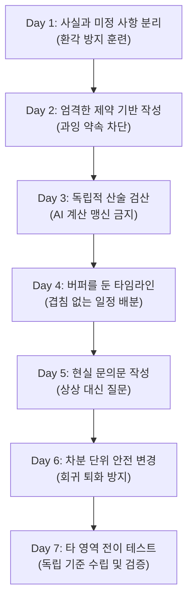

> 📌 **원문 안내**: 본 가이드는 [FreeAI Dog 공식 플랫폼](https://freeaidog.com/ko/blog/ai-practice-plan-for-beginners/)에서 최초 발행되었습니다. 실시간 LLM 가용성 레이더 및 인터랙티브 테스트 도구는 공식 사이트를 방문하세요: [https://freeaidog.com/ko/](https://freeaidog.com/ko/).


# AI를 단순 잡담용 장난감으로 쓰지 마라: 초보자를 위한 '단일 미니 프로젝트 7일 실전 완성 플랜'

> **머리말**: 매일 AI에게 온갖 질문을 던지며 신기해하지만, 정작 회의 안내문 작성, 견적 비교, 빡빡한 일정 수립 같은 '진짜 업무'가 주어지면 AI가 엉뚱한 거짓말을 늘어놓거나 허세를 부려 당황한 적이 있으신가요?
> 
> 진정한 AI 실무 역량은 시중의 '프롬프트 100선'을 외운다고 생기지 않습니다. 그것은 **엄격한 현실 제약 속에서 AI의 출력을 꼼꼼히 검수하고 다듬는 '인간 주도 검증 사이클'**을 통해서만 체득됩니다. 본 가이드에서는 하나의 구체적인 미니 프로젝트를 7일간 하루 15~20분씩 단계별로 다루며, AI를 믿음직한 파트너로 통제하는 비결을 전달합니다.

---

## 1. 왜 단편적인 질문으로는 AI 실력이 늘지 않는가?

대다수 입문자들은 AI를 산발적인 장난감으로 소비합니다. 오늘은 시를 쓰게 하고, 내일은 우주 상식을 묻고, 모레는 파이썬 코드 한 줄을 요청합니다. 이런 방식으로는 실전 업무를 감당할 수 있는 근육이 붙지 않습니다.

실무 현장에서 AI를 쓸 때 직면하는 4대 난관은 다음과 같습니다:

1. **환각 함정 (Hallucination)**: 정보가 부족할 때 AI는 "모른다"고 답하는 대신, 매우 당당한 어조로 가짜 사실을 지어냅니다.
2. **제약 조건 무력화 (Constraint Drift)**: "140자 이내", "무료 다과 언급 금지"라고 지시해도 방심하는 순간 글자 수를 넘기거나 혜택을 남발합니다.
3. **산술 맹점 (Arithmetic Blindness)**: 거대언어모델(LLM)은 단어 확률 예측기이지 계산기가 아닙니다. 복수 견적과 배송비, 예산 잔액 계산을 AI에게 통째로 맡기면 반드시 구멍이 납니다.
4. **수정 시 회귀 퇴화 (Regression on Revision)**: 한 문장만 고쳐달라고 했는데, 기존에 확인했던 주소나 준비물 목록을 말없이 누락해 버리는 일이 흔합니다.

해결책은 Google 프롬프트 설계 가이드라인과 궤를 같이하는 **'단일 진실 공급원(SSOT) 기반 인간 검증 루프'**를 구축하는 것입니다.

---

## 2. 실습의 주춧돌: 유일한 '진실의 기준점 (Brief)'

7일 실습을 시작하기 전, 아래 **가상의 미니 프로젝트 요건**을 메모장에 저장해 두세요. 이 요건서만이 본 실습 전체에서 유일하게 공인된 사실입니다. AI가 웹 검색을 통해 임의로 정보를 덧붙이는 것은 엄격히 금지됩니다.

> 📋 **【실습 프로젝트: 12인 규모 동네 옷 수선 워크숍】**
> 
> - **주제**: 의류 및 직물 소품 수선 (손바느질 및 패치 덧대기)
> - **일시**: 2026년 10월 17일
> - **대관 시간**: 14:00 – 16:00 (**주최 측 사전 세팅 및 행사 후 청소·정리 시간 포함**)
> - **모집 인원**: 12명 정원
> - **재료비 예산 상한**: 총 90달러
> - **참가자 지참물**: 깨끗하게 세탁된 수선할 옷이나 천 소품 1점
> - **현장 제공 도구**: 가위와 바늘은 주최 측에서 전원 제공
> - **배리어프리 현황**: **턱 없는 평지 출입구 확인 완료; 장애인 전용 화장실 여부는 미확인**
> - **신청 방법**: 2026년 10월 10일까지 주최자에게 이메일 회신
> - **상세 주소**: 시더 룸 (가상 주소: 마켓 스트리트 8번지)
> - **다과 및 음료**: **미정**

*※ [FreeAI Dog 홈](/)에서 Google Gemini 2.5 Flash, DeepSeek-V3 등 무료 API 모델을 활용해 0원으로 바로 실습할 수 있습니다.*

---

## 3. 7일간의 점진적 실전 커리큘럼



---

### Day 1: 가정 배제 —— 사실은 사실대로, 의문은 의문대로

#### 🎯 목표
제시된 요건서만을 바탕으로 **확정된 사실**과 **미확인 질문**을 완벽히 분리해, AI의 뇌피셜 개입을 차단합니다.

#### 📝 프롬프트 템플릿
```text
제시된 워크숍 요건서만을 바탕으로 내용을 두 가지 영역으로 분류해 정리해 주세요:
1. [확정된 사항] (정확한 날짜, 숫자, 시간대, 주소 유지)
2. [아직 미확인된 의문점]

일반 상식이나 추측으로 빈자리를 채우지 마세요. 요건서에 명시되지 않은 내용은 확정 사항으로 분류할 수 없습니다.

【워크숍 요건서】:
[여기에 위 요건서 붙여넣기]
```

#### 🔍 검증 체크리스트
- [ ] 장애인 화장실이 '미확인' 목록에 들어가 있는가? "편의시설 완비"로 적혀 있다면 탈락입니다.
- [ ] 다과 제공 여부가 미정으로 분류되었는가?
- [ ] 14:00~16:00가 순수 강의 시간이 아닌 준비와 정리를 포함한 대관 시간으로 명시되었는가?

---

### Day 2: 족쇄를 차고 글쓰기 —— 글자 수 제한과 과잉 약속 차단

#### 🎯 목표
엄격한 분량 및 팩트 제약 속에서 주민 대상 안내문을 작성합니다.

#### 📝 프롬프트 템플릿
```text
요건서를 바탕으로 주민 대상의 친근한 안내문을 작성해 주세요.
엄격한 필수 조건:
1. 한국어 본문 140자 이내 엄수;
2. 일시, 대관 시간대, 주소, 준비물, 신청 방법 및 10월 10일 마감일을 정확히 포함할 것;
3. 장애인 전용 화장실은 대관 측에 확인 중이라는 점을 밝힐 것;
4. '참가비 무료'나 '다과 무료 제공' 같은 표현은 일체 금지할 것.
```

#### 🔍 검증 체크리스트
- [ ] 글자 수 세기 도구로 140자 이하인지 직접 검증했는가?
- [ ] 재료비 90달러가 책정되어 있다고 해서 AI가 '무료 행사'라고 임의로 단정 짓지 않았는가?
- [ ] 누락 사항이 있다면 처음부터 다시 쓰게 하지 말고 "화장실 확인 중 문구만 덧붙이고 140자를 유지하라"고 핀포인트 지시를 내립니다.

---

### Day 3: 계산 맹신 버리기 —— 복수 견적 비교와 독립 검산

#### 🎯 목표
두 업체의 견적을 비교하고, **자신의 계산기로 계산 결과를 직접 교차 검증**합니다.

#### 📝 프롬프트 템플릿
```text
12명분의 수선 키트 구매를 위해 부가세 포함 두 곳의 견적을 받았습니다:
- A안: 세트당 5달러, 배송비 일괄 18달러
- B안: 세트당 6달러, 배송비 일괄 8달러
예산 한도는 90달러입니다.

다음을 단계별로 계산해 주세요:
1. 각 안의 물품 소계(12세트 × 단가), 배송비, 최종 총액을 각각 명시;
2. 90달러 예산 중 얼마가 남는지 계산;
3. 어느 안이 총비용 면에서 더 저렴한지 제시하세요. 품질에 대한 근거 없는 추측은 금지합니다.
```

#### 🔍 검증 체크리스트
직접 계산기 두드리기:
- A안: $12 \times 5 + 18 = 60 + 18 = \$78$ (잔액 $\$12$)
- B안: $12 \times 6 + 8 = 72 + 8 = \$80$ (잔액 $\$10$)
- [ ] 단계별 계산과 결과가 일치하는가?
- [ ] 배송비를 합산했을 때 A안이 더 저렴하다는 결론을 정확히 도출했는가?
- [ ] B안이 더 고품질이라거나 빨리 도착할 것이라는 식의 근거 없는 추천을 걸러냈는가?

---

### Day 4: 빡빡한 타임라인 설계 —— 버퍼 사수와 겹침 없는 배분

#### 🎯 목표
120분 대관 시간 안에서 세팅과 퇴실 청소 버퍼를 사수하는 2가지 일정표를 작성합니다.

#### 📝 프롬프트 템플릿
```text
14:00~16:00(120분) 대관 시간 내에서 2가지 일정안을 구성해 주세요:
제약 사항:
1. 14:00~14:15: 세팅 및 등록 (15분);
2. 15:45~16:00: 도구 반납 및 정리 (15분);
3. 워크숍 본 순서는 순수 90분 배정.

- 1안 [시연 중심]: 강사 시연 시간을 길게 가져가는 구성
- 2안 [실습 중심]: 시연을 짧게 하고 참가자 자율 수선 실습을 극대화하는 구성

모든 코너의 시작과 종료 시각을 기재하고 시간 겹침이나 공백이 없어야 합니다.
```

---

### Day 5: 현실 창구에 질문하기 —— 상상 대신 문의문 작성

#### 🎯 목표
모르는 정보를 AI더러 꾸며내게 하지 않고, 건물 관리소에 보낼 정중한 문의 이메일을 작성합니다.

#### 📝 프롬프트 템플릿
```text
시더 룸 건물 관리팀에 보낼 간결한 문의 이메일을 작성해 주세요:
목적: 10월 17일 14:00~16:00 대관 시 동일 층의 장애인 전용 화장실이 개방 및 정상 가동되는지 확인.
조건:
1. 예약 일시와 룸 이름을 밝히고 정중할 것;
2. 이것은 확인을 구하는 질문이어야 하며, 이미 사용 가능하다고 기정사실화하지 말 것;
3. 참가자의 사적인 의료 정보나 개인정보를 지어내지 말 것.
```

---

### Day 6: 차분(Diff) 단위 안전 수정 —— 뼈대를 건드리지 않는 업데이트

#### 🎯 목표
새로운 사실 2가지가 업데이트되었을 때, Day 2 완성본에서 **해당 문장만 안전하게 교체**합니다.

#### 📝 프롬프트 템플릿
```text
두 가지 사실이 공식 확인되었습니다:
1. 관리소 측에서 당일 장애인 화장실이 정상 개방된다고 회신함;
2. 신청 마감일이 10월 10일에서 10월 12일로 연장됨.

Day 2에서 확정한 140자 안내문을 수정해 주세요:
- 변경된 2가지 내용과 관련된 문장만 수정하고, 주소나 준비물 등 기존 확정 정보는 단 한 글자도 바꾸지 말 것;
- 140자 이내 분량을 유지할 것;
- 수정 후 어디를 고쳤는지 2줄로 요약할 것.
```

#### 🔍 검증 체크리스트
- [ ] 기존 버전과 대조하여 주소나 지참물 요구 사항이 실수로 지워지지 않았는지 확인했는가?
- [ ] 화장실 확정 문구와 마감일만 깔끔하게 바뀌었는가?

---

### Day 7: 새로운 실전 전이 테스트 —— 독립 검증력 완성

#### 🎯 목표
새로운 빈 대화창을 열고, 완전히 다른 업무에 본 검증 워크플로우를 대입해 스스로 검수합니다.

> **【새 과제 요건】**
> - 사내 독서 모임: 2026년 11월 6일 오전 10:00~11:00 (참석 6명)
> - 과제: 첨부된 분기 보고서 1~8페이지를 사전 완독하고 참석할 것
> - 온라인 미팅 링크: 미정 (행사 하루 전 별도 전달)
> - 참석 여부: 자율 참석 (의무 아님)

AI가 멋대로 가짜 줌 링크를 지어내지 않는지, 독서 범위를 틀리지 않는지, 강제 참석으로 둔갑시키지 않는지 내 손으로 직접 감리해 보세요.

---

## 4. 프롬프트 마법에서 엔지니어링 마인드로

| 단순 챗봇 사용 | 신뢰도 높은 AI 협업 방식 |
| :--- | :--- |
| 당당한 어조를 맹신하고 복사해 붙여넣기 | **당당함 $\ne$ 팩트**: AI 답변은 항상 사실 목록과 대조해 감리 |
| 복합 연산과 견적 합계를 AI에게 일임 | **산술 독립의 원칙**: 계산은 계산기나 코드로 인간이 직접 검증 |
| 마음에 안 들면 "전부 다시 써줘" 남발 | **차분 업데이트 원칙**: 바뀐 지점만 메스로 도려내듯 수정 |
| 부족한 정보가 있으면 AI더러 지어내라고 재촉 | **현실 인터페이스 원칙**: 미확인 항목은 현실의 인간에게 물을 질문문으로 변환 |

AI 시대에 가장 귀중한 자산은 모델이 쏟아내는 화려한 수식어가 아니라, **엄격한 현실 제약 속에서 결과물의 품질을 담보해 내는 인간의 검증력**입니다. 지금 바로 [FreeAI Dog](/ko/tools)의 무료 도구들과 함께 여러분의 Day 1을 시작해 보세요!

---

> 💡 **원문 출처 및 실시간 모니터링**：
> - 원문 출처: [FreeAI Dog 공식 블로그](https://freeaidog.com/ko/blog/ai-practice-plan-for-beginners/)
> - 무료 대형 언어 모델 실시간 가용성 및 지연 시간 측정은 [FreeAI Dog 가용성 레이더](https://freeaidog.com/ko/radar/)에서 확인하세요.

