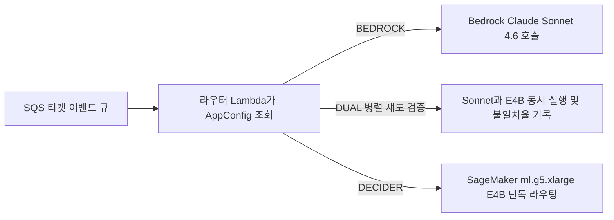

> 📌 **원문 안내**: 본 가이드는 [FreeAI Dog 공식 플랫폼](https://freeaidog.com/ko/blog/amazon-strands-decider-4b-replace-sonnet-46-routing-cost-guide/)에서 최초 발행되었습니다. 실시간 LLM 가용성 레이더 및 인터랙티브 테스트 도구는 공식 사이트를 방문하세요: [https://freeaidog.com/ko/](https://freeaidog.com/ko/).


초당 수십 토큰씩 출력하는 범용 추론 모델에게 20개 중 1개 카테고리를 고르게 시키는 건 사실상 지연 시간에 돈을 태우는 일입니다.

Amazon 내부 엔지니어들이 최근 티켓 라우팅 비용 장부를 공개했습니다. 기존에는 Bedrock 위 `Claude Sonnet 4.6`으로 고객 불만, 권한 요청, 경보 티켓 등을 고정 20개 카테고리와 예외 항목으로 분류했습니다. 티켓 1건당 평균 입력 6,554토큰을 넣고, 이유 설명과 JSON으로 출력 170토큰을 받았습니다. 호출당 평균 지연은 4,215밀리초. 정가 기준으로 티켓당 0.0222달러, 100만 건이면 22,200달러가 나갔습니다.

이를 오픈 웨이트 모델인 `Strands Decider E4B`로 바꾼 뒤에는 호출 지연이 897밀리초로 내려갔고, 100만 건당 비용은 약 500달러 수준으로 떨어졌습니다. 서류상 절감률은 98%입니다. 하지만 성급히 따라 해서는 안 됩니다. 이 계산 뒤에는 냉정한 전제가 붙습니다. 연간 수천만~1억 건에 육박하는 처리량이 받쳐주지 않으면, 월정액 GPU 인스턴스 유휴 임대료가 절감액을 다 까먹습니다. 게다가 입력 JSON의 키 순서만 바뀌어도 예측 확률이 흔들리는 문제까지 터졌습니다.

아래 수치는 모두 공식 엔지니어링 블로그, GitHub 메인 브랜치, Hacker News 스레드에서 직접 대조한 값입니다. 직접 SageMaker GPU를 띄워 100만 동시 요청을 돌린 것은 아니므로, 로컬 부하 그래프를 꾸며내지 않고 비용 구조와 실운영 장애 기록만 검증합니다.

## 포인터 헤드가 내뱉는 건 단 1토큰: 파인튜닝 챗 모델과 구조가 다르다

처음 `strands-labs/strands-decider`를 봤을 때 저 역시 흔한 SFT 소형 챗 모델일 거라 넘겨짚었습니다. 코드를 열어보니 아예 다른 구조였습니다.

일반 LLM은 자기회귀 디코딩 루프를 한 글자씩 돕니다. 분류 이름 하나만 필요해도 토큰 생성 루프를 끝까지 돌 수밖에 없습니다. 반면 이 저장소는 `Gemma 4`나 `Qwen3.5` 기반 모델 위에 전용 포인터 출력 헤드를 얹었습니다. 텍스트 상태와 함께 이산 선택 `choice`, 예/아니오 판별 `noul`, 점수 `score` 중 하나를 지정하면, 단 한 번의 순전파로 보정된 확률값이 나옵니다. 출력 길이는 무조건 1토큰입니다.

공식 저장소에 올라온 Gemma 4 전체 라인업 수치를 보면 하드웨어 선택 기준이 드러납니다.

| 모델 체크포인트 | JevBench 점수 | Brier 보정 오차 | BF16 가중치 VRAM | H100 단일 중앙 지연 | 주된 사용 환경 |
| --- | --- | --- | --- | --- | --- |
| `strands-decider-E2B-gemma4-v1-2610` | 180 | 0.313 | 약 9 GB | 102 ms | 극단적 VRAM 절약 또는 CPU 단독 배포 |
| `strands-decider-E4B-gemma4-v1-2610` | 187 | 0.243 | 약 15 GB | 139 ms | 24GB 단일 GPU에서 타 서비스와 공존 |
| `strands-decider-12B-gemma4-v1-2610` | 200 | 0.173 | 약 23 GB | 136 ms | 단일 GPU 단독 점유로 정확도 우선 |
| `strands-decider-26B-A4B-gemma4-v1-2610` | 207 | 0.162 | 약 51 GB | 245 ms | 오분류 비용이 큰 고위험 의사결정 |

표 안에 직관과 어긋나는 숫자가 보입니다. H100 기준 12B 모델 중앙 지연은 136밀리초로, E4B의 139밀리초보다 3밀리초 더 빠릅니다. 더 정확하고 빠르기까지 한데 실서비스는 왜 E4B를 골랐을까요. 답은 GPU 메모리입니다. SageMaker `ml.g5.xlarge`는 24GB A10G 1장만 제공합니다. E4B는 적재 시 약 19GiB를 써서 여유 공간이 남지만, 12B는 가중치만 23GB를 먹어 요청 길이가 조금만 늘어나도 즉시 메모리가 터집니다.

로컬에서 시험 삼아 돌려볼 때는 패키징 함정도 피해야 합니다. PyPI에 올라간 `strands-decider` 구버전은 아직 Gemma 4를 지원하지 않아 바로 실행하면 에러가 납니다. GitHub 메인 브랜치에서 직접 받아 설치해야 합니다.

```bash
pip install "strands-decider @ git+https://github.com/strands-labs/strands-decider"
strands-decider ask StrandsAgents/strands-decider-E4B-gemma4-v1-2610 \
  --state "Help! My payouts have been failing for 3 days! " \
  --choice "Which team should handle this?=billing,sales,retail"
```

애플 실리콘 Mac 사용자라면 두 가지를 기억해 두세요. `--device mlx` 옵션을 주면 MPS보다 1.4~1.6배 빠르지만 `pip install -e ".[mlx]"`로 소스 설치를 해야 활성화됩니다. 모달리티 제약도 헷갈리기 쉽습니다. Gemma 4 계열은 현재 텍스트 전용이며, 이미지 입력 `--vision`이 동작하는 건 이전 모델인 `Qwen3.5-2B-Base`뿐이니 E4B에 스크린샷을 넣지 마세요.

## 시간당 1.408달러 GPU 계산서: 요청량이 적으면 오히려 손해

공식 사례 글에 공개된 전환 전후 수치를 나란히 놓아 보겠습니다.

| 핵심 비교 지표 | Claude Sonnet 4.6 Bedrock | Strands Decider E4B SageMaker | 변화 폭 및 기준 |
| --- | --- | --- | --- |
| 호출당 평균 응답 시간 | 4,215 ms | 897 ms | 78% 단축; 인스턴스 내부 처리 약 640 ms |
| 평균 입력 토큰 수 | 6,554 | 2,009 | 69% 축소; 프롬프트 압축 적용 |
| 평균 출력 토큰 수 | 170 | 1 | JSON 서술 없이 단일 선택지 출력 |
| us-east-1 공개 단가 | 입력 3달러 / 출력 15달러 per 1M | `ml.g5.xlarge` 시간당 1.408달러 | 온디맨드 정가 기준; Lambda 비용 별도 |
| 100만 건당 추산 비용 | 약 22,200달러 | 약 500달러 | 약 98% 절감; 완전 포화 시 이론치 250달러 |

100만 건마다 21,700달러가 남는다는 숫자만 보면 눈이 휘둥그레집니다. 하지만 연간 물량으로 역산하면 금세 현실이 보입니다. 제목처럼 '연간 수백만 달러 절감'이 성립하려면 매년 9,000만 건 이상의 티켓이 쏟아져야 합니다. 웬만한 회사에서 그 정도 트래픽이 나올까요.

중소 규모 팀이 그대로 도입하면 거의 적자입니다. `ml.g5.xlarge`는 요청 유무와 무관하게 인스턴스 가동 시간당 요금을 매깁니다. 1대를 한 달 내내 켜두면 기본 임대료만 1,014달러입니다. 다중 가용 영역 이중화와 스테이징 노드까지 붙이면 티켓 한 장 처리하기 전부터 매달 2,000~3,000달러 고정비가 빠져나갑니다. 가령 월간 티켓이 5만 건뿐이라면 Sonnet 4.6 API를 그대로 써도 월 청구액은 1,110달러에 그칩니다. API 파라미터만 Haiku급 경량 모델로 바꿔도 월 200달러 밑으로 떨어지고, 컨테이너 운영이나 콜드 스타트 대응도 필요 없어집니다.

전용 GPU 엔드포인트를 직접 띄울 기준은 두 가지뿐입니다. 24시간 큐를 꽉 채워 시간당 1.408달러 고정비를 충분히 쪼갤 수 있거나, 보안 규정상 데이터가 프라이빗 VPC 밖으로 한 발짝도 나갈 수 없어 폐쇄망 SageMaker 컨테이너가 강제되는 경우입니다. 여기서 자연스러운 의문이 남습니다. 비용 격차가 이토록 큰데 왜 AWS는 Bedrock에서 토큰당 과금하는 호스팅 API로 내놓지 않을까요. Hacker News 원글 스레드에서도 똑같은 질문이 여러 개 달렸지만, 아직 답한 사람이 없습니다.

## 실운영 장애 기록: JSON 키 순서에 따른 0.19 편차와 4,096 토큰 장벽

비용표보다 눈길이 오래 머문 대목은 글 후반부에 실린 운영 장애 기록이었습니다. 엔지니어들이 창피한 실패를 숨기지 않았습니다.

가장 기묘한 버그는 직렬화 단계에서 터졌습니다. 입력 JSON의 필드 순서만 바꿔도 분류 확률이 달라졌습니다. 본문 글자는 한 글자도 건드리지 않고 딕셔너리 키 순서만 뒤바꿨는데 출력 확률이 0.19까지 요동쳤습니다. 신뢰도 점수를 기준으로 사람 검수 여부를 가르는 자동화 파이프라인에서 0.19 편차는 경계 사례를 모조리 뒤집어놓기에 충분합니다. 팀은 결국 모든 요청 페이로드의 키를 알파벳 순으로 강제 정렬하도록 못 박았습니다. 직접 래퍼를 짠다면 직렬화 순서 고정부터 잠그셔야 합니다.

키 순서를 잠그고 나니 이번엔 4,096토큰 컨텍스트 천장에 부딪혔습니다. Sonnet용으로 작성해 둔 20개 카테고리 분류 지침만으로도 4,096토큰 한계를 넘겨버린 겁니다. 규칙을 지우면 오분류가 나고, 그대로 넣으면 에러로 뻗었습니다. 그래서 20개 규칙을 1~2문장짜리 짧은 판단 기준으로 전부 다시 깎고 `"none"` 예외 항목을 넣었습니다. 댓글이 수십 개씩 달린 긴 티켓은 가장 오래된 과거 답글부터 잘라내 최근 맥락만 남겼고, 그 결과 평균 입력 토큰을 2,009개까지 낮출 수 있었습니다.

실제 트래픽 전환도 한 번에 뒤집지 않았습니다. 라우터 Lambda 앞단에서 AWS `AppConfig` 플래그를 읽어 3단계 스위치를 두었습니다.



초기에는 `DUAL` 섀도 모드로 묶어 실제 응답은 계속 Sonnet 결과를 쓰면서, 백그라운드에서 E4B와의 불일치 샘플을 모아 신뢰도 임계값을 다듬었습니다. 안정화된 뒤에야 `DECIDER`로 넘겼고, 새벽에 오분류 경보가 뜨면 코드나 컨테이너 재배포 없이 `AppConfig` 값만 바꿔 45초 만에 롤백하도록 설계했습니다.

끝으로 Hacker News 댓글란을 달군 묵직한 질문도 짚고 넘어가야 합니다. 카테고리가 20개로 고정되어 있다면 아예 `scikit-learn`이나 `ModernBERT`로 전용 분류기를 학습시키는 편이 낫지 않느냐는 반론입니다. 실제로 전통적인 인코더는 10밀리초 안쪽으로 응답하고 GPU 임대료보다 몇 단계 더 저렴합니다. 단 하나의 전제는 이미 깨끗하게 라벨링된 수만 건의 과거 티켓 데이터가 쌓여 있어야 한다는 점입니다. Strands Decider가 승부수를 던지는 지점은 바로 오늘 당장 새 카테고리가 추가되었는데 학습 데이터가 0건인 제로샷 콜드 스타트 상황입니다.

---

본문에 인용한 단가, 지연 시간, 확률 편차 수치는 아래 1차 출처에서 직접 확인한 내용입니다.

| 검증 항목 | 1차 출처 링크 |
| --- | --- |
| Amazon 티켓 시스템의 Sonnet 4.6 교체 사례 원문 | https://strandsagents.com/blog/amazon-saves-millions-replacing-sonnet-with-strands-decider/ |
| Strands Decider 공식 저장소 및 CLI 설치 가이드 | https://github.com/strands-labs/strands-decider |
| StrandsAgents Gemma 4 E4B 모델 카드 | https://huggingface.co/StrandsAgents/strands-decider-E4B-gemma4-v1-2610 |
| Marc Brooker의 디코더 대 인코더 기술 비교 글 | https://brooker.co.za/blog/2026/10/04/encoders.html |
| Hacker News 원글 비용 논쟁 및 클래식 ML 반론 | https://news.ycombinator.com/item?id=50436640 |

저라면 이 전환 작업을 맡은 이번 주에 바로 GPU 인스턴스를 띄우지 않겠습니다. 먼저 운영 라우터에 비동기 섀도 로그를 7일만 걸어두고 딱 두 숫자만 확인하겠습니다. 월간 분류 요청이 진짜 100만 건을 넘는지, 그리고 오래된 답글을 잘라냈을 때 정확도가 몇 퍼센트포인트 떨어지는지 말입니다. 그 두 숫자를 책상 위에 올려놓고 보면 '비용 98% 절감'이라는 제목도 훨씬 차분하게 보일 겁니다.

---

> 💡 **원문 출처 및 실시간 모니터링**：
> - 원문 출처: [FreeAI Dog 공식 블로그](https://freeaidog.com/ko/blog/amazon-strands-decider-4b-replace-sonnet-46-routing-cost-guide/)
> - 무료 대형 언어 모델 실시간 가용성 및 지연 시간 측정은 [FreeAI Dog 가용성 레이더](https://freeaidog.com/ko/radar/)에서 확인하세요.

