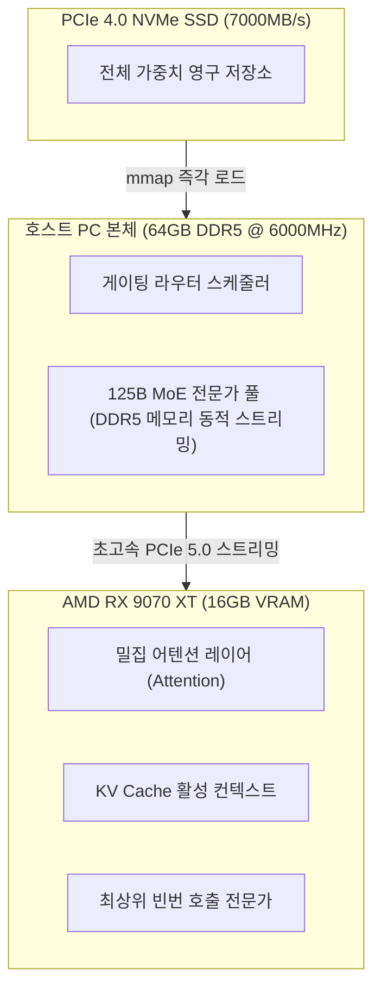

> 📌 **원문 안내**: 본 가이드는 [FreeAI Dog 공식 플랫폼](https://freeaidog.com/ko/blog/amd-rx-9070-xt-strata-qwen-flash-next-budget-setup/)에서 최초 발행되었습니다. 실시간 LLM 가용성 레이더 및 인터랙티브 테스트 도구는 공식 사이트를 방문하세요.


# 1600유로로 최전선 Flash Next 정복! AMD RX 9070 XT + Strata로 90 t/s 달성: 양자화 함정과 가성비 조립 실측 가이드

로컬 환경에서 125B 파라미터급 초대형 MoE(Mixture of Experts) 모델을 운용하려고 견적을 뽑아보면 누구나 한숨을 내쉬게 됩니다:
"RTX 3090/4090 두 장을 꽂거나, 아니면 400만 원이 훌쩍 넘는 32GB RTX 5090을 사야 한다."

하지만 오픈소스 하드웨어 커뮤니티에는 가성비의 한계를 시험하는 열정적인 해커들이 항상 존재합니다.

최근 Reddit의 r/LocalLLaMA 커뮤니티에서 수백 개의 댓글이 달리며 엄청난 화제를 모은 글이 있었습니다. 유럽의 한 엔지니어가 **Intel Core i7-14700KF + 64GB DDR5 + AMD 신세대 Radeon RX 9070 XT 16GB(RDNA4 아키텍처)** 조합으로 총 견적 **1,600유로(한화 약 240만 원)** 수준의 본체를 완성한 것입니다.

이 가성비 워크스테이션에서 MoE 동적 오프로딩에 특화된 오픈소스 추론 엔진 **Strata**를 활용해 알리바바의 최신 멀티모달 코딩 모델 **Qwen 3.8 Flash Next**를 구동한 결과, **초당 70 ~ 90 토큰(tokens/s)**이라는 놀라운 디코드 속도를 기록했습니다!

이 속도는 사람의 일반적인 독서 속도를 훌쩍 뛰어넘으며, 어지간한 상용 클라우드 유료 API보다도 빠른 반응성입니다.

하지만 무작정 부품을 주문하기 전에 짚고 넘어가야 할 치명적인 포인트들이 있습니다. 단순히 속도 수치만 보고 덤벼들었다가 "Q2 양자화의 지능 저하"나 "ROCm 드라이버 오류"라는 복병을 만날 수 있기 때문입니다. 저(샤오커)가 이 조립 시스템의 실제 메커니즘, 소프트웨어 설정법, 그리고 핵심 주의사항을 명쾌하게 정리해 드립니다.

---

## 1. 1,600유로 부품 견적서 분석: 비용은 어디에 쓰였는가?

이 시스템이 200만 원대 중반의 예산으로 125B급 거대 모델을 쾌적하게 구동할 수 있는 핵심 원리는 **"VRAM에 핵심 어텐션과 KV 캐시를 고정하고, 고대역폭 고클럭 DDR5 메모리로 전문가 레이어를 유기적으로 순환시키는 계층형 오프로딩"**에 있습니다.

실제 검증된 본체 부품 내역은 다음과 같습니다:

| 부품 종류 | 실측 채택 모델 | 하드웨어 선정 이유 | 국내 기준 예상 가격 |
| :--- | :--- | :--- | :--- |
| **그래픽카드 (GPU)** | **AMD Radeon RX 9070 XT 16GB** | RDNA4 아키텍처(Navi 48). 네이티브 FP8/FP4 행렬 가속 지원, 동급 VRAM 경쟁사 대비 압도적 가성비 | 약 95만 원 |
| **프로세서 (CPU)** | **Intel Core i7-14700KF** | 20코어 28스레드. 높은 싱글코어 부스트 클럭으로 전문가 라우팅 스케줄링 병목 해소 | 약 52만 원 |
| **메모리 (RAM)** | **64GB (32GB×2) DDR5 6000MHz CL30** | **가장 중요!** 대역폭 약 96 GB/s. MoE 전문가 레이어를 GPU로 전송하는 메인 동맥 | 약 28만 원 |
| **메인보드 (MB)** | **B760 / Z790 상급 ATX** | PCIe 5.0 그래픽 슬롯 및 최소 2개 이상의 PCIe 4.0×4 M.2 슬롯 필수 | 약 26만 원 |
| **SSD** | **2TB PCIe 4.0 NVMe (7000+ MB/s)** | 모델 가중치 즉각 mmap 매핑과 콜드 전문가 호출을 위한 초고속 저장장치 | 약 19만 원 |
| **파워서플라이 (PSU)** | **850W ATX 3.0 Gold 풀모듈러** | 9070 XT와 14700KF의 순간 피크 전력 수요를 안정적으로 방어 | 약 15만 원 |
| **쿨러 및 케이스** | **360mm 수랭 쿨러 + 고풍량 케이스** | 장시간 연속 추론 작업 시 CPU 쓰로틀링 방지 | 약 16만 원 |
| **본체 전체 합계** | **완제품 1세트 견적** | **RTX 5090 단품 카드 1장 가격도 안 되는 예산으로 125B MoE 로컬 인프라 구축** | **약 251만 원 (~1,600 €)** |



이 계층형 파이프라인 덕분에 RX 9070 XT의 16GB VRAM에는 어텐션 매트릭스와 현재 생성 중인 KV 캐시가 항상 상주하며, 나머지 거대한 전문가 가중치들은 64GB DDR5 메모리로부터 Strata 엔진을 통해 실시간으로 지연 없이 스왑됩니다.

---

## 2. 커뮤니티 핵심 쟁점: 90 t/s의 'Q2 양자화' 정말 쓸만한가?

원문 게시 후 커뮤니티의 최대 논쟁거리는 속도가 아니라 **양자화 손실에 따른 모델 지능 저하**였습니다.

테스트 환경에서 70~90 t/s를 찍은 모델은 `Qwen3.8-Flash-Next-GSQ-RCO-Q2_0`이었습니다.

코딩이나 정밀한 비즈니스 로직에 활용하려는 개발자라면 아래 등급별 차이를 반드시 점검해야 합니다:

### 양자화 3개 등급 실측 비교

| 양자화 등급 | 실측 디코드 속도 | 총 메모리 점유율 | 실무 활용도 및 샤오커의 평가 |
| :--- | :---: | :---: | :--- |
| **GSQ-RCO-Q2_0** | **90 ~ 70 t/s** | 약 38 GB | ⚠️ **속도는 빠르지만 지능 저하 체감**. 일상 대화나 아이디어 스케치에는 쾌적하지만, 다단계 논리 추론, 복잡한 코드 작성, 엄격한 JSON 도구 호출 시 인자 누락이나 논리 모순이 빈번합니다. |
| **GSQ-RCO-IQ3_S** *(적극 추천)* | **60 ~ 50 t/s** | 약 48 GB | 🏆 **속도와 지능을 모두 잡은 황금 스위트스팟!** 중요도 행렬 보존 양자화로 핵심 논리가 유지됩니다. 코딩 및 함수 호출이 안정적이며, 50+ t/s의 출력 속도는 실사용에 완벽합니다. |
| **Atomic Q4 / GSQ-RCO-Q4** | **50 ~ 30 t/s** | 약 62 GB | 💎 **엔터프라이즈 프로덕션급**. 네이티브 FP16에 근접한 높은 추론 정확도를 보이며 할루시네이션 증가가 없습니다. 장문 분석과 대형 코드 리팩토링에 적합합니다. |

> **샤오커의 실전 조언**: 벤치마크 숫자 자랑을 위해 굳이 Q2_0을 고집하지 마세요. **IQ3_S가 실무용으로는 최고의 선택**입니다. 20 t/s 정도를 양보하고 정확한 추론 지능과 무오류 함수 호출을 얻는 것이 훨씬 생산적입니다.

---

## 3. 실전 구축 가이드: RX 9070 XT에서 Strata 구동하기

AMD 그래픽카드에서 최신 AI 연산 환경을 구축할 때는 윈도우 기본 드라이버 대신 최적화 패치가 집중되는 Linux(ROCm) 환경을 사용하는 것이 기본입니다.

권장 환경: **Ubuntu 24.04 LTS (Linux 커널 6.10 이상)**.

### 1단계: AMD ROCm 6.3 런타임 설치
```bash
# 1. 공식 리포지토리 추가
sudo apt-get update && sudo apt-get install -y wget gnupg2
wget https://repo.radeon.com/rocm/rocm.gpg.key -O - | \
    gpg --dearmor | sudo tee /etc/apt/trusted.gpg.d/rocm.gpg > /dev/null

echo "deb [arch=amd64] https://repo.radeon.com/rocm/apt/6.3/ noble main" | \
    sudo tee /etc/apt/sources.list.d/rocm.list

# 2. ROCm HIP SDK 및 관련 도구 설치
sudo apt-get update && sudo apt-get install -y \
    rocm-hip-sdk rocm-opencl-runtime rocm-smi-lib rocminfo

# 3. 렌더링 그룹 권한 부여
sudo usermod -a -G render,video $USER
```

> **RDNA4 환경 필수 팁**: RX 9070 XT는 최신 Navi 48(gfx1201) 타깃입니다. 컴파일러가 타깃 GPU를 인식하지 못할 경우 환경 변수를 추가해 주세요:
> ```bash
> export HSA_OVERRIDE_GFX_VERSION=12.0.0
> export ROCM_PATH=/opt/rocm
> ```

### 2단계: Strata 추론 엔진 소스코드 빌드
Strata는 비대칭 MoE 오프로딩을 위해 최적화된 고성능 엔진입니다 (`stratallm.dev` / `github.com/Niko1221/Strata`):

```bash
git clone https://github.com/Niko1221/Strata.git
cd Strata

# ROCm HIP 백엔드로 컴파일
mkdir build && cd build
cmake .. -DHIP_ROOT_DIR=/opt/rocm -DSTRATA_ENABLE_ROCM=ON -DCMAKE_BUILD_TYPE=Release
make -j$(nproc)
```

### 3단계: 양자화 모델 가중치 내려받기
```bash
# 추천 스위트스팟 IQ3_S 모델 다운로드
huggingface-cli download \
    LoneStriker/Qwen3.8-Flash-Next-GSQ-RCO-IQ3_S-GGUF \
    --local-dir /models/Qwen3.8-Flash-Next-IQ3_S
```

### 4단계: 계층형 오프로드 서버 시작
```bash
./bin/strata-server \
    --model /models/Qwen3.8-Flash-Next-IQ3_S \
    --vram-budget 14500 \
    --ram-budget 52000 \
    --port 8000 \
    --ctx-size 65536
```
주요 옵션 설명:
- `--vram-budget 14500`: 16GB VRAM 중 14.5GB를 할당하고, 화면 표시용으로 1.5GB를 보존;
- `--ram-budget 52000`: 64GB 시스템 RAM 중 52GB를 전문가 캐시 풀로 배정.

서버가 실행되면 로컬 `http://localhost:8000/v1`에서 완전한 OpenAI 호환 엔드포인트를 즉시 활용할 수 있습니다!

---

## 4. 극가성비 대안: 200달러(약 28만 원) 구형 서버 폐기물 활용법

원문 댓글 창에서는 예산이 턱없이 부족한 하드웨어 마니아들을 위한 또 다른 충격적인 대안이 공유되었습니다:

만약 수중에 200만 원은커녕 수십만 원의 용돈밖에 없다면 최신 MoE를 돌릴 수 없을까요?

답은 **"중고 서버 부품을 모아 구성하는 것"**입니다:

- **CPU**: Intel Xeon E5-2673 v4 (20코어 40스레드, 중고가 **약 1~2만 원**);
- **RAM**: 16GB DDR4-2133 RDIMM ECC 4장 (쿼드채널 64GB 합계 **약 5~6만 원**);
- **메인보드**: 중고 X99 쿼드채널 보드 (**약 6~8만 원**);
- **그래픽카드**: **AMD Radeon Instinct MI50 16GB** (ROCm을 정식 지원하는 연산 전용 가속기, 중고가 **약 14~16만 원**);
- **파워 및 오픈 프레임**: 중고 750W 파워 + 테스트 벤치 거치대 (**약 3~4만 원**).

**총견적 200달러 안팎(약 28만 원)!**
DDR4 대역폭 한계로 Atomic Q4 기준 속도는 **30 ~ 45 tokens/s** 수준이지만, 회식 한두 번 비용으로 방구석에서 125B 파라미터 AI 두뇌를 직접 굴릴 수 있다는 점은 엄청난 매력입니다.

---

## 마치며

유럽 개발자의 1600유로 RX 9070 XT 조립 시스템부터 20만 원대 중고 서버 개조까지, 오픈소스 AI 생태계는 값비싼 하드웨어 독점을 무력화하고 있습니다.

반드시 고가의 NVIDIA 그래픽카드만 고집할 필요는 없습니다. **AMD RDNA4 + Strata 동적 오프로딩**이라는 실속형 아키텍처는 개인 개발자에게 매우 훌륭한 탈출구를 제공합니다.

새로운 조립 PC나 홈랩 구성을 고민 중이시라면 이 가이드를 참고해 보세요. 조립이나 세팅 과정에서 막히는 부분이 있다면 언제든 댓글로 남겨주세요. 샤오커가 도와드리겠습니다!

---

> 💡 **원문 출처 및 실시간 모니터링**：
> - 원문 출처: [FreeAI Dog 공식 블로그](https://freeaidog.com/ko/blog/amd-rx-9070-xt-strata-qwen-flash-next-budget-setup/)
> - 무료 대형 언어 모델 실시간 가용성 및 지연 시간 측정은 [FreeAI Dog 가용성 레이더](https://freeaidog.com/ko/radar/)에서 확인하세요.
