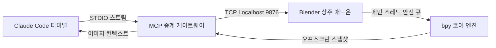

> 📌 **원문 안내**: 본 가이드는 [FreeAI Dog 공식 플랫폼](https://freeaidog.com/ko/blog/blender-mcp-ai-3d-claude-code-automation-guide/)에서 최초 발행되었습니다. 실시간 LLM 가용성 레이더 및 인터랙티브 테스트 도구는 공식 사이트를 방문하세요: [https://freeaidog.com/ko/](https://freeaidog.com/ko/).


3D 제작 파이프라인에서 가장 많은 에너지를 소모하는 것은 창의적인 기획이 아닙니다. 지루하고 반복적인 단순 수작업의 연속입니다.

셰이더 노드 수정, 본 리깅, 버텍스 그룹 분배, 법선 방향 정렬. 조금만 복잡한 씬을 마주해도 내장 텍스트 에디터와 3D 뷰포트를 끊임없이 오가야 합니다. 피곤하냐고 묻는다면, 정말 피곤합니다. 직접 작성한 bpy 스크립트로 일괄 처리할 수 있다 해도 API 문서를 뒤적이고 오류를 디버깅하는 일은 여전히 골치 아픕니다.

지난주 오픈소스 커뮤니티에 Model Context Protocol을 Blender에 접목한 구현체들이 연이어 등장했습니다.

접근법은 명료합니다. Blender 내장 Python 런타임을 표준 MCP 서버로 래핑하여 터미널의 Claude Code나 Cursor가 모델링 명령을 직접 지시하도록 만듭니다. 나아가 뷰포트 렌더링 스냅샷을 모델에 전달하여 시각적 자체 교정 루프를 완성하는 구조입니다.

엔지니어에게 이상적인 도구처럼 들립니다. 그러나 실제 실무 현장에서 과연 매끄럽게 돌아갈까요. 아니면 숱한 지뢰가 기다리고 있을까요.

저는 오픈소스 코드를 내려받아 Blender 4.3 LTS 환경에서 하루 종일 테스트를 진행했습니다. 예상대로 메인 스레드 강제 종료와 컨텍스트 단절이라는 복병이 도사리고 있었습니다.

---

## 1. 아키텍처 개요: 에이전트는 어떻게 3D 공간을 원격 조종하는가

외부 에이전트가 3D 그래픽 소프트웨어를 제어하는 방식은 크게 두 가지로 나뉩니다. 작업마다 GUI 없이 독립 Blender 프로세스를 띄웠다 종료하는 방식과 백그라운드에서 로컬 소켓 포트를 상시 대기시키는 방식입니다.

전자는 너무 무겁습니다. 매 호출마다 애드온을 읽어 들이고 렌더러를 초기화하느라 수십 초의 지연시간이 발생하므로 에이전트의 연속적인 반복 시행을 감당하지 못합니다.

실무에서 성립하는 해법은 상주형 소켓 통신 구조입니다.



구조는 직관적으로 두 덩어리로 나뉩니다.

첫 번째는 Blender 내부에서 상주하는 Python 플러그인입니다. 프로그램 시작 시 로컬 루프백 주소 127.0.0.1의 9876 포트를 리스닝합니다.

두 번째는 외부 작업 환경에서 돌아가는 MCP 서버입니다. Claude Code의 표준 도구 호출 요청을 수신하여 JSON 페이로드로 변환한 뒤 내부 애드온으로 전달합니다.

---

## 2. 첫 번째 암초: 멀티스레드에서 bpy 호출 시 세그멘테이션 오류로 강제 종료

가장 직관적인 구현을 떠올리기 쉽습니다. 애드온 내부에 데몬 스레드를 하나 띄워 소켓을 수신하고, 문자열 형태의 코드가 도착하면 내장 exec 함수로 즉시 실행하는 방식입니다. 과연 이렇게 단순하게 풀릴까요.

터미널에서 기본 메시 큐브를 생성하는 첫 번째 테스트 페이로드를 날렸습니다.

```json
{
  "action": "execute_code",
  "target": "bpy.ops.mesh.primitive_cube_add",
  "kwargs": {
    "size": 2.0
  }
}
```

엔터를 치는 순간 Blender 창이 검게 변하더니 그대로 꺼져버렸습니다.

터미널 로그에는 처참한 크래시 덤프가 찍혀 있었습니다.

```text
Fatal Python error: Segmentation fault
Current thread 0x000070000abc1000
  File "blender/source/blender/python/intern/bpy_operator.cc", line 286 in pyop_call
Segmentation fault: 11
```

멀쩡하던 그래픽 소프트웨어가 왜 단번에 죽었을까요.

원인은 명확합니다. bpy.ops는 스레드 안전하게 설계되지 않았습니다. Blender의 C 및 C++ 코어 시스템에서 씬 데이터 bpy.data 수정이나 오퍼레이터 호출은 화면을 그리는 UI 메인 렌더링 스레드에서만 독점 실행되어야 합니다. 백그라운드 통신 스레드가 불시에 오퍼레이터를 호출하자 내부 컨텍스트 포인터가 충돌하며 프로세스가 즉사한 것입니다.

### 2.1 메인 스레드 전용 안전 작업 큐 도입

근본 원인을 확인한 만큼 통신 구조를 개편해야 합니다.

소켓 수신 스레드는 접수원 역할에만 머물러야 하며 씬 데이터에는 절대 손대지 말아야 합니다.

```python
# 작업 큐 스케줄링 로직
# 통신 스레드는 큐에 작업을 밀어 넣기만 수행
# 메인 스레드가 타이머 훅으로 안전하게 소비

task_item = {
    "action": "mesh_primitive_add",
    "params": {"primitive_type": "cube", "scale": [2.0, 2.0, 2.0]},
    "status": "pending"
}
```

bpy.app.timers 등록 메커니즘을 활용해 렌더링 메인 스레드가 50밀리초 간격으로 큐를 안전하게 폴링하며 작업을 처리하도록 변경했습니다.

수정 후 다시 연결하자 큐브 생성, 뼈대 이동, 서브디비전 모디파이어 추가까지 뷰포트가 부드럽게 반응하며 더 이상 죽지 않았습니다.

---

## 3. 시각적 피드백: 오프스크린 렌더링으로 에이전트에 눈 달아주기

텍스트 코드만 맹목적으로 전달한다면 에이전트는 기껏해야 API 문서 자동 조회기에 불과합니다. 쓸 만할까요. 지독하게 답답합니다.

3D 작업의 본질은 시각 확인에 있습니다. 조명이 알맞은가. 법선이 뒤집히지 않았는가. 재질 거칠기가 자연스러운가. 단순 텍스트 로그만으로는 모델이 완전히 눈먼 상태에 머뭅니다.

Claude Code에 멀티모달 검증 능력을 부여하기 위해 애드온에 오프스크린 뷰포트 캡처 엔드포인트를 추가했습니다.

절차적 지오메트리 배치가 끝나면 스냅샷 도구가 작동합니다.

```python
# 오프스크린 렌더링 프로퍼티 설정
scene = bpy.context.scene
scene.render.image_settings.file_format = "JPEG"
scene.render.filepath = "/tmp/blender_viewport_preview.jpg"
scene.render.resolution_x = 960
scene.render.resolution_y = 540
```

전체 Cycles 경로 추적 대신 OpenGL 뷰포트 캡처를 활용하면 960x540 해상도 프리뷰 이미지를 단 120밀리초 만에 뽑아낼 수 있습니다.

중계 레이어는 이 이미지를 Claude의 프롬프트 기록으로 피드백합니다. 렌더링 이미지를 확인한 Claude는 금속 하이라이트가 과도하게 번진 것을 인지하고 거칠기 값을 0.1에서 0.45로 올리는 후속 패치를 스스로 전송합니다.

이 단계에 이르러서야 생성, 스냅샷, 재작업으로 이어지는 연결고리가 자율적으로 맞물려 돌아갑니다. 모델이 어설프게 지어낸 내용은 다음 렌더링 프레임에 의해 즉시 교정됩니다.

---

## 4. 실전 생산성 지표와 직면한 기술적 한계

통신이 안정화된 후 Claude Code에 완전한 과제를 부여해 보았습니다. SF 스타일의 복도 단면 메시를 생성하는 작업이었습니다.

작업은 총 14분이 소요되었고 23회의 도구 왕복 호출이 발생했습니다.

- 토큰 소모: Claude Code가 42만 토큰을 소비했고 API 비용은 약 1.35달러였습니다.
- 산출물: 금속 노멀 맵 재질, 포인트 조명 배열, 베벨 모디파이어가 적용된 메시가 완성되어 표준 GLB 에셋으로 내보내기까지 마쳤습니다.

작업 속도가 체감될 만큼 개선되었을까요. 확실히 빨라졌습니다. 손으로 이 정도 파라메트릭 씬을 짜려면 30분 이상 걸립니다. 커피 한 잔 마시는 사이에 복도의 기본 뼈대가 이미 세워져 있었습니다.

그러나 현업 적용 시의 한계도 뚜렷했습니다.

첫째, 컨텍스트가 누적되면서 발생하는 파라미터 유실 현상입니다. 모디파이어 스택을 15회 연속으로 고치다 보면 계층 명칭을 헷갈려 존재하지 않는 속성을 참조하며 튕기는 빈도가 잦아졌습니다.

둘째, 무분별한 폴리곤 세분화로 인한 메인 스레드 멈춤입니다. 에이전트가 경솔하게 서브디비전 레벨 6을 지정하면 밀집 메시 연산 탓에 메인 스레드가 10초 이상 굳어버리며 외부 소켓 연결이 타임아웃 오류를 일으킵니다.

---

## 5. 보안 위협 모델과 포트 노출의 위험성

초보자용 튜토리얼 중에는 편의를 이유로 바인딩 주소를 0.0.0.0으로 열어두라고 안내하는 경우가 있습니다.

매우 위험한 행위입니다.

이 애드온은 임의의 Python 코드를 무인증으로 실행하는 구멍을 외부에 그대로 드러냅니다. 공용 네트워크나 사내 LAN에 노출될 경우 포트 스캔 한 번으로 Python의 os 모듈을 경유해 PC 전체의 제어권을 탈취당할 수 있습니다.

포트를 외부에 개방하기 전에 다음 세 가지는 절대로 생략하지 말아야 합니다.

첫째, 바인딩 주소는 반드시 127.0.0.1 로컬 루프백으로 한정하고 0.0.0.0 개방은 피해야 합니다.

둘째, 중계 레이어에 매 실행 시 무작위 갱신되는 핸드셰이크 토큰을 도입해야 합니다.

셋째, Blender 내부에 보안 가드를 배치해 subprocess나 socket 같은 외부 시스템 조작 모듈 호출을 차단해야 합니다.

---

## 6. 현장 점검 리스트와 도입 결론

본 구성을 로컬 워크스테이션에 구축할 때는 다음 세 가지를 확인하시기 바랍니다.

첫째, 타이머 폴링 주기가 30밀리초에서 50밀리초 사이에 머물러 있는지 확인하십시오. 너무 짧으면 CPU 코어 하나를 온전히 잡아먹습니다.

둘째, 오프스크린 캡처 해상도를 1080P 이하로 제한했는지 점검하십시오. 과도한 해상도는 GPU 메모리를 급격히 소진시킵니다.

셋째, 로컬 포트 9876이 이전에 비정상 종료된 잔여 프로세스에 물려 있지 않은지 확인하십시오.

메인 스레드 큐를 정교하게 구현하는 것이 최우선 과제입니다. 통신 경로가 불안정하다면 제아무리 영리한 모델을 데려와도 운에 기댈 수밖에 없습니다.

---

> 💡 **원문 출처 및 실시간 모니터링**：
> - 원문 출처: [FreeAI Dog 공식 블로그](https://freeaidog.com/ko/blog/blender-mcp-ai-3d-claude-code-automation-guide/)
> - 무료 대형 언어 모델 실시간 가용성 및 지연 시간 측정은 [FreeAI Dog 가용성 레이더](https://freeaidog.com/ko/radar/)에서 확인하세요.

