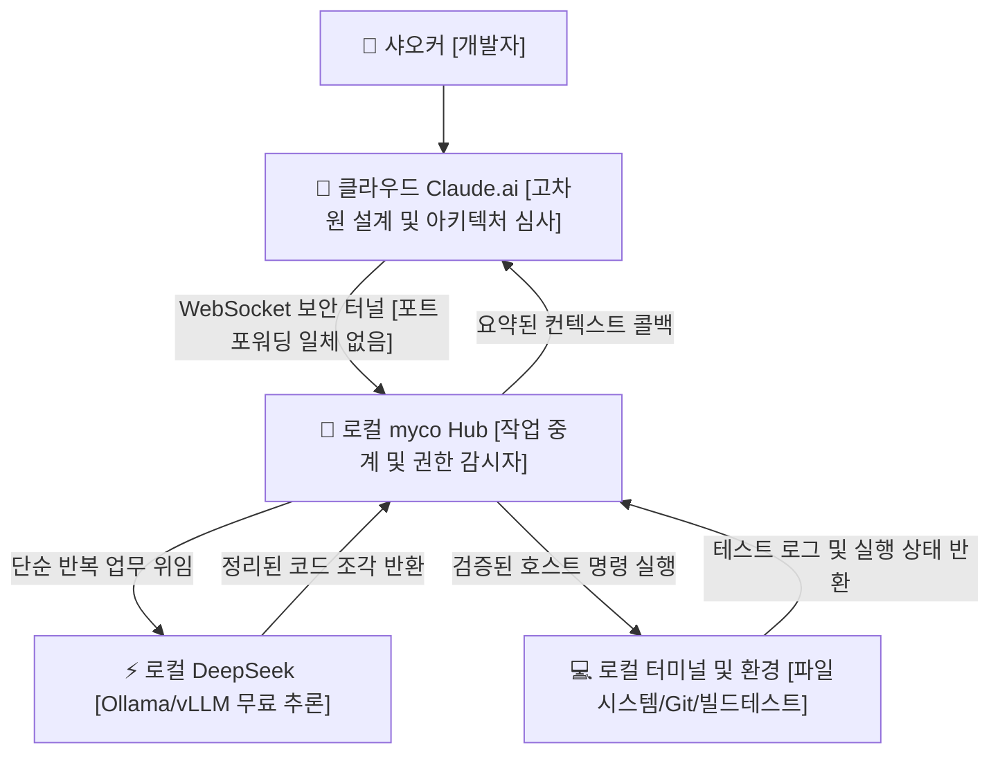

> 📌 **원문 안내**: 본 가이드는 [FreeAI Dog 공식 플랫폼](https://freeaidog.com/ko/blog/cloud-claude-local-deepseek-myco-hybrid-agent-guide/)에서 최초 발행되었습니다. 실시간 LLM 가용성 레이더 및 인터랙티브 테스트 도구는 공식 사이트를 방문하세요: [https://freeaidog.com/ko/](https://freeaidog.com/ko/).


# 클라우드 Claude 로 설계하고 로컬 DeepSeek 로 실행하기: myco 기반 포트 포워딩 없는 하이브리드 에이전트 구축 가이드

코딩에 한창 몰입해 있을 때, Claude 의 사용 한도 경고 때문에 작업 흐름이 끊겨본 적이 있으신가요?

매달 수십에서 수백 달러에 달하는 구독료를 지불하고 있는데도 말입니다.

복잡한 시스템 아키텍처 설계나 까다로운 알고리즘 결함을 짚어낼 때 Claude 의 추론 능력은 독보적입니다. 하지만 불과 서너 시간 동안 집중해서 코드를 작성하다 보면, 5시간당 45회라는 엄격한 한도 제한 알림이 뜨면서 다음 초기화 주기까지 작업이 완전히 멈춰버리곤 합니다.

가장 아쉬운 점은, 이 소중한 토큰의 상당 부분이 다음과 같은 단순한 기계적 작업에 낭비된다는 사실입니다:

프로젝트 디렉터리를 훑어 라우팅 목록 추출하기, 수십 개 파일의 변수명을 카멜케이스에서 스네이크케이스로 일괄 변경하기, 터미널 로그 출력을 정규표현식으로 파싱하기.

이러한 기계적인 밑바닥 작업에 최고급 프론티어 추론 모델을 투입할 이유는 전혀 없습니다.

그와 동시에 샤오커 [小可] 의 책상 밑에서는 24GB VRAM 그래픽카드를 장착한 데스크톱이 Ollama 를 통해 DeepSeek 모델을 띄워둔 채 대기하고 있습니다. 계산 자원은 무제한이고, 추가 비용은 0원이며, 로컬 파일 시스템과 터미널에 대한 완벽한 네이티브 권한을 가지고 있습니다.

그러나 두 환경 사이에는 두터운 장벽이 가로놓여 있습니다:

클라우드의 Claude 는 로컬 소스코드에 직접 손댈 수 없고, 로컬 DeepSeek 단독으로는 고차원적 비즈니스 판단을 내리기 어렵습니다.

결국 개발자 자신이 두 창 사이를 오가며 코드와 오류 로그를 복사해 나르는 인간 중계기로 전락하게 됩니다.

커뮤니티 개발자 chenhg5 가 공개한 오픈소스 프로젝트 `myco` 는 바로 이 구조적 난제를 정조준합니다. GitHub 저장소 `chenhg5/myco` 에 코드가 공개되어 있습니다.

핵심 원리는 한 줄로 요약할 수 있습니다:

클라우드 Claude 와 로컬 환경 사이에 안전한 아웃바운드 장기 연결을 구축하여, 고가의 클라우드 두뇌가 무료 로컬 DeepSeek 에게 번거로운 실행 작업을 지시하도록 만드는 구조입니다.



## 문제 분석: 기존 포트 포워딩 방식이 위험한 이유

클라우드 AI 가 로컬 컴퓨터를 제어하도록 만들고자 할 때, 많은 개발자가 가장 먼저 떠올리는 방법은 포트 포워딩이나 외부 터널링입니다.

VPS 를 대여해 frp 를 구성하거나 ngrok 터널을 열어 11434 포트를 공용 인터넷에 노출하려 합니다.

샤오커는 이 방식을 결코 권장하지 않습니다.

첫 번째 위험은 **로컬 시스템 보안 방화벽이 완전히 무력화된다는 점**입니다.

자율 에이전트는 셸 명령어를 스스로 생성하여 실행하는 권한을 가집니다. 로컬 포트를 인터넷에 그대로 노출하면 외부 자동화 스캔 봇의 표적이 됩니다. 최근 외부 AI 서비스 제공업체의 키 유출 사고가 잇따르는 상황에서, 로컬 셸 권한을 공용망에 올려두는 것은 무방비 상태나 다름없습니다.

두 번째 위험은 **컨텍스트 폭증과 네트워크 대역폭 낭비**입니다.

일반적인 원격 호출은 코드를 수정할 때마다 방대한 원본 파일 전체를 외부 네트워크로 전송합니다. 통신 지연이 발생할 뿐 아니라, 클라우드 Claude 의 제한된 컨텍스트 창이 정형화된 보일러플레이트 코드로 가득 차버려 소중한 토큰이 급속도로 고갈됩니다.

myco 의 해결책은 매우 실용적입니다: **아웃바운드 전용 보안 핸드셰이크와 로컬 내부 완결 처리**.

로컬 머신에서 외부로 안전한 WebSocket 연결을 능동적으로 생성하므로 클라우드에 내부 IP 를 노출할 필요가 없습니다. 무거운 검색과 코드 생성은 로컬 LAN 안에서 모두 끝내고, 정제된 결과 요약본만을 클라우드로 전달합니다.

## 실전 가이드: 4단계로 하이브리드 파이프라인 완성하기

복잡한 리버스 프록시 설정 없이, 터미널 명령어 몇 줄로 5분 만에 구성할 수 있습니다.

### 1단계: myco Hub 설치 및 노드 등록

macOS, Linux, Windows 를 모두 지원합니다. 사전에 Node.js 환경과 Ollama 등 로컬 추론 엔진을 준비합니다.

저장소를 복제하고 빌드를 실행합니다:

```bash
git clone https://github.com/chenhg5/myco.git
cd myco
npm install
npm run build
```

로컬 중계 데몬을 구동합니다:

```bash
node dist/index.js start --port 8765 --workspace /Users/cool/projects
```

실행 후 터미널에 생성된 인증 토큰과 `ws://127.0.0.1:8765` 대기 주소가 출력됩니다.

### 2단계: 접근 권한 및 보안 가드레일 설정

터미널 실행 권한을 에이전트에 위임하는 만큼, 안전 관리는 엄격해야 합니다.

설정 파일 `config.json` 에서 작업 허용 디렉터리와 차단 명령어를 명확히 지정합니다:

```json
{
  "hub": {
    "port": 8765,
    "authToken": "myco_sec_token_9918"
  },
  "permissions": {
    "allowedDirectories": [
      "/Users/cool/projects/freeai-hub",
      "/Users/cool/projects/sandbox"
    ],
    "disallowedCommands": [
      "rm -rf /",
      "dd",
      "mkfs",
      "shutdown",
      "reboot"
    ],
    "autoConfirmReadOnly": true
  },
  "localWorker": {
    "engine": "ollama",
    "endpoint": "http://127.0.0.1:11434",
    "model": "deepseek-coder:6.7b"
  }
}
```

이 설정을 통해 두 가지 보안 원칙이 유지됩니다:

첫째, 로컬 DeepSeek 과 셸은 인가된 프로젝트 경로 내에서만 파일을 읽고 씁니다.

둘째, 치명적인 시스템 명령어는 미들웨어 차원에서 즉시 거부됩니다.

### 3단계: Claude.ai 에 연동 프로프트 등록

웹 버전 Claude.ai 를 열고, 프로젝트 기능이나 커스텀 지침 란에 myco 연동 규격을 주입합니다:

```markdown
당신은 프로젝트의 총괄 설계자이자 사고의 중추입니다.
당신에게는 로컬 환경과 DeepSeek 모델을 직접 다룰 수 있는 myco_local 에이전트가 연결되어 있습니다.

다음 업무 분담 원칙을 엄격히 준수하십시오:
1. 시스템 설계, 예외 조건 검토, 복잡한 로직 심사는 당신이 직접 깊이 있게 추론하여 결정합니다.
2. 파일 탐색, Git 변경점 비교, 단위 테스트 실행, 보일러플레이트 코드 대량 수정 등 단순 작업은
   장문의 코드를 직접 출력하지 말고, 로컬 에이전트에 전달할 실행 페이로드를 생성하여 위임하십시오.
3. 로컬 에이전트의 작업이 완료되면, 반환된 결과 요약을 검토하여 최종 승인합니다.
```

### 4단계: 실전 테스트——레거시 라우팅 모듈 리팩토링

설정을 마친 후, 샤오커는 Claude 대화창에 다음과 같은 실전 요청을 입력했습니다:

`"routes 디렉터리 내의 모든 라우팅 정의를 점검하고, 남아있는 any 타입을 엄격한 TypeScript 인터페이스로 치환한 뒤 로컬 빌드 테스트를 실행해줘."`

기존 방식이었다면 Claude 는 관련 파일 전체를 복사해 올리라고 요구했을 것이며, 수천 개의 토큰이 허공으로 사라졌을 것입니다.

하지만 myco 연동 환경에서는 흐름이 완전히 달라집니다:

1. **클라우드 Claude 의 기획**: Claude 가 구조화된 작업 지시서를 생성하여 로컬 에이전트에 `./routes` 탐색 명령 하달;
2. **로컬 셸의 스캔**: myco 가 지시를 수신하여 로컬에서 `grep` 과 파일 목록 생성을 밀리초 단위로 완료;
3. **로컬 DeepSeek 의 변환**: 각 라우팅 파일을 로컬의 DeepSeek 에 전달하여 타입 치환을 수행하고 디스크에 직접 저장;
4. **로컬 호스트의 빌드 검증**: myco 가 `npm run check` 명령어를 로컬에서 자동 실행하여 컴파일 결과 확인;
5. **클라우드로의 최종 보고**: 3줄 요약과 수정된 차이점 [Diff] 만이 Claude 창으로 전송되고, Claude 는 "14개 파일의 리팩토링이 완료되었습니다. 타입 에러는 0개입니다"라고 간결하게 마무리.

## 효과 측정: 토큰 절감과 비용 실측 데이터

이 파이프라인을 일주일 동안 실무에 적용하여 측정한 객관적 데이터는 다음과 같습니다:

| 측정 지표 | 순수 클라우드 Claude 사용 시 | myco 클라우드 두뇌와 로컬 결합 시 | 개선 효과 |
| :--- | :--- | :--- | :--- |
| **일일 클라우드 토큰 소모량** | 약 380,000 토큰 | 약 58,000 토큰 | **84.7% 절감** |
| **429 한도 초과 중단 횟수** | 일평균 2회에서 3회 작업 대기 | 7일 연속 발생 횟수 0회 | **작업 중단 스트레스 해소** |
| **코드 외부 반출 위험** | 파일 전체를 반복해서 외부 전송 | LAN 내부에서 직접 수정 완결 | **보안성과 속도 동시 확보** |
| **하드웨어 가동 효율** | 24GB VRAM 이 하루 종일 유휴 상태 | 로컬 GPU 가 기초 작업의 80% 처리 | **보유 장비 가치 극대화** |

## 샤오커의 실전 조언

마지막으로, 직접 구성하면서 겪었던 세 가지 팁을 정리해 드립니다:

1. **로컬 모델의 크기에 집착하지 마세요**: 로컬 Worker 의 핵심은 문법 수정과 보일러플레이트 작성입니다. 단일 카드에서 7B 나 14B 양자화 모델이 가장 민첩하게 반응합니다. 70B 급을 무리하게 올려 로컬 생성이 지연되면 전체 파이프라인 속도가 떨어집니다.
2. **슬립 모드 복귀 시 연결 점검**: 노트북을 열었을 때 WebSocket 하트비트가 끊기지 않았는지 확인하세요. 로컬 실행 스크립트에 자동 재연결 로직을 넣어두는 것을 권장합니다.
3. **커밋 전 최종 변경 확인 습관**: 샌드박스 제한이 있더라도, 마지막 `git commit` 을 실행하기 전에는 터미널에서 `git diff` 로 최종 코드를 가볍게 훑어보는 이중 검증 습관을 유지하시기 바랍니다.

역할에 맞는 최적의 모델을 적재적소에 배치하기.

고차원 추론은 클라우드에 맡기고, 기계적 작업은 보유한 하드웨어로 처리하여, 최소한의 예산으로 개발 몰입도를 극대화하는 것. 이것이야말로 독립 개발자가 선택할 수 있는 가장 우아하고 합리적인 해법입니다.

---

> 💡 **원문 출처 및 실시간 모니터링**：
> - 원문 출처: [FreeAI Dog 공식 블로그](https://freeaidog.com/ko/blog/cloud-claude-local-deepseek-myco-hybrid-agent-guide/)
> - 무료 대형 언어 모델 실시간 가용성 및 지연 시간 측정은 [FreeAI Dog 가용성 레이더](https://freeaidog.com/ko/radar/)에서 확인하세요.

